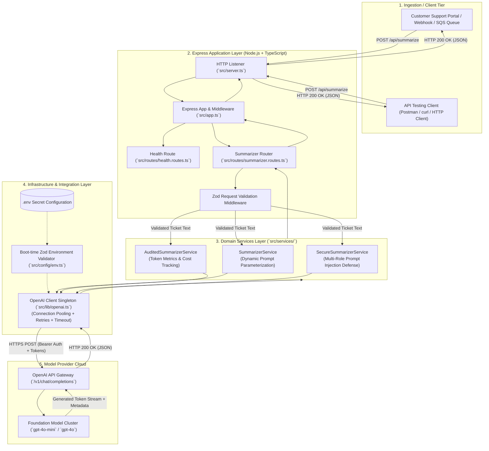

# Chapter 00: System Overview, Architectural Blueprint & File Structure

> **Chapter Goal:** Establish the architectural foundation of the Support Ticket Summarizer microservice, map the enterprise system topology, understand the design patterns applied across the codebase, and provide a comprehensive directory tree breakdown.

---

## 0.1 Architectural Overview

The **Support Ticket Summarizer Microservice** is a production-grade backend service built with **Node.js, Express, and TypeScript**. It operationalizes the core concepts from **Lecture 03: Talking to an LLM from Your Application**, demonstrating how enterprise software bridges human natural language inputs to foundation models in a grounded, observable, and secure manner.



---

## 0.2 Core Design Principles

1. **Layered Separation of Concerns:**
   - **Transport Layer (`app.ts`, `server.ts`):** Handles TCP listening, JSON parsing, logging, and global error handling.
   - **Routing Layer (`routes/`):** Matches HTTP verbs/paths and handles HTTP status codes.
   - **Validation Layer (`zod`):** Rejects invalid, empty, or oversized payloads *before* consuming billable API tokens.
   - **Service Layer (`services/`):** Encapsulates LLM prompt construction, message role separation, and business logic.
   - **Client Layer (`lib/openai.ts`):** Manages cloud connection pooling, timeouts, and automatic retry policies.
   - **Configuration Layer (`config/env.ts`):** Validates all environment variables on startup to prevent mid-flight crashes.

2. **Connection Pooling & Client Reusability:**
   Instead of instantiating `new OpenAI()` on every HTTP request, a configured client singleton preserves socket connections via HTTP Keep-Alive, eliminating repeated TLS handshake latency.

3. **Fail-Fast Boot Validation:**
   If the developer fails to configure `OPENAI_API_KEY`, the application terminates immediately on boot with a descriptive error rather than failing during customer traffic.

4. **Security & Prompt Hygiene:**
   Untrusted user text is strictly isolated in `role: 'user'` and governed by immutable system policy in `role: 'system'`, neutralizing prompt injection and goal hijacking attacks.

---

## 0.3 Complete Repository File Structure

Below is the directory layout of `Lecture 03/code`:

```text
Lecture 03/code/
├── package.json                    # Project dependencies, build scripts, and execution commands
├── package-lock.json               # Locked dependency tree for deterministic builds
├── tsconfig.json                   # TypeScript compiler configuration (ES2022 / NodeNext)
├── .env.example                    # Template for environment configuration
├── .env                            # Local environment variables and secrets (Git ignored)
├── .gitignore                      # Git ignore rules (node_modules, dist, .env, logs)
├── test-requests.http              # HTTP test suite for VS Code REST Client / Postman
├── README.md                       # High-level codebase documentation & run instructions
├── implementations guide/          # Step-by-step implementation guide (This series)
│   ├── 00_Overview_and_File_Structure.md
│   ├── 01_Project_Initialization_and_TypeScript_Setup.md
│   ├── 02_Environment_Configuration_and_Validation.md
│   ├── 03_OpenAI_Client_Singleton_and_Connection_Pooling.md
│   ├── 04_Summarization_Services_and_Multi_Role_Security.md
│   ├── 05_API_Routing_and_Zod_Validation_Middleware.md
│   ├── 06_Express_Application_and_Server_Bootstrap.md
│   ├── 07_CLI_Prototypes_and_Adversarial_Injection_Testing.md
│   └── 08_End_to_End_Verification_and_HTTP_Testing.md
├── src/                            # TypeScript source code
│   ├── app.ts                      # Express application setup, middlewares, and route mounting
│   ├── server.ts                   # Entry point: binds port and starts listening
│   ├── config/
│   │   └── env.ts                  # Boot-time Zod validation for process.env
│   ├── lib/
│   │   └── openai.ts               # Shared OpenAI SDK client singleton
│   ├── services/
│   │   ├── summarizer.service.ts   # Basic dynamic ticket summarizer (Chapter 05)
│   │   ├── audited.service.ts      # Telemetry-rich summarizer with token metrics (Chapter 06)
│   │   └── secure.service.ts       # Role-separated injection-proof summarizer (Chapter 06)
│   ├── routes/
│   │   ├── health.routes.ts        # GET /health health-check endpoint
│   │   └── summarizer.routes.ts    # POST /api/summarize, /audited, /secure endpoints
│   └── scripts/
│       ├── direct-prototype.ts     # Standalone CLI script mimicking direct Postman calls
│       └── test-injection.ts       # Adversarial test script verifying prompt injection protection
└── dist/                           # Compiled JavaScript output (generated via npm run build)
    ├── app.js
    ├── server.js
    ├── config/
    ├── lib/
    ├── routes/
    ├── scripts/
    └── services/
```

---

## 0.4 Step-by-Step Implementation Roadmap

To build this microservice from scratch, follow the chapters in chronological order:

| Chapter | Phase & Component | Core Focus |
| :--- | :--- | :--- |
| **[Chapter 01](./01_Project_Initialization_and_TypeScript_Setup.md)** | **Toolchain Setup** | Initialize `package.json`, configure `tsconfig.json`, setup `.gitignore`, `.env.example`. |
| **[Chapter 02](./02_Environment_Configuration_and_Validation.md)** | **Config & Validation** | Build `src/config/env.ts` with strict Zod schema validation. |
| **[Chapter 03](./03_OpenAI_Client_Singleton_and_Connection_Pooling.md)** | **AI Client Singleton** | Construct `src/lib/openai.ts` with connection pooling, retries, and timeouts. |
| **[Chapter 04](./04_Summarization_Services_and_Multi_Role_Security.md)** | **Domain Services** | Implement `SummarizerService`, `AuditedSummarizerService`, and `SecureSummarizerService`. |
| **[Chapter 05](./05_API_Routing_and_Zod_Validation_Middleware.md)** | **API Routing** | Build `health.routes.ts` and `summarizer.routes.ts` with Zod validation. |
| **[Chapter 06](./06_Express_Application_and_Server_Bootstrap.md)** | **Server Assembly** | Wire middlewares, error handlers in `src/app.ts`, and launch in `src/server.ts`. |
| **[Chapter 07](./07_CLI_Prototypes_and_Adversarial_Injection_Testing.md)** | **CLI & Security Tests** | Build standalone prototype script and automated adversarial injection test script. |
| **[Chapter 08](./08_End_to_End_Verification_and_HTTP_Testing.md)** | **System Verification** | Test endpoints with `test-requests.http` and verify token accounting in practice. |

In Chapter 01, we begin by setting up the project dependencies and TypeScript compiler.
