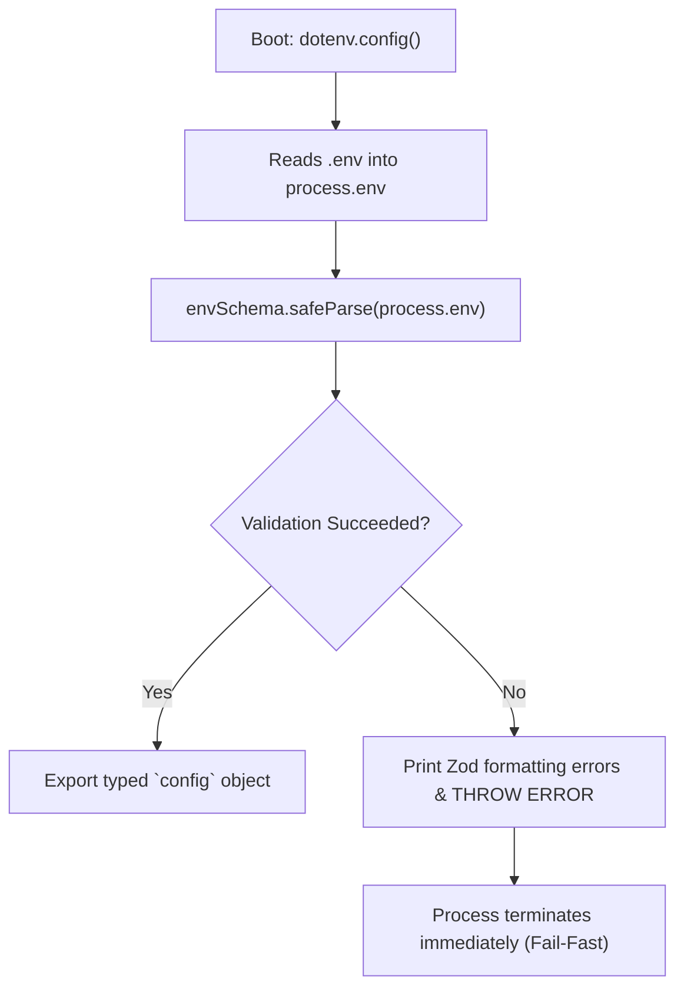

# Chapter 02: Environment Configuration & Runtime Validation

> **Chapter Goal:** Build a bulletproof configuration management module in `src/config/env.ts`, leverage Zod for runtime schema validation, enforce boot-time fail-fast guarantees for missing API keys, and export strongly-typed configuration objects.

---

## 2.1 File Details & Setup Commands

In production microservices, accessing `process.env` directly throughout business logic is a dangerous anti-pattern. If an environment variable is misspelled, missing, or malformed, the application will boot successfully, pass initial health checks, and only crash minutes later when a user initiates a request.

We resolve this by creating a centralized, validated configuration module.

### File Metadata:
- **File Path:** `Lecture 03/code/src/config/env.ts`
- **Primary Dependencies:** `dotenv`, `zod`
- **Architectural Role:** Infrastructure Configuration & Boot-time Guardrail
- **Key Patterns:** Fail-Fast Pattern, Schema-Driven Configuration, Inferred TypeScript Types

### Terminal Commands to Execute:

```bash
# Create the config directory
mkdir -p "Lecture 03/code/src/config"

# Ensure local .env file exists
cp "Lecture 03/code/.env.example" "Lecture 03/code/.env"
```

---

## 2.2 Full Code: `src/config/env.ts`

File Path: `Lecture 03/code/src/config/env.ts`

```typescript
import dotenv from 'dotenv';
import { z } from 'zod';

// Load variables from .env file
dotenv.config();

/**
 * Enterprise Environment Schema.
 * Validates critical settings at boot time to prevent mid-flight runtime crashes.
 */
const envSchema = z.object({
  PORT: z.coerce.number().default(8080),
  OPENAI_API_KEY: z.string({
    required_error: 'OPENAI_API_KEY is missing from environment. Please define it in your .env file.',
  }).min(1, 'OPENAI_API_KEY cannot be empty.'),
  AI_MODEL: z.string().default('gpt-4o-mini'),
  AI_TEMPERATURE: z.coerce.number().min(0).max(2).default(0.3),
});

// Parse and validate environment variables
const parseResult = envSchema.safeParse({
  PORT: process.env.PORT,
  OPENAI_API_KEY: process.env.OPENAI_API_KEY,
  AI_MODEL: process.env.AI_MODEL,
  AI_TEMPERATURE: process.env.AI_TEMPERATURE,
});

if (!parseResult.success) {
  console.error('❌ Environment Configuration Validation Failed:');
  console.error(JSON.stringify(parseResult.error.format(), null, 2));
  console.error('👉 Make sure you have created a valid .env file (see .env.example)');
  // We throw a descriptive error on boot
  throw new Error('Invalid environment configuration. Fix .env file before starting the service.');
}

export const config = parseResult.data;
```

---

## 2.3 Block-by-Block Code Explanation



### Block 1: Environment Loading
```typescript
import dotenv from 'dotenv';
import { z } from 'zod';

// Load variables from .env file
dotenv.config();
```
- **What it does:** Imports `dotenv` and parses the local `.env` file, injecting its key-value pairs into Node’s global `process.env` hash map.
- **Why it is written this way:** Allows developers to maintain local secrets without configuring system-level shell variables.
- **How it works:** Reads the `.env` file synchronously during module evaluation before any other application code runs.

---

### Block 2: Zod Schema Definition
```typescript
const envSchema = z.object({
  PORT: z.coerce.number().default(8080),
  OPENAI_API_KEY: z.string({
    required_error: 'OPENAI_API_KEY is missing from environment. Please define it in your .env file.',
  }).min(1, 'OPENAI_API_KEY cannot be empty.'),
  AI_MODEL: z.string().default('gpt-4o-mini'),
  AI_TEMPERATURE: z.coerce.number().min(0).max(2).default(0.3),
});
```
- **`PORT`:**
  - `z.coerce.number()` converts incoming environment strings (e.g., `"8080"`) into native JavaScript numbers.
  - `.default(8080)` provides a fallback if `PORT` is not defined.
- **`OPENAI_API_KEY`:**
  - `z.string(...)` demands a valid string.
  - `required_error` provides a clear, human-actionable message if the key is missing entirely.
  - `.min(1)` prevents empty strings (`""`) from slipping through validation.
- **`AI_MODEL`:**
  - Defaults to `'gpt-4o-mini'` if omitted in `.env`.
- **`AI_TEMPERATURE`:**
  - `z.coerce.number().min(0).max(2).default(0.3)` verifies that temperature is a valid floating-point number between `0.0` (purely deterministic) and `2.0` (maximum randomness). Defaults to `0.3` for factual summarization.

---

### Block 3: Safe Parsing & Fail-Fast Enforcement
```typescript
// Parse and validate environment variables
const parseResult = envSchema.safeParse({
  PORT: process.env.PORT,
  OPENAI_API_KEY: process.env.OPENAI_API_KEY,
  AI_MODEL: process.env.AI_MODEL,
  AI_TEMPERATURE: process.env.AI_TEMPERATURE,
});

if (!parseResult.success) {
  console.error('❌ Environment Configuration Validation Failed:');
  console.error(JSON.stringify(parseResult.error.format(), null, 2));
  console.error('👉 Make sure you have created a valid .env file (see .env.example)');
  // We throw a descriptive error on boot
  throw new Error('Invalid environment configuration. Fix .env file before starting the service.');
}

export const config = parseResult.data;
```
- **`envSchema.safeParse(...)`:**
  - Evaluates the values against the schema without throwing an uncaught exception immediately, giving us full control over error formatting.
- **Error Formatting & Fatal Throw:**
  - If validation fails, `parseResult.error.format()` outputs a clean, readable JSON breakdown pinpointing the exact missing or invalid keys.
  - Throwing an explicit `Error` immediately halts server initialization.
- **Type Inference:**
  - `export const config = parseResult.data;` exports a guaranteed, immutable configuration object with TypeScript types inferred automatically:
  ```typescript
  type Config = {
    PORT: number;
    OPENAI_API_KEY: string;
    AI_MODEL: string;
    AI_TEMPERATURE: number;
  };
  ```

---

## 2.4 Testing Configuration Validation

We can verify the fail-fast behavior directly in the terminal:

### Test Case 1: Missing API Key (Fails Fast)
```bash
OPENAI_API_KEY="" npx tsx -e "import('./src/config/env.ts')"
```
**Expected Output:**
```text
❌ Environment Configuration Validation Failed:
{
  "_errors": [],
  "OPENAI_API_KEY": {
    "_errors": [
      "OPENAI_API_KEY cannot be empty."
    ]
  }
}
👉 Make sure you have created a valid .env file (see .env.example)
Error: Invalid environment configuration. Fix .env file before starting the service.
```

### Test Case 2: Valid Configuration (Passes)
```bash
OPENAI_API_KEY="sk-test-mock-key" npx tsx -e "import('./src/config/env.ts').then(m => console.log('Parsed:', m.config))"
```
**Expected Output:**
```text
Parsed: {
  PORT: 8080,
  OPENAI_API_KEY: 'sk-test-mock-key',
  AI_MODEL: 'gpt-4o-mini',
  AI_TEMPERATURE: 0.3
}
```

In Chapter 03, we use this validated configuration to construct our OpenAI client singleton.
