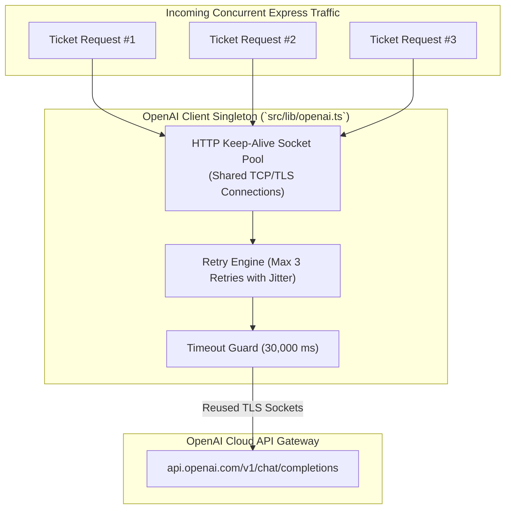

# Chapter 03: OpenAI Client Singleton & Connection Pooling

> **Chapter Goal:** Implement a shared, thread-safe OpenAI client singleton in `src/lib/openai.ts`, understand the network-level advantages of HTTP connection pooling and keep-alive sockets, configure automated exponential backoff retries, and protect the system against socket starvation via request timeouts.

---

## 3.1 File Details & Setup Commands

When integrating cloud foundation models into Express microservices, junior developers often instantiate a new client instance on every incoming HTTP request:

```typescript
// ❌ DANGEROUS ANTI-PATTERN: DO NOT DO THIS
app.post('/api/summarize', async (req, res) => {
  const client = new OpenAI({ apiKey: process.env.OPENAI_API_KEY }); // Creates new TLS socket every request!
  // ...
});
```

In a production system handling hundreds of concurrent tickets, creating new client instances causes:
1. **Socket Exhaustion:** Thousands of short-lived TCP sockets enter the `TIME_WAIT` state, eventually exhausting the operating system's ephemeral port range.
2. **TLS Handshake Latency:** Every request pays a 100–300 ms penalty to perform DNS resolution, TCP three-way handshake, and TLS cryptographic key exchange.
3. **Memory Leaks:** Repeated garbage collection overhead for discarded agent instances.

We eliminate this by establishing an exported **Client Singleton** with connection pooling.

### File Metadata:
- **File Path:** `Lecture 03/code/src/lib/openai.ts`
- **Primary Dependencies:** `openai`, `src/config/env.ts`
- **Architectural Role:** Cloud Integration & Resilient Transport
- **Key Patterns:** Singleton Pattern, Connection Pooling, Keep-Alive Reuse, Exponential Backoff

### Terminal Commands to Execute:

```bash
# Create the lib directory
mkdir -p "Lecture 03/code/src/lib"
```

---

## 3.2 Full Code: `src/lib/openai.ts`

File Path: `Lecture 03/code/src/lib/openai.ts`

```typescript
import OpenAI from 'openai';
import { config } from '../config/env.js';

/**
 * Shared singleton instance of the OpenAI client.
 *
 * Benefits:
 * - Reuses HTTP keep-alive connections (avoids TLS handshake overhead on every ticket).
 * - Implements automatic exponential backoff on HTTP 429 rate limits or transient 500 errors.
 * - Enforces timeout limits so slow cloud responses don't exhaust server sockets.
 */
export const openai = new OpenAI({
  apiKey: config.OPENAI_API_KEY,
  maxRetries: 3,
  timeout: 30000, // 30 seconds
});
```

---

## 3.3 Block-by-Block Code Explanation



### Block 1: Imports
```typescript
import OpenAI from 'openai';
import { config } from '../config/env.js';
```
- **`import OpenAI from 'openai'`:** Imports the official, production-maintained client class.
- **`import { config } from '../config/env.js'`:** Imports our boot-validated configuration. Notice the `.js` extension, required by Node's native ECMAScript Modules (`NodeNext`) resolution standard.

---

### Block 2: Singleton Instantiation & Configuration
```typescript
export const openai = new OpenAI({
  apiKey: config.OPENAI_API_KEY,
  maxRetries: 3,
  timeout: 30000, // 30 seconds
});
```

#### Parameter 1: `apiKey: config.OPENAI_API_KEY`
- Under the hood, the client injects this key into the standard HTTP Authorization header:
  ```http
  Authorization: Bearer sk-proj-...
  ```
- Because it reads from our validated `config` object, it is guaranteed at compile-time and runtime to be a non-empty string.

#### Parameter 2: `maxRetries: 3`
- Cloud AI providers occasionally experience transient micro-outages or brief traffic spikes.
- By default, the SDK automatically intercepts and retries the following HTTP status codes:
  - `408 Request Timeout`
  - `409 Conflict`
  - `429 Rate Limit Exceeded / Too Many Requests`
  - `500 Internal Server Error`
  - `502 Bad Gateway`
  - `503 Service Unavailable`
  - `504 Gateway Timeout`
- **Backoff Mechanics:** Uses **exponential backoff with jitter**:
  - Attempt 1: Wait $\approx 0.5\text{s}$
  - Attempt 2: Wait $\approx 1.0\text{s}$
  - Attempt 3: Wait $\approx 2.0\text{s}$
- This prevents "thundering herd" problems where retrying clients overwhelm recovering API clusters.

#### Parameter 3: `timeout: 30000` (30 Seconds)
- If a GPU cluster hangs or network packets drop silently, an unconfigured HTTP request will remain open indefinitely until the operating system socket times out (often 2+ minutes).
- Setting a strict 30-second timeout ensures that hanging connections are cleanly aborted, releasing Node.js event loop memory.

---

## 3.4 Runtime Verification

You can verify that the client singleton initializes without errors:

```bash
npx tsx -e "import('./src/lib/openai.ts').then(m => console.log('Client ready:', Boolean(m.openai)))"
```
**Expected Output:**
```text
Client ready: true
```

In Chapter 04, we inject this client into our domain services to execute dynamic prompt summarization.
