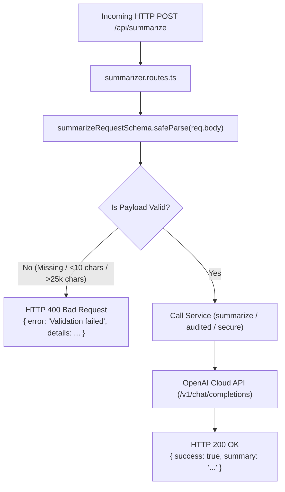

# Chapter 05: Express Routes & Input Validation Middleware

> **Chapter Goal:** Implement the HTTP routing layer in `src/routes/`, expose the health-check probe in `health.routes.ts`, build `summarizer.routes.ts` with Zod schema validation, and ensure invalid requests are rejected before incurring cloud API token costs.

---

## 5.1 Architecture & Overview of the Routing Layer

The routing layer maps HTTP endpoints to business service invocations. A crucial Forward Deployed Engineering principle is:

> **Never send unvalidated user payloads to a paid LLM API.**
> 
> Validating the presence, type, and size of incoming text with **Zod** saves financial cost, prevents denial-of-service memory exhaustion, and returns immediate, descriptive `400 Bad Request` feedback to client callers.



### Terminal Commands to Execute:

```bash
# Create the routes directory
mkdir -p "Lecture 03/code/src/routes"
```

---

## 5.2 Full Code: `src/routes/health.routes.ts`

File Path: `Lecture 03/code/src/routes/health.routes.ts`

```typescript
import { Router, Request, Response } from 'express';
import { config } from '../config/env.js';

export const healthRouter = Router();

healthRouter.get('/health', (_req: Request, res: Response) => {
  res.status(200).json({
    status: 'UP',
    timestamp: new Date().toISOString(),
    service: 'support-summarizer-service',
    configuredModel: config.AI_MODEL,
    temperature: config.AI_TEMPERATURE,
    uptimeSeconds: Math.floor(process.uptime()),
  });
});
```

### Block-by-Block Explanation:

#### Block 1: Express Router Instantiation
```typescript
import { Router, Request, Response } from 'express';
import { config } from '../config/env.js';

export const healthRouter = Router();
```
- Creates an isolated modular router instance using Express’s `Router()`.

#### Block 2: Liveness & Readiness Handler
```typescript
healthRouter.get('/health', (_req: Request, res: Response) => {
  res.status(200).json({
    status: 'UP',
    timestamp: new Date().toISOString(),
    service: 'support-summarizer-service',
    configuredModel: config.AI_MODEL,
    temperature: config.AI_TEMPERATURE,
    uptimeSeconds: Math.floor(process.uptime()),
  });
});
```
- **Why this endpoint is mandatory in enterprise:**
  - **Kubernetes / ECS:** Used by kubelet liveness probes to verify the pod is healthy.
  - **Load Balancers (ALB/Nginx):** Verifies the server can accept traffic before routing user requests.
  - **Observability:** Returns the live active model (`gpt-4o-mini`), temperature (`0.3`), and uptime without consuming API tokens.

---

## 5.3 Full Code: `src/routes/summarizer.routes.ts`

File Path: `Lecture 03/code/src/routes/summarizer.routes.ts`

```typescript
import { Router, Request, Response, NextFunction } from 'express';
import { z } from 'zod';
import { summarizerService } from '../services/summarizer.service.js';
import { auditedSummarizerService } from '../services/audited.service.js';
import { secureSummarizerService } from '../services/secure.service.js';

export const summarizerRouter = Router();

// Zod Schema for incoming ticket payload
const summarizeRequestSchema = z.object({
  text: z
    .string({ required_error: 'Field "text" is required.' })
    .min(10, 'Ticket text must be at least 10 characters long.')
    .max(25000, 'Ticket text exceeds maximum character limit of 25,000.'),
});

/**
 * POST /api/summarize
 * Basic 2-line ticket summarization endpoint (Chapter 05).
 */
summarizerRouter.post(
  '/summarize',
  async (req: Request, res: Response, next: NextFunction): Promise<void> => {
    try {
      const parsed = summarizeRequestSchema.safeParse(req.body);

      if (!parsed.success) {
        res.status(400).json({
          error: 'Validation failed',
          details: parsed.error.flatten().fieldErrors,
        });
        return;
      }

      const summary = await summarizerService.summarize(parsed.data.text);

      res.status(200).json({
        success: true,
        summary,
      });
    } catch (error) {
      next(error);
    }
  }
);

/**
 * POST /api/summarize/audited
 * Summarization with full token economics and telemetry metadata (Chapter 06).
 */
summarizerRouter.post(
  '/summarize/audited',
  async (req: Request, res: Response, next: NextFunction): Promise<void> => {
    try {
      const parsed = summarizeRequestSchema.safeParse(req.body);

      if (!parsed.success) {
        res.status(400).json({
          error: 'Validation failed',
          details: parsed.error.flatten().fieldErrors,
        });
        return;
      }

      const result = await auditedSummarizerService.summarizeWithAudit(parsed.data.text);

      res.status(200).json({
        success: true,
        data: result,
      });
    } catch (error) {
      next(error);
    }
  }
);

/**
 * POST /api/summarize/secure
 * Multi-role summarizer hardened against prompt injection and goal hijacking (Chapter 06).
 */
summarizerRouter.post(
  '/summarize/secure',
  async (req: Request, res: Response, next: NextFunction): Promise<void> => {
    try {
      const parsed = summarizeRequestSchema.safeParse(req.body);

      if (!parsed.success) {
        res.status(400).json({
          error: 'Validation failed',
          details: parsed.error.flatten().fieldErrors,
        });
        return;
      }

      const result = await secureSummarizerService.summarizeSecure(parsed.data.text);

      res.status(200).json({
        success: true,
        data: result,
      });
    } catch (error) {
      next(error);
    }
  }
);
```

---

## 5.4 Block-by-Block Code Explanation

### Block 1: Zod Input Validation Schema
```typescript
const summarizeRequestSchema = z.object({
  text: z
    .string({ required_error: 'Field "text" is required.' })
    .min(10, 'Ticket text must be at least 10 characters long.')
    .max(25000, 'Ticket text exceeds maximum character limit of 25,000.'),
});
```
- **`required_error`:** Ensures incoming JSON bodies contain a `"text"` property.
- **`.min(10)`:** Prevents spending money on empty or nonsensical input like `"hi"`, `"test"`, or `""`.
- **`.max(25000)`:** Prevents malicious attackers from submitting 10-megabyte payloads that would saturate the model's context window, exhaust Node’s memory buffer, and bill the company thousands of dollars.

---

### Block 2: Validation Guard & Error Response
```typescript
const parsed = summarizeRequestSchema.safeParse(req.body);

if (!parsed.success) {
  res.status(400).json({
    error: 'Validation failed',
    details: parsed.error.flatten().fieldErrors,
  });
  return;
}
```
- **`safeParse`:** Runs validation synchronously in memory.
- If invalid, execution returns **HTTP 400 Bad Request** immediately with a structured field-level breakdown.
- **Critical takeaway:** Zero network calls are made to OpenAI, protecting the company's financial budget.

---

### Block 3: Asynchronous Delegation & Error Propagation
```typescript
try {
  const summary = await summarizerService.summarize(parsed.data.text);
  res.status(200).json({ success: true, summary });
} catch (error) {
  next(error);
}
```
- Awaits the promise returned by the service.
- If cloud inference succeeds, returns HTTP `200 OK` with JSON `{ success: true, summary }`.
- If an exception occurs (e.g., OpenAI rate limit or network drop), `next(error)` forwards the error to Express’s global error-handling middleware.

In Chapter 06, we wire these routers into the main Express application and launch the server.
