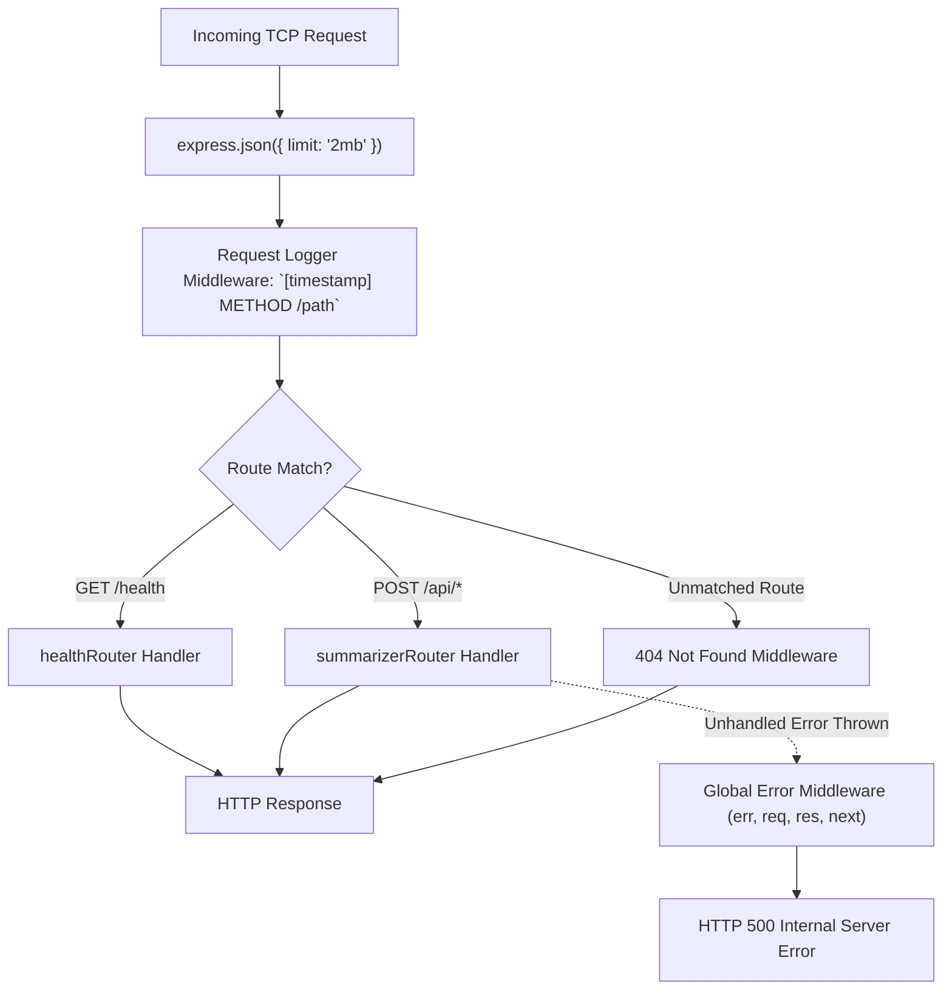

# Chapter 06: Express Application Configuration & Server Bootstrap

> **Chapter Goal:** Assemble the Express application pipeline in `src/app.ts`, implement body parsing, request logging, 404 catch-alls, and enterprise error-handling middleware, and bootstrap the HTTP listener in `src/server.ts`.

---

## 6.1 Architecture & Middleware Lifecycle

A well-structured production microservice decouples the Express **application configuration** (`app.ts`) from the **server networking listener** (`server.ts`). This decoupling provides two major enterprise advantages:
1. **Automated Testing:** Supertest can bind to `app` directly without opening real TCP ports or conflicting with busy ports during CI/CD test runs.
2. **Clean Separation of Concerns:** Middleware, routes, and error handling are configured independently from process lifecycle and port management.



---

## 6.2 Full Code: `src/app.ts`

File Path: `Lecture 03/code/src/app.ts`

```typescript
import express, { Request, Response, NextFunction } from 'express';
import { healthRouter } from './routes/health.routes.js';
import { summarizerRouter } from './routes/summarizer.routes.js';

export const app = express();

// Middleware: parse incoming application/json payloads up to 2MB
app.use(express.json({ limit: '2mb' }));

// Middleware: request logger
app.use((req: Request, _res: Response, next: NextFunction) => {
  const timestamp = new Date().toISOString();
  console.log(`[${timestamp}] ${req.method} ${req.path}`);
  next();
});

// Mount Routes
app.use(healthRouter);
app.use('/api', summarizerRouter);

// 404 Route Handler
app.use((_req: Request, res: Response) => {
  res.status(404).json({
    error: 'Not Found',
    message: 'The requested resource does not exist.',
  });
});

// Global Error Handling Middleware
app.use((err: Error, _req: Request, res: Response, _next: NextFunction) => {
  console.error('Unhandled Application Error:', err);
  res.status(500).json({
    error: 'Internal Server Error',
    message: err.message || 'An unexpected error occurred during processing.',
  });
});
```

### Block-by-Block Explanation of `src/app.ts`:

#### Block 1: Body Parsing Middleware
```typescript
app.use(express.json({ limit: '2mb' }));
```
- Automatically parses incoming HTTP `application/json` request bodies and populates `req.body`.
- **`limit: '2mb'`:** Enforces a strict body size ceiling. Prevents memory exhaustion attacks where an attacker streams an oversized multi-gigabyte JSON payload.

#### Block 2: Request Logging Middleware
```typescript
app.use((req: Request, _res: Response, next: NextFunction) => {
  const timestamp = new Date().toISOString();
  console.log(`[${timestamp}] ${req.method} ${req.path}`);
  next();
});
```
- Emits clean, standard logs for every incoming HTTP request.
- Must call `next()` to pass execution control to downstream route handlers.

#### Block 3: Route Mounting
```typescript
app.use(healthRouter);
app.use('/api', summarizerRouter);
```
- Mounts `healthRouter` at the root path (`GET /health`).
- Mounts `summarizerRouter` under the `/api` prefix (`/api/summarize`, `/api/summarize/audited`, `/api/summarize/secure`).

#### Block 4: 404 Catch-All Handler
```typescript
app.use((_req: Request, res: Response) => {
  res.status(404).json({
    error: 'Not Found',
    message: 'The requested resource does not exist.',
  });
});
```
- Positioned after all route definitions. Catches any unmatched endpoints and returns clean JSON rather than default HTML error pages.

#### Block 5: Global Error-Handling Middleware
```typescript
app.use((err: Error, _req: Request, res: Response, _next: NextFunction) => {
  console.error('Unhandled Application Error:', err);
  res.status(500).json({
    error: 'Internal Server Error',
    message: err.message || 'An unexpected error occurred during processing.',
  });
});
```
- **The Four-Argument Signature:** Express requires all four arguments `(err, req, res, next)` to recognize this function as an error handler.
- Catches uncaught exceptions from async promises forwarded by `next(error)` and prevents server process termination.

---

## 6.3 Full Code: `src/server.ts`

File Path: `Lecture 03/code/src/server.ts`

```typescript
import { app } from './app.js';
import { config } from './config/env.js';

app.listen(config.PORT, () => {
  console.log('================================================================');
  console.log(`🚀 Support Ticket Summarizer Microservice Started Successfully`);
  console.log(`📡 Server listening on: http://localhost:${config.PORT}`);
  console.log(`🤖 Configured AI Model: ${config.AI_MODEL}`);
  console.log(`🌡️  Configured Temperature: ${config.AI_TEMPERATURE}`);
  console.log(`🔍 Health Check: http://localhost:${config.PORT}/health`);
  console.log(`📝 Summarize API: http://localhost:${config.PORT}/api/summarize`);
  console.log('================================================================');
});
```

### Block-by-Block Explanation of `src/server.ts`:

#### Block 1: Imports
```typescript
import { app } from './app.js';
import { config } from './config/env.js';
```
- Imports the configured `app` and validated `config` object.

#### Block 2: Listener Bootstrap & Startup Banner
```typescript
app.listen(config.PORT, () => {
  // Logs formatted operational banner
});
```
- Binds to the validated TCP port (`config.PORT`).
- Prints an informative startup banner displaying active configuration parameters, endpoints, and health probe URLs.

---

## 6.4 Running the Application

### Development Mode (with Live Reload):
```bash
npm run dev
```

**Console Output:**
```text
================================================================
🚀 Support Ticket Summarizer Microservice Started Successfully
📡 Server listening on: http://localhost:8080
🤖 Configured AI Model: gpt-4o-mini
🌡️  Configured Temperature: 0.3
🔍 Health Check: http://localhost:8080/health
📝 Summarize API: http://localhost:8080/api/summarize
================================================================
```

### Production Build & Launch:
```bash
# 1. Compile TypeScript into dist/
npm run build

# 2. Launch production compiled bundle
npm start
```

In Chapter 07, we explore the CLI prototype scripts and security verification tests.
