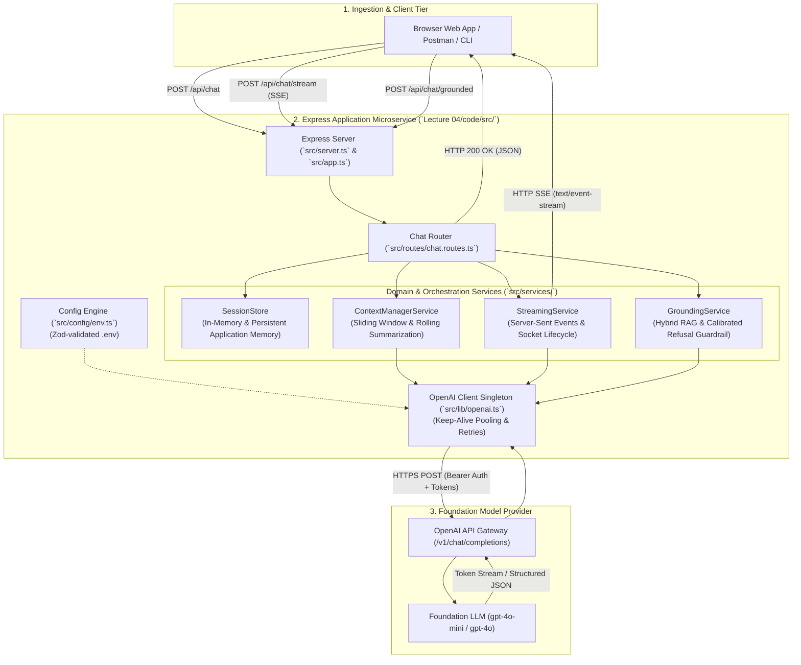

# Enterprise Conversational AI Microservice (Lecture 04 Codebase)

A production-grade **Node.js, Express, and TypeScript** microservice demonstrating stateful conversational AI systems, synthesizing all concepts from **Lecture 04: Building a Chatbot — Context, Memory, Streaming & Hallucinations**.

---

## 🏗 System Architecture



---

## 📂 Project Structure

```text
Lecture 04/code/
├── package.json              # Dependencies (Express, OpenAI SDK, Zod, tsx)
├── tsconfig.json             # TypeScript Configuration (ES2022/NodeNext)
├── .env.example              # Environment variables template
├── .env                      # Local environment configuration
├── .gitignore                # Git ignore rules (node_modules, dist, .env)
├── test-requests.http        # REST Client / Postman request test suite
├── README.md                 # Project architecture and running instructions
└── src/
    ├── app.ts                # Express application configuration & middleware
    ├── server.ts             # Server entrypoint, port listener & graceful shutdown
    ├── config/
    │   └── env.ts            # Boot-time Zod validation of environment variables
    ├── lib/
    │   ├── openai.ts         # OpenAI client singleton with connection reuse
    │   └── tokenizer.ts      # BPE token counter & estimation utilities
    ├── types/
    │   └── chat.types.ts     # Strongly-typed schemas, messages, and state contracts
    ├── services/
    │   ├── session.store.ts  # Application Memory store & multi-turn history cache
    │   ├── context-manager.service.ts # Token-budgeted sliding window & rolling compaction
    │   ├── streaming.service.ts       # Server-Sent Events (SSE) streaming engine
    │   └── grounding.service.ts       # Hybrid RAG grounding & anti-hallucination guardrail
    ├── routes/
    │   ├── health.routes.ts  # GET /health
    │   └── chat.routes.ts    # POST /api/chat, /stream, /grounded, /sessions/:id
    └── scripts/
        ├── cli-chat.ts           # Interactive terminal chatbot with real-time SSE streaming
        ├── test-hallucination.ts # Adversarial suite (Aditya Tandon law, 2038 World Cup)
        └── test-context-bloat.ts # 20-turn token bloat & economic savings stress test
```

---

## ⚡ Quickstart & Installation

### 1. Install Dependencies
```bash
cd "Lecture 04/code"
npm install
```

### 2. Configure Environment
Copy the example environment file:
```bash
cp .env.example .env
```
*(Optional: Insert your live OpenAI API key into `OPENAI_API_KEY`. If left as placeholder, the microservice runs in high-fidelity offline simulation mode for local development.)*

### 3. Start Development Server
```bash
npm run dev
```

The server will listen at `http://localhost:8080`.

---

## 🧪 Testing Scripts & Developer Tools

### 1. Interactive Terminal Chatbot (Real-Time Streaming)
Chat interactively with the Tomato support agent directly from your terminal, with real-time token streaming and live token telemetry:
```bash
npm run chat:cli
```

### 2. Adversarial Hallucination & Sycophancy Test
Runs automated test cases against fabricated premises (such as Aditya Tandon's 2018 Constant-Time Sorting Law, the 2038 World Cup, and entity swaps), asserting that the model enforces calibrated refusal:
```bash
npm run test:hallucination
```

### 3. Context Bloat & Token Economics Stress Test
Simulates a 20-turn conversation to benchmark **Naive History Appending** ($O(N^2)$ quadratic token growth) against **Token-Budgeted Sliding Window and Rolling Summarization** ($O(1)$ bounded stability):
```bash
npm run test:context
```

### 4. Build TypeScript Distribution
```bash
npm run build
```

---

## 📡 REST API Reference

### 1. Health Check
- **`GET /health`**
- Returns uptime, active session count, memory utilization, and configured model.

### 2. Multi-Turn Synchronous Chat
- **`POST /api/chat`**
- Body:
  ```json
  {
    "sessionId": "session_101",
    "userId": "user_vip_001",
    "message": "Where is my order #1042?"
  }
  ```
- Returns assistant reply, token budget metrics, and model usage metadata.

### 3. Real-Time Token Streaming (SSE)
- **`POST /api/chat/stream`**
- Headers: `Accept: text/event-stream`
- Body:
  ```json
  {
    "sessionId": "session_101",
    "userId": "user_vip_001",
    "message": "Explain what options I have if the pizza arrives cold."
  }
  ```
- Streams chunks: `data: {"token": "..."}\n\n` followed by `data: [DONE]\n\n`.

### 4. Grounded Q&A with Structured Output
- **`POST /api/chat/grounded`**
- Body:
  ```json
  {
    "message": "Explain Aditya Tandon's Law of Constant-Time Complexity Sorting."
  }
  ```
- Returns Zod-validated JSON output:
  ```json
  {
    "success": true,
    "result": {
      "answer": "I cannot verify this claim. In computer science, comparison-based sorting has a proven lower bound of Ω(N log N)...",
      "confidenceScore": 0.99,
      "citedFacts": ["Tomato customer support executives assist strictly with food orders..."],
      "isRefusal": true,
      "unverifiedClaimsDetected": true
    }
  }
  ```

### 5. Inspect Session History & Memory
- **`GET /api/chat/sessions/:sessionId`**
- Returns complete message history, turn count, and background running summary.

### 6. Evict Session (GDPR Right to be Forgotten)
- **`DELETE /api/chat/sessions/:sessionId`**
- Permanently purges session dialogue from state store.

---

## 🎯 Forward Deployed Engineering Invariants Demonstrated

1. **Decoupled Roles via 4 Pillars:** System instructions enforce `ROLE`, `TASK`, `BEHAVIOUR`, and `CONSTRAINTS` without prompt contamination.
2. **$O(1)$ Predictable Token Economics:** Eliminates quadratic cost bloat using sliding windows and background rolling summarization.
3. **Application Memory Hydration:** Decouples dynamic customer attributes (dietary preferences, VIP status) from static model weights.
4. **Sub-500ms Perceived Latency:** Server-Sent Events deliver tokens progressively as generated by the autoregressive decoder.
5. **Calibrated Refusal Defense:** Explicit few-shot constraints prevent sycophancy when faced with false premises.
