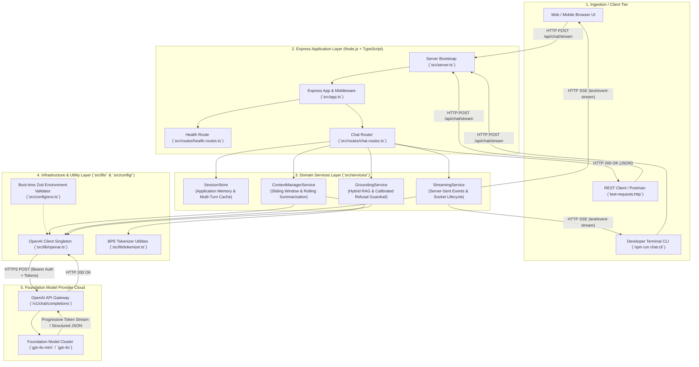

# Chapter 00: System Overview, Architectural Blueprint & File Structure

> **Chapter Goal:** Establish the architectural foundation of the Enterprise Conversational AI microservice, map the system topology, understand the design patterns applied across the codebase, and provide a comprehensive directory tree breakdown.

---

## 0.1 Architectural Overview

The **Enterprise Conversational AI Microservice** is a production-grade backend service built with **Node.js, Express, and TypeScript**. It operationalizes the core concepts from **Lecture 04: Building a Chatbot — Context, Memory, Streaming & Hallucinations**, demonstrating how enterprise software transforms a stateless, probabilistic foundation model into an interactive, stateful, and reliable conversational application.



---

## 0.2 Design Patterns & Enterprise Engineering Invariants

1. **Decoupled State Tier (Application Memory Pattern):**
   The Large Language Model is completely stateless. The application maintains persistent session state, hydrates user profile memory (e.g., dietary restrictions, VIP tier) into prompt context, and allows immediate session purging in compliance with GDPR.
2. **The 4 Pillars System Prompt Architecture:**
   System prompts are explicitly partitioned into `ROLE`, `TASK`, `BEHAVIOUR`, and `CONSTRAINTS`. This prevents prompt contamination and establishes firm boundaries against roleplay hijacking.
3. **$O(1)$ Bounded Context Window Economics:**
   Unbounded history accumulation leads to quadratic ($O(N^2)$) token growth. The service deploys a Token-Budgeted Sliding Window (FIFO) combined with asynchronous Rolling Conversational Summarization to stabilize token consumption.
4. **Real-Time Server-Sent Events (SSE) Streaming:**
   Autoregressive generation naturally produces output token-by-token. Streaming over SSE delivers immediate feedback (sub-500ms Time-to-First-Token), disables proxy buffering via `X-Accel-Buffering: no`, and gracefully aborts upstream generation when sockets close.
5. **7-Layer Anti-Hallucination Guardrails:**
   Combines in-context hybrid RAG grounding, calibrated few-shot refusal ("I don't know"), constrained decoding via Zod schemas, and deterministic post-generation citation assertions.

---

## 0.3 Complete File Tree Breakdown

```text
Lecture 04/code/
├── package.json              # Project dependencies, runner scripts, and metadata
├── tsconfig.json             # TypeScript compiler configuration (ES2022/NodeNext)
├── .env.example              # Environment variables template
├── .env                      # Local environment configuration file
├── .gitignore                # Git ignore rules for node_modules, dist, and secrets
├── test-requests.http        # REST Client / Postman request test suite (10 scenarios)
├── README.md                 # Project architecture and running instructions
├── implementations guide/    # Step-by-Step Implementation Guide
│   ├── README.md             # Guide index and build order
│   ├── Complete_Implementation_Guide.md # Consolidated master reference
│   └── [00 - 11 Chapters].md # Individual detailed implementation chapters
└── src/
    ├── app.ts                # Express application setup, middleware, and error handling
    ├── server.ts             # Server entrypoint, port listener & graceful termination
    ├── config/
    │   └── env.ts            # Boot-time Zod validation of environment variables
    ├── lib/
    │   ├── openai.ts         # OpenAI client singleton with connection pooling & retries
    │   └── tokenizer.ts      # BPE token counter & estimation utilities
    ├── types/
    │   └── chat.types.ts     # Strongly-typed schemas, messages, and state contracts
    ├── services/
    │   ├── session.store.ts  # Application Memory store & multi-turn history cache
    │   ├── context-manager.service.ts # Token-budgeted sliding window & rolling compaction
    │   ├── streaming.service.ts       # Server-Sent Events (SSE) streaming engine
    │   └── grounding.service.ts       # Hybrid RAG grounding & anti-hallucination guardrail
    ├── routes/
    │   ├── health.routes.ts  # GET /health liveness and telemetry probe
    │   └── chat.routes.ts    # POST /api/chat, /stream, /grounded, /sessions/:id
    └── scripts/
        ├── cli-chat.ts           # Interactive terminal chatbot with real-time SSE streaming
        ├── test-hallucination.ts # Adversarial suite (Aditya Tandon law, 2038 World Cup)
        └── test-context-bloat.ts # 20-turn token bloat & economic savings stress test
```

---

## 0.4 Verification Checklist Before Building

Before writing implementation files, ensure your development environment satisfies:
- **Node.js:** `v18.0.0` or higher (`v20+` recommended).
- **TypeScript:** `v5.0.0` or higher.
- **Package Manager:** `npm`, `pnpm`, or `yarn`.
- **OpenAI Key (Optional):** Live key starting with `sk-` for cloud inference. If omitted, the service runs in high-fidelity offline simulation mode.
