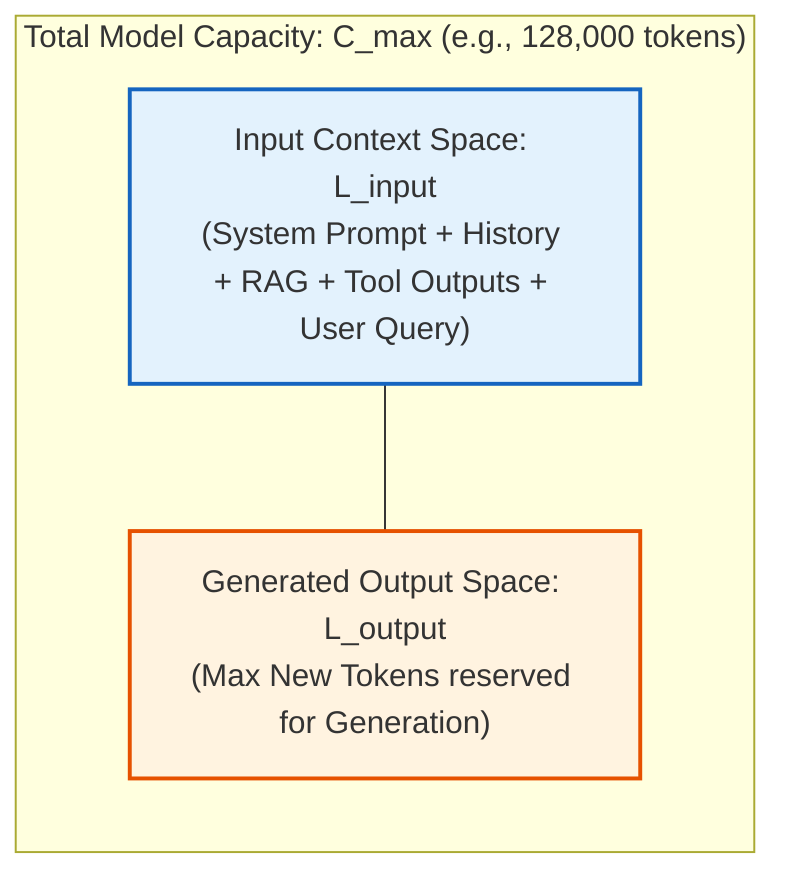
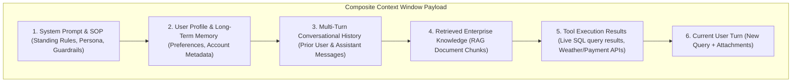
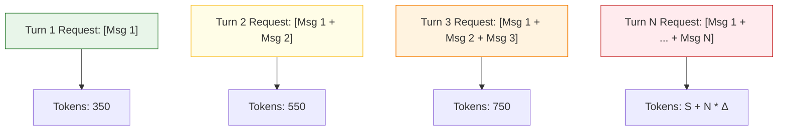
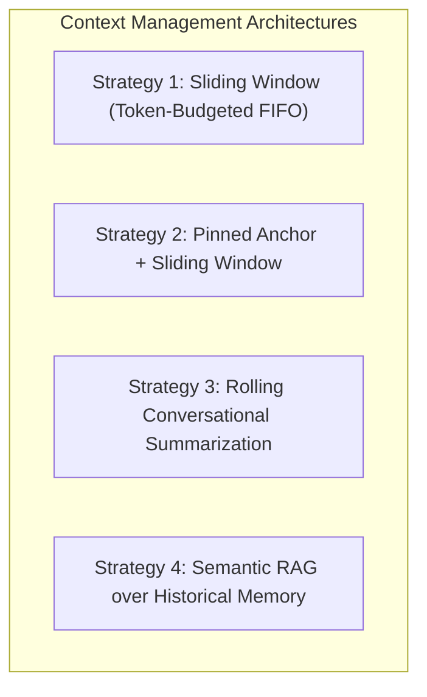
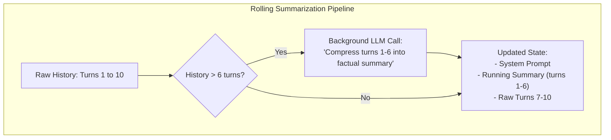

# Chapter 02: Context Windows, Token Accumulation & Context Management

> **Chapter Goal:** Master the anatomy and constraints of the LLM context window, formulate the quadratic token accumulation problem ($O(N^2)$ cumulative token expansion), evaluate the economic and latency hazards of naive context forwarding, unpack the "Lost-in-the-Middle" phenomenon, and implement enterprise context management strategies (Sliding Window, Pinned Anchor, Rolling Summarization, and Semantic History RAG) in TypeScript.

---

## 2.1 The Anatomy of the Context Window

In conversational AI engineering, the **Context Window** represents the total, finite working capacity of an LLM for any given inference cycle.

### The "Sheet of Paper" Mental Model
Imagine an expert analyst sitting at a desk with an empty sheet of paper:
1. You write down the standing operational instructions at the top.
2. You transcribe the previous dialogue exchanges.
3. You paste snippets of internal manuals or database records.
4. You write the user's latest question at the bottom.
5. You hand the paper to the analyst and say: *"Answer the user's question using ONLY the information written on this sheet."*

The analyst has no access to external filing cabinets or previous conversations from yesterday unless they are explicitly transcribed onto this sheet. For a Large Language Model, that metaphorical sheet of paper is its **Context Window**, measured strictly in **Tokens**.



### The Capacity Constraint Formula

Every foundation model enforces a hard architectural limit on total sequence length ($C_{\text{max}}$):

$$L_{\text{total}} = L_{\text{input}} + L_{\text{output}} \le C_{\text{max}}$$

Where:
- $L_{\text{input}}$ is the sum of all prompt tokens submitted to the API.
- $L_{\text{output}}$ is the number of tokens generated by the model during autoregressive decoding.
- $C_{\text{max}}$ is the maximum sequence length supported by the model architecture (e.g., 8,192 for Llama 3, 128,000 for GPT-4o, 1,000,000 for Gemini 1.5 Pro).

> **The Context Starvation Trap:**
> 
> If an application fills $99\%$ of $C_{\text{max}}$ with historical conversation logs and retrieved documents, the model is physically throttled. If $C_{\text{max}} = 8{,}192$ and $L_{\text{input}} = 8{,}100$, the model can generate at most $92$ tokens before hitting the ceiling, prematurely truncating the response mid-sentence (`finish_reason: "length"`).

---

## 2.2 What Enters the Context Window?

In an enterprise Generative AI application, the context window is rarely filled with just conversational chit-chat. It is a highly contested, multi-tenant workspace shared across six distinct subsystems:



| Component | Ingestion Source | Variability | Primary Failure Mode If Unmanaged |
| :--- | :--- | :--- | :--- |
| **System Prompt** | Application Code | Static per deployment | Token bloat if over-engineered; instruction conflict |
| **User Profile / Memory** | Database / Redis | Dynamic per user session | Outdated facts; stale preferences |
| **Conversation History** | Session Storage | Monotonically grows per turn | Quadratic token expansion ($O(N^2)$); context overflow |
| **RAG Knowledge** | Vector DB / Hybrid Search | Dynamic per user query | Irrelevant noise injection; distraction from primary intent |
| **Tool Outputs** | Microservice APIs | Dynamic per tool call | Huge JSON payloads consuming 80%+ of available window |
| **Current Query** | End User UI | Dynamic per turn | Prompt injection attacks; adversarial syntax |

Because every one of these components consumes tokens, an unmanaged chatbot will rapidly degrade in speed, cost, and coherence.

---

## 2.3 The Quadratic Token Accumulation Problem ($O(N^2)$ Bloat)

When building a chat application, the most common beginner pattern is **naive history appending**: every new turn takes the existing array of messages, appends the new exchange, and resends the entire array to the model.

Let us trace how the token volume scales across $N$ conversation turns:

```
Turn 1: [System] + [User 1]                                      --> Sent to LLM
Turn 2: [System] + [User 1] + [Assistant 1] + [User 2]           --> Sent to LLM
Turn 3: [System] + [User 1] + [Assistant 1] + ... + [User 3]     --> Sent to LLM
...
Turn N: [System] + [All prior N-1 turns] + [User N]               --> Sent to LLM
```



### Mathematical Derivation of Cumulative Token Load

Let:
- $S$ = Size of System Prompt (tokens)
- $U$ = Average size of each User message (tokens)
- $A$ = Average size of each Assistant response (tokens)
- $\Delta = U + A$ = Average token expansion per complete conversational turn
- $Q$ = Size of the newest user question

For turn $k$, the input token count for that single request is:
$$L_{\text{input}}(k) = S + (k - 1) \cdot \Delta + Q$$

The **cumulative number of input tokens billed** across an $N$-turn conversation is the arithmetic series:
$$T_{\text{cumulative}}(N) = \sum_{k=1}^N \left( S + (k - 1)\Delta + Q \right)$$
$$T_{\text{cumulative}}(N) = N(S + Q) + \Delta \sum_{k=1}^{N} (k - 1)$$
$$T_{\text{cumulative}}(N) = N(S + Q) + \Delta \cdot \frac{(N-1)N}{2} = \mathcal{O}(N^2)$$

> **The $O(N^2)$ Economic Explosion:**
> 
> The total number of tokens processed does not scale linearly with conversation length; **it scales quadratically**. Doubling the conversation length quadruples the historical tokens re-processed and billed by foundation model providers!

### Concrete Numerical Ledger: Naïve History vs Managed History

Assume realistic enterprise values:
- System Prompt ($S$): $150$ tokens
- User Message ($U$): $50$ tokens
- Assistant Response ($A$): $150$ tokens
- Total turn expansion ($\Delta$): $200$ tokens

| Turn Number ($k$) | Naïve Request Tokens ($L_{\text{input}}$) | Naïve Cumulative Billed Tokens | Managed Sliding Window ($K=6$ turns) | Cost Differential (GPT-4o @ \$2.50 / 1M) |
| :---: | :---: | :---: | :---: | :---: |
| **Turn 1** | $200$ | $200$ | $200$ | $0\%$ savings |
| **Turn 5** | $1{,}000$ | $3{,}000$ | $1{,}000$ | $0\%$ savings |
| **Turn 10** | $2{,}000$ | $11{,}000$ | $1{,}400$ | $30.0\%$ savings |
| **Turn 20** | $4{,}000$ | $42{,}000$ | $1{,}400$ | $65.0\%$ savings |
| **Turn 50** | $10{,}000$ | $255{,}000$ | $1{,}400$ | **$86.0\%$ savings** |
| **Turn 100** | $20{,}000$ | $1{,}010{,}000$ | $1{,}400$ | **$93.0\%$ savings** |

In an unmanaged 100-turn customer support session, you pay for over **1,000,000 input tokens** for a dialogue that contained only a few thousand unique words.

---

## 2.4 The Fallacy of "Send Everything"

Modern foundation models frequently advertise massive context windows:
- GPT-4o: $128\text{k}$ tokens ($\approx 96{,}000$ words)
- Claude 3.5 Sonnet: $200\text{k}$ tokens ($\approx 150{,}000$ words)
- Gemini 1.5 Pro: $2{,}000\text{k}$ tokens ($\approx 1{,}500{,}000$ words)

This leads many teams to commit an architectural blunder:
> *"Our model has a 1-million token context window. We don't need context management; we will simply dump our entire chat history, complete database tables, and all user manuals into every prompt!"*

### The Analyst Analogy
Imagine walking into a junior colleague's office and asking:
> *"What was the key policy decision Rohit made regarding Java deployments last year?"*

Instead of handing the analyst the 2-page decision memo, you dump **50 cardboard boxes containing 250,000 pages** of emails, Slack banter, calendar invites, and expense receipts on their desk and say: *"It's in here somewhere. Read it all and answer me."*

What happens?
1. The analyst takes significantly longer to answer (Latency).
2. The analyst misses the critical memo buried in Box 34 (Attention degradation).
3. The analyst gets distracted by conflicting emails from other colleagues (Hallucination / Noise).
4. The organizational cost of reviewing 250,000 pages is astronomical (Financial waste).

### The "Lost-in-the-Middle" Phenomenon

In seminal research (*Liu et al., Stanford / Berkeley, 2023: "Lost in the Middle: How Language Models Use Long Contexts"*), researchers demonstrated that transformer self-attention mechanisms exhibit a pronounced **U-shaped performance curve**:

```
Model Accuracy
 ▲
 │  ████                                           ████
 │  ████                                           ████
 │  ████                                           ████
 │  ████    ░░░░                           ░░░░    ████
 │  ████    ░░░░                           ░░░░    ████
 │  ████    ░░░░    ▒▒▒▒           ▒▒▒▒    ░░░░    ████
 │  ████    ░░░░    ▒▒▒▒   ▼▼▼▼    ▒▒▒▒    ░░░░    ████
 └────────────────────────────────────────────────────────► Position in Context
   Beginning of Prompt          Middle of Prompt         End of Prompt
  (System Prompt & SOP)       (Lost in the Middle!)    (Recent User Query)
```

1. **Primacy Effect (Beginning):** The model attends strongly to the initial tokens (System instructions).
2. **Recency Effect (End):** The model attends strongly to the final tokens (Latest user question).
3. **Information Sag (Middle):** Factual details placed in the middle $60\%$ of a massive prompt suffer a **$30\% - 50\%$ drop in retrieval accuracy**.

> **The FDE Context Principle:**
> 
> **Relevant Context $\gg$ Maximum Context.**
> 
> The job of a Forward Deployed Engineer is not to see how many tokens can fit into a model's mouth. It is to filter, compress, and present precisely the tokens the model requires to execute the task with zero ambiguity.

---

## 2.5 Production Context Management Strategies

To prevent runaway token costs, maintain low latency, and preserve model reasoning accuracy, production systems employ four proven context management architectures:



### Strategy 1: Sliding Window (FIFO Buffer)
- **Mechanism:** Retain only the most recent $K$ conversational turns (or up to a strict token budget $B$). When a new turn arrives, the oldest turn is evicted from the prompt payload.
- **Pros:** Trivial to implement, guarantees a constant upper bound on per-request cost and latency.
- **Cons:** Complete amnesia for anything that occurred before the window cutoff. If the user stated their account number in Turn 1, it vanishes by Turn 10.

### Strategy 2: Pinned Anchor + Sliding Window
- **Mechanism:** Retain the System Prompt and the **First $K$ conversational turns** (which usually contain user identity, initial problem statement, and goals), combined with the **Most Recent $M$ turns**.
- **Pros:** Preserves original problem scope while maintaining low token volume.
- **Cons:** Loses intermediate decisions and troubleshooting steps made in the middle of the conversation.

### Strategy 3: Rolling Conversational Summarization (Memory Compaction)
- **Mechanism:** Maintain an asynchronous background task. When history exceeds a threshold (e.g., 8 turns), an LLM generates a concise, bulleted summary of turns $1 \dots 6$. The system prompt is then injected with this running summary, followed by raw turns $7 \dots 8$.
- **Pros:** Retains long-term state across hundreds of turns without linear token expansion.
- **Cons:** Adds background LLM calls and latency; loss of exact quotes or verbatim syntax.



### Strategy 4: Semantic RAG over Historical Memory
- **Mechanism:** Every completed turn is vectorized and stored in an ephemeral Vector Database (e.g., Qdrant, Pinecone, or pgvector). When the user submits a new query, the application performs a semantic similarity search across past turns, injecting only the top 3 relevant historical turns into context.
- **Pros:** Scales to indefinite multi-week sessions; retrieves long-forgotten constraints instantly.
- **Cons:** Vector search latency overhead; potential loss of strict chronological ordering.

---

## 2.6 Comparative Analysis & Strategy Selection Matrix

| Architectural Dimension | Naïve Append | Sliding Window (FIFO) | Pinned Anchor | Rolling Summarization | Semantic Memory RAG |
| :--- | :--- | :--- | :--- | :--- | :--- |
| **Token Scaling** | $O(N^2)$ (Quadratic) | $O(1)$ (Bounded) | $O(1)$ (Bounded) | $O(1)$ (Logarithmic-like) | $O(K)$ (Constant $K$ chunks) |
| **Max Turn Capacity** | $10 - 30$ turns | Infinite (with amnesia) | Infinite (partial amnesia) | $100+$ turns | Thousands of turns |
| **Retention of Early Facts**| High (until overflow)| Zero | High (First $K$ preserved)| High (Abstracted) | High (If query matches) |
| **Latency Consistency** | Degrades linearly | Fixed & predictable | Fixed & predictable | Fixed & predictable | Depends on vector DB |
| **Computational Overhead**| Zero local compute | Minimal array slicing | Minimal array slicing | Background LLM summarizer | Embedding model + Vector DB |
| **Best Production Use Case**| Quick 2-turn scripts | Simple transactional bots| Tech support diagnostics | Long-form coaching & tutors| Enterprise multi-session agents|

---

## 2.7 Complete TypeScript Context Manager Engine

Below is a production-grade TypeScript implementation showcasing both **Token-Budgeted Sliding Window** and **Rolling Summarization Context Management**:

```typescript
import { OpenAI } from 'openai';

export interface ChatMessage {
  role: 'system' | 'user' | 'assistant';
  content: string;
}

export interface ContextConfig {
  maxPromptTokens: number;
  summarizationThreshold: number;
}

export class ProductionContextManager {
  private openai: OpenAI;
  private systemPrompt: string;
  private runningSummary: string = '';
  private conversationHistory: ChatMessage[] = [];
  private config: ContextConfig;

  constructor(apiKey: string, systemPrompt: string, config?: Partial<ContextConfig>) {
    this.openai = new OpenAI({ apiKey });
    this.systemPrompt = systemPrompt;
    this.config = {
      maxPromptTokens: config?.maxPromptTokens ?? 3000,
      summarizationThreshold: config?.summarizationThreshold ?? 8,
    };
  }

  /**
   * Fast token estimator: 1 token ≈ 4 characters for English text.
   * In enterprise production, use @dqbd/tiktoken for exact BPE counts.
   */
  private estimateTokens(text: string): number {
    return Math.ceil(text.length / 4);
  }

  public addMessage(role: 'user' | 'assistant', content: string): void {
    this.conversationHistory.push({ role, content });
  }

  /**
   * Compacts older conversation turns into a synthesized background summary.
   */
  public async compactHistoryIfNeeded(): Promise<void> {
    if (this.conversationHistory.length < this.config.summarizationThreshold) {
      return;
    }

    // Partition: summarize oldest 6 turns, retain remaining recent turns
    const turnsToSummarize = this.conversationHistory.slice(0, 6);
    this.conversationHistory = this.conversationHistory.slice(6);

    const promptText = turnsToSummarize
      .map((m) => `${m.role.toUpperCase()}: ${m.content}`)
      .join('\n');

    const summaryPrompt = `
You are a context compaction engine. 
Existing Running Summary: "${this.runningSummary || 'None'}"

Update the running summary by incorporating the following conversation turns. 
Retain critical user constraints, identified entities, order numbers, and decisions. 
Keep the summary under 150 words.

New Conversation Segment:
${promptText}
`;

    const response = await this.openai.chat.completions.create({
      model: 'gpt-4o-mini', // Cost-effective model for background summarization
      messages: [{ role: 'system', content: summaryPrompt }],
      temperature: 0.1,
    });

    this.runningSummary = response.choices[0]?.message?.content || this.runningSummary;
  }

  /**
   * Assembles the optimized, token-budgeted payload for the foundation model.
   */
  public buildPayload(): ChatMessage[] {
    const payload: ChatMessage[] = [];

    // 1. Synthesize System Instruction + Running Summary
    let completeSystemPrompt = this.systemPrompt;
    if (this.runningSummary) {
      completeSystemPrompt += `\n\n[CONVERSATION BACKGROUND SUMMARY]:\n${this.runningSummary}`;
    }
    payload.push({ role: 'system', content: completeSystemPrompt });

    // 2. Budget token allowance for recent turns
    let currentTokens = this.estimateTokens(completeSystemPrompt);
    const selectedTurns: ChatMessage[] = [];

    // Traverse turns in reverse chronological order (newest first)
    for (let i = this.conversationHistory.length - 1; i >= 0; i--) {
      const msg = this.conversationHistory[i];
      const msgTokens = this.estimateTokens(msg.content);

      if (currentTokens + msgTokens <= this.config.maxPromptTokens) {
        selectedTurns.unshift(msg);
        currentTokens += msgTokens;
      } else {
        // Exceeded token budget; discard older turns
        break;
      }
    }

    return [...payload, ...selectedTurns];
  }
}
```

---

## 2.8 Chapter Summary & Key Engineering Takeaways

1. **Context Windows are Hard Architectural Constraints:** Total tokens are strictly bounded by $L_{\text{input}} + L_{\text{output}} \le C_{\text{max}}$. Filling input capacity starvates output generation.
2. **Naive History Appending Scales Quadratically ($O(N^2)$):** In multi-turn chat, repeatedly sending historical dialogue compounds token consumption quadratically, causing cost and latency spikes.
3. **Beware the "Lost-in-the-Middle" Effect:** Massive context windows suffer from U-shaped attention degradation. Information situated in the middle of giant prompts experiences severe recall loss.
4. **Relevant Context Trumps Maximum Context:** Never blindly saturate a 1-million token window. Precision filtering produces faster, cheaper, and more accurate AI responses.
5. **Context Management is a Core FDE Discipline:** Production architectures use Sliding Windows for predictable cost, Pinned Anchors for goal preservation, Rolling Summarization for long sessions, and Semantic History RAG for persistent multi-day memory.
