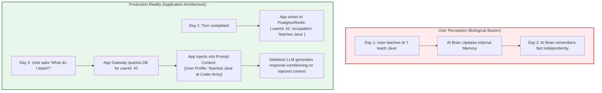
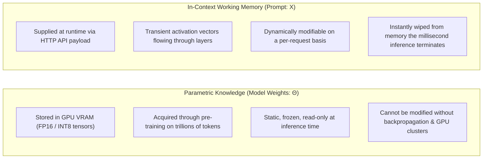
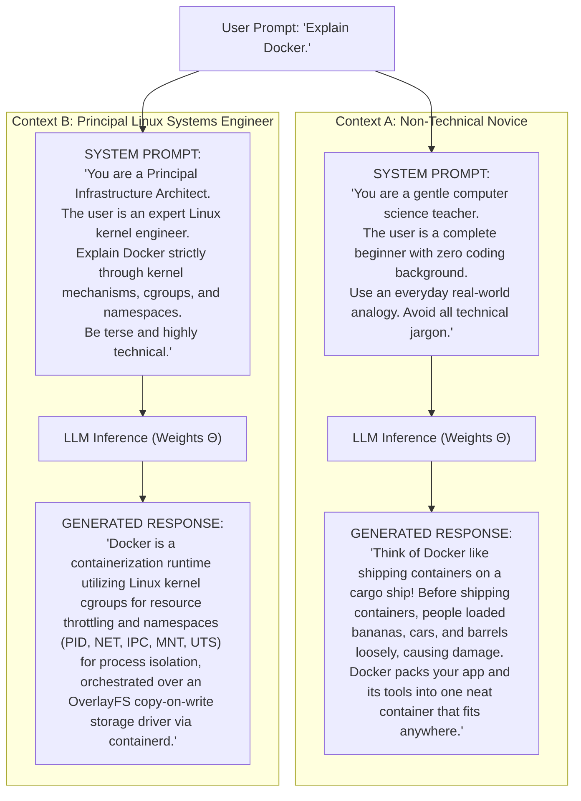
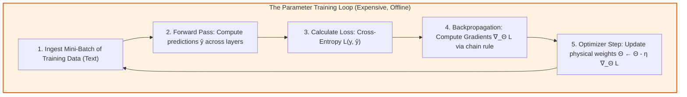
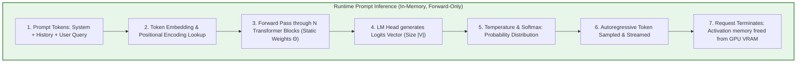

# Chapter 03: Context vs. Model Weights & The Illusion of Learning

> **Chapter Goal:** Unpack the profound cognitive and engineering difference between in-context working memory and neural network parameter training, dismantle the illusion that LLMs "learn" or "remember" from prompt interactions, analyze the mathematical mechanics of context-conditioned generation ($P(w_t \mid w_{<t}, \text{Context})$), contrast backpropagation against static inference passes, and master the architectural separation of Application Memory vs. Model Training.

---

## 3.1 The Illusion of Memory

In enterprise product discussions, business stakeholders and novice developers routinely say things like:
> *"Our AI chatbot remembered that the customer prefers vegetarian food from their conversation yesterday!"*
> *"I taught the model what our internal codename 'GateKeeper' means, so it knows our architecture now!"*

Consider the following interaction sequence:

```
[Day 1 - Session 101]
User:      "I teach Java at Coder Army."
Assistant: "That's great! Java is a powerful object-oriented language."

[Day 2 - Session 205]
User:      "What do I teach?"
Assistant: "You teach Java at Coder Army!"
```

To the end user, this feels like biological learning: the AI listened, retained the memory overnight, and recalled it during a new conversation.

However, from an engineering standpoint, this is **The Illusion of Memory**:



> **The Fundamental Axiom:**
> 
> **The foundation model remembered nothing.**
> 
> The neural network's parameters are completely identical to what they were yesterday. It was the **Application Layer** that extracted, persisted, indexed, retrieved, and re-injected the user's information into the prompt context for that specific API request.

---

## 3.2 Parametric Knowledge vs. In-Context Working Memory

To architect robust AI systems, Forward Deployed Engineers must maintain a strict conceptual divide between **Parametric Knowledge** and **In-Context Working Memory**:



### Comparative Breakdown: Parameters vs. Context

| Dimension | Parametric Knowledge ($\Theta$) | In-Context Working Memory ($X_{\text{prompt}}$) |
| :--- | :--- | :--- |
| **Physical Storage** | High-Bandwidth GPU VRAM (Model Weight Files) | Temporary HTTP request buffer & KV Cache |
| **Modification Mechanism** | Stochastic Gradient Descent (SGD) & Backpropagation | String serialization in application code |
| **Update Latency** | Days to months (Re-training or Fine-Tuning) | **Sub-millisecond** (Application DB lookup) |
| **Update Financial Cost**| Thousands to millions of dollars in compute | Fraction of a cent (API token cost) |
| **Persistence Horizon**| Permanent until checkpoint deprecation | **Ephemeral** (Zero cross-request retention) |
| **Scope of Impact** | Affects all global users interacting with the model | Isolated strictly to that single HTTP request |
| **Data Deletion (GDPR)**| Mathematically difficult (Machine Unlearning problem)| Trivial (`DELETE FROM user_memory WHERE id = 42`) |

---

## 3.3 The Mathematical Mechanics of Context-Conditioned Prediction

At its mathematical core, an autoregressive language model is an estimator of conditional probability distributions over a discrete vocabulary $V$:

$$P(w_t \mid w_1, w_2, \dots, w_{t-1}; \Theta)$$

Where:
- $w_t \in V$ is the token being predicted at step $t$.
- $w_1 \dots w_{t-1}$ is the sequence of preceding tokens (the context window).
- $\Theta$ is the static, frozen weight tensor of the transformer.

When we modify the prompt context $C$, we are **not** changing the function parameters $\Theta$. We are changing the **conditioning vector** upon which the probability distribution is computed:

$$P(w_t \mid \text{Context}_A; \Theta) \neq P(w_t \mid \text{Context}_B; \Theta)$$

The attention heads in each transformer layer calculate dot-product affinities between query tokens and key tokens:
$$\text{Attention}(Q, K, V) = \text{softmax}\left(\frac{QK^T}{\sqrt{d_k}}\right)V$$

By injecting specific facts into the prompt, the Key ($K$) vectors for those facts cause the Query ($Q$) vectors of subsequent tokens to attend heavily to them, steering the resulting Logits vector toward contextually congruent words.

---

## 3.4 "Same Question, Different Context": A Concrete Case Study

To visualize how context steers generation without changing weights, consider submitting the exact same four-word user prompt to the exact same model:

```text
USER PROMPT: "Explain Docker."
```



### The FDE Insight
- The foundation model weights ($\Theta$) were **100% identical** in both runs.
- The base user prompt was identical.
- **The context alone modulated the output distribution.** In Context A, words like *"cargo ship"* and *"bananas"* had the highest conditional probability. In Context B, words like *"cgroups"*, *"namespaces"*, and *"OverlayFS"* dominated the distribution.

---

## 3.5 What Actually Happens During Model Training

To appreciate why prompting is not training, review the actual computational loop of model training:



### Requirements for Training:
1. **Computational Infrastructure:** Clusters of hundreds or thousands of networked GPUs (e.g., Nvidia H100s connected via InfiniBand).
2. **Backpropagation:** Full backward pass computing partial derivatives of the loss with respect to every weight in all transformer layers.
3. **Parameter Mutation:** Overwriting the floating-point values in the model's weight matrices.
4. **Time & Cost:** Days to months of compute; hundreds of thousands to tens of millions of dollars.

---

## 3.6 What Actually Happens During Prompt Inference

Now contrast model training with a runtime prompt invocation:



### Critical Inference Invariants:
1. **Zero Backpropagation:** Gradients are never calculated ($\nabla_\Theta \mathcal{L} = \emptyset$).
2. **Zero Weight Modification:** Every weight tensor in GPU VRAM is marked read-only.
3. **Pure Forward Pass:** Activations flow strictly forward through layers to compute logits.
4. **Complete State Teardown:** Once the final token is generated, the intermediate activation tensors are deallocated. The model retains zero residual trace of the interaction.

---

## 3.7 Deconstructing "In-Context Learning": The "Coder Army" Case Study

Consider the following prompt exchange:

```text
USER:      "Whenever I say 'Army', I mean 'Coder Army'."
USER:      "What does Army mean?"
ASSISTANT: "Army means 'Coder Army'."
```

Did you just "teach" the AI a new rule?
- **In common parlance:** Yes, the AI followed your instruction.
- **In computer science reality:** **No.** You merely conditioned the model's self-attention heads to map the token `"Army"` to the token string `"Coder Army"` for the duration of that specific forward pass.

If you open a new browser tab or submit a separate API request without that initial sentence, and ask:
```text
"What does Army mean?"
```
the model will immediately revert to its parametric knowledge:
```text
"An army is a heavily armed, highly organized military force primarily oriented for land warfare."
```

> **The Forward Deployed Engineer Rule:**
> 
> If a business requirement demands that user facts persist across time, **never rely on in-context learning alone**. You must engineer an external, deterministic persistence engine that stores the fact in a database and hydrates it into future requests.

---

## 3.8 Application Memory vs. Model Training: Architectural Trade-Off Matrix

When designing an enterprise conversational system, executives often ask:
> *"Should we fine-tune a custom model on our company's user data, or should we use an application memory database with RAG?"*

Use the following architectural decision matrix to guide the strategy:

| Evaluation Vector | Application Memory Architecture (Database + In-Context Hydration) | Model Fine-Tuning / Continual Training |
| :--- | :--- | :--- |
| **Data Freshness** | **Instantaneous:** Database writes take $< 5\text{ms}$. New facts are available to the LLM immediately. | **Stale:** Requires batch collection, dataset curation, retraining runs, and redeployment cycles (days/weeks). |
| **Auditability & Traceability** | **100% Deterministic:** Every remembered fact is a distinct row in PostgreSQL/Redis with created timestamps. | **Opaque Black Box:** Facts are absorbed into diffuse weight matrices; impossible to trace why a fact was recalled. |
| **Data Deletion (GDPR / CCPA)** | **Trivial:** Standard SQL command (`DELETE FROM user_memory WHERE user_id = ?`). | **Extreme Research Challenge:** "Machine unlearning" is computationally intractable and unreliable. |
| **Cost per Update** | Negligible (Standard database write). | High GPU compute costs per fine-tuning run. |
| **Risk of Catastrophic Forgetting**| **Zero:** The base model's general reasoning remains completely untouched. | **High:** Retraining can degrade reasoning, coding, or language comprehension on out-of-distribution tasks. |
| **Primary Limitation** | Bound by context window limits and retrieval accuracy. | Cannot reliably memorize exact tabular records or fast-changing state. |

**Verdict:** 
For customer memory, personal preferences, user state, and business records, **Application Memory wins 100% of the time**. Fine-tuning should be reserved exclusively for teaching specialized output styles, proprietary syntax, or internal jargon—never for dynamic state storage.

---

## 3.9 TypeScript Enterprise Pattern: Decoupled Application Memory Store

Below is a production-grade TypeScript implementation demonstrating how an FDE decouples persistent application memory from the stateless foundation model:

```typescript
import { OpenAI } from 'openai';

export interface UserFact {
  factId: string;
  category: 'preference' | 'constraint' | 'identity';
  content: string;
  recordedAt: number;
}

/**
 * Production Long-Term Memory Store (backed by Redis/PostgreSQL in production)
 */
export class UserMemoryRepository {
  private memoryStore: Map<string, UserFact[]> = new Map();

  public async saveFact(userId: string, category: UserFact['category'], content: string): Promise<void> {
    const facts = this.memoryStore.get(userId) || [];
    facts.push({
      factId: `fact_${Date.now()}_${Math.random().toString(36).substring(2, 7)}`,
      category,
      content,
      recordedAt: Date.now(),
    });
    this.memoryStore.set(userId, facts);
  }

  public async getFactsForUser(userId: string): Promise<UserFact[]> {
    return this.memoryStore.get(userId) || [];
  }

  public async deleteUserMemory(userId: string): Promise<void> {
    // Compliant with GDPR "Right to be Forgotten"
    this.memoryStore.delete(userId);
  }
}

/**
 * Enterprise Personalized Chat Orchestrator
 */
export class PersonalizedChatOrchestrator {
  private openai: OpenAI;
  private memoryRepo: UserMemoryRepository;

  constructor(apiKey: string, memoryRepo: UserMemoryRepository) {
    this.openai = new OpenAI({ apiKey });
    this.memoryRepo = memoryRepo;
  }

  public async generatePersonalizedResponse(
    userId: string,
    systemBasePrompt: string,
    userQuery: string
  ): Promise<string> {
    // 1. Fetch persistent user facts from database
    const userFacts = await this.memoryRepo.getFactsForUser(userId);

    // 2. Synthesize dynamic, hydrated system context
    let hydratedSystemPrompt = systemBasePrompt;
    if (userFacts.length > 0) {
      hydratedSystemPrompt += '\n\n[PERSISTENT USER MEMORY & PREFERENCES]:';
      for (const fact of userFacts) {
        hydratedSystemPrompt += `\n- (${fact.category.toUpperCase()}): ${fact.content}`;
      }
      hydratedSystemPrompt += '\nIncorporate these user facts seamlessly into your assistance.';
    }

    // 3. Dispatch stateless request to foundation LLM
    const response = await this.openai.chat.completions.create({
      model: 'gpt-4o',
      messages: [
        { role: 'system', content: hydratedSystemPrompt },
        { role: 'user', content: userQuery },
      ],
      temperature: 0.2,
    });

    return response.choices[0]?.message?.content || 'No response generated.';
  }
}
```

---

## 3.10 Chapter Summary & Key Engineering Takeaways

1. **Memory is an Application Illusion:** LLMs do not retain cross-session memory. Any apparent memory is the result of external databases capturing data and re-injecting it into the context window.
2. **Parameters are Frozen; Context is Fluid:** Model weights ($\Theta$) are static floating-point tensors stored in GPU VRAM. Context ($X$) is temporary working data flowing through the network during a single forward pass.
3. **Context Steers Probabilities Without Retraining:** Identical prompts produce wildly different outputs under different context instructions because self-attention condition vectors reshape the vocabulary probability distribution $P(w_t \mid \text{Context})$.
4. **Inference Executes Zero Backpropagation:** Training requires loss calculation, gradients, and weight mutations. Inference is a forward-only pass through frozen weights; all activations are wiped upon response completion.
5. **Architect for Application Memory, Not Model Fine-Tuning:** Dynamic facts, user profiles, and business state must live in high-speed databases (PostgreSQL/Redis), where they can be instantly updated, audited, and deleted in compliance with privacy laws.
