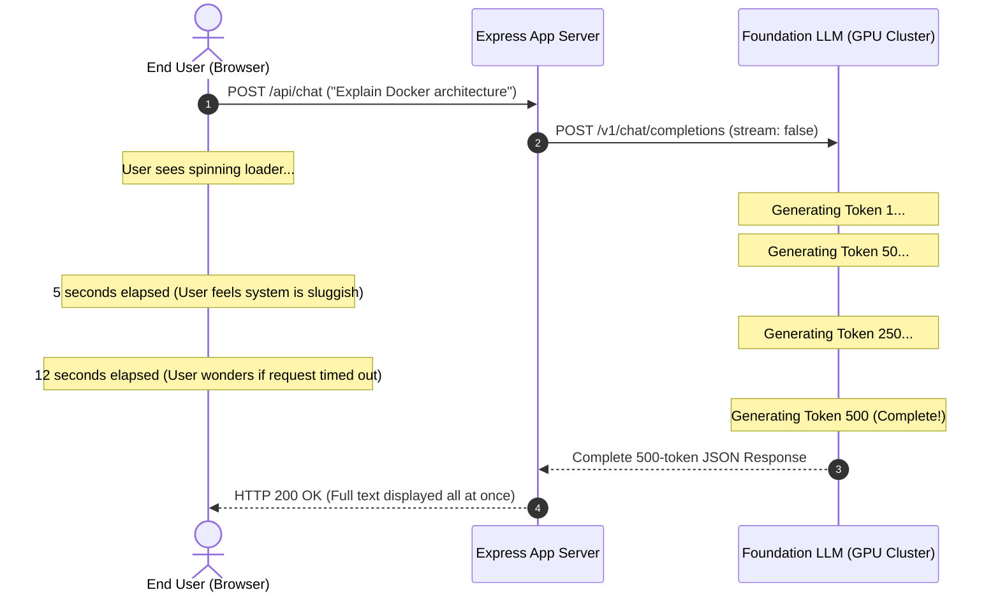
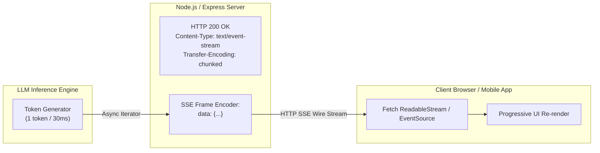
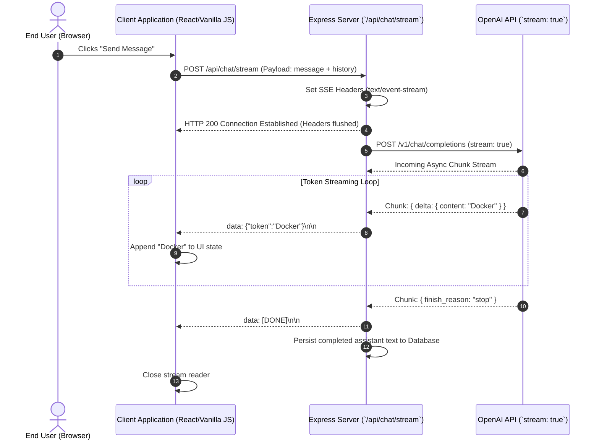

# Chapter 04: Real-Time Streaming Architecture & SSE Protocols

> **Chapter Goal:** Deconstruct the mechanics of autoregressive token generation, analyze the latency bottleneck of traditional request-response architectures, evaluate Time-to-First-Token (TTFT) versus Inter-Token Latency (ITL), master the Server-Sent Events (SSE) protocol and HTTP chunked transfer encoding, and implement a production-grade streaming pipeline in TypeScript across both backend (Express/OpenAI SDK) and frontend (Fetch Streams API).

---

## 4.1 The Autoregressive Generation Reality

To understand why streaming is the universal standard for Generative AI applications, one must first look at how a Large Language Model physically produces text:

```
Step 1: Context ────────────────────────────────────────► "Docker"
Step 2: Context + "Docker" ─────────────────────────────► "is"
Step 3: Context + "Docker is" ──────────────────────────► "a"
Step 4: Context + "Docker is a" ────────────────────────► "containerization"
Step 5: Context + "Docker is a containerization" ───────► "platform."
```

An LLM does **not** synthesize an entire paragraph in a single instant. Because it is an autoregressive decoder, every single token requires a distinct forward pass through all transformer blocks:

1. The current context is fed through the layers to compute the next token's probability distribution.
2. A single token is sampled from that distribution.
3. The newly sampled token is appended to the context.
4. The entire process repeats for the next token.

> **The Fundamental Realization:**
> 
> Because the foundation model is **already producing output progressively**, holding back tokens on the server until the entire paragraph finishes is an artificial bottleneck created by outdated application architectures!

---

## 4.2 The Bottleneck of Traditional Request-Response (Without Streaming)

In classical Web 2.0 architectures, web applications follow a strict **buffering request-response lifecycle**:
1. Client sends an HTTP POST request.
2. Server executes business logic, waits for all data to settle, and packages the complete JSON payload.
3. Server returns the response to the client.



### The Latency Breakdown Equation
Total response time ($T_{\text{total}}$) is defined as:

$$T_{\text{total}} = \text{TTFT} + (N_{\text{output}} \times \text{ITL})$$

Where:
- $\text{TTFT}$ (**Time-to-First-Token**): Time required for network transit, prompt tokenization, and initial prefill pass through GPU cores (typically $200\text{ms} - 800\text{ms}$).
- $N_{\text{output}}$: Total number of tokens generated in the response.
- $\text{ITL}$ (**Inter-Token Latency**): Time required to decode each subsequent token (typically $20\text{ms} - 50\text{ms}$ per token on modern inference hardware).

### Numerical Comparison: Perceived Latency

Assume a detailed technical response generates $N_{\text{output}} = 600$ tokens, with $\text{TTFT} = 500\text{ms}$ and $\text{ITL} = 30\text{ms}$:

$$T_{\text{total}} = 500\text{ms} + (600 \times 30\text{ms}) = 500\text{ms} + 18{,}000\text{ms} = 18.5\text{ seconds}$$

| Mode | Perceived Wait Time for User | User Psychological Experience | Risk of Gateway Timeout (504) |
| :--- | :--- | :--- | :--- |
| **Without Streaming (Buffered)** | **$18.5$ seconds** | Extreme friction; feels frozen; users repeatedly click or abandon page | High (Cloudflare / Nginx 30s limits) |
| **With Streaming** | **$0.5$ seconds** ($\text{TTFT}$) | Immediate, conversational response; human reading speed matches token stream | Virtually Zero (Connection actively streams) |

> **Crucial Engineering Distinction:**
> 
> **Streaming does NOT make the model generate tokens faster.** The total wall-clock time ($18.5\text{s}$) remains virtually unchanged. Streaming dramatically reduces **perceived latency** by presenting information at human reading speeds ($3-5$ words per second) starting the moment the first token exits the GPU.

---

## 4.3 The Streaming Protocol: Server-Sent Events (SSE)

To stream tokens across standard HTTP networks, the industry standard protocol is **Server-Sent Events (SSE)**, standardized under HTML5 and supported natively by all web browsers and server runtimes.



### Why SSE Over WebSockets?
1. **Unidirectional Simplicity:** Chat responses flow from server to client. WebSockets require full-duplex framing, connection state management, and ping-pong heartbeats that add unnecessary complexity.
2. **HTTP/2 Multiplexing:** SSE runs over standard HTTP. Over HTTP/2, dozens of SSE streams share a single TCP connection without head-of-line blocking.
3. **Enterprise Firewall Friendly:** SSE utilizes standard HTTP ports (`80` / `443`), bypassing strict corporate proxy firewalls that routinely terminate long-lived WebSocket connections.

### The SSE Wire Protocol Format
An SSE stream consists of plain UTF-8 text partitioned into events separated by double newline characters (`\n\n`):

```http
HTTP/1.1 200 OK
Content-Type: text/event-stream; charset=utf-8
Cache-Control: no-cache, no-transform
Connection: keep-alive
Transfer-Encoding: chunked

data: {"choices":[{"delta":{"content":"Docker"}}]}

data: {"choices":[{"delta":{"content":" is"}}]}

data: {"choices":[{"delta":{"content":" an"}}]}

data: {"choices":[{"delta":{"content":" open"}}]}

data: [DONE]

```

Notice the final termination sentinel: `data: [DONE]\n\n`. When the client parser detects `[DONE]`, it cleanly closes the connection.

---

## 4.4 End-to-End Streaming Architecture

Building a production streaming pipeline requires orchestrating three discrete tiers:



---

## 4.5 Production TypeScript Implementation: Express SSE Streaming Endpoint

Below is a production-ready Express router implementing token streaming, proper HTTP header negotiation, error handling, and client disconnection tracking via `AbortController`:

```typescript
import { Router, Request, Response } from 'express';
import { OpenAI } from 'openai';

const router = Router();
const openai = new OpenAI({ apiKey: process.env.OPENAI_API_KEY });

/**
 * POST /api/chat/stream
 * Enterprise Server-Sent Events (SSE) Streaming Endpoint
 */
router.post('/stream', async (req: Request, res: Response): Promise<void> => {
  const { messages } = req.body;

  if (!messages || !Array.isArray(messages)) {
    res.status(400).json({ error: 'Valid messages array is required.' });
    return;
  }

  // 1. Configure Mandatory SSE Response Headers
  res.writeHead(200, {
    'Content-Type': 'text/event-stream',
    'Cache-Control': 'no-cache, no-transform',
    'Connection': 'keep-alive',
    'X-Accel-Buffering': 'no', // Critical: Disables Nginx reverse proxy buffering
  });

  // Flush headers immediately so client establishes connection
  res.flushHeaders?.();

  // 2. Setup AbortController for client disconnection handling
  const abortController = new AbortController();
  req.on('close', () => {
    // Client aborted request (closed tab or clicked cancel)
    abortController.abort();
  });

  let fullGeneratedText = '';

  try {
    // 3. Initiate Streaming Request with Foundation Model SDK
    const stream = await openai.chat.completions.create(
      {
        model: 'gpt-4o',
        messages: [
          { role: 'system', content: 'You are an expert enterprise solutions engineer.' },
          ...messages,
        ],
        stream: true,
      },
      { signal: abortController.signal }
    );

    // 4. Iterate over Async Token Chunks
    for await (const chunk of stream) {
      const token = chunk.choices[0]?.delta?.content || '';
      
      if (token) {
        fullGeneratedText += token;
        
        // Format chunk as standard SSE frame
        const ssePayload = JSON.stringify({ token });
        res.write(`data: ${ssePayload}\n\n`);
      }
    }

    // 5. Transmit Protocol Termination Sentinel
    res.write('data: [DONE]\n\n');
    res.end();

    // 6. Asynchronously persist full output to database for session history
    // await saveMessageToDatabase(req.body.sessionId, 'assistant', fullGeneratedText);

  } catch (error: any) {
    if (abortController.signal.aborted) {
      console.log('Client closed connection mid-stream.');
      return;
    }

    console.error('Streaming pipeline encountered error:', error);
    // If headers already flushed, emit an error frame over the stream
    const errorPayload = JSON.stringify({ error: 'Generation interrupted by system error.' });
    res.write(`data: ${errorPayload}\n\n`);
    res.end();
  }
});

export default router;
```

---

## 4.6 Browser / Client-Side Consumption in Modern JavaScript / TypeScript

Modern frontend clients consume streaming endpoints using the standard web `fetch()` API combined with `ReadableStreamDefaultReader`:

```typescript
/**
 * Consumes an SSE stream from the backend and progressively updates UI state
 */
export async function streamChatResponse(
  endpointUrl: string,
  messages: Array<{ role: string; content: string }>,
  onToken: (token: string) => void,
  onComplete: (fullText: string) => void
): Promise<void> {
  const response = await fetch(endpointUrl, {
    method: 'POST',
    headers: { 'Content-Type': 'application/json' },
    body: JSON.stringify({ messages }),
  });

  if (!response.ok || !response.body) {
    throw new Error(`HTTP error! status: ${response.status}`);
  }

  const reader = response.body.getReader();
  const decoder = new TextDecoder('utf-8');
  let accumulatedText = '';
  let buffer = '';

  while (true) {
    const { value, done } = await reader.read();
    if (done) break;

    // Decode byte buffer to text string
    buffer += decoder.decode(value, { stream: true });

    // Partition buffer by double newlines into discrete SSE frames
    const lines = buffer.split('\n\n');
    buffer = lines.pop() || ''; // Retain partial trailing chunk

    for (const line of lines) {
      const trimmed = line.trim();
      if (!trimmed.startsWith('data: ')) continue;

      const rawData = trimmed.replace(/^data: /, '');

      if (rawData === '[DONE]') {
        onComplete(accumulatedText);
        return;
      }

      try {
        const parsed = JSON.parse(rawData);
        if (parsed.token) {
          accumulatedText += parsed.token;
          onToken(parsed.token); // Progressively append token to DOM
        }
      } catch (e) {
        console.warn('Failed to parse SSE JSON frame:', rawData);
      }
    }
  }

  onComplete(accumulatedText);
}
```

---

## 4.7 Production Engineering Challenges & Edge Cases

When deploying streaming architectures in enterprise infrastructure, Forward Deployed Engineers encounter four critical operational challenges:

### 1. Reverse Proxy Buffering (Nginx / Cloudflare)
By default, web servers like Nginx and CDNs like Cloudflare attempt to optimize network throughput by buffering responses until they reach 4KB or 16KB before transmitting packets to the client.
- **Symptom:** The user still waits 10 seconds, then gets 300 words in one massive burst.
- **Fix:** You must disable proxy buffering by emitting the HTTP header:
  ```http
  X-Accel-Buffering: no
  ```
  and configuring Nginx with `proxy_buffering off;`.

### 2. Mid-Stream Exceptions
In traditional REST, if an exception occurs, you return `HTTP 500 Internal Server Error`. In streaming, you have already committed `HTTP 200 OK` and flushed headers.
- **Fix:** You cannot change the HTTP status code once headers are flushed. You must transmit a typed error event over the stream:
  ```http
  data: {"error": "Rate limit exceeded during token generation", "code": 429}
  ```
  The client parser must detect the error field and display a retry alert to the user.

### 3. Orphaned Generation & GPU Waste
If an impatient user navigates away or refreshes the page mid-stream, the client terminates the TCP socket. If your server does not listen for `req.on('close')`, your server will continue requesting and paying for tokens from the foundation model!
- **Fix:** Always propagate the client socket close event to an `AbortController` passed to the OpenAI SDK.

---

## 4.8 Chapter Summary & Key Engineering Takeaways

1. **Autoregressive Generation Enables Natural Streaming:** LLMs generate text token-by-token. Buffering the entire response wastes time and creates artificial latency bottlenecks.
2. **Streaming Optimizes Perceived Latency (TTFT):** Total generation time remains the same, but the user begins reading in under $500\text{ms}$ instead of waiting $15-30$ seconds on a loading screen.
3. **SSE is the Gold Standard for AI Streams:** Server-Sent Events (`text/event-stream`) provide lightweight, unidirectional, firewall-friendly streaming over standard HTTP without WebSocket operational overhead.
4. **Flushing & Disabling Reverse Proxy Buffering is Mandatory:** Always set `X-Accel-Buffering: no` to prevent Nginx or Cloudflare from capturing token chunks in buffer queues.
5. **Handle Sockets with AbortControllers:** Connect client socket close events (`req.on('close')`) to SDK abort signals to prevent paying for orphaned generation cycles on abandoned browser tabs.
