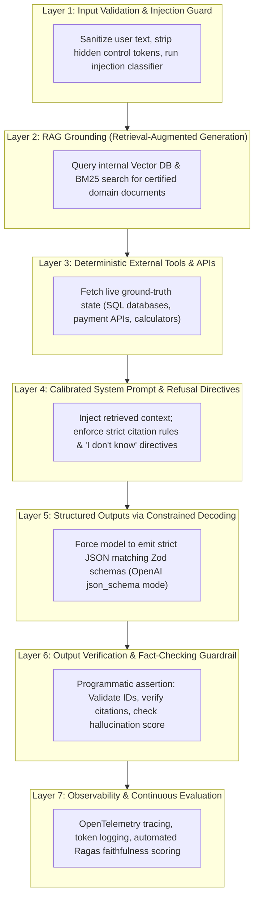
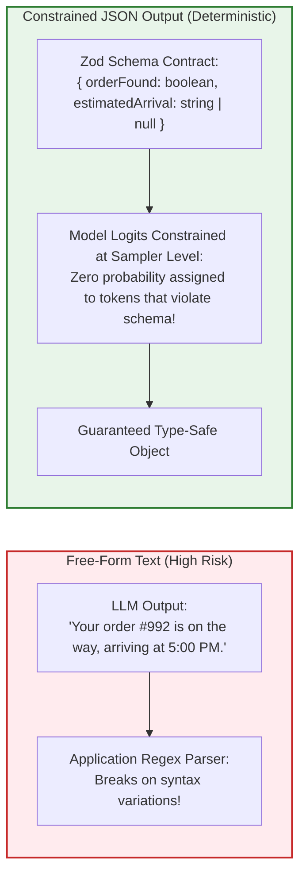

# Chapter 06: Engineering Defenses: RAG, Guardrails & Verification

> **Chapter Goal:** Master the 7-Layer Defense-in-Depth architecture for mitigating hallucinations and securing LLM applications, understand why prompt-level rules alone fail in production, implement Retrieval-Augmented Generation (RAG) grounding and deterministic tool calling, enforce schema compliance with TypeScript and Zod Structured Outputs, calibrate model refusals ("I don't know"), and construct programmatic output verification pipelines.

---

## 6.1 The Fallacy of Prompt-Only Defenses

When a generative AI application produces an embarrassing hallucination or leaks confidential data, junior teams often respond by appending another line to the system prompt:

```text
// ❌ NAÏVE PROMPT PATCHING (Fragile & Insufficient)
"Please do not hallucinate."
"Only speak 100% certified facts."
"If you are not sure, strictly do not guess."
```

> **The Forward Deployed Engineering Reality:**
> 
> **You cannot eliminate hallucinations through prompt instructions alone.**
> 
> System prompts influence token likelihoods, but they do not alter the underlying statistical mechanics of next-token prediction. Under complex prompts, long conversation histories, or subtle user manipulations, prompt-only constraints inevitably degrade.

```mermaid
flowchart TD
    subgraph NaiveDefense["❌ Fragile Single-Layer Defense"]
        PromptIn["User Query"] --> LLM_Only["LLM with System Prompt:<br/>'Do not hallucinate'"]
        LLM_Only --> OutFail["Hallucination & Vulnerabilities Persist!"]
    end

    subgraph DefenseInDepth["✅ Production 7-Layer Defense-in-Depth"]
        L1["1. Input Gateway & Injection Guard"]
        L2["2. Hybrid RAG Knowledge Retrieval"]
        L3["3. Deterministic Tool Calling"]
        L4["4. Grounded Prompt & Refusal Tuning"]
        L5["5. Type-Safe Structured Outputs (Zod)"]
        L6["6. Output Guardrail & Hallucination Scorer"]
        L7["7. Observability & Ragas Evals"]
        
        L1 --> L2 --> L3 --> L4 --> L5 --> L6 --> L7
    end

    style NaiveDefense fill:#ffebee,stroke:#c62828,stroke-width:2px
    style DefenseInDepth fill:#e8f5e9,stroke:#2e7d32,stroke-width:2px
```



Production AI engineering requires **Defense in Depth**: wrapping the unprivileged, probabilistic model in deterministic software guardrails that validate inputs, inject certified facts, execute external tools, enforce type schemas, and audit outputs.

---

## 6.2 The 7-Layer Defense-in-Depth Architecture

Forward Deployed Engineers deploy seven complementary layers to transform a probabilistic LLM into an enterprise-reliable software product:



### Detailed Breakdown of the 7 Layers

| Layer | Responsibility | Technology Stack / Approach | Failure Prevented |
| :--- | :--- | :--- | :--- |
| **1. Input Sanitization** | Block prompt injections, jailbreaks, and PII leaks before inference. | Regex, Llama Guard, NeMo Guardrails | Adversarial goal hijacking, prompt leakage |
| **2. RAG Grounding** | Inject fresh, private, factual documentation into prompt context. | Hybrid Search (Dense vectors + BM25 keyword) | Outdated training cutoffs, missing domain facts |
| **3. External Tools** | Offload arithmetic, order lookups, and state changes to deterministic code. | REST APIs, SQL clients, Function Calling | Mathematical errors, invented inventory/pricing |
| **4. Calibrated Refusal** | Train prompt context to challenge false premises and admit ignorance. | Few-shot in-context refusal demonstrations | Sycophancy, fabricated answers to trick queries |
| **5. Structured Outputs** | Guarantee that generated responses parse strictly into application data types. | OpenAI Structured Outputs, Zod, JSON Schema | Broken UI JSON parsing, missing required fields |
| **6. Output Guardrails** | Deterministically verify generated claims against source context. | Fact-checking classifiers, citation validators | Subtle entity swaps (e.g., IBM vs Sun Microsystems)|
| **7. Evaluation Suite** | Measure production faithfulness and context recall continuously. | Ragas, TruLens, LLM-as-a-Judge test suites | Silent model drift, prompt regression |

---

## 6.3 Deep Dive: Calibrated Refusal Engineering ("I Don't Know")

The default tendency of an ungrounded LLM is to provide an answer, even when context is missing. To counteract this, production prompts must implement **Calibrated Refusal Engineering**:

```text
SYSTEM INSTRUCTION (Refusal Calibration):
1. Rely ONLY on the clear facts directly mentioned in the [CONTEXT] section below.
2. Do not assume or extrapolate from outside knowledge.
3. If the user asks about an event, person, or order detail that is not explicitly confirmed 
   in the provided [CONTEXT], you MUST respond with:
   "I do not have sufficient verified information to answer this question."
4. If a user question contains an unverified premise (e.g., asking about a nonexistent event), 
   explicitly reject the premise before proceeding.
```

### Few-Shot Refusal Exemplars
Models follow few-shot demonstrations significantly better than abstract rules. Injecting 1-2 examples of proper refusal into the prompt context dramatically reduces hallucination rates:

```text
[EXAMPLE 1]:
Context: "Tomato delivery service is available in Delhi, Mumbai, and Bangalore."
User Query: "Can I order food in Hyderabad?"
Assistant: "Based on the provided information, Tomato does not currently operate in Hyderabad."

[EXAMPLE 2]:
Context: "Order #4812 was placed at 12:30 PM for a Margherita Pizza."
User Query: "Who is the delivery rider for Order #4812?"
Assistant: "I do not have access to rider details for Order #4812 in the current system records."
```

---

## 6.4 Deep Dive: Guaranteed Structured Outputs with TypeScript & Zod

One of the greatest advancements in modern AI engineering is **Constrained Decoding** (available via OpenAI's `response_format: { type: "json_schema", ... }`).

Rather than allowing the model to generate arbitrary, free-form markdown text and hoping it includes the right facts, you compel the model's vocabulary sampling to conform strictly to a context-free grammar defined by a JSON Schema:



---

## 6.5 Production TypeScript Implementation: Grounded Chat Service with Fact Verification

Below is an end-to-end, enterprise-ready TypeScript service that unifies **RAG Context Grounding**, **Zod Structured Output**, and a **Deterministic Post-Generation Fact Verifier**:

```typescript
import { OpenAI } from 'openai';
import { z } from 'zod';
import { zodResponseFormat } from 'openai/helpers/zod';

// ============================================================================
// 1. Zod Response Schema Definition
// ============================================================================

export const GroundedResponseSchema = z.object({
  answer: z.string().describe('The direct, empathetic answer to the user query.'),
  confidenceScore: z.number().min(0).max(1).describe('Model confidence based strictly on context (0.0 to 1.0).'),
  citedFacts: z.array(z.string()).describe('Exact factual statements extracted from the provided context.'),
  isRefusal: z.boolean().describe('True if the model refused to answer due to missing or contradictory context.'),
  unverifiedClaimsDetected: z.boolean().describe('True if the user made false or unverified premises in their question.'),
});

export type GroundedResponse = z.infer<typeof GroundedResponseSchema>;

// ============================================================================
// 2. Production Grounded Chatbot Engine
// ============================================================================

export class GroundedChatEngine {
  private openai: OpenAI;

  constructor(apiKey: string) {
    this.openai = new OpenAI({ apiKey });
  }

  /**
   * Generates a grounded response constrained by provided RAG documents.
   */
  public async generateGroundedAnswer(
    userQuery: string,
    retrievedContextChunks: string[]
  ): Promise<GroundedResponse> {
    const formattedContext = retrievedContextChunks
      .map((chunk, index) => `[FACT ${index + 1}]: ${chunk}`)
      .join('\n\n');

    const systemPrompt = `
You are a reliable enterprise support assistant for Tomato.
You are strictly evaluated on factuality and precision.

OPERATIONAL CONSTRAINTS:
1. Answer the user query using ONLY the verified facts supplied in [CONTEXT].
2. If the context does not contain sufficient information, set isRefusal=true and state that the information is unavailable.
3. If the user question presumes a fact that is false or absent from [CONTEXT], set unverifiedClaimsDetected=true.
4. Every single statement in your answer must be backed by one of the [CONTEXT] entries.

[CONTEXT]:
${formattedContext}
`;

    // Dispatch constrained decoding request via OpenAI Structured Outputs
    const completion = await this.openai.beta.chat.completions.parse({
      model: 'gpt-4o-2024-08-06',
      messages: [
        { role: 'system', content: systemPrompt },
        { role: 'user', content: userQuery },
      ],
      response_format: zodResponseFormat(GroundedResponseSchema, 'grounded_response'),
      temperature: 0.0, // Zero temperature to minimize stochastic variance
    });

    const parsedData = completion.choices[0]?.message?.parsed;

    if (!parsedData) {
      throw new Error('LLM failed to produce valid structured response matching schema.');
    }

    // ========================================================================
    // 3. Programmatic Post-Generation Verification Guardrail
    // ========================================================================
    this.verifyCitationsAgainstContext(parsedData, retrievedContextChunks);

    return parsedData;
  }

  /**
   * Deterministic Output Guardrail: Verifies that cited facts actually exist in source context.
   */
  private verifyCitationsAgainstContext(
    response: GroundedResponse,
    sourceContextChunks: string[]
  ): void {
    if (response.isRefusal) {
      return; // Refusals do not require citation matching
    }

    const unifiedSourceText = sourceContextChunks.join(' ').toLowerCase();

    for (const citedFact of response.citedFacts) {
      // Check if key entity tokens from the cited fact appear in source text
      const keywords = citedFact
        .toLowerCase()
        .replace(/[^a-z0-9 ]/g, '')
        .split(' ')
        .filter((w) => w.length > 4);

      const matches = keywords.filter((word) => unifiedSourceText.includes(word));
      const matchRatio = keywords.length > 0 ? matches.length / keywords.length : 1;

      if (matchRatio < 0.6) {
        console.warn(`[GUARDRAIL TRIGGERED]: Potential Hallucination in citation: "${citedFact}"`);
        // In strict mode, flip response to refusal or trigger human-in-the-loop review
      }
    }
  }
}
```

---

## 6.6 Chapter Summary & Key Engineering Takeaways

1. **Prompt-Only Directives are Insufficient:** Adding *"Do not hallucinate"* to a prompt is a cosmetic measure. Production systems require multi-layered deterministic software defenses.
2. **Deploy the 7-Layer Defense-in-Depth:** Combine Input Sanitization, RAG Grounding, External Tool Execution, Grounded Prompts, Structured Outputs, Output Verification Guardrails, and Evals.
3. **Calibrate Refusal Proactively:** Overcome model sycophancy by injecting explicit refusal instructions and few-shot examples teaching the model how and when to say *"I do not know."*
4. **Enforce Type Safety with Structured Outputs:** Eliminate syntax errors and unformatted text by utilizing OpenAI JSON Schema mode constrained decoding paired with Zod validation.
5. **Programmatically Verify Output Claims:** Never trust model outputs implicitly. Implement deterministic code to verify order IDs, match cited keywords against RAG source chunks, and score responses before serving them to users.
