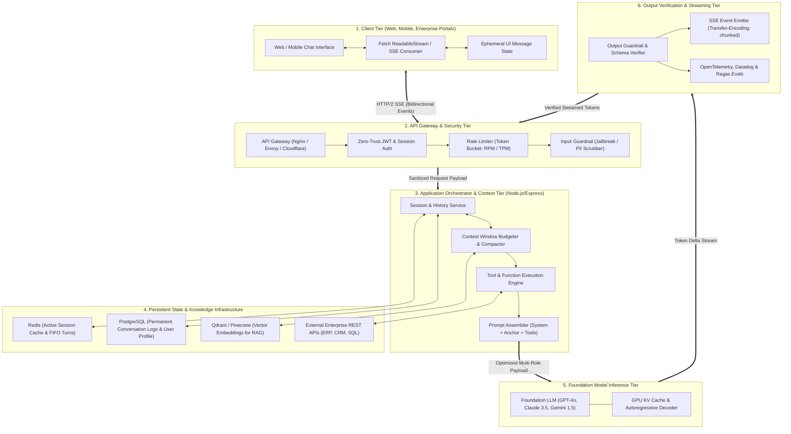
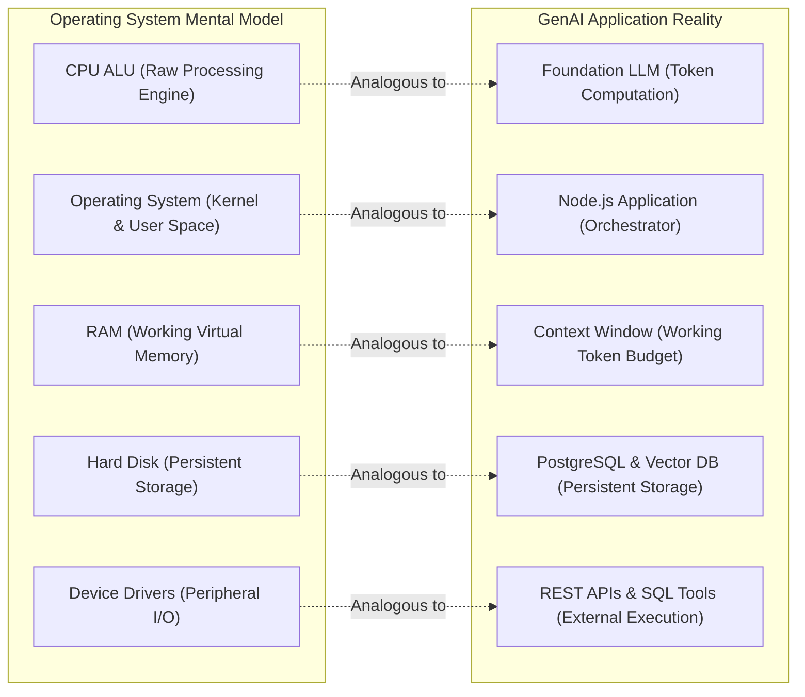

# Chapter 07: Complete Enterprise Chatbot Architecture & Key Takeaways

> **Chapter Goal:** Synthesize the entire curriculum of Lecture 04 into a unified, production-grade Enterprise Chatbot Architecture, establish the "LLM as Unprivileged Kernel" mental model, contrast naïve chatbot scripts with resilient production systems, map the complete conceptual landscape via an architectural mindmap, and master the 25 Cardinal Engineering Principles of conversational AI.

---

## 7.1 Master Enterprise Chatbot Topology

In production engineering, connecting an application to a Large Language Model is never a simple one-line `fetch()` call. The model is merely a cognitive calculation engine nestled within a multi-tiered software system:



---

## 7.2 The FDE Mental Model: The LLM as an Unprivileged Kernel

To avoid architectural mistakes, Forward Deployed Engineers treat the Large Language Model not as a magic "all-knowing brain," but through the architectural analogy of an **Operating System Kernel**:

```
CPU Core (ALU) ──────────► Foundation LLM
Operating System (OS) ───► Application Layer (Node.js / Express)
RAM & Page Files ────────► Context Window & Redis Cache
Hard Disk Storage ───────► PostgreSQL & Vector Databases
System Calls & Drivers ──► External APIs & Tool Calling
User Permissions (Ring 3)► Input & Output Guardrails
```



### The Invariants of the Operating System Model
1. **The CPU has no persistent memory:** When a thread context-switches off the CPU, its registers are saved to RAM. Similarly, when an LLM API call completes, its state is gone; the application must save conversation turns to a database.
2. **The CPU cannot execute raw I/O directly:** An ALU cannot send an email or query a database without device drivers and OS kernel mediation. An LLM cannot execute business logic without the application orchestrating tool calls.
3. **The CPU operates on unprivileged code:** The OS does not trust user-space binaries with root privileges. Similarly, an enterprise application never trusts raw user prompts or unverified LLM generations with direct access to sensitive infrastructure.

---

## 7.3 Architectural Comparison: Naïve Prototype vs. Enterprise Production Chatbot

| Architectural Vector | Naïve Prototype Chatbot | Enterprise Production Chatbot (FDE Grade) |
| :--- | :--- | :--- |
| **API Networking** | Synchronous, blocking HTTP POST; user waits $15\text{s}$ on spinner. | Real-time **Server-Sent Events (SSE)** streaming; Time-to-First-Token $< 500\text{ms}$. |
| **State Handling** | Relies on client browser memory or unbounded in-memory array. | Distributed **Redis session cache** backed by permanent **PostgreSQL audit log**. |
| **Context Management** | Blindly appends all turns; suffers $O(N^2)$ token explosion and cost runaway. | **Token-budgeted sliding window** and **rolling LLM summarization**; bounded $O(1)$ cost. |
| **Role Separation** | Concatenates rules into user string; vulnerable to immediate prompt injection. | Strict semantic role decoupling (`system` vs `user` vs `assistant`) with structural priority. |
| **Factuality & Knowledge**| Relies on parametric memory; frequently produces confident hallucinations. | **Hybrid RAG grounding** (BM25 + Dense Vectors) + deterministic enterprise API tools. |
| **Refusal Handling** | Eagerly answers trick questions; exhibits sycophancy to false premises. | **Calibrated refusal engineering**; explicitly challenges false assumptions and admits ignorance. |
| **Output Type Safety** | Free-form markdown text; string parsing frequently breaks downstream UI. | Constrained decoding via **OpenAI JSON Schema mode** validated with **Zod schemas**. |
| **Security & Guardrails**| "Don't do bad things" in prompt; zero external defenses. | Multi-layer defense-in-depth: Input injection scanners, PII scrubbers, citation validators. |
| **Observability** | `console.log(response)` in terminal. | Distributed tracing via **OpenTelemetry**, Datadog dashboards, token ledgers, and Ragas evals. |

---

## 7.4 Comprehensive Conceptual Mindmap of Lecture 04

```mermaid
mindmap
  root((Lecture 04: Building a Chatbot))
    Stateless Foundations
      HTTP POST Decoupling
      Zero Cross-Request VRAM Retention
      Illusion of Conversational Memory
      Application-Layer State Hydration
    Role Architecture
      System Role (Standing Operating Procedures)
      User Role (Untrusted Runtime Input)
      Assistant Role (Autoregressive Conditioning Anchor)
      Anti-Pattern: Prompt Contamination
      4 Pillars: Role, Task, Behaviour, Constraints
    Context Management
      Working Scratchpad (L_input + L_output <= C_max)
      Quadratic Accumulation Problem (O(N^2) Bloat)
      Fallacy of "Send Everything"
      Lost-in-the-Middle Phenomenon
      Sliding Window & Rolling Summarization
      Semantic History RAG
    Parametric vs In-Context
      Model Weights Θ (Static, Frozen)
      Context X (Ephemeral Activations)
      P(w_t | w_<t, Context)
      Training (Backprop, Loss, GPUs)
      Inference (Forward Pass Only)
      Application Memory vs Fine-Tuning
    Streaming Architecture
      Autoregressive Next-Token Decoding
      TTFT vs Inter-Token Latency (ITL)
      Server-Sent Events Protocol (SSE)
      HTTP Chunked Transfer Encoding
      AbortSignals & Connection Lifecycle
    Hallucinations & Defenses
      Probabilistic Plausibility vs Empirical Truth
      Fluency Heuristic Trap (Sounds Smart != Fact)
      Coherent Fabrication (Gosling IBM Case)
      Sycophancy & False Premises (Aditya Tandon Law)
      7-Layer Defense-in-Depth
      RAG Grounding & Deterministic Tools
      Zod Structured Outputs & Output Verification
```

---

## 7.5 25 Cardinal Engineering Principles for Production Conversational AI

1. **The LLM Has Zero Native Memory:** Every conversation you have with an LLM is a brand-new interaction. The application layer alone constructs and maintains the conversational state.
2. **Context Hydration is Mandatory:** Omitting previous assistant outputs destroys the model's ability to resolve pronouns (*"it"*), track commitments, and interpret agreements (*"Yes"*).
3. **Decouple Semantics via Message Roles:** Never concatenate system rules and user queries into a single string. Enforce strict role boundaries across `system`, `user`, and `assistant`.
4. **Architect System Prompts via the 4 Pillars:** Always structure system instructions with `ROLE` (identity), `TASK` (mission), `BEHAVIOUR` (tone and style), and `CONSTRAINTS` (negative boundaries).
5. **Prompts are Guidelines, Not Security Boundaries:** Do not rely on prompts to protect secrets or enforce access control. Enforce security through deterministic code, RBAC, and input sanitization.
6. **Context Space is a Zero-Sum Budget:** Every prompt token ingested reduces the room available for generated output ($L_{\text{input}} + L_{\text{output}} \le C_{\text{max}}$). Avoid context starvation.
7. **Beware the $O(N^2)$ Token Explosion:** Unbounded history accumulation compounds token usage quadratically over multi-turn dialogues, inflating costs and latency.
8. **Relevant Context Over Maximum Context:** Massive context windows suffer from the "Lost-in-the-Middle" degradation. Precision filtering outperforms data dumps.
9. **Implement Proactive Context Management:** Deploy Token-Budgeted Sliding Windows for transactional bots and Rolling Summarization for long-form multi-turn coaching.
10. **Prompting Does Not Retrain the Model:** Supplying facts in a prompt creates transient activations during a single forward pass; it does not alter neural network weights.
11. **Context Modulates Probability Distributions:** Different system instructions shift the conditional probability $P(w_t \mid \text{Context})$, guiding the exact same model to speak like a beginner tutor or a principal kernel engineer.
12. **Inference Involves Zero Backpropagation:** Model weights remain strictly frozen during generation. Gradients are never calculated, and activations are discarded upon request termination.
13. **Application Memory Beats Fine-Tuning for Facts:** Store dynamic facts, customer data, and preferences in databases (PostgreSQL/Redis) where they can be updated in milliseconds and audited deterministically.
14. **Respect the GDPR "Right to be Forgotten":** Never burn user personal data into model weights. Keep personal data in relational databases where it can be deleted with standard SQL commands.
15. **Autoregressive Generation Demands Streaming:** Holding back tokens until generation finishes creates artificial latency bottlenecks. Emit tokens as they emerge from the GPU.
16. **Streaming Optimizes Perceived Latency (TTFT):** Streaming does not make generation faster; it reduces perceived user wait time from $20\text{ seconds}$ to under $500\text{ms}$.
17. **Use Server-Sent Events (SSE) for Text Delivery:** SSE is lightweight, unidirectional, firewall-friendly, and multiplexed natively over HTTP/2 without WebSocket overhead.
18. **Disable Reverse Proxy Buffering:** Always transmit `X-Accel-Buffering: no` to prevent Nginx or Cloudflare from capturing token streams in internal buffers.
19. **Propagate Socket Disconnections via AbortController:** Listen to client connection closures (`req.on('close')`) to abort upstream generation and eliminate wasted GPU billing.
20. **Hallucination is Inherent to Probabilistic Generation:** LLMs optimize statistical likelihood, not empirical truth. They are engines of plausibility, not guaranteed fact-checkers.
21. **Fluency is Decoupled from Truth:** Flawless grammar, articulate prose, and authoritative confidence do not guarantee factuality. Reject the Fluency Heuristic.
22. **Coherent Fabrication is the Real Hazard:** Dangerous hallucinations do not look like absurd nonsense; they look like perfectly researched facts with subtle entity swaps.
23. **Guard Against Model Sycophancy:** Without calibrated refusal instructions, models will happily agree with false premises and fabricate non-existent laws and events.
24. **Enforce Type Safety with Structured Outputs:** Use OpenAI JSON Schema mode constrained decoding paired with Zod schemas to eliminate markdown parsing errors.
25. **Deploy Defense-in-Depth:** Production AI reliability requires wrapping the foundation LLM in input sanitizers, RAG grounding, external deterministic tools, output guardrails, and continuous evaluations.
