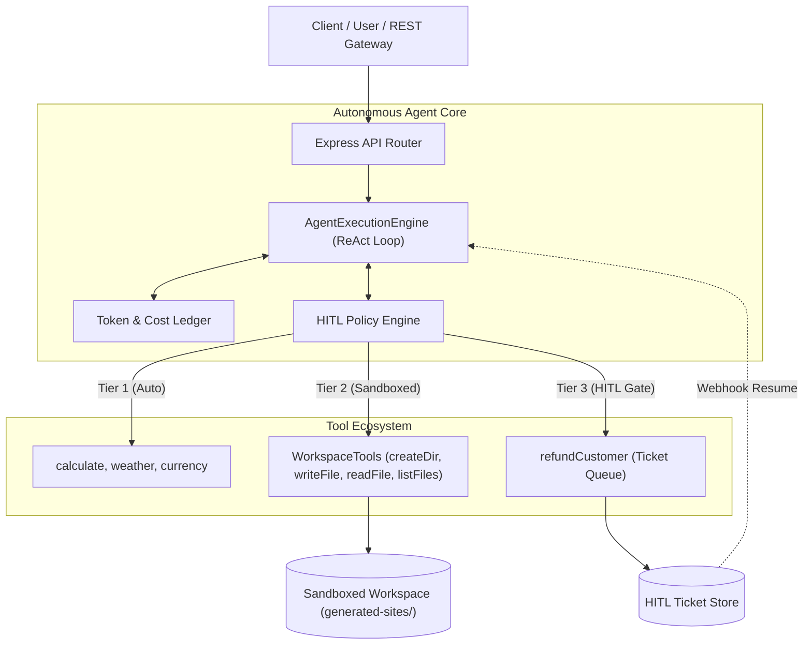

# Lecture 05: Autonomous AI Agents & Tool Calling Framework

Welcome to the production TypeScript reference implementation for **Lecture 05: AI Agents — Tools, Autonomous Loops & Building an Agent (From LLMs to Tools to Agents)**.

This repository provides an enterprise Forward Deployed Engineer (FDE) grade agentic microservice showcasing native tool contracts, closed-loop ReAct execution, sandboxed filesystem mutation, and Human-in-the-Loop (HITL) governance.

---

## 🧱 Architectural Topology



---

## 🚀 Key Features

1. **Protocol-Level Function Calling:**
   - Implements strict JSON Schema definitions via Zod.
   - Resilient parameter parsing to guard against model-emitted string syntax errors.
2. **Multi-Tool Autonomous Chaining:**
   - Sequential dependency chains (e.g., Currency Conversion $\to$ Division Calculation).
   - Parallel concurrent tool dispatches (e.g., Weather query + Currency lookup via `Promise.all()`).
3. **Sandboxed Workspace Execution (`WorkspaceTools`):**
   - Safe path resolution preventing directory traversal (`../../etc/passwd`) and symlink escapes (`fs.realpath`).
   - Atomic file operations (`createDirectory`, `writeFile`, `readFile`, `listFiles`).
   - Closed-loop observation: reading files back to verify DOM links and repair syntax defects.
4. **Human-in-the-Loop (HITL) Governance:**
   - 3-tier classification: Informative (Tier 1), Scoped Mutate (Tier 2), Critical Action (Tier 3).
   - Asynchronous pause/resume state machine for high-value financial refunds.
5. **Deterministic Offline Mode:**
   - Built-in simulation fallback allowing complete test suite execution without external paid API keys.

---

## 📁 Repository Directory Structure

```text
Lecture 05/code/
├── src/
│   ├── config/
│   │   └── env.ts                      # Zod-validated environment config
│   ├── types/
│   │   ├── tool.types.ts               # Tool contracts, tiers, and wire definitions
│   │   ├── agent.types.ts              # Agent traces, results, and loop configurations
│   │   └── hitl.types.ts               # Approval tickets and webhook payloads
│   ├── tools/
│   │   ├── calculator.tool.ts          # Safe deterministic calculator (add, sub, mul, div, pow, mod)
│   │   ├── weather.tool.ts             # Live atmospheric telemetry provider
│   │   ├── currency.tool.ts            # ISO 4217 fiat currency exchange converter
│   │   ├── workspace.tools.ts          # Sandboxed filesystem actuator & observer
│   │   ├── refund.tool.ts              # High-value transaction tool with approval trigger
│   │   └── registry.ts                 # Centralized tool repository & wire aggregator
│   ├── engine/
│   │   ├── agent-engine.ts             # The Autonomous ReAct Loop Engine
│   │   └── token-ledger.ts             # Token accumulation & economic cost ledger
│   ├── prompts/
│   │   ├── website-builder.prompt.ts   # System prompt with strict Action Mandate
│   │   └── general-agent.prompt.ts     # General multi-tool conversational persona
│   ├── services/
│   │   ├── website-builder.service.ts  # Autonomous static site generation orchestrator
│   │   └── hitl-approval.service.ts    # Durable ticket queue & resolution manager
│   ├── routes/
│   │   ├── chat.routes.ts              # POST /api/chat
│   │   ├── website.routes.ts           # POST /api/generate-site
│   │   └── hitl.routes.ts              # GET /api/approvals & POST /api/agent/resume
│   ├── scripts/
│   │   ├── cli-multitool-agent.ts      # Multi-tool chaining CLI demo
│   │   ├── cli-website-agent.ts        # Website Builder Agent CLI demo
│   │   └── test-hitl-flow.ts           # Human-in-the-Loop automated test
│   ├── app.ts                          # Express server setup & static file mounts
│   └── server.ts                       # Server bootstrap & process lifecycle
├── package.json
├── tsconfig.json
├── .env.example
├── .gitignore
└── test-requests.http                  # HTTP test collection
```

---

## ⚡ Quickstart & Setup

### 1. Install Dependencies
```bash
npm install
```

### 2. Configure Environment Variables
```bash
cp .env.example .env
```
*(Optional: Provide a valid `OPENAI_API_KEY`. If left default, the service seamlessly falls back to the deterministic ReAct simulator mode).*

### 3. Build & Typecheck
```bash
npm run build
```

### 4. Start the Development Server
```bash
npm run dev
```

The service will start on `http://localhost:8080`.

---

## 🧪 Running Demonstration Scripts

### A. Run Multi-Tool Chaining Demo
```bash
npm run agent:multitool
```
*Tests sequential dependency chains (USD to INR conversion followed by division among 6 people) and parallel multi-tool dispatch (Delhi weather + USD conversion).*

### B. Run Website Builder Agent Demo
```bash
npm run agent:website
```
*Runs the closed-loop agent to generate the BrewLab coffee shop landing page inside `generated-sites/brewlab/`, complete with `index.html`, `style.css`, and `script.js`.*

### C. Run Human-in-the-Loop Governance Test
```bash
npm run test:hitl
```
*Tests issuing a ₹50,000 refund request, intercepting execution with an approval gate, reviewing the pending ticket, and resuming execution upon managerial approval.*

---

## 📡 API Endpoints Summary

| Method | Endpoint | Description |
| :--- | :--- | :--- |
| `GET` | `/health` | Service health check and active configuration |
| `POST` | `/api/chat` | Conversational multi-tool routing endpoint |
| `POST` | `/api/generate-site` | Autonomous Website Builder agent endpoint |
| `GET` | `/api/approvals` | List pending Human-in-the-Loop tickets |
| `POST` | `/api/agent/resume` | Webhook to approve/reject a ticket and resume the agent |
| `GET` | `/sites/<site>/index.html` | Statically serves generated websites for live browser viewing |
