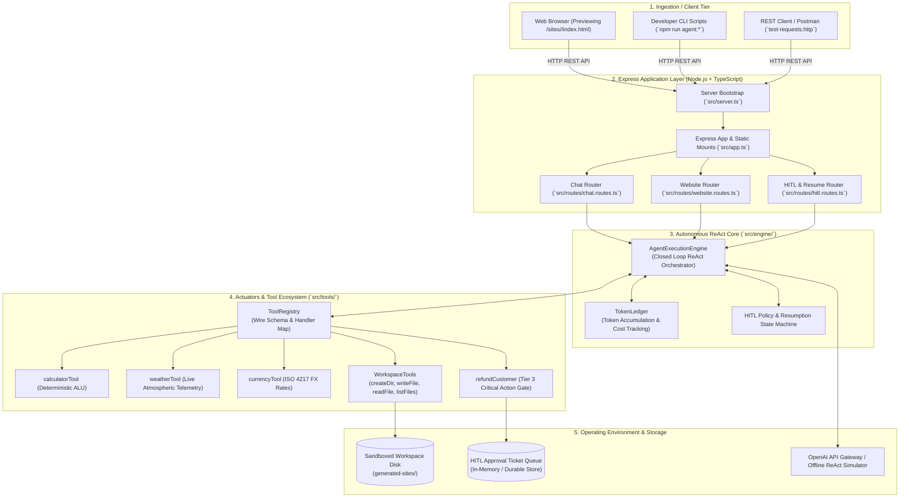

# Chapter 00: System Overview, Architectural Blueprint & File Structure

> **Chapter Goal:** Establish the architectural foundation of the Enterprise Autonomous AI Agent microservice, map the system topology, understand the design patterns applied across the codebase, and provide a comprehensive directory tree breakdown.

---

## 0.1 Architectural Overview

The **Enterprise Autonomous AI Agent Microservice** is a production-grade backend service built with **Node.js, Express, and TypeScript**. It operationalizes the core concepts from **Lecture 05: AI Agents — Tools, Autonomous Loops & Building an Agent (From LLMs to Tools to Agents)**, demonstrating how enterprise software transforms a stateless, probabilistic foundation model into an active, goal-directed autonomous agent.



---

## 0.2 Design Patterns Applied

1. **ReAct (Reasoning + Acting) Cognitive Loop:**  
   The engine implements an alternating cycle: the model generates reasoning thoughts and emits structured tool requests, the local runtime executes the tools on the host environment, and tool outputs are serialized as observations back into the context window for subsequent planning.
2. **Command-Query Separation (CQS) for Tools:**  
   Tools are explicitly classified into **Informative Tools** (read-only telemetry, safe to execute autonomously) and **Action Tools** (mutating external state, requiring sandboxing or human approval).
3. **Defense-in-Depth Sandboxing & Principle of Least Privilege:**  
   File manipulation is anchored strictly inside a designated project root directory (`generated-sites/`). The `safePath()` resolver verifies lexical boundaries and resolves symlinks via `fs.realpath` to prevent path traversal and symlink escapes.
4. **Human-in-the-Loop (HITL) Durable State Machine:**  
   High-value mutations (e.g., refunds exceeding ₹5,000) are intercepted before execution. The agent saves its execution state, creates a pending approval ticket, and resumes seamlessly upon receiving an authorized webhook callback.
5. **Circuit Breakers & Self-Healing Feedback:**  
   The autonomous loop is bounded by recursion limits (`maxSteps`) and timeout budgets (`AbortSignal`). When a tool throws a runtime exception, the engine catches it and feeds the error message back to the LLM as an observation, enabling the model to self-correct its parameters.

---

## 0.3 Directory Tree Breakdown

```text
Lecture 05/code/
├── package.json                        # Project metadata, dependencies, and execution scripts
├── tsconfig.json                       # TypeScript compiler options (ES2022, NodeNext modules)
├── .env.example                        # Blueprint for environment variables
├── .env                                # Local environment configuration (API keys, ports)
├── .gitignore                          # Excludes node_modules, dist, and generated sites
├── README.md                           # Quickstart guide and architectural documentation
├── test-requests.http                  # Complete VS Code REST Client test collection
├── generated-sites/                    # Sandboxed directory where the agent creates web assets
│   └── brewlab/
│       ├── index.html                  # Autonomously created HTML5 markup
│       ├── style.css                   # Autonomously created modern CSS stylesheet
│       └── script.js                   # Autonomously created interactive client JavaScript
├── src/
│   ├── app.ts                          # Express application factory, static mounts, and middleware
│   ├── server.ts                       # Server bootstrap, port listener, and graceful shutdown
│   ├── config/
│   │   └── env.ts                      # Boot-time environment validation using Zod
│   ├── types/
│   │   ├── tool.types.ts               # Tool contracts, parameter schemas, and tier definitions
│   │   ├── agent.types.ts              # Agent execution results, step traces, and configuration
│   │   └── hitl.types.ts               # Approval ticket interfaces and resume payloads
│   ├── engine/
│   │   ├── agent-engine.ts             # The Master Autonomous ReAct Loop Engine
│   │   └── token-ledger.ts             # Token accumulation and economic cost estimator
│   ├── tools/
│   │   ├── calculator.tool.ts          # Deterministic arithmetic compute tool
│   │   ├── weather.tool.ts             # Live atmospheric telemetry provider tool
│   │   ├── currency.tool.ts            # ISO 4217 fiat currency exchange conversion tool
│   │   ├── workspace.tools.ts          # Sandboxed filesystem actuator (createDir, write, read, list)
│   │   ├── refund.tool.ts              # High-value financial mutation tool with approval gate
│   │   └── registry.ts                 # Central tool registry and OpenAI wire schema aggregator
│   ├── prompts/
│   │   ├── website-builder.prompt.ts   # System prompt with the 12-point contract & Action Mandate
│   │   └── general-agent.prompt.ts     # Multi-tool conversational assistant prompt
│   ├── services/
│   │   ├── website-builder.service.ts  # Domain service orchestrating autonomous site builds
│   │   └── hitl-approval.service.ts    # In-memory ticket queue and approval resolution manager
│   ├── routes/
│   │   ├── chat.routes.ts              # POST /api/chat: Multi-tool conversational endpoint
│   │   ├── website.routes.ts           # POST /api/generate-site: Autonomous site generator
│   │   └── hitl.routes.ts              # GET /api/approvals & POST /api/agent/resume
│   └── scripts/
│       ├── cli-multitool-agent.ts      # CLI demo for sequential & parallel tool chaining
│       ├── cli-website-agent.ts        # CLI demo for autonomous website generation
│       └── test-hitl-flow.ts           # Automated test script for pause/resume approval gates
└── implementations guide/              # Chapter-by-chapter pedagogical implementation manual
```

---

## 0.4 Prerequisites & Development Commands

### Prerequisites
- **Node.js:** v18.0.0 or higher (v24+ recommended)
- **npm:** v9.0.0 or higher
- **OpenAI API Key (Optional):** If not provided, the service runs in deterministic offline simulator mode.

### Standard Lifecycle Commands
```bash
# 1. Install dependencies
npm install

# 2. Build TypeScript project
npm run build

# 3. Start development server with live reload
npm run dev

# 4. Start production server
npm start

# 5. Run Multi-Tool Chaining CLI demo
npm run agent:multitool

# 6. Run Website Builder Agent CLI demo
npm run agent:website

# 7. Run Human-in-the-Loop Governance test
npm run test:hitl
```
