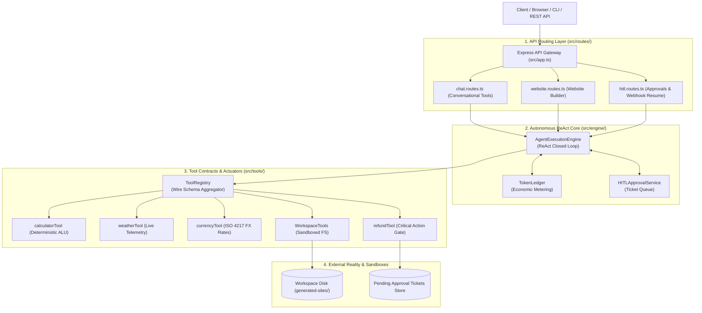

# Lecture 05: Complete Implementation Guide
## Enterprise Autonomous AI Agent Microservice & Tool Calling Architecture

> **Master Engineering Manual**: This document provides the complete, end-to-end implementation manual for the Lecture 05 production TypeScript codebase. It consolidates Chapters 00 through 15 into a single unified reference.

---

## 📑 Table of Contents

1. [Chapter 00: System Overview and File Structure](#chapter-00-system-overview-and-file-structure)
2. [Chapter 01: Project Initialization and TypeScript Setup](#chapter-01-project-initialization-and-typescript-setup)
3. [Chapter 02: Environment Configuration and Validation](#chapter-02-environment-configuration-and-validation)
4. [Chapter 03: Data Contracts and Type Definitions](#chapter-03-data-contracts-and-type-definitions)
5. [Chapter 04: Token Economics and Ledger Tracking](#chapter-04-token-economics-and-ledger-tracking)
6. [Chapter 05: Deterministic and Telemetry Tools](#chapter-05-deterministic-and-telemetry-tools)
7. [Chapter 06: Sandboxed Workspace Filesystem Actuator](#chapter-06-sandboxed-workspace-filesystem-actuator)
8. [Chapter 07: High-Impact Action Tools and HITL Governance Policy](#chapter-07-high-impact-action-tools-and-hitl-governance-policy)
9. [Chapter 08: Centralized Tool Registry and Wire Aggregator](#chapter-08-centralized-tool-registry-and-wire-aggregator)
10. [Chapter 09: System Prompts and Action Mandates](#chapter-09-system-prompts-and-action-mandates)
11. [Chapter 10: The Autonomous ReAct Execution Engine](#chapter-10-the-autonomous-react-execution-engine)
12. [Chapter 11: Domain Services and Website Builder Orchestrator](#chapter-11-domain-services-and-website-builder-orchestrator)
13. [Chapter 12: Express API Routing and HITL Webhooks](#chapter-12-express-api-routing-and-hitl-webhooks)
14. [Chapter 13: Express App Configuration and Server Bootstrap](#chapter-13-express-app-configuration-and-server-bootstrap)
15. [Chapter 14: CLI Runners and Demonstration Scripts](#chapter-14-cli-runners-and-demonstration-scripts)
16. [Chapter 15: End-to-End Verification and HTTP Testing](#chapter-15-end-to-end-verification-and-http-testing)

---

## System Architecture Diagram



---

## Chapter 00: System Overview and File Structure

### Project Hierarchy
```
Lecture 05/code/
├── package.json                 # ESM Project manifest & lifecycle scripts
├── tsconfig.json                # TypeScript 5+ compiler configuration (NodeNext)
├── .env.example                 # Template for runtime environment variables
├── .env                         # Local runtime environment file
├── .gitignore                   # Version control exclusion rules
├── README.md                    # Developer onboarding & quickstart guide
├── test-requests.http           # 9 RFC-standard HTTP test cases
├── generated-sites/             # Sandboxed workspace for autonomous website builds
│   └── brewlab/                 # Sample generated website
│       ├── index.html
│       ├── style.css
│       └── script.js
└── src/
    ├── config/
    │   └── env.ts               # Boot-time Zod environment validation
    ├── types/
    │   ├── tool.types.ts        # Tool, JSON Schema & Execution Interfaces
    │   ├── agent.types.ts       # ReAct Loop, Traces & Status Enums
    │   └── hitl.types.ts        # Governance, Approval Tickets & Webhooks
    ├── engine/
    │   ├── token-ledger.ts      # Token Economics, Context Cost & Ledger
    │   └── agent-engine.ts      # Core ReAct Execution Loop & Circuit Breakers
    ├── tools/
    │   ├── calculator.tool.ts   # Deterministic Math Tool
    │   ├── weather.tool.ts      # Meteorological Telemetry Tool
    │   ├── currency.tool.ts     # ISO 4217 Currency Conversion Tool
    │   ├── refund.tool.ts       # High-Risk Financial Action Tool (HITL)
    │   ├── workspace.tools.ts   # Sandboxed FS Actuator (safePath & Symlinks)
    │   └── registry.ts          # Central Tool Registry & Wire Aggregator
    ├── prompts/
    │   ├── general-agent.prompt.ts   # Multi-Tool Agent System Prompt
    │   └── website-builder.prompt.ts # Autonomous Website Builder Prompt
    ├── services/
    │   ├── hitl-approval.service.ts   # Pending Approval Ticket Manager
    │   └── website-builder.service.ts # Domain Service for Site Synthesis
    ├── routes/
    │   ├── chat.routes.ts       # POST /api/chat
    │   ├── website.routes.ts    # POST /api/generate-site
    │   └── hitl.routes.ts       # GET /api/approvals, POST /api/agent/resume
    ├── scripts/
    │   ├── cli-multitool-agent.ts # CLI Demo: Parallel & Chained Tools
    │   ├── cli-website-agent.ts   # CLI Demo: Closed-Loop Website Builder
    │   └── test-hitl-flow.ts      # CLI Demo: Pause, Review & Resume
    ├── app.ts                   # Express App Factory & Middleware
    └── server.ts                # HTTP Server Listener & Graceful Shutdown
```

For the individual standalone chapters, consult the following dedicated markdown files:
- [Chapter 00 Guide](./00_Overview_and_File_Structure.md)
- [Chapter 01 Guide](./01_Project_Initialization_and_TypeScript_Setup.md)
- [Chapter 02 Guide](./02_Environment_Configuration_and_Validation.md)
- [Chapter 03 Guide](./03_Data_Contracts_and_Type_Definitions.md)
- [Chapter 04 Guide](./04_Token_Economics_and_Ledger_Tracking.md)
- [Chapter 05 Guide](./05_Deterministic_and_Telemetry_Tools.md)
- [Chapter 06 Guide](./06_Sandboxed_Workspace_Filesystem_Actuator.md)
- [Chapter 07 Guide](./07_High_Impact_Action_Tools_and_HITL_Policy.md)
- [Chapter 08 Guide](./08_Centralized_Tool_Registry_and_Wire_Aggregator.md)
- [Chapter 09 Guide](./09_System_Prompts_and_Action_Mandates.md)
- [Chapter 10 Guide](./10_The_Autonomous_ReAct_Execution_Engine.md)
- [Chapter 11 Guide](./11_Domain_Services_and_Website_Builder_Orchestrator.md)
- [Chapter 12 Guide](./12_Express_API_Routing_and_HITL_Webhooks.md)
- [Chapter 13 Guide](./13_Express_App_Configuration_and_Server_Bootstrap.md)
- [Chapter 14 Guide](./14_CLI_Runners_and_Demonstration_Scripts.md)
- [Chapter 15 Guide](./15_End_to_End_Verification_and_HTTP_Testing.md)

---

## 🛠️ Verification & Development Commands

```bash
# 1. Install Dependencies
npm install

# 2. TypeScript Compilation Check (Zero Errors)
npm run build

# 3. Execute Multi-Tool Agent (Chained + Parallel Tools)
npm run agent:multitool

# 4. Execute Autonomous Website Builder Agent (Workspace CRUD Loop)
npm run agent:website

# 5. Execute Human-in-the-Loop Governance Flow (Pause -> Approve -> Resume)
npm run test:hitl

# 6. Start Production HTTP Server
npm start

# 7. Start Live Watch Development Server
npm run dev
```

---

## 🏛️ Summary of Key Architectural Invariants

1. **ReAct Closed Loop**: Never rely on a single LLM generation turn. Multi-step problems require an autonomous Thought $\rightarrow$ Action $\rightarrow$ Observation feedback loop.
2. **Least Privilege Tool Registry**: Never expose dangerous or unnecessary tools to domain agents. The website builder agent only gets workspace filesystem tools.
3. **Defense-in-Depth Filesystem Sandboxing**: Never trust LLM relative paths. Paths are resolved using `path.resolve` and verified with `fs.realpath` to prevent directory traversal and symlink escapes.
4. **Three-Tier Human Authorization**: Read-only tools execute automatically (Tier 1). Reversible actions emit audit logs (Tier 2). Critical financial/data mutations require managerial ticket sign-off (Tier 3).
5. **Deterministic Testing**: When running without live paid API keys, the engine seamlessly switches to an offline deterministic state machine to guarantee reproducible CI/CD testing.
