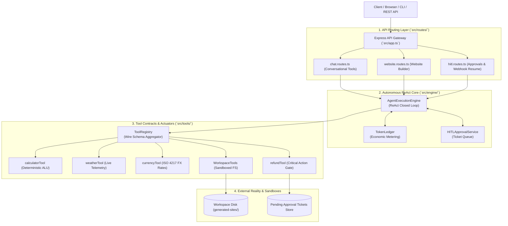

# Implementation Guide: Autonomous AI Agent Microservice

Welcome to the comprehensive, chapter-by-chapter **Implementation Guide** for the **Lecture 05: Autonomous AI Agent Microservice**.

This guide is designed as an architectural manual and pedagogical walkthrough for engineers building production-grade agentic systems. Every chapter covers a discrete architectural layer, includes the **complete production code file**, and dissects the code **block-by-block** to explain what each segment does and how it functions under the hood.

---

## 🧭 System Topology & Architecture

---

## 📚 Chapter Navigation Index

| Chapter | Title | Focus & Files Covered |
| :---: | :--- | :--- |
| **[Chapter 00](./00_Overview_and_File_Structure.md)** | **System Overview & Blueprint** | Architectural blueprint, system topology, folder hierarchy, and development commands. |
| **[Chapter 01](./01_Project_Initialization_and_TypeScript_Setup.md)** | **Project Initialization & Tooling** | `package.json`, `tsconfig.json`, `.gitignore`, dependencies analysis, and TypeScript configuration. |
| **[Chapter 02](./02_Environment_Configuration_and_Validation.md)** | **Environment Configuration & Validation** | `.env.example`, `.env`, and `src/config/env.ts` (boot-time Zod validation and live/mock detection). |
| **[Chapter 03](./03_Data_Contracts_and_Type_Definitions.md)** | **Data Contracts & Type Definitions** | `src/types/tool.types.ts`, `src/types/agent.types.ts`, and `src/types/hitl.types.ts`. |
| **[Chapter 04](./04_Token_Economics_and_Ledger_Tracking.md)** | **Token Economics & Metering** | `src/engine/token-ledger.ts` (quadratic cost tracking, token budgeting, and cost metrics). |
| **[Chapter 05](./05_Deterministic_and_Telemetry_Tools.md)** | **Deterministic & Telemetry Tools** | `src/tools/calculator.tool.ts`, `src/tools/weather.tool.ts`, and `src/tools/currency.tool.ts`. |
| **[Chapter 06](./06_Sandboxed_Workspace_Filesystem_Actuator.md)** | **Sandboxed Workspace Actuator** | `src/tools/workspace.tools.ts` (`safePath`, path traversal mitigation, symlink resolution, CRUD file ops). |
| **[Chapter 07](./07_High_Impact_Action_Tools_and_HITL_Policy.md)** | **Action Tools & HITL Governance** | `src/tools/refund.tool.ts` and `src/services/hitl-approval.service.ts` (managerial approval gates). |
| **[Chapter 08](./08_Centralized_Tool_Registry_and_Wire_Aggregator.md)** | **Tool Registry & Wire Aggregator** | `src/tools/registry.ts` (tool metadata registration and OpenAI ChatCompletionTool JSON Schema mapping). |
| **[Chapter 09](./09_System_Prompts_and_Action_Mandates.md)** | **System Prompts & Action Mandates** | `src/prompts/website-builder.prompt.ts` and `src/prompts/general-agent.prompt.ts`. |
| **[Chapter 10](./10_The_Autonomous_ReAct_Execution_Engine.md)** | **The Autonomous ReAct Engine** | `src/engine/agent-engine.ts` (while-loop orchestrator, circuit breakers, parallel tool dispatch, error feedback, pause/resume). |
| **[Chapter 11](./11_Domain_Services_and_Website_Builder_Orchestrator.md)** | **Website Builder Domain Service** | `src/services/website-builder.service.ts` (high-level orchestration of autonomous site builds). |
| **[Chapter 12](./12_Express_API_Routing_and_HITL_Webhooks.md)** | **API Routing & Webhooks** | `src/routes/chat.routes.ts`, `src/routes/website.routes.ts`, and `src/routes/hitl.routes.ts`. |
| **[Chapter 13](./13_Express_App_Configuration_and_Server_Bootstrap.md)** | **App Configuration & Bootstrap** | `src/app.ts` (Express server setup, static site mounts) and `src/server.ts` (process lifecycle). |
| **[Chapter 14](./14_CLI_Runners_and_Demonstration_Scripts.md)** | **CLI Runners & Test Scripts** | `src/scripts/cli-multitool-agent.ts`, `src/scripts/cli-website-agent.ts`, and `src/scripts/test-hitl-flow.ts`. |
| **[Chapter 15](./15_End_to_End_Verification_and_HTTP_Testing.md)** | **End-to-End Verification & HTTP Testing** | `test-requests.http`, curl commands, manual testing guide, and verification checklist. |
| **[Consolidated](./Complete_Implementation_Guide.md)** | **Master Consolidated Guide** | Single consolidated reference containing all chapters merged end-to-end. |
