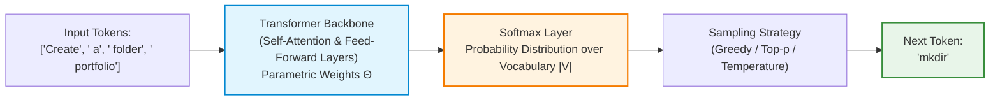
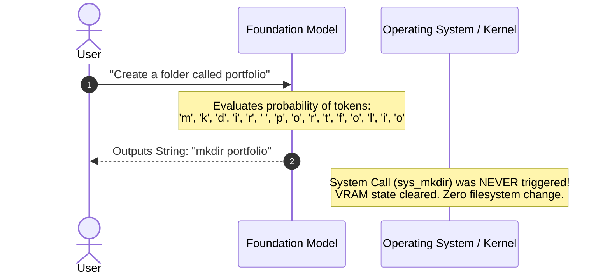
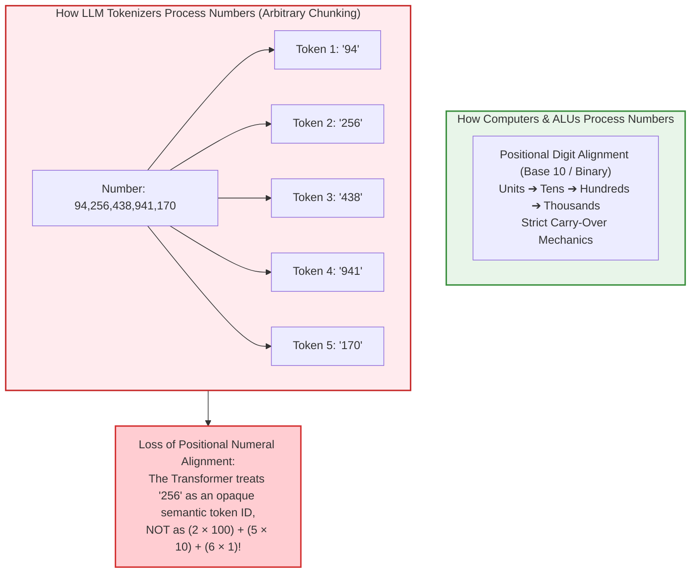
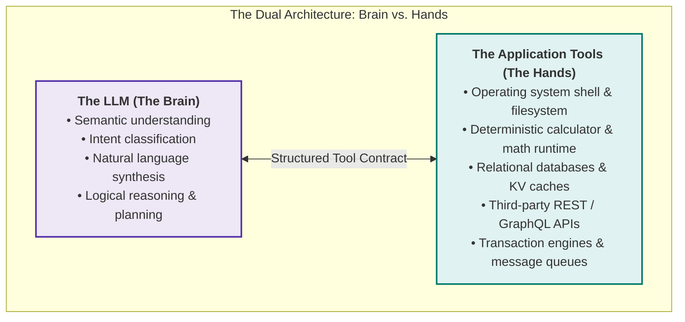
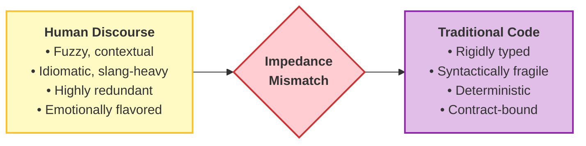
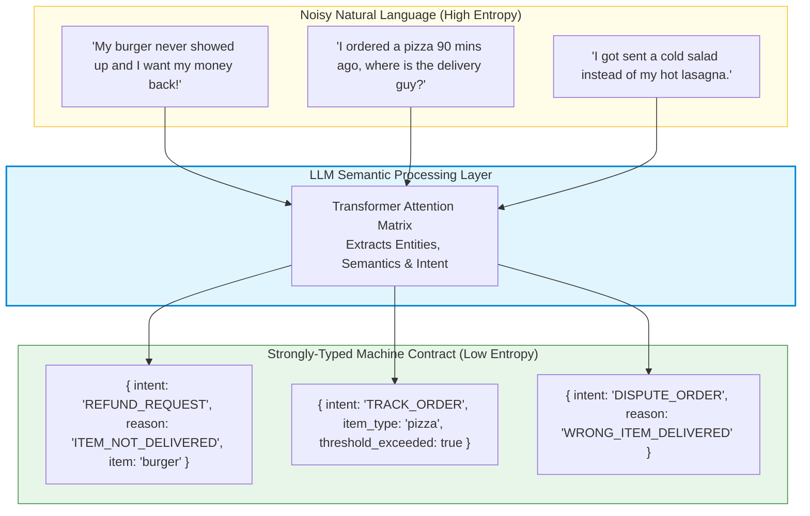
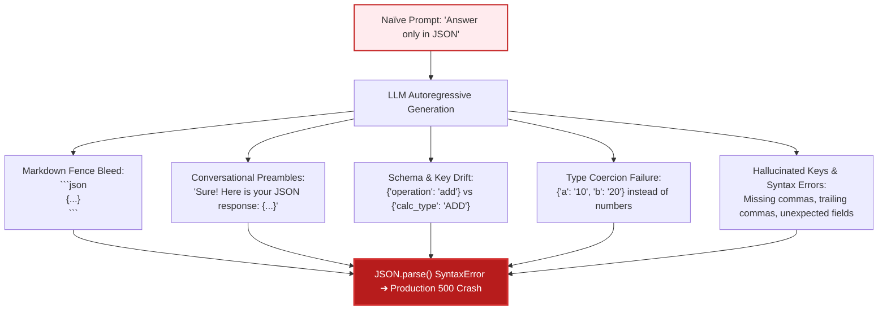

# Chapter 01: From Token Prediction to Tool Augmentation

> **Chapter Goal:** Unpack the fundamental physical and mathematical limitation of Large Language Models—autoregressive token prediction—and contrast generating text representations with executing physical actions. Dissect the BPE tokenization arithmetic defect that causes foundation models to hallucinate calculations, establish the "Brain vs. Hands" architectural duality, explore the linguistic impedance mismatch between human ambiguity and deterministic code, understand LLMs as universal semantic decoders, and analyze why naïve "Return JSON" prompting catastrophically crashes production backends.

---

## 1.1 What Is an LLM Actually Built to Do?

Modern public discourse frequently anthropomorphizes Large Language Models, describing them as "reasoning entities," "digital brains," or "autonomous agents." However, from an engineering and computational standpoint, a foundation model performs exactly one core mathematical task:

$$\text{Given an input sequence of tokens } (w_1, w_2, \dots, w_{t-1}), \text{ compute a probability distribution over the vocabulary } V \text{ and sample the next token } w_t:$$

$$P(w_t \mid w_1, w_2, \dots, w_{t-1}; \Theta)$$



This autoregressive generation loop repeats token by token until an end-of-sequence token (`<|endoftext|>`, `<|im_end|>`) is sampled or a predefined token budget is reached.

### The Critical Gulf: Text Generation vs. Environmental Action

Suppose a developer or end user issues the following instruction to an LLM:

```text
User: "Create a directory called portfolio and write an index.html inside it."
```

The model evaluates token transition probabilities and outputs the following character sequence:

```bash
mkdir portfolio
touch portfolio/index.html
```



**The Core Engineering Truth:**
- The LLM **generated characters representing an action**.
- The LLM did **not perform the action**.
- Generating the text string `mkdir portfolio` emits photons on a user's monitor; it does not issue an interrupt to the Linux kernel (`sys_mkdir`) or allocate an inode on the file system.

An isolated LLM is fundamentally trapped in a purely semantic universe. It can describe reality, predict descriptions of actions, and explain algorithms, but it cannot alter bits on a disk, trigger an HTTP request, or query a live database.

---

## 1.2 The BPE Tokenization Arithmetic Defect: Why LLMs Fail at Math

A common question among backend engineers is: *"Why do we need to give an LLM a calculator tool for simple arithmetic? Shouldn't a model with 70 billion parameters be able to multiply two numbers?"*

The root cause lies in the **Byte-Pair Encoding (BPE) Tokenization Architecture** used by virtually all modern foundation models.



### Why Subword Tokenizers Break Mathematical Reasoning

1. **Inconsistent Chunking:** Depending on frequency statistics in the training corpus, the number `94256438941170` might be tokenized as `["94", "256", "438", "941", "170"]`. Another number of identical length might be chunked as `["9", "42", "56", "43", "89", "41", "170"]`.
2. **Lack of Digit-Level Alignment:** In traditional elementary school arithmetic, multiplication requires aligning digits by place value from right to left and carrying digits over to the next column. When numbers are chunked into arbitrary multi-digit tokens, the self-attention mechanism cannot maintain exact column alignment across layers.
3. **Probabilistic Approximation vs. Deterministic Arithmetic:** A Transformer outputs the token that is *most statistically probable* given its training corpus. For common calculations like `2 + 2 = 4` or `12 × 12 = 144`, memorized frequency weights yield correct answers. But for unmemorized large numbers like `78965 × 34576`, the model simply hallucinates a number with the plausible *shape and length* of a product:
   $$78965 \times 34576 = 2,730,333,840 \quad (\text{Exact Result})$$
   $$\text{LLM Output} \approx 2,732,154,890 \quad (\text{Plausible-sounding Hallucination})$$

**The Architectural Moral:**
> Never force an LLM to act as an Arithmetic Logic Unit (ALU). Connect the LLM to a **deterministic calculator tool** and let the model delegate computation to the CPU.

---

## 1.3 The "Brain Without Hands" Mental Model

To design effective AI architectures, engineers must adopt a rigorous separation of concerns between **cognitive processing** and **peripheral actuation**.

### The Genius Locked in a Room Analogy

Imagine a human genius with an eidetic memory of the world's literature, science, and mathematics, locked inside a windowless, soundproof room.
- They have vast analytical reasoning capability.
- They possess mastery over dozens of human and programming languages.
- **However, they have no physical hands, no eyes to the outside world, and no peripheral tools.**

If you slip a handwritten note under the door:
```text
"The room is 40°C. Please turn on the air conditioner."
```

The genius understands the physical discomfort, knows the thermodynamics of heat pumps, and can write a note back:
```text
"Reach over to the wall unit and press the blue power button on the remote."
```

Regardless of how brilliant their advice is, **they cannot physically press the power button.** Without an external actuator, the air conditioner remains off, and the room remains hot.



### What a Raw LLM Lacks Out of the Box

A raw foundation model operates under strict operational boundaries:
1. **No Environmental Mutability:** Cannot write files, modify system memory, or execute system binaries.
2. **No Real-Time Temporal Grounding:** Its parametric weights are frozen at the training cutoff. It cannot inspect today's stock price, the current weather in Delhi, or server uptime.
3. **No Exact Arithmetic Compute:** While models approximate arithmetic via pattern matching, they do not possess an internal ALU. They will hallucinate calculations on large numbers.
4. **No Authenticated Access:** Cannot reach private internal corporate APIs, Jira tickets, Slack channels, or production customer databases.

To transform an LLM from a passive conversationalist into an active operational engine, the surrounding software application must supply the **Hands** (Tools) and manage the interaction.

---

## 1.4 The Linguistic Impedance Mismatch

Why do we need an LLM to control software tools in the first place? Why not simply write traditional programs?

Software systems and human communicators operate on diametrically opposed paradigms:



### The Brittleness of Classical String Matching

Consider a simple arithmetic function in TypeScript:

```typescript
function add(a: number, b: number): number {
  return a + b;
}
```

A compiler or JavaScript runtime executes `add(10, 20)` instantaneously and flawlessly. But consider the infinite combinatorial variety with which human beings express this exact instruction:

- *"Add 10 and 20."*
- *"What is ten plus twenty?"*
- *"Combine 10 with 20."*
- *"Could you tell me the sum of 10 and 20?"*
- *"I have 10 apples, and my friend gave me 20 more. How many do I have in total?"*
- *"I started the day with $10 in my wallet and earned $20 doing freelance work. How much do I have now?"*
- *"10 + 20"*

To handle this with traditional backend code, developers historically wrote regexes and heuristic parsers:

```typescript
// ❌ NAÏVE TRADITIONAL APPROACH: Fragile string parsing
function parseAddIntent(userInput: string): { a: number; b: number } | null {
  const lower = userInput.toLowerCase();
  
  // Attempt 1: check for 'add'
  if (lower.includes("add")) {
    const numbers = lower.match(/\d+/g);
    if (numbers && numbers.length >= 2) {
      return { a: parseInt(numbers[0], 10), b: parseInt(numbers[1], 10) };
    }
  }
  
  // Attempt 2: check for 'plus', 'sum', 'total'
  if (lower.includes("plus") || lower.includes("sum") || lower.includes("combine")) {
    // ... endless regex permutations ...
  }
  
  return null;
}
```

### Why Classical Parsing Inevitably Breaks

1. **Vocabulary Explosion:** Users substitute synonyms (`plus`, `increased by`, `tally`, `aggregate`, `together with`).
2. **Implied Semantics:** In the sentence *"I have ₹300 and received another ₹200"*, neither the word `add` nor `plus` appears anywhere in the text. The arithmetic addition is purely conceptual.
3. **Word-Order Inversion:** *"From my base of 20, increase it by 10"* reverses standard parameter positions.
4. **Noise & Conversational Filler:** *"Hey, hope you're having a good day! Quick question: what do 10 and 20 make?"* breaks fragile positional indexing.

Writing regexes or heuristic tokenizers to anticipate every permutations of human expression is an $O(\infty)$ losing battle.

---

## 1.5 LLMs as Universal Semantic Decoders

The most critical breakthrough of modern LLMs in backend engineering is not merely creative writing; it is **semantic decoding**:

> **Definition: Semantic Decoder**  
> An LLM possesses the unique capability to map high-entropy, noisy, unconstrained natural language into low-entropy, deterministic, machine-readable data structures.



### Case Study: Food Delivery Customer Support

In an enterprise food delivery application, the backend microservice expects structured JSON payloads sent to REST endpoints:

```typescript
// Strict backend interface
interface OrderActionPayload {
  intent: 'REFUND_REQUEST' | 'ORDER_STATUS' | 'MODIFY_ADDRESS';
  orderId?: string;
  reason?: 'ITEM_NOT_DELIVERED' | 'COLD_FOOD' | 'WRONG_ITEM';
  targetItem?: string;
}
```

Instead of requiring the end-user to navigate rigid dropdown menus or forcing developers to maintain thousands of regex patterns, the LLM functions as an **adaptive translation layer**:

$$\text{Messy Human Intent} \xrightarrow{\text{LLM Semantic Decoder}} \text{Strict Typed Contract} \xrightarrow{\text{Deterministic Execution}} \text{Backend Microservice}$$

This bridges the gap between non-deterministic human cognition and deterministic software architecture.

---

## 1.6 Why Prompting "Return JSON" Fails in Production

Once engineers realize that LLMs can extract structured semantics, the first naïve implementation strategy is almost always:

```text
System Prompt:
"You are a helpful assistant. Always answer only with valid JSON. Do not include any explanations."
```

In academic benchmarks or small demos, this occasionally works. In high-throughput production environments, **this approach fails unpredictably and catastrophically**.



### The 5 Classic Production Failures of "Return JSON" Prompting

#### 1. Conversational Preamble and Markdown Fences
Models trained with Reinforcement Learning from Human Feedback (RLHF) have strong conversational conversational priors. They want to be helpful and polite:

```text
Sure! Here is the JSON you requested:
```json
{
  "operation": "multiply",
  "a": 12,
  "b": 7
}
```
I hope this helps!
```

If your Node.js backend executes `JSON.parse(response)`, it throws:
```text
SyntaxError: Unexpected token 'S', "Sure! Here"... is not valid JSON
```

#### 2. Schema Drift and Field Inconsistency
A prompt asking for an arithmetic operation might return:
- Request 1: `{"operation": "add", "num1": 10, "num2": 20}`
- Request 2: `{"action": "ADDITION", "first": 10, "second": 20}`
- Request 3: `{"type": "+", "values": [10, 20]}`

Because there is no cryptographic or algorithmic constraint on token probability, the model frequently changes field names across turns.

#### 3. String Type Coercion
The backend function expects numbers: `a: number, b: number`. The prompt-based LLM output often yields:
```json
{
  "operation": "add",
  "a": "10",
  "b": "20"
}
```
If your JavaScript code does `a + b`, `"10" + "20"` results in the string `"1020"`, creating silent data corruption bugs.

#### 4. Trailing Commas and Syntax Malformations
Large language models frequently output trailing commas before closing braces:
```json
{
  "operation": "add",
  "a": 10,
  "b": 20,
}
```
Standard ECMAScript `JSON.parse()` strictly rejects trailing commas, terminating the API request with a 500 error.

#### 5. Lack of Native Sampling-Time Constraints
When prompting for JSON, the model's vocabulary distribution $P(w_t)$ is completely unconstrained. At any point in the generation, the model is mathematically free to sample natural language words, markdown tokens, or invalid escape sequences.

---

## 1.7 The Architectural Solution: Native Tool Calling Protocols

To achieve enterprise reliability, the AI engineering community moved away from raw prompt-based text instructions and established **Native Function / Tool Calling Protocols**:

| Dimension | Naïve "Return JSON" Prompting | Native Tool / Function Calling |
| :--- | :--- | :--- |
| **Contract Definition** | Loose English sentences inside prompt | Formal JSON Schema / OpenAPI schema specifications |
| **Enforcement Layer** | Best-effort prompt adherence | Constrained grammar sampling / fine-tuned API protocols |
| **Wire Payload** | Appears inside standard message text | Structured `tool_calls` object with designated function name & serialized arguments |
| **Type Guarantees** | Extremely low; requires brittle regex sanitization | Strongly typed; validates directly against Zod or JSON Schema |
| **Error Handling** | Application crashes on invalid syntax | Systematic protocol feedback loops allow model to self-correct |

---

## 1.8 Chapter Summary & Key Engineering Takeaways

- **Generating Tokens $\neq$ Performing Actions:** Foundation LLMs compute probability distributions over vocabulary strings. Emitting the text `mkdir portfolio` does not allocate disk blocks or trigger Linux kernel syscalls.
- **LLM = Brain, Tools = Hands:** Cognitive processing (understanding, planning, summarizing) belongs to the LLM. Environmental actuation (database queries, filesystem writes, calculations) belongs to deterministic software tools.
- **The BPE Tokenization Defect:** Byte-Pair Encoding chunks numbers into arbitrary character slices, stripping away positional numeral alignment. LLMs will always hallucinate large arithmetic unless delegated to a deterministic calculator.
- **Semantic Decoder Role:** An LLM's primary value in system engineering is bridging the impedance mismatch between high-entropy, ambiguous human language and low-entropy, typed backend APIs.
- **Why Prompted JSON Fails:** Prompts asking for JSON suffer from markdown fence bleed, conversational preambles, schema drift, and string coercion. Production systems must rely on native tool calling protocols governed by JSON Schema contracts.
