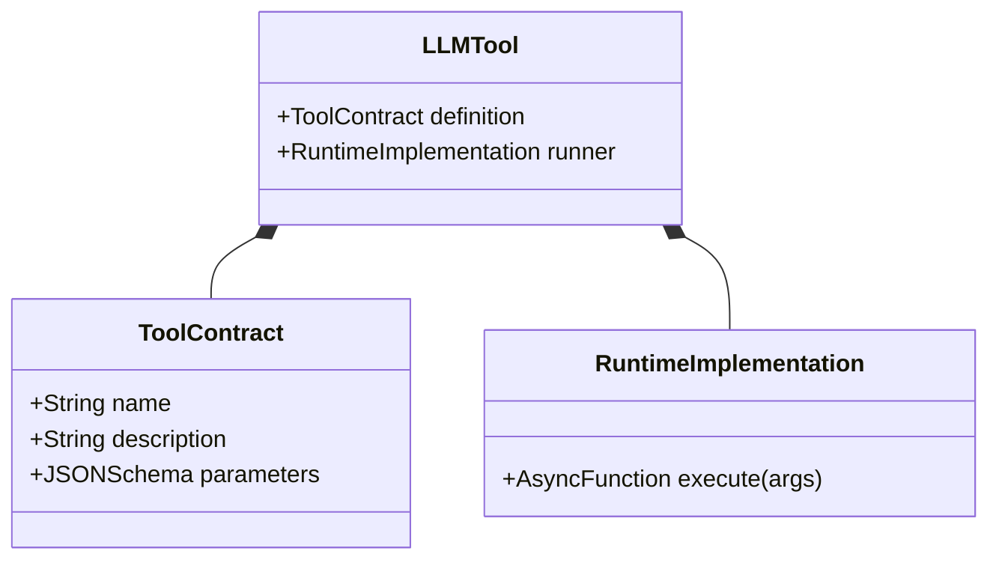
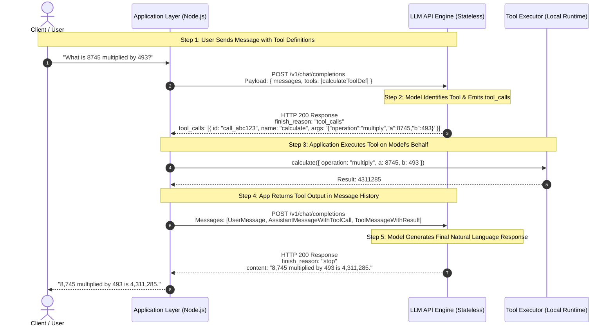
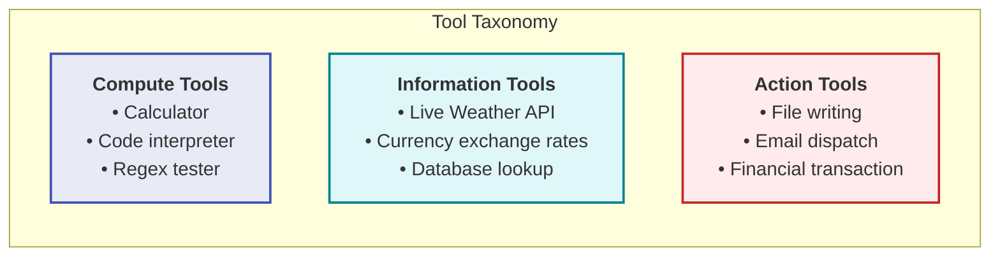
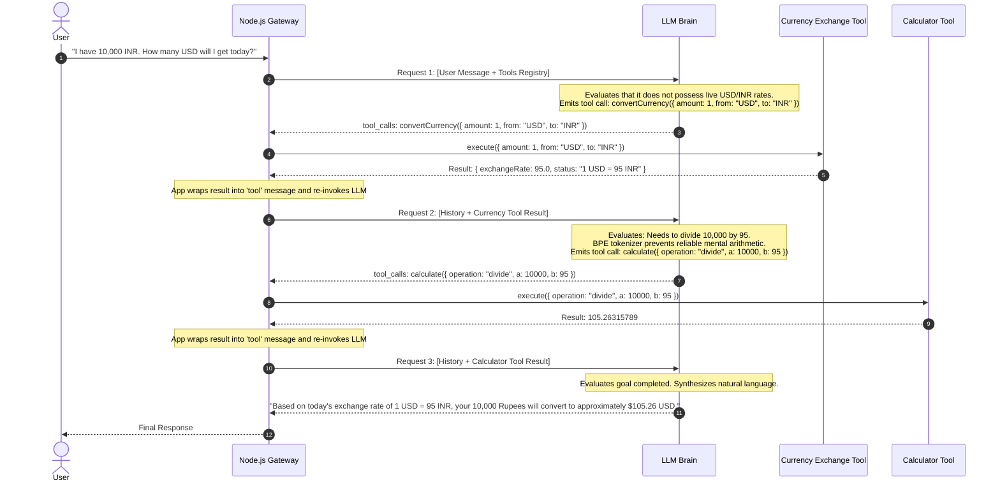
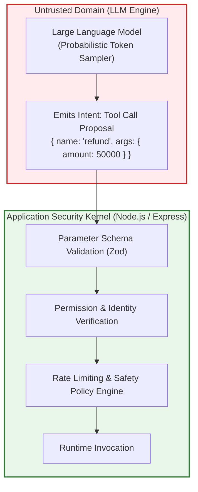

# Chapter 02: The Tool Calling Protocol & Wire Architecture

> **Chapter Goal:** Deconstruct what a tool truly is at the software layer, master the JSON Schema function contract specification, dissect the exact 5-step HTTP wire lifecycle of a tool call, implement deterministic and live information tools in TypeScript using Zod, understand `tool_choice` routing policies, and establish the boundary between LLM intent formulation and application execution.

---

## 2.1 Deconstructing Tools: Functions Wrapped in Contracts

Strip away AI marketing buzzwords, and the definition of a tool is straightforward:

> **Core Architectural Definition:**  
> A **Tool** is an ordinary, deterministic application function exposed to a Large Language Model through a formal, structured schema contract.

```typescript
// Ordinary TypeScript Function (Zero AI dependencies)
function multiply(a: number, b: number): number {
  return a * b;
}
```

By itself, this function is just a block of bytecode in the V8 engine. The LLM has no inherent awareness of its existence, arguments, or purpose.

To transform this function into an **LLM Tool**, the application must expose two distinct elements:
1. **The Behavioral Implementation:** The executable code executed by the host runtime (Node.js/TypeScript).
2. **The Tool Definition (The Contract):** A standardized JSON Schema describing the function's name, purpose, and parameter types to the model.



---

## 2.2 The Tool Definition as an OpenAPI / JSON Schema Contract

When an application invokes an LLM API (such as OpenAI, Anthropic, or Google Gemini), the model **never sees your underlying implementation**. It does not know if your code is written in TypeScript, Java, Rust, or Python.

Instead, the model receives an array of declarative definitions formatted according to the **JSON Schema specification**:

```json
{
  "type": "function",
  "function": {
    "name": "calculate",
    "description": "Performs exact deterministic mathematical calculations. Use this whenever arithmetic computation is required.",
    "parameters": {
      "type": "object",
      "properties": {
        "operation": {
          "type": "string",
          "enum": ["add", "subtract", "multiply", "divide", "power", "mod"],
          "description": "The arithmetic operation to perform."
        },
        "a": {
          "type": "number",
          "description": "The first operand."
        },
        "b": {
          "type": "number",
          "description": "The second operand."
        }
      },
      "required": ["operation", "a", "b"]
    }
  }
}
```

### The Three Critical Pillars of a Tool Contract

| Component | Semantic Role | Architectural Importance |
| :--- | :--- | :--- |
| **`name`** | Unique Identifier | Acts as the symbol the model will emit when requesting execution. Must be concise, descriptive, and follow naming standards (snake_case or camelCase). |
| **`description`** | Semantic Trigger & Usage Guide | **The most critical field for model reasoning.** The LLM matches user intent to the tool based on this description. Ambiguous descriptions cause hallucinations and misrouted tool selections. |
| **`parameters`** | Strict JSON Schema Specification | Dictates the exact object structure, property types, enums, and required fields. Constrains the model's token sampler during function call generation. |

---

## 2.3 The 5-Step HTTP Wire Protocol Lifecycle

Understanding tool calling requires tracing the raw HTTP payloads exchanged across the network. A common misconception among junior engineers is that the LLM reaches into the server and runs code. 

**The LLM does not execute anything.** The LLM simply returns an instruction payload requesting that *your application* execute the function.



### Wire Payload Deep-Dive: Turn-by-Turn Inspection

#### Wire Turn 1: Application to LLM (Step 1)
```json
{
  "model": "gpt-4o",
  "messages": [
    {
      "role": "user",
      "content": "What is 8745 multiplied by 493?"
    }
  ],
  "tools": [
    {
      "type": "function",
      "function": {
        "name": "calculate",
        "description": "Performs exact arithmetic calculations.",
        "parameters": {
          "type": "object",
          "properties": {
            "operation": { "type": "string", "enum": ["add", "subtract", "multiply", "divide"] },
            "a": { "type": "number" },
            "b": { "type": "number" }
          },
          "required": ["operation", "a", "b"]
        }
      }
    }
  ],
  "tool_choice": "auto"
}
```

#### Wire Turn 2: LLM to Application (Step 2)
The model stops text generation (`content: null`) and sets `finish_reason: "tool_calls"`:
```json
{
  "id": "chatcmpl-9xyz",
  "choices": [
    {
      "finish_reason": "tool_calls",
      "index": 0,
      "message": {
        "role": "assistant",
        "content": null,
        "tool_calls": [
          {
            "id": "call_8745_mul_493",
            "type": "function",
            "function": {
              "name": "calculate",
              "arguments": "{\"operation\":\"multiply\",\"a\":8745,\"b\":493}"
            }
          }
        ]
      }
    }
  ]
}
```

#### Wire Turn 3: Application to LLM with Tool Output (Step 4)
The application must append the assistant's previous tool call message **and** add a new message with `role: "tool"` matching the exact `tool_call_id`:
```json
{
  "model": "gpt-4o",
  "messages": [
    {
      "role": "user",
      "content": "What is 8745 multiplied by 493?"
    },
    {
      "role": "assistant",
      "content": null,
      "tool_calls": [
        {
          "id": "call_8745_mul_493",
          "type": "function",
          "function": {
            "name": "calculate",
            "arguments": "{\"operation\":\"multiply\",\"a\":8745,\"b\":493}"
          }
        }
      ]
    },
    {
      "role": "tool",
      "tool_call_id": "call_8745_mul_493",
      "content": "4311285"
    }
  ]
}
```

#### Wire Turn 4: LLM to Application (Step 5)
```json
{
  "choices": [
    {
      "finish_reason": "stop",
      "message": {
        "role": "assistant",
        "content": "8,745 multiplied by 493 is 4,311,285."
      }
    }
  ]
}
```

---

## 2.4 Production TypeScript Implementation: Safe Calculator Tool

Let us implement a type-safe tool management framework in TypeScript without bloated high-level abstractions:

```typescript
import { z } from 'zod';

// 1. Define Parameter Schema using Zod
export const CalculatorArgsSchema = z.object({
  operation: z.enum(['add', 'subtract', 'multiply', 'divide', 'power', 'mod']),
  a: z.number().describe('First operand'),
  b: z.number().describe('Second operand')
});

export type CalculatorArgs = z.infer<typeof CalculatorArgsSchema>;

// 2. Define Generic Tool Interface
export interface Tool<TArgs = any, TResult = any> {
  name: string;
  description: string;
  parameters: Record<string, any>; // JSON Schema
  execute: (args: TArgs) => Promise<TResult>;
}

// 3. Implement the Deterministic Safe Calculator Tool
export const calculatorTool: Tool<CalculatorArgs, number> = {
  name: 'calculate',
  description: 'Executes exact deterministic arithmetic calculations. Supports add, subtract, multiply, divide, power, and mod.',
  parameters: {
    type: 'object',
    properties: {
      operation: {
        type: 'string',
        enum: ['add', 'subtract', 'multiply', 'divide', 'power', 'mod'],
        description: 'Arithmetic operation to execute'
      },
      a: { type: 'number', description: 'First number' },
      b: { type: 'number', description: 'Second number' }
    },
    required: ['operation', 'a', 'b']
  },
  execute: async ({ operation, a, b }): Promise<number> => {
    switch (operation) {
      case 'add':
        return a + b;
      case 'subtract':
        return a - b;
      case 'multiply':
        return a * b;
      case 'divide':
        if (b === 0) {
          throw new Error('Division by zero is mathematically undefined.');
        }
        return a / b;
      case 'power':
        return Math.pow(a, b);
      case 'mod':
        if (b === 0) {
          throw new Error('Modulo by zero is mathematically undefined.');
        }
        return a % b;
      default:
        throw new Error(`Unsupported operation: ${operation}`);
    }
  }
};
```

---

## 2.5 Dynamic Information Tools: Weather and Currency Conversion

Unlike the calculator, which provides **deterministic compute**, information tools provide **live environmental telemetry** that the model cannot possess parametrically.



### Implementing the Live Weather Tool

```typescript
export const WeatherArgsSchema = z.object({
  city: z.string().describe('The standard name of the city, e.g., London, Tokyo, Delhi')
});

export type WeatherArgs = z.infer<typeof WeatherArgsSchema>;

export interface WeatherData {
  city: string;
  temperatureCelsius: number;
  condition: string;
  humidityPercentage: number;
  windSpeedKmh: number;
}

export const weatherTool: Tool<WeatherArgs, WeatherData> = {
  name: 'getCurrentWeather',
  description: 'Retrieves real-time atmospheric weather conditions, temperature, and humidity for a specified city.',
  parameters: {
    type: 'object',
    properties: {
      city: { type: 'string', description: 'The name of the city' }
    },
    required: ['city']
  },
  execute: async ({ city }): Promise<WeatherData> => {
    // In production, integrate with OpenWeatherMap, AccuWeather, etc.
    const normalizedCity = city.trim().toLowerCase();
    
    // Deterministic mock data for enterprise demonstration
    const telemetryMap: Record<string, WeatherData> = {
      delhi: { city: 'Delhi', temperatureCelsius: 34, condition: 'Hazy Sun', humidityPercentage: 45, windSpeedKmh: 12 },
      london: { city: 'London', temperatureCelsius: 16, condition: 'Partly Cloudy', humidityPercentage: 78, windSpeedKmh: 20 },
      tokyo: { city: 'Tokyo', temperatureCelsius: 22, condition: 'Clear', humidityPercentage: 60, windSpeedKmh: 8 }
    };

    const telemetry = telemetryMap[normalizedCity];
    if (!telemetry) {
      return {
        city,
        temperatureCelsius: 20,
        condition: 'Sunny',
        humidityPercentage: 50,
        windSpeedKmh: 10
      };
    }
    return telemetry;
  }
};
```

### Implementing the Live Currency Conversion Tool

```typescript
export const CurrencyArgsSchema = z.object({
  amount: z.number().positive().describe('The numerical quantity of currency to convert'),
  from: z.string().length(3).describe('ISO 4217 three-letter currency code, e.g., USD, EUR, INR'),
  to: z.string().length(3).describe('ISO 4217 three-letter target currency code, e.g., USD, EUR, INR')
});

export type CurrencyArgs = z.infer<typeof CurrencyArgsSchema>;

export interface CurrencyConversionResult {
  sourceAmount: number;
  sourceCurrency: string;
  targetCurrency: string;
  exchangeRate: number;
  convertedAmount: number;
}

export const currencyTool: Tool<CurrencyArgs, CurrencyConversionResult> = {
  name: 'convertCurrency',
  description: 'Converts financial amounts between international fiat currencies using live exchange rates. Requires ISO 4217 codes.',
  parameters: {
    type: 'object',
    properties: {
      amount: { type: 'number', description: 'Amount to convert' },
      from: { type: 'string', description: 'Source 3-letter currency code' },
      to: { type: 'string', description: 'Target 3-letter currency code' }
    },
    required: ['amount', 'from', 'to']
  },
  execute: async ({ amount, from, to }): Promise<CurrencyConversionResult> => {
    const fromCode = from.toUpperCase();
    const toCode = to.toUpperCase();

    // Baseline exchange matrix pegged to USD
    const ratesAgainstUSD: Record<string, number> = {
      USD: 1.0,
      INR: 83.5,
      EUR: 0.92,
      GBP: 0.79,
      JPY: 154.2
    };

    const fromRate = ratesAgainstUSD[fromCode];
    const toRate = ratesAgainstUSD[toCode];

    if (!fromRate || !toRate) {
      throw new Error(`Unsupported currency code pair: ${fromCode} -> ${toCode}`);
    }

    const rate = toRate / fromRate;
    const convertedAmount = Math.round(amount * rate * 100) / 100;

    return {
      sourceAmount: amount,
      sourceCurrency: fromCode,
      targetCurrency: toCode,
      exchangeRate: rate,
      convertedAmount
    };
  }
};
```

---

## 2.6 Multi-Tool Routing & `tool_choice` Policies

When an application exposes a suite of tools (`[calculatorTool, weatherTool, currencyTool]`), how does the LLM know when to call a tool versus answering with plain text?

This behavior is governed by the `tool_choice` parameter in the API request:

---

## 2.6 Case Study: The Multi-Tool Currency Exchange & Division Protocol

To ground these concepts in physical systems, let us trace the concrete scenario documented in the lecture architectural notes:

```text
User: "I have 10,000 Rupees. How much dollars will I get based on today's exchange rate?"
```



### Key Protocol Observations
1. **Dynamic Chaining:** The LLM did not guess the live exchange rate; it queried the `CurrencyTool`.
2. **Subword Math Avoidance:** The LLM did not attempt to compute `10000 / 95` internally; it recognized its own arithmetic limitations and delegated the division to the `CalcTool`.
3. **Sequential Context Accumulation:** The output of tool 1 directly informed the parameter payload of tool 2.

---

## 2.7 Wire-Level Parsing Defenses: Handling Serialized Arguments

In the OpenAI and Anthropic tool calling protocol, notice a critical detail in the returned wire schema:

```json
{
  "tool_calls": [
    {
      "id": "call_123",
      "type": "function",
      "function": {
        "name": "calculate",
        "arguments": "{\"operation\":\"divide\",\"a\":10000,\"b\":95}"
      }
    }
  ]
}
```

The `arguments` field is **not a parsed JavaScript object**. It is a **stringified JSON string** emitted token-by-token by the model.

### The Argument Parsing Vulnerability
If an application directly executes:
```typescript
// ❌ DANGEROUS: Unhandled JSON parse crashes the application
const parsed = JSON.parse(toolCall.function.arguments);
```
Any malformed token or truncated response terminates the process with an uncaught `SyntaxError`.

### Production Defense: Resilient Schema Parsing
```typescript
import { ZodSchema } from 'zod';

export function parseAndValidateArgs<T>(
  rawArgsString: string,
  schema: ZodSchema<T>
): { success: true; data: T } | { success: false; error: string } {
  try {
    const rawObject = JSON.parse(rawArgsString);
    const validationResult = schema.safeParse(rawObject);
    
    if (!validationResult.success) {
      return {
        success: false,
        error: `Schema Validation Error: ${validationResult.error.issues.map((i) => i.message).join('; ')}`
      };
    }
    
    return { success: true, data: validationResult.data };
  } catch (err: any) {
    return {
      success: false,
      error: `JSON Malformation Error: Could not parse arguments string: ${err.message}`
    };
  }
}
```

---

## 2.8 Multi-Tool Routing & `tool_choice` Policies

When an application exposes a suite of tools (`[calculatorTool, weatherTool, currencyTool]`), how does the LLM know when to call a tool versus answering with plain text?

This behavior is governed by the `tool_choice` parameter in the API request:

```mermaid
flowchart TD
    UserQuery["User Prompt In"] --> PolicyRouter{"tool_choice Policy"}

    PolicyRouter -->|"auto" (Default)| AutoDecision{"LLM Evaluates Context"}
    AutoDecision -->|Needs Capability| EmitTool["Emit tool_calls Object"]
    AutoDecision -->|Simple Chit-Chat| EmitText["Emit Plain Text Response"]

    PolicyRouter -->|"required"| ForceAny["Forces LLM to select<br/>at least one tool"]
    
    PolicyRouter -->|"none"| ForceText["Disables tools completely;<br/>forces text output only"]

    PolicyRouter -->|"{ type: 'function', ... }"| SpecificTool["Forces LLM to invoke<br/>a specific designated tool"]

    style PolicyRouter fill:#fff3e0,stroke:#f57c00,stroke-width:2px
    style EmitTool fill:#e8f5e9,stroke:#388e3c,stroke-width:2px
    style EmitText fill:#e1f5fe,stroke:#0288d1,stroke-width:2px
```

### Routing Policy Comparison

| `tool_choice` Setting | Model Behavior | Enterprise Production Use Case |
| :--- | :--- | :--- |
| `"auto"` | The LLM autonomously chooses between answering with plain text or calling one/more tools. | General conversational assistants, customer support agents. |
| `"required"` | Guarantees that the LLM *must* invoke at least one tool from the array before returning text. | Automated ETL extractors, workflow gateways where text responses are invalid. |
| `"none"` | Prohibits the LLM from calling any tools, regardless of user intent. | Fallback safety modes, degradation under downstream tool outage. |
| `{"type": "function", "function": {"name": "calculate"}}` | Forces the model to execute that specific tool. | Intent-locked routing pipelines, rigid data-extraction pipelines. |

---

## 2.9 The Boundary Principle: The Application Is the Kernel

We conclude this chapter with the foundational law of AI tool engineering:

> **The Sovereign Law of Tool Execution:**  
> **The LLM decides WHAT it desires to invoke.**  
> **The Application decides IF, HOW, and WHEN it is executed.**



1. **Never trust the arguments emitted by an LLM without runtime schema validation.** A model can generate negative numbers, malformed paths, or SQL injection strings.
2. **Never execute tools inside the LLM process.** The application runtime mediates all input, checks permissions, executes the code, and sanitizes output before passing results back to the model.

---

## 2.10 Chapter Summary & Key Engineering Takeaways

- **A Tool is Code Wrapped in a Schema:** A tool is an ordinary deterministic TypeScript function exposed through an OpenAPI/JSON Schema definition. The model never inspects implementation code; it only attends to name, description, and parameter types.
- **The 5-Step Wire Lifecycle:** Tool calling is a ping-pong HTTP lifecycle: (1) App sends query + tools, (2) Model returns `tool_calls` request with `content: null`, (3) App executes runtime function locally, (4) App injects result as a `tool` role message matching `tool_call_id`, (5) Model synthesizes final text or requests subsequent tools.
- **Tool Descriptions are Critical Prompts:** The `description` field is the primary semantic anchor the LLM uses to evaluate relevance. Vague descriptions lead to tool hallucination and misrouted calls.
- **Stringified Arguments Require Guardrails:** Model tool arguments are emitted as serialized strings. Always validate raw strings with resilient parsers and Zod schemas to prevent 500 runtime crashes.
- **The Application is the Security Kernel:** The LLM proposes intent; the application runtime enforces authentication, authorization, rate limits, and parameter validation.
