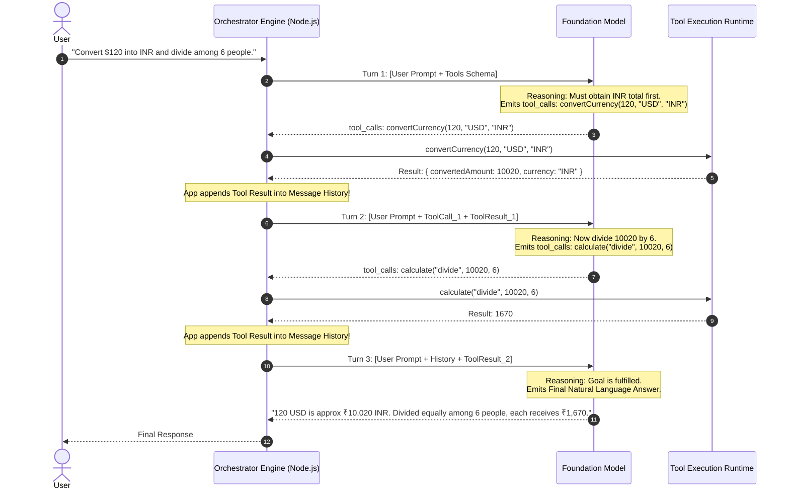
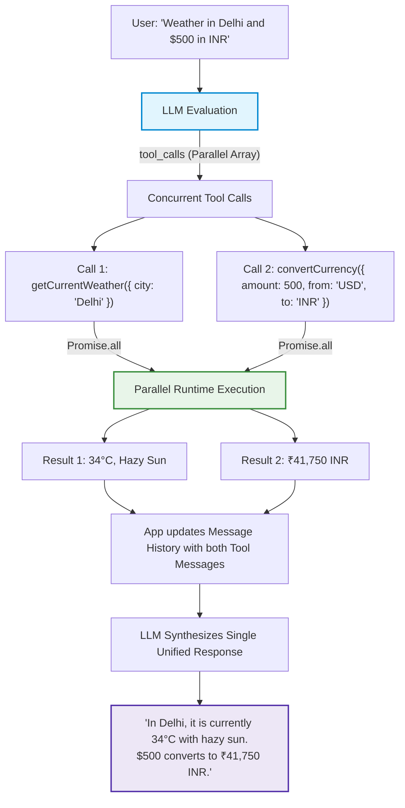
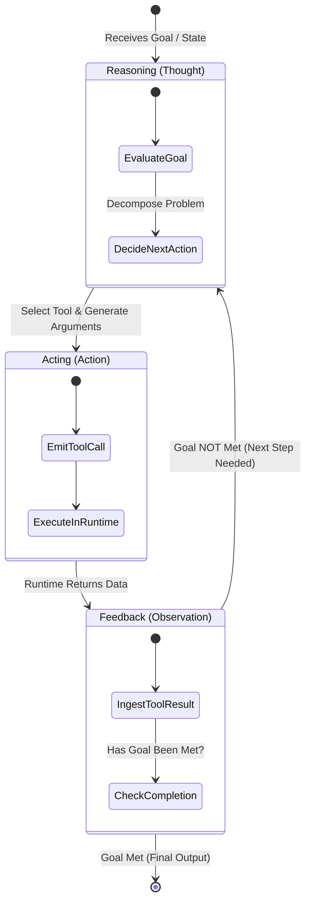
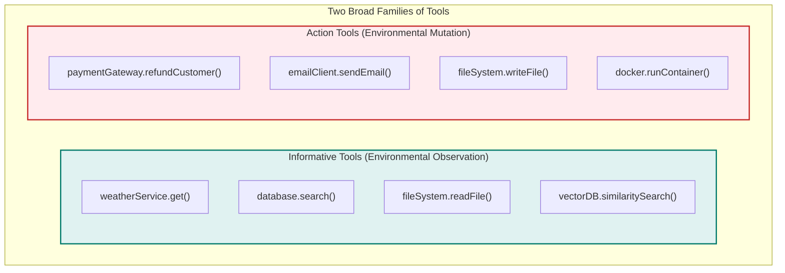
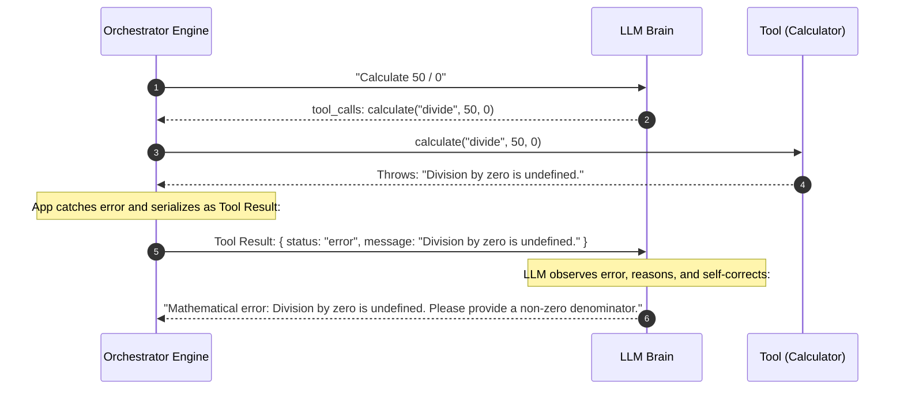
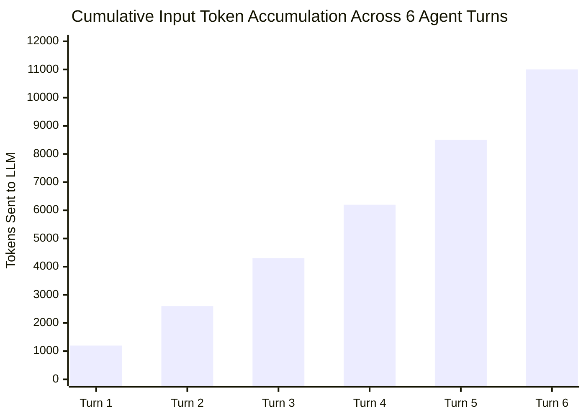

# Chapter 03: Multi-Step Tool Chaining & Execution Loops

> **Chapter Goal:** Master complex multi-step tool composition (sequential dependency chains vs. parallel dispatches), formalize the ReAct (Reasoning + Acting) cognitive architecture, distinguish between Informative Tools and Action Tools, implement a production-grade autonomous agent execution engine in TypeScript with recursion limits and circuit breakers, enable self-healing error recovery loops, and analyze token bloat dynamics.

---

## 3.1 Multi-Tool Orchestration: Beyond Single-Turn Delegation

In basic tool calling, an LLM handles a single request with a single tool:
$$\text{User Query} \longrightarrow \text{Tool Call} \longrightarrow \text{Tool Result} \longrightarrow \text{Final Response}$$

However, real-world operational problems cannot be solved with an isolated function call. They require **multi-step reasoning and dynamic tool chaining**.

### Sequential Tool Chaining (Data Dependency Chains)

Consider the user prompt from the lecture notes:

```text
User: "Convert $120 into Indian rupees and then divide that amount equally among 6 people."
```

No single tool exists in the application called `convertCurrencyAndDivideAmongPeople()`. The application simply provides two independent atomic tools:
1. `convertCurrency({ amount, from, to })`
2. `calculate({ operation, a, b })`



**The Profound Engineering Breakthrough:**
- The software engineer **did not write hardcoded orchestration logic**:
  ```typescript
  // ❌ NO HARDCODED ORCHESTRATION WAS WRITTEN
  const inr = await currencyService.convert(120, 'USD', 'INR');
  const perPerson = inr / 6;
  ```
- The model autonomously decomposed the high-level human goal into a directed dependency graph:
  1. Identifies that step 2 (`calculate`) depends on the output of step 1 (`convertCurrency`).
  2. Waits for the application to observe and return the result of step 1.
  3. Formulates arguments for step 2 conditioned on that runtime observation.
  4. Concludes the loop when no further tools are required.

---

### Parallel Tool Dispatch (Independent Concurrent Operations)

Now consider the second scenario from the lecture notes:

```text
User: "I'm travelling to Delhi. What is the current weather there, and how much is $500 in Indian rupees?"
```

Here, the sub-goals are orthogonal: weather telemetry in Delhi has zero computational dependency on USD-to-INR currency exchange rates.

Modern foundation models emit **parallel tool calls in a single inference response**:



In modern Node.js backends, this allows developers to wrap tool execution inside `Promise.all()`:

```typescript
// Parallel execution of concurrent tool calls emitted by the model
const toolResults = await Promise.all(
  toolCalls.map(async (tc) => {
    const tool = registry.get(tc.function.name);
    const args = JSON.parse(tc.function.arguments);
    const result = await tool.execute(args);
    return {
      role: 'tool' as const,
      tool_call_id: tc.id,
      content: JSON.stringify(result)
    };
  })
);
```

---

## 3.2 The ReAct Cognitive Paradigm (Reasoning + Acting)

The conceptual foundation of multi-step tool calling was formalized by Yao et al. (2022) as the **ReAct (Reasoning + Acting)** framework.



In the ReAct framework, the interaction follows a continuous triplet:
1. **Thought:** The model generates internal reasoning or analyzes current state (*"I need to check the temperature in Delhi before recommending clothing"*).
2. **Action:** The model emits a structured tool call into the execution environment.
3. **Observation:** The application executes the action and injects the ground-truth result back into the model's context window.

By alternating between reasoning and acting, the system dynamically adjusts its plan based on actual environmental feedback rather than hallucinating the entire trajectory upfront.

---

## 3.3 Two Broad Families of Tools: Informative vs. Action

Not all tools carry the same operational weight. In software engineering, functions are classified into **Queries** (Read) and **Commands** (Write/Mutate) under the Command-Query Separation (CQS) principle.

Similarly, LLM tools fall into two distinct families:



### Architectural Comparison Matrix

| Property | Informative Tools (Queries) | Action Tools (Mutations) |
| :--- | :--- | :--- |
| **Operational Goal** | *"Give me information I do not currently have."* | *"Change the state of the external world for me."* |
| **Environmental Impact** | Read-only; idempotent; zero side-effects. | State-altering; non-idempotent; creates side-effects. |
| **Failure Consequences** | Low; retryable; returns empty or error data. | High; can lead to financial loss, data deletion, or security breaches. |
| **Caching Viability** | Highly cacheable (TTL caches, Redis). | Never cacheable; must execute against live state. |
| **Safety Governance** | Autonomous execution is safe. | Requires Sandboxing, Least Privilege, or Human-in-the-Loop (HITL) approval. |

---

## 3.4 Production TypeScript Implementation: The Autonomous Execution Engine

Below is a complete, production-ready implementation of an **Autonomous Agent Execution Loop** in TypeScript. It includes:
- Multi-turn conversation state hydration.
- Parameter schema parsing and runtime error handling.
- **Circuit Breakers:** Recursion limiters (`maxSteps`) and infinite-loop detection.
- Self-healing error feedback.

```typescript
import OpenAI from 'openai';
import { Tool } from './02_The_Tool_Calling_Protocol_and_Wire_Architecture';

export interface AgentEngineConfig {
  model?: string;
  maxSteps?: number;
  temperature?: number;
  systemPrompt?: string;
}

export interface AgentStepTrace {
  step: number;
  toolCalls?: Array<{ name: string; args: string; result: string }>;
  thoughtOrResponse?: string | null;
}

export class AgentExecutionEngine {
  private openai: OpenAI;
  private tools: Map<string, Tool> = new Map();
  private maxSteps: number;
  private model: string;
  private systemPrompt: string;

  constructor(apiKey: string, tools: Tool[], config: AgentEngineConfig = {}) {
    this.openai = new OpenAI({ apiKey });
    this.maxSteps = config.maxSteps ?? 10;
    this.model = config.model ?? 'gpt-4o';
    this.systemPrompt = config.systemPrompt ?? 'You are a helpful autonomous assistant equipped with tools.';
    
    for (const tool of tools) {
      this.tools.set(tool.name, tool);
    }
  }

  /**
   * Formats the registered tools into the standard JSON Schema wire definition
   */
  private getToolDefinitions(): OpenAI.Chat.ChatCompletionTool[] {
    return Array.from(this.tools.values()).map((tool) => ({
      type: 'function' as const,
      function: {
        name: tool.name,
        description: tool.description,
        parameters: tool.parameters
      }
    }));
  }

  /**
   * Executes the autonomous ReAct loop until goal completion or circuit breaker triggers
   */
  public async execute(userGoal: string): Promise<{
    finalAnswer: string;
    traces: AgentStepTrace[];
    totalSteps: number;
  }> {
    const messages: OpenAI.Chat.ChatCompletionMessageParam[] = [
      { role: 'system', content: this.systemPrompt },
      { role: 'user', content: userGoal }
    ];

    const traces: AgentStepTrace[] = [];
    let currentStep = 0;
    const toolDefinitions = this.getToolDefinitions();

    while (currentStep < this.maxSteps) {
      currentStep++;

      // 1. Invoke Foundation Model with current conversation history & available tools
      const response = await this.openai.chat.completions.create({
        model: this.model,
        messages,
        tools: toolDefinitions.length > 0 ? toolDefinitions : undefined,
        tool_choice: 'auto'
      });

      const choice = response.choices[0];
      const assistantMessage = choice.message;

      // Append assistant's response to history
      messages.push(assistantMessage);

      // Check termination condition: Model stopped without requesting tools
      if (choice.finish_reason === 'stop' || !assistantMessage.tool_calls || assistantMessage.tool_calls.length === 0) {
        traces.push({
          step: currentStep,
          thoughtOrResponse: assistantMessage.content
        });

        return {
          finalAnswer: assistantMessage.content ?? 'Task completed successfully without explicit text.',
          traces,
          totalSteps: currentStep
        };
      }

      // Step Trace for Tool Invocations
      const stepTrace: AgentStepTrace = {
        step: currentStep,
        toolCalls: [],
        thoughtOrResponse: assistantMessage.content
      };

      // 2. Dispatch requested tool calls in parallel
      const toolOutputs = await Promise.all(
        assistantMessage.tool_calls.map(async (toolCall) => {
          const toolName = toolCall.function.name;
          const tool = this.tools.get(toolName);

          let executionResultString: string;

          if (!tool) {
            executionResultString = JSON.stringify({
              error: `Tool '${toolName}' does not exist in registry. Available: ${Array.from(this.tools.keys()).join(', ')}`
            });
          } else {
            try {
              // Parse arguments emitted by model
              const parsedArgs = JSON.parse(toolCall.function.arguments);
              
              // Execute local application function
              const rawResult = await tool.execute(parsedArgs);
              executionResultString = typeof rawResult === 'string' ? rawResult : JSON.stringify(rawResult);
            } catch (err: any) {
              // Self-healing: Catch error and serialize as tool feedback!
              executionResultString = JSON.stringify({
                error: `Tool execution failed: ${err.message || 'Unknown error'}`
              });
            }
          }

          stepTrace.toolCalls?.push({
            name: toolName,
            args: toolCall.function.arguments,
            result: executionResultString
          });

          return {
            role: 'tool' as const,
            tool_call_id: toolCall.id,
            content: executionResultString
          };
        })
      );

      // 3. Append all Tool Results back to conversation history
      messages.push(...toolOutputs);
      traces.push(stepTrace);
    }

    // Circuit Breaker Triggered
    throw new Error(
      `Agent exceeded maximum allowed iteration budget (${this.maxSteps} steps) without completing goal.`
    );
  }
}
```

---

## 3.5 Self-Healing Error Recovery & Exception Feedback

A critical flaw in early agent implementations was crashing the server when a tool threw an error.

```typescript
// ❌ WRONG: Throwing runtime exception crashes the entire agent loop
try {
  const result = await tool.execute(args);
} catch (err) {
  throw err; // Application terminates with HTTP 500!
}
```

If the user asks: *"Calculate 50 divided by 0"*, the calculator throws a `Division by zero` error. Crashing the backend turns an ordinary edge-case into a catastrophic outage.

### The Self-Correction Feedback Loop

Instead of throwing, **the runtime catches the exception and returns it as a string observation**:

```typescript
// ✅ RIGHT: Return the runtime error to the LLM as observation
catch (err: any) {
  return {
    role: 'tool',
    tool_call_id: toolCall.id,
    content: JSON.stringify({
      status: 'error',
      message: err.message
    })
  };
}
```



By receiving the error in its context window, the model can:
1. Explain the error politely to the end user.
2. Fix hallucinated parameters and re-attempt the tool call with valid data.
3. Choose an alternative fallback tool.

---

## 3.6 Token Accumulation & Economic Ledger in Multi-Turn Loops

While the autonomous ReAct loop is extremely powerful, engineers must be conscious of its economic cost.

In an agent loop, **the message history grows monotonically with every turn**:
- Turn 1: `[System, User]` ($L_1$ tokens)
- Turn 2: `[System, User, Assistant_1, ToolResults_1]` ($L_2$ tokens)
- Turn 3: `[System, User, Assistant_1, ToolResults_1, Assistant_2, ToolResults_2]` ($L_3$ tokens)

$$\text{Total Input Tokens Processed Across Loop} = \sum_{k=1}^{N} \text{Length}(\text{History}_k) \in O(N^2)$$



### Engineering Best Practices for Agent Cost Control

1. **Strict Recursion Limits (`maxSteps`):** Always cap iterations (default 5–10 steps). Uncapped loops can consume hundreds of dollars in seconds if the model gets trapped in an infinite cycle.
2. **Deterministic Timeout Budgets (`AbortSignal`):** Provide an `AbortSignal` with a hard deadline (e.g. 60 seconds) so that stalling network operations or slow tool calls terminate cleanly.
3. **Compact Tool Output Payloads:** Tools should return only the data the model strictly needs. Never return an entire 2MB JSON document from a database query if 3 fields suffice.
4. **Pruning Tool History:** For long-running agents, prune older intermediate tool outputs from message history or summarize them once the subsequent decision is made.

```typescript
// Production Timeout Pattern with AbortSignal
export async function executeAgentWithTimeout(
  engine: AgentExecutionEngine,
  goal: string,
  timeoutMs: number = 60000
) {
  const controller = new AbortController();
  const timer = setTimeout(() => controller.abort(), timeoutMs);

  try {
    return await engine.execute(goal);
  } finally {
    clearTimeout(timer);
  }
}
```

---

## 3.7 Chapter Summary & Key Engineering Takeaways

- **Dynamic Orchestration Emerges from Contracts:** In multi-step tool calls, the developer does not hardcode `toolA() -> toolB()`. The model autonomously constructs the dependency graph conditioned on intermediate runtime observations.
- **Sequential vs. Parallel Execution:** When tools are independent (Weather and Currency), the LLM emits parallel `tool_calls` executed via `Promise.all()`. When sub-goals depend on intermediate results (Currency output fed into Calculator), the loop executes sequentially across turns.
- **The ReAct Triplet:** Autonomous agency is grounded in the cyclical loop: **Thought (Reasoning) $\to$ Action (Tool Call) $\to$ Observation (Environmental Feedback)**.
- **Informative vs. Action Tools:** Informative tools (queries) observe the world and have zero side effects. Action tools (mutations) alter external state and require stricter permissions, sandboxing, and approval gates.
- **Self-Healing Error Loops:** Never crash your Node.js process when a tool throws an error. Catch the exception and serialize `{ error: err.message }` as the tool observation. The LLM can interpret the failure, adjust its parameters, and retry.
- **Quadratic Token Accumulation ($O(N^2)$):** Because the message array accumulates every turn's assistant thoughts and tool results, input tokens compound quadratically. Enforce strict `maxSteps` limits to prevent runaway loops and cost explosions.
