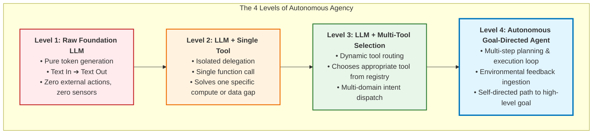
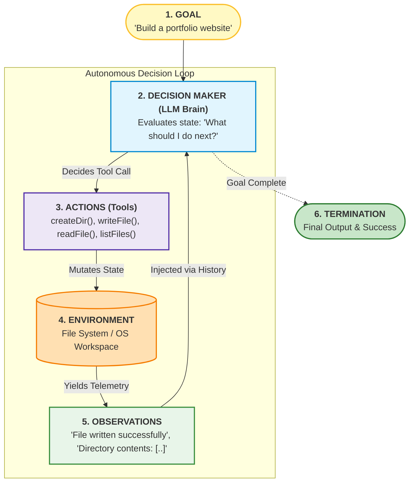
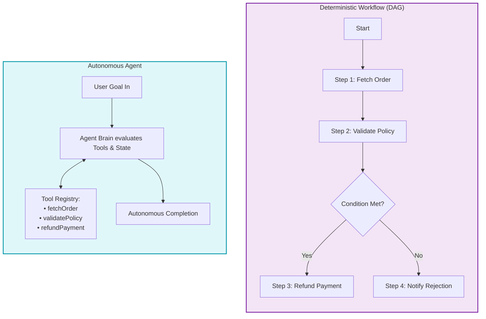
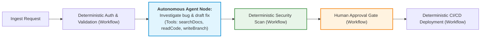
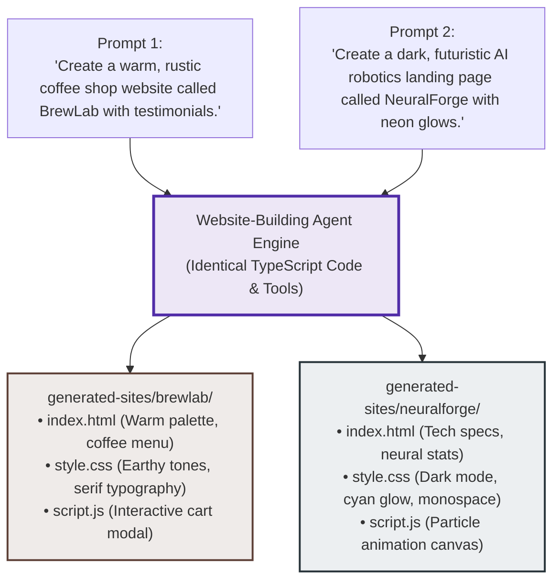

# Chapter 04: First Principles of AI Agents & The Agency Spectrum

> **Chapter Goal:** Establish the definitive theoretical and engineering foundations of AI agents from first principles. Trace the 4 levels of the agency spectrum, deconstruct the 6 canonical components of an agent, analyze the architectural distinction between deterministic workflows and autonomous agents, explore hybrid topologies, and demonstrate general-purpose emergence across heterogeneous domains with zero backend code changes.

---

## 4.1 The Agency Spectrum: The 4 Progressive Levels

In the software industry, the word "agent" is frequently overused. To bring engineering rigor to the discipline, agency must be understood not as a binary switch, but as a **spectrum of progressive autonomy**.

### Detailed Breakdown of the 4 Levels

#### Level 1: Raw Foundation LLM (Text Generation)
- **Architecture:** User Query $\longrightarrow$ LLM $\longrightarrow$ Text Answer.
- **Example:** *"Explain polymorphism in object-oriented programming."*
- **Operational Reality:** The model generates tokens based on parametric weights $\Theta$. Nothing outside the model's memory changes. No external system is queried.

#### Level 2: LLM + Single Tool (Isolated Delegation)
- **Architecture:** User Query $\longrightarrow$ LLM $\longrightarrow$ Single Tool Call $\longrightarrow$ Result $\longrightarrow$ LLM $\longrightarrow$ Text Answer.
- **Example:** *"What is 94823 multiplied by 3291?"*
- **Operational Reality:** The LLM delegates a specific mathematical computation to a calculator. It solves a single domain gap in one round-trip.

#### Level 3: LLM + Multi-Tool Selection (Dynamic Routing)
- **Architecture:** User Query $\longrightarrow$ LLM evaluates Tool Registry `[Calculator, Weather, Currency]` $\longrightarrow$ Routes to matching tool.
- **Example:** *"What is the weather in Delhi right now?"* vs. *"Convert 500 USD to INR."*
- **Operational Reality:** The LLM acts as an intelligent router or natural language API gateway. It evaluates which capability is required for an isolated request.

#### Level 4: Autonomous Goal-Directed Agent (Multi-Step Closed Loop)
- **Architecture:** User Goal $\longrightarrow$ $\text{Loop}[\text{Decide} \to \text{Act} \to \text{Observe} \to \text{Re-evaluate}]$ $\longrightarrow$ Goal Achieved.
- **Example:** *"Build a full-featured coffee shop landing page called BrewLab in a dedicated workspace directory."*
- **Operational Reality:** The LLM is provided with a high-level objective and primitive workspace tools (`createDirectory`, `writeFile`, `readFile`, `listFiles`). It autonomously sequences dozens of decisions, checks its own work, corrects errors, and stops only when the objective is verified.

---

## 4.2 The First-Principles 6-Component Agent Model

Instead of memorizing marketing frameworks, any AI agent operating in computer science can be rigorously defined using **six fundamental components**:

### The 6 Canonical Components

| # | Component | Definition & Role | Example in Website Builder Agent |
| :---: | :--- | :--- | :--- |
| **1** | **Goal** | The explicit target state or objective specified by the user or upstream system. | *"Build a modern portfolio website for a data scientist."* |
| **2** | **Decision Maker** | The cognitive engine that analyzes the current state and determines the next optimal action. | Foundation LLM (conditioned on System Prompt & History). |
| **3** | **Actions (Tools)** | The discrete set of actuators and capabilities exposed to the decision maker. | `createDirectory`, `writeFile`, `readFile`, `listFiles`. |
| **4** | **Environment** | The external system or reality upon which actions act and produce state transitions. | The sandboxed local file system (`generated-sites/`). |
| **5** | **Observations** | The empirical feedback received from the environment following each action. | `"Directory created"`, `"Successfully wrote index.html"`, file contents. |
| **6** | **Decision Loop** | The cyclical control structure that repeatedly prompts the decision maker until the goal is achieved. | While loop orchestrator checking `finish_reason` and iteration limits. |

### The Master Mathematical Formula
$$\mathbf{AI\ Agent} = \mathbf{Foundation\ LLM} + \mathbf{Tools} + \mathbf{Environment} + \mathbf{Observations} + \mathbf{Decision\ Loop} + \mathbf{Goal}$$

---

## 4.3 Agent vs. Workflow: The Architectural Distinction

One of the most consequential decisions an AI systems architect makes is deciding whether a business problem requires a **Deterministic Workflow** or an **Autonomous Agent**.

### The Definitive Comparison

| Dimension | Deterministic Workflow | Autonomous AI Agent |
| :--- | :--- | :--- |
| **Who Defines WHAT?** | The Developer | The Developer / User (Goal) |
| **Who Defines HOW?** | **The Developer** (Hardcoded paths, if/else branches, state machines) | **The LLM** (Dynamically decides tool order, retries, and parameters) |
| **Execution Graph** | Static Directed Acyclic Graph (DAG) | Dynamic, emergent execution trajectory |
| **Predictability & Testing** | 100% deterministic; straightforward unit and integration testing | Probabilistic; requires trajectory evaluation, guardrails, and sandboxes |
| **Flexibility to Novel States** | Extremely low; crashes or halts on unhandled edge cases | High; reasons through unexpected exceptions and tries fallback tools |
| **Ideal Use Cases** | KYC verification, checkout flows, database ETL, compliance audits | Code generation, complex research, dynamic customer troubleshooting, creative design |

### The Hybrid Topology: The Golden Enterprise Standard

In production enterprise systems, pure autonomous agents can be dangerous if given unrestricted freedom. Conversely, pure workflows are too rigid.

The premier enterprise architecture is the **Hybrid Pattern**:
$$\text{Deterministic State Machine (Workflow)} \longleftrightarrow \text{Constrained Autonomous Agent Nodes}$$

In this pattern:
- The macro-level business process is governed by a rigid, reliable workflow.
- High-ambiguity micro-tasks are delegated to autonomous agents equipped with tightly sandboxed tools.

---

## 4.4 General-Purpose Emergence: Same Code, Diverse Capabilities

The ultimate validation of an agentic architecture is **general-purpose capability without code changes**.

In traditional software engineering, if you want a coffee shop generator, you write a `CoffeeShopGenerator` class. If you later want a robotics website generator, you must write an entirely new `RoboticsGenerator` class with different templates, hardcoded assets, and logic.

In an agentic architecture:
$$\text{Tools stay identical } (\text{createDirectory}, \text{writeFile}, \text{readFile}, \text{listFiles}).$$
$$\text{The application code remains completely untouched.}$$

### Why Emergence Works
The LLM's vast parametric pre-training contains design patterns, color harmonies, semantic HTML layouts, and domain terminology for thousands of industries. 

When provided with workspace tools:
1. It draws upon its domain knowledge of "coffee shops" or "robotics companies" to synthesize appropriate aesthetics, copy, and layout.
2. It uses the exact same `createDirectory` and `writeFile` tools to instantiate those designs on disk.

We did not build specialized domain software. **We built an autonomous agent that projects its generalized intelligence into an operational environment.**

---

## 4.5 Chapter Summary & Key Engineering Takeaways

- **Agency is a Progressive Spectrum:** Autonomy is not binary. It evolves from Level 1 (Raw LLM text output) $\to$ Level 2 (Single-tool delegation) $\to$ Level 3 (Multi-tool dynamic routing) $\to$ Level 4 (Autonomous goal-directed execution loops).
- **The 6 Canonical Components:** Every AI agent consists of: (1) Goal, (2) Decision Maker (LLM Brain), (3) Actions (Tools), (4) Environment, (5) Observations, and (6) Decision Loop.
- **The Core Formula:** $\text{AI Agent} = \text{LLM} + \text{Tools} + \text{Environment} + \text{Observations} + \text{Decision Loop} + \text{Goal}$.
- **Workflows vs. Agents:** In a workflow, the developer programs both WHAT and HOW through explicit DAG edges. In an agent, the developer defines WHAT (the goal), while the LLM autonomously determines HOW by selecting and sequencing tools.
- **The Hybrid Enterprise Pattern:** Production systems achieve optimal reliability by nesting autonomous agents inside deterministic workflow nodes (combining structure with cognitive adaptability).
- **General-Purpose Emergence:** A well-designed agent does not require domain-specific code changes. The exact same workspace tools (`createDirectory`, `writeFile`, `readFile`, `listFiles`) build a rustic coffee shop or a cyberpunk robotics portal based solely on the prompt.
