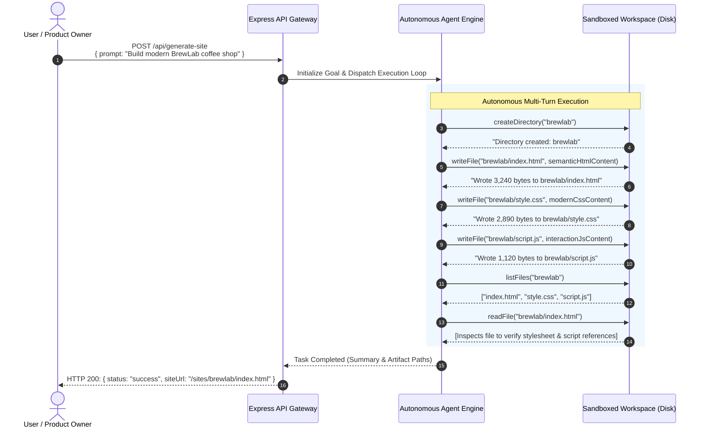
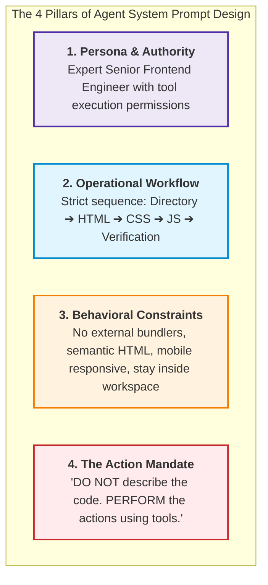
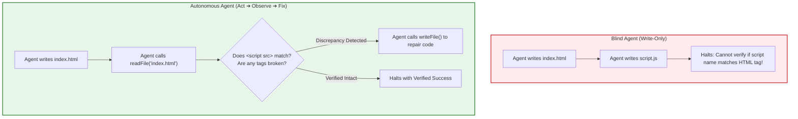

# Chapter 06: Building an Autonomous Website Builder Agent

> **Chapter Goal:** Assemble all architectural components into a complete, production-grade Autonomous Website Builder Agent in TypeScript. Master system prompt engineering for action-oriented agents ("Don't describe the action. Perform it!"), build the Express controller and orchestrator, trace an end-to-end multi-turn execution generating the "BrewLab" coffee shop site, and analyze how environmental inspection (`readFile`, `listFiles`) unlocks autonomous self-correction.

---

## 6.1 The Architectural Vision: From Advice to Actuation

In traditional conversational AI applications, asking an LLM to build a website yields a passive response:

```text
User: "Build me a website for BrewLab coffee shop."
Chatbot: "Sure! Here is the code you should copy and paste into your files..."
```

The user must manually create folders, create files, open an editor, paste code, and debug missing link tags. The model acts as an **advisor**, placing the entire operational burden back onto the human.

In an **Autonomous Agent Architecture**, the model is equipped with **Hands**:



The human expresses the **Goal**; the agent autonomously mutates the **Environment** until the goal is verified.

---

## 6.2 System Prompt Engineering: The Job Description

An agent's system prompt is not conversational chit-chat; it is a **formal legal contract and job specification**.

Without unambiguous operational rules, an LLM defaults to its conversational pre-training—it will write code in chat messages rather than triggering tools.



### The Production System Prompt Contract

```typescript
export const WEBSITE_BUILDER_SYSTEM_PROMPT = `
You are an expert autonomous senior frontend engineer and website builder.
Your objective is to create complete, responsive, visually stunning static websites in the sandboxed workspace using your available workspace tools.

For every website requested by the user:
1. Create a dedicated project directory using createDirectory (e.g., 'brewlab' or 'neuralforge').
2. Create index.html using semantic HTML5, including proper meta viewport tags, accessible headers, sections, and footers.
3. Create style.css with a curated, modern aesthetic:
   - Use custom CSS variables (--bg, --primary, --text, --card).
   - Use vibrant dark modes, sleek glassmorphism, modern typography, and smooth CSS transitions.
   - Ensure full mobile responsiveness using Flexbox and CSS Grid.
4. Create script.js to add dynamic interactive polish (mobile navigation toggles, interactive modals, form handlers, or scroll effects).
5. Link style.css and script.js properly inside index.html using relative paths.
6. Do not use external build tools, bundlers, or framework dependencies (Vanilla HTML/CSS/JS only).
7. Keep all files strictly inside your dedicated project workspace directory.
8. After creating the files, call listFiles to inspect the created structure.
9. Call readFile on critical files (such as index.html) to verify link paths, script tags, and syntax integrity. Fix any defects immediately using writeFile.
10. Terminate only when the website is completely written, verified, and ready for deployment.

CRITICAL OPERATIONAL MANDATE:
Do not merely tell the user what code they should write in your conversational response.
Actually execute the actions and create the files using your tools.
Don't describe the action. Perform it.
`.trim();
```

---

## 6.3 Complete TypeScript Agent Server Implementation

Let us assemble the server, controller, and agent engine using **Express** and the **OpenAI SDK**.

```typescript
import express, { Request, Response } from 'express';
import { AgentExecutionEngine } from './03_Multi_Step_Tool_Chaining_and_Execution_Loops';
import { WorkspaceTools } from './05_Workspace_Sandboxing_and_Agent_Security';
import { WEBSITE_BUILDER_SYSTEM_PROMPT } from './WebsiteBuilderPrompt';

const app = express();
app.use(express.json());

// Initialize Sandboxed Workspace and Tools
const workspaceTools = new WorkspaceTools('generated-sites');

// Serve generated static sites directly for live browser viewing
app.use('/sites', express.static('generated-sites'));

// Clean, decoupled API Controller
app.post('/api/generate-site', async (req: Request, res: Response) => {
  try {
    const { prompt } = req.body;

    if (!prompt || typeof prompt !== 'string') {
      return res.status(400).json({ error: "Missing or invalid 'prompt' field in request body." });
    }

    // Ensure workspace directory exists on disk
    await workspaceTools.init();

    // Instantiate Agent Engine with Workspace Tools and System Prompt
    const agent = new AgentExecutionEngine(
      process.env.OPENAI_API_KEY || 'mock-key',
      workspaceTools.getAllTools(),
      {
        model: 'gpt-4o',
        maxSteps: 15,
        temperature: 0.2, // Low temperature for deterministic code authoring
        systemPrompt: WEBSITE_BUILDER_SYSTEM_PROMPT
      }
    );

    console.log(`[Agent Orchestrator] Initiating goal execution: "${prompt}"`);

    // Execute Autonomous Closed Loop
    const result = await agent.execute(prompt);

    return res.status(200).json({
      status: 'success',
      totalStepsTaken: result.totalSteps,
      summary: result.finalAnswer,
      executionTrace: result.traces
    });
  } catch (error: any) {
    console.error('[Agent Orchestrator Failure]', error);
    return res.status(500).json({
      status: 'error',
      message: error.message || 'Agent execution failed.'
    });
  }
});

const PORT = process.env.PORT || 3000;
app.listen(PORT, () => {
  console.log(`Autonomous Website Builder Service running on port ${PORT}`);
  console.log(`Generated sites available at: http://localhost:${PORT}/sites/<project-name>/index.html`);
});
```

Notice the simplicity of the controller:
```typescript
// From the controller's perspective, there is zero hardcoded site-generation logic!
const result = await agent.execute(prompt);
```
All sequencing, tool decisions, file creation, and verification are handled autonomously by the model conditioned on its tools.

---

## 6.4 End-to-End Execution Walkthrough: The BrewLab Case Study

Let us trace the exact multi-turn execution generated when the following payload is dispatched:

```json
{
  "prompt": "Create a premium landing page for a coffee shop called BrewLab. Use a dark elegant design with a hero section, featured coffees, customer testimonials and a contact section."
}
```



```mermaid
flowchart TD
    Start(["Goal: Build BrewLab Landing Page"]) --> T1

    subgraph Turn1["Turn 1: Project Scaffolding"]
        T1["LLM evaluates tools ➔ calls createDirectory('brewlab')"] 
        --> O1["Obs: 'Directory created: brewlab'"]
    end

    subgraph Turn2["Turn 2: HTML Structure"]
        O1 --> T2["LLM writes brewlab/index.html<br/>Semantic tags: &lt;header&gt;, &lt;section id='hero'&gt;,<br/>&lt;section id='menu'&gt;, &lt;link rel='stylesheet' href='style.css'&gt;"]
        T2 --> O2["Obs: 'Successfully wrote 3,420 bytes'"]
    end

    subgraph Turn3["Turn 3: Styling System"]
        O2 --> T3["LLM writes brewlab/style.css<br/>CSS Variables (--coffee-dark, --amber-glow),<br/>Flexbox grids, card hover transforms, responsive media queries"]
        T3 --> O3["Obs: 'Successfully wrote 2,980 bytes'"]
    end

    subgraph Turn4["Turn 4: Interactive Script"]
        O3 --> T4["LLM writes brewlab/script.js<br/>Adds interactive cart order modal and smooth scrolling navigation"]
        T4 --> O4["Obs: 'Successfully wrote 980 bytes'"]
    end

    subgraph Turn5["Turn 5: Environmental Verification"]
        O4 --> T5["LLM calls listFiles('brewlab') to verify directory"]
        T5 --> O5["Obs: ['index.html', 'style.css', 'script.js']"]
    end

    subgraph Turn6["Turn 6: Code Audit & Integrity Check"]
        O5 --> T6["LLM calls readFile('brewlab/index.html')<br/>Verifies &lt;link&gt; and &lt;script&gt; paths match exactly"]
        T6 --> O6["Obs: Complete HTML verified intact"]
    end

    subgraph Turn7["Turn 7: Goal Fulfilled"]
        O6 --> T7["LLM emits stop finish_reason<br/>Returns final Markdown summary to user"]
    end

    T7 --> End(["Website Complete on Disk!"])

    style Turn1 fill:#f3e5f5,stroke:#7b1fa2,stroke-width:1px
    style Turn2 fill:#e1f5fe,stroke:#0288d1,stroke-width:1px
    style Turn3 fill:#e8f5e9,stroke:#388e3c,stroke-width:1px
    style Turn4 fill:#fff3e0,stroke:#f57c00,stroke-width:1px
    style Turn5 fill:#e0f7fa,stroke:#00838f,stroke-width:1px
    style Turn6 fill:#ede7f6,stroke:#512da8,stroke-width:1px
    style Turn7 fill:#c8e6c9,stroke:#2e7d32,stroke-width:2px
```

### The Resulting Artifacts on Disk

At the conclusion of Turn 7, the filesystem state inside `generated-sites/` is:

```text
generated-sites/
└── brewlab/
    ├── index.html   (Semantic HTML5 with metadata and content)
    ├── style.css    (Modern responsive stylesheet)
    └── script.js    (Interactive JavaScript)
```

Opening `http://localhost:3000/sites/brewlab/index.html` loads an immediately usable, fully functional website.

---

## 6.5 The Environmental Feedback Loop: Why `readFile` and `listFiles` Transform Capability

In early AI prototypes, developers provided only `writeFile`. Without `readFile` and `listFiles`, the agent is **blind after writing**.



When an agent has `readFile`:
1. **Self-Correction:** It can read its own generated HTML, notice that it referenced `app.js` instead of `script.js`, and re-write the file to fix the broken tag.
2. **Incremental Editing:** For complex projects, it can read an existing file, append new CSS classes or navigation items, and write back the updated file.
3. **Closing the Loop:** **Observation is what separates an open-loop script from a true closed-loop agent.**

### Concrete Self-Repair Execution Trace
```text
[Turn 5] Agent calls: listFiles({ path: "brewlab" })
[Turn 5] Observation: ["index.html", "style.css", "script.js"]

[Turn 6] Agent calls: readFile({ path: "brewlab/index.html" })
[Turn 6] Observation: "<!DOCTYPE html><html><head><link rel='stylesheet' href='style.css'></head><body>...</body></html>"

[Agent Internal Thought]
"I inspected index.html and noticed that while script.js was created, the <script src='script.js'></script> tag is missing before the closing </body> tag. I must fix this immediately using writeFile."

[Turn 7] Agent calls: writeFile({ path: "brewlab/index.html", content: "<!DOCTYPE html>...<script src='script.js'></script></body></html>" })
[Turn 7] Observation: "Successfully wrote 3,490 characters to: brewlab/index.html"

[Turn 8] Agent finishes: "BrewLab website successfully created and verified with active JavaScript wiring."
```

---

## 6.6 Chapter Summary & Key Engineering Takeaways

- **From Advisor to Actuator:** Traditional chatbots explain how to write code; autonomous agents execute the actions directly in the environment using tools.
- **The Job Description Contract:** System prompts for agents must include clear roles, explicit multi-step workflows, strict format constraints, and an unambiguous Action Mandate: *"Don't describe the action. Perform it!"*
- **Simple Controller, Autonomous Engine:** The API gateway remains simple and decoupled. The controller invokes `agent.execute(prompt)`, while the engine and tool loop handle all dynamic planning, execution, and verification.
- **The Power of Environmental Observation:** Without `readFile` and `listFiles`, an agent is an open-loop, blind writer. Environmental inspection provides closed-loop feedback, unlocking autonomous error detection and self-repair.
- **Multi-File Coherence:** An autonomous agent maintains shared mental state across multiple files, ensuring that CSS variable names in `style.css` and DOM IDs in `script.js` align with the semantic markup in `index.html`.
