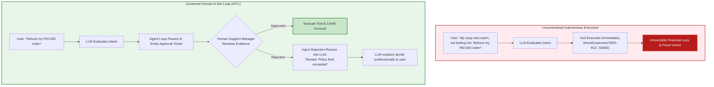
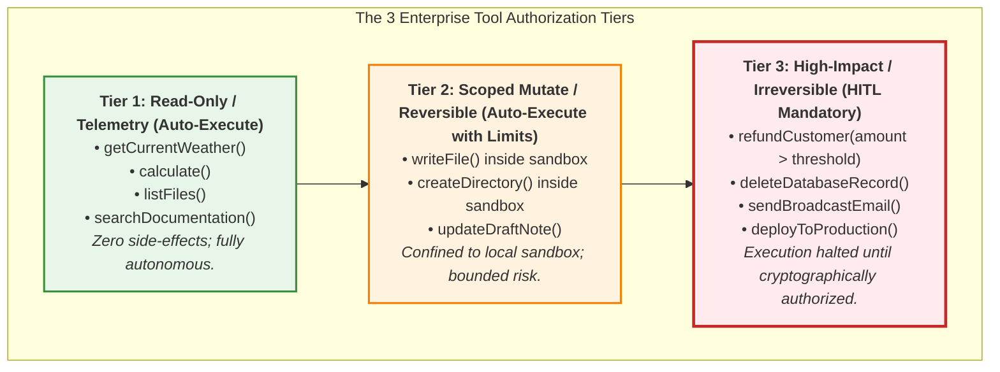
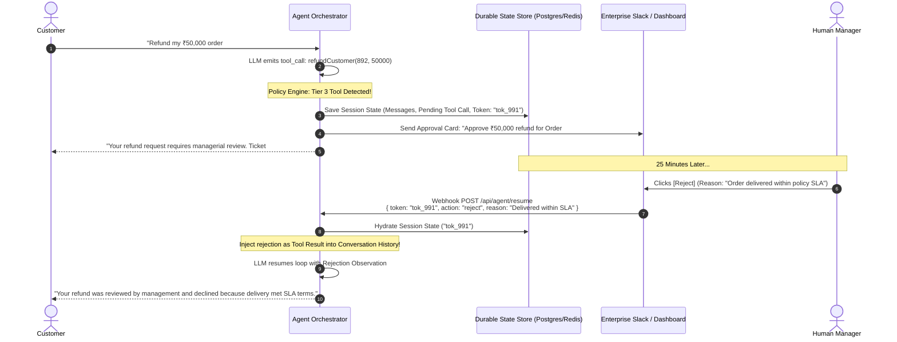
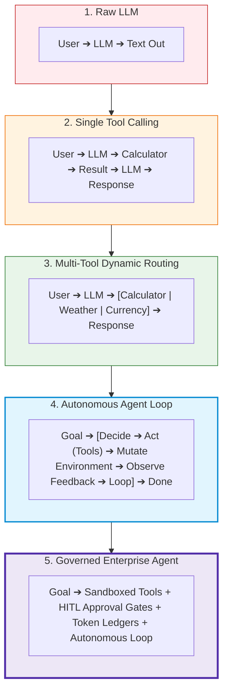

# Chapter 07: Human-in-the-Loop Safety & Enterprise Patterns

> **Chapter Goal:** Master the governance and safety architecture of production agents through Human-in-the-Loop (HITL) approval gates. Establish multi-tier tool authorization policies, implement synchronous and durable asynchronous pause/resume state machines in TypeScript, synthesize the complete end-to-end mental model, and codify the 25 Cardinal Engineering Principles for production AI agents.

---

## 7.1 The Necessity of Human-in-the-Loop (HITL)

As autonomous agents evolve from answering questions to executing real-world actions, **the cost of a mistake shifts from an embarrassing hallucination to a catastrophic business liability**.

Consider an enterprise customer support agent equipped with two action tools:
1. `sendEmail(recipient, subject, body)`
2. `refundCustomer(orderId, amount)`



**The Core Operational Reality:**
> An LLM is a probabilistic token sampler. **It has no skin in the game.** It does not face legal prosecution, suffer financial loss, or understand fiduciary responsibility. High-consequence actions must be guarded by human judgment.

---

## 7.2 The 3-Tier Tool Authorization Policy Matrix

To prevent engineering bottlenecks while ensuring ironclad safety, tools should not be treated uniformly. Enterprise architects classify tools into **Three Operational Tiers**:



### Authorization Tier Matrix

| Tier | Policy Name | Risk Profile | Execution Mode | Example Primitives |
| :---: | :--- | :--- | :--- | :--- |
| **1** | **Read-Only / Informative** | Zero Side-Effects; Idempotent | **Fully Autonomous** | `calculate`, `weatherService`, `readFile`, `database.query` |
| **2** | **Scoped Mutate** | Sandboxed; Reversible; Bounded | **Autonomous within Sandbox Quotas** | `createDirectory`, `writeFile` (inside `generated-sites/`) |
| **3** | **Critical / External** | Non-Idempotent; Financial; Irreversible | **Human Approval Mandatory (HITL)** | `refundCustomer`, `sendEmail`, `dropTable`, `purchaseItem` |

---

## 7.3 Asynchronous Durable Pause/Resume State Machine

In enterprise systems, human approval rarely occurs in milliseconds. A support manager might take 20 minutes to review a refund request.

A production agent cannot keep a Node.js HTTP connection hanging for 20 minutes. It requires a **Durable State Machine**:



### TypeScript Implementation: Durable HITL Gate

```typescript
export interface PendingApproval {
  id: string;
  agentSessionId: string;
  toolName: string;
  toolArgs: any;
  status: 'pending' | 'approved' | 'rejected';
  rejectionReason?: string;
  createdAt: Date;
}

export class HITLPolicyEngine {
  private static readonly CRITICAL_TOOLS = new Set(['refundCustomer', 'sendEmail', 'deleteRecord']);
  private static readonly FINANCIAL_THRESHOLD = 5000; // ₹5,000 auto-approval ceiling

  /**
   * Determines if a tool call can execute autonomously or requires human sign-off
   */
  public static requiresHumanApproval(toolName: string, args: any): boolean {
    if (!this.CRITICAL_TOOLS.has(toolName)) {
      return false; // Tier 1 & Tier 2 tools execute autonomously
    }

    if (toolName === 'refundCustomer' && args.amount <= this.FINANCIAL_THRESHOLD) {
      return false; // Micro-refunds auto-approved
    }

    return true; // Tier 3: Require explicit human gate
  }

  /**
   * Resolves a pending approval and formats the appropriate observation message for the LLM
   */
  public static resolveToolExecution(
    approval: PendingApproval,
    toolRunner: (args: any) => Promise<any>
  ): Promise<{ status: string; result: any }> {
    if (approval.status === 'rejected') {
      return Promise.resolve({
        status: 'rejected_by_human',
        result: `Action was explicitly denied by human supervisor. Reason: ${approval.rejectionReason || 'Policy non-compliance'}`
      });
    }

    // Approved: proceed with execution
    return toolRunner(approval.toolArgs).then((data) => ({
      status: 'approved_and_executed',
      result: data
    }));
  }
}
```

---

## 7.4 The Complete Mental Model: Evolution from Raw LLM to Agent

We started our journey with a raw, autoregressive token predictor. Let us trace the architectural progression:



### Comprehensive Paradigm Comparison Matrix

| Architectural Dimension | Raw Foundation LLM | Chatbot Assistant | Deterministic Workflow | Enterprise AI Agent |
| :--- | :--- | :--- | :--- | :--- |
| **Core Paradigm** | Pure token sampling | Conversational QA | Static DAG / Pipeline | Autonomous Goal Attainment |
| **Memory Across Turns** | Zero (Stateless) | Hydrated Chat History | Database State / KV store | Hydrated History + Sandboxed Environment State |
| **Environmental Impact** | Zero | Zero (Text only) | High (Programmatic) | High (Dynamic Tool Actuation) |
| **Planning Capability** | None | Local response context | Pre-programmed by developer | Emergent, multi-step dynamic decomposition |
| **Environmental Telemetry** | None | None | Hardcoded API responses | Closed-loop observations (`readFile`, `listFiles`) |
| **Failure Recovery** | Hallucinates plausible text | Apologizes or hallucinating | Throws exceptions or retries | Self-corrects parameters based on error observations |
| **Safety Governance** | Moderation APIs | Prompt guardrails | IAM & unit test assertions | Sandboxes + Path containment + HITL approval gates |

---

## 7.5 The 25 Cardinal Engineering Principles for Production AI Agents

To conclude Lecture 05, we codify the **25 Cardinal Engineering Principles** that govern production Forward Deployed Engineering:

### Cognitive Foundations & LLM Realities
1. **The Representation Law:** Generating tokens that spell `mkdir` is not issuing a `sys_mkdir` syscall. Text generation is orthogonal to environmental action.
2. **LLM = Brain, Tools = Hands:** An LLM without tools is an intellect trapped in a room without actuators.
3. **The Semantic Decoder Principle:** An LLM's greatest engineering strength is translating high-entropy human ambiguity into low-entropy typed contracts.
4. **The Naïve JSON Fallacy:** Never rely on prompt-based `"Always answer in JSON"` instructions in production. Always use native Function/Tool Calling schemas.
5. **Autoregressive Conditioning:** Every tool execution result must be serialized into the message array so subsequent tokens can condition on physical reality.

### Tool Architecture & Contracts
6. **Tools Are Normal Code:** Strip away AI jargon—a tool is simply an ordinary function exposed through a JSON Schema contract.
7. **The Tool Definition Law:** The LLM never sees your source code; it sees only your `name`, `description`, and `parameters` schema.
8. **Descriptions Are Prompts:** The tool `description` is the primary feature the model attends to when selecting actions. Make descriptions unambiguous.
9. **Separate Compute from Generation:** Never ask an LLM to multiply 8-digit numbers in its weights when a 4-line JavaScript function does it deterministically in 1 microsecond.
10. **The Command-Query Separation:** Distinguish Informative Tools (read-only, idempotent) from Action Tools (mutating, side-effect producing).

### Autonomous Loops & Execution
11. **The Master Agent Formula:** $\text{AI Agent} = \text{LLM} + \text{Tools} + \text{Environment} + \text{Observations} + \text{Decision Loop} + \text{Goal}$.
12. **The ReAct Triplet:** True agency requires continuous cycling through **Thought $\longrightarrow$ Action $\longrightarrow$ Observation**.
13. **Observation Closes the Loop:** An agent that writes files without reading them is open-loop. `readFile` and `listFiles` enable closed-loop self-correction.
14. **The Circuit Breaker Mandate:** Never allow an agent to run an unbounded `while(true)` loop. Always enforce strict `maxSteps` and timeout budgets.
15. **Exception Serialization:** When a tool throws an error, catch it and return the error message as a tool observation. Let the model self-correct.

### Security, Sandboxing & Least Privilege
16. **Tool = Capability + Permission:** Giving an agent a tool grants it authority to alter that subsystem.
17. **The Application Is the Kernel:** The LLM decides *what* it wants to do; the application enforces *what* it is permitted to do.
18. **The Least Privilege Law:** Expose only atomic domain primitives (`createDirectory`, `writeFile`), never raw OS shells (`exec`, `bash`).
19. **Path Traversal Defense:** Always normalize paths and verify lexical and canonical boundary containment using `path.resolve` and `fs.realpath`.
20. **Indirect Prompt Injection Shielding:** Treat all content returned by tools (read files, web pages) as untrusted user data.

### Governance, Architecture & Production Economics
21. **Workflow Defines How; Agent Decides How:** In workflows, developers hardcode the path. In agents, developers set the goal and the agent determines the trajectory.
22. **The Hybrid Golden Pattern:** Wrap autonomous agents inside deterministic workflow nodes; combine flexibility with predictability.
23. **The HITL Invariant:** High-impact, non-reversible, or financial operations must be gated behind human approval.
24. **Durable Pause/Resume:** Long-running approvals must persist state in durable stores (Postgres/Redis) rather than blocking threads.
25. **The Quadratic Token Ledger:** Agent loops accumulate context at $O(N^2)$. Prune intermediate tool outputs and enforce token budgets to prevent cost explosions.

### Production Express Webhook Endpoint for HITL Resumption

```typescript
import express, { Request, Response } from 'express';

const app = express();
app.use(express.json());

// Webhook invoked by Slack / Internal Admin Dashboard when human manager reviews ticket
app.post('/api/agent/resume', async (req: Request, res: Response) => {
  const { approvalId, action, rejectionReason, managerId } = req.body;

  // 1. Retrieve session & pending approval from durable store (e.g. Postgres / Redis)
  const approval = await getPendingApprovalFromDB(approvalId);
  if (!approval || approval.status !== 'pending') {
    return res.status(404).json({ error: 'Pending approval ticket not found or already processed.' });
  }

  // 2. Update ticket status
  approval.status = action === 'approve' ? 'approved' : 'rejected';
  approval.rejectionReason = rejectionReason;
  await saveApprovalToDB(approval);

  // 3. Resolve tool execution using policy engine
  const toolResult = await HITLPolicyEngine.resolveToolExecution(
    approval,
    async (args) => executeRefundMicroservice(args)
  );

  // 4. Hydrate agent session and inject resolved observation into conversation history
  const session = await getAgentSessionFromDB(approval.agentSessionId);
  session.messages.push({
    role: 'tool',
    tool_call_id: approval.id,
    content: JSON.stringify(toolResult)
  });

  // 5. Resume autonomous loop to synthesize final customer notification
  const agent = new AgentExecutionEngine(process.env.OPENAI_API_KEY!, getRegisteredTools());
  const finalReport = await agent.resumeSession(session);

  return res.status(200).json({ status: 'resumed_and_completed', report: finalReport });
});
```

---

## 7.6 Chapter Summary & Key Engineering Takeaways

- **The Fiduciary Reality of AI Actions:** While chatbots risk bad advice, action-oriented agents risk financial fraud, data loss, and regulatory non-compliance. High-impact tools must never execute without human gates.
- **The 3-Tier Governance Model:** Classify tools into Tier 1 (Read-only, auto-approved), Tier 2 (Scoped mutate inside sandboxes, auto-approved with quotas), and Tier 3 (High-impact/financial, mandatory human sign-off).
- **Asynchronous Durable Execution:** Never keep HTTP threads blocking while awaiting human approval. Persist state in durable stores (Postgres/Redis), emit approval cards to Slack/dashboards, and resume via webhooks.
- **The Application as the Sovereign Kernel:** The LLM is an untrusted client proposing action intents; the application layer acts as the security kernel enforcing IAM, rate limits, schema validation, and human gates.
- **The 25 Cardinal Principles:** Master the foundational laws spanning the representation law, tool contracts, closed-loop observation, sandboxing, and the quadratic token ledger.
