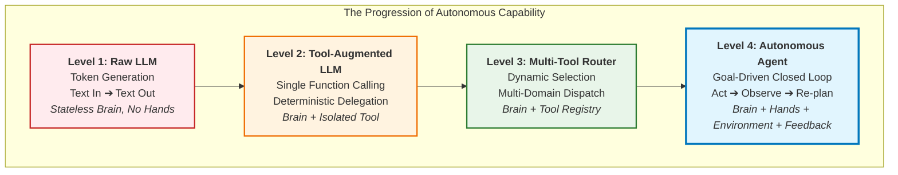

# Lecture 05 Notes: AI Agents — Tools, Autonomous Loops & Building an Agent

Welcome to the comprehensive, enterprise-grade course notes for **Lecture 05: AI Agents — Tools, Autonomous Loops & Building an Agent (From LLMs to Tools to Agents)**.

These notes synthesize, formalize, and dramatically expand upon the core concepts introduced in [`Notes.pdf`](./Notes.pdf) and the conceptual architectural sketches in [`Excalidraw-Notes.svg`](./Excalidraw-Notes.svg). All architectural topologies, pseudocode, tool contracts, security sandboxes, and agent loops are authored in modern **TypeScript / Node.js** to reflect enterprise Forward Deployed Engineering (FDE) practices.

---

## 🧭 The Core Evolution: From LLM to Agent

### The Master Formula
$$\mathbf{AI\ Agent} = \mathbf{Foundation\ LLM} + \mathbf{Tools} + \mathbf{Environment} + \mathbf{Observations} + \mathbf{Decision\ Loop} + \mathbf{Goal}$$

---

## 📚 Chapter Navigation Index

| Chapter | Module Title | Core Topics & Key Engineering Concepts |
| :--- | :--- | :--- |
| **[Chapter 01](./01_From_Token_Prediction_to_Tool_Augmentation.md)** | **From Token Prediction to Tool Augmentation** | Fundamental limits of autoregressive token prediction ($P(w_t \mid w_{<t})$); generating action strings vs. performing actions; the "Hands vs. Brain" mental model (the genius trapped in a room); linguistic impedance mismatch (why natural language breaks traditional software); LLMs as universal semantic decoders; why naïve "Return JSON" prompting fails in production (markdown fences, schema drift, hallucinated keys). |
| **[Chapter 02](./02_The_Tool_Calling_Protocol_and_Wire_Architecture.md)** | **The Tool Calling Protocol & Wire Architecture** | Deconstructing tools: ordinary functions + JSON Schema contracts; OpenAPI/JSON Schema wire format (`name`, `description`, `parameters`, `required`); the 5-step wire protocol lifecycle (`user` ➔ `assistant` with `tool_calls` ➔ runtime execution ➔ `tool` message ➔ final response); TypeScript schemas with Zod; building deterministic tools (Safe Calculator) and live information tools (Weather, Currency Exchange); multi-tool routing and `tool_choice` policies. |
| **[Chapter 03](./03_Multi_Step_Tool_Chaining_and_Execution_Loops.md)** | **Multi-Step Tool Chaining & Execution Loops** | Multi-tool sequential dependencies (Currency ➔ Calculator) and parallel dispatches (Weather + Currency); the ReAct framework (Reasoning + Acting: Thought ➔ Action ➔ Observation); two functional families: Informative Tools vs. Action Tools; building the autonomous TypeScript execution engine; recursion guards, maximum turn limits, and runaway loop prevention; self-correction of runtime tool exceptions; token ledger accumulation across iterations. |
| **[Chapter 04](./04_First_Principles_of_AI_Agents_and_Agency_Spectrum.md)** | **First Principles of AI Agents & The Agency Spectrum** | The 4 Levels of Agency; the First-Principles 6-Component Agent Model (Goal, Decision Maker, Actions, Environment, Observations, Decision Loop); Agent vs. Workflow architectural comparison (Deterministic Graph/DAG vs. Dynamic Emergence; What+How vs. What+Self-Directed How); hybrid workflows (Agent inside DAG); general-purpose emergence: BrewLab Coffee Shop vs. NeuralForge AI Robotics with zero code changes. |
| **[Chapter 05](./05_Workspace_Sandboxing_and_Agent_Security.md)** | **Workspace Sandboxing & Agent Security** | Principle of Least Privilege: Tool = Capability + Permission; why unrestricted shell tools (`exec`, `bash`) are fatal in production; threat modeling: path traversal (`../../etc/passwd`), privilege escalation, data wiping, and indirect prompt injection; building `WorkspaceTools` in TypeScript; rigorous path normalization and boundary containment (`safePath`); containerization vs. chroot vs. in-process sandbox layers. |
| **[Chapter 06](./06_Building_an_Autonomous_Website_Builder_Agent.md)** | **Building an Autonomous Website Builder Agent** | Complete end-to-end case study: The Website Builder Agent; job description and system prompt engineering ("Don't describe the action. Perform it!"); four core workspace tools (`createDirectory`, `writeFile`, `readFile`, `listFiles`); end-to-end TypeScript orchestrator; trace execution of BrewLab coffee landing page; the environmental feedback loop: reading back generated files, verifying DOM structure, and iterative self-repair. |
| **[Chapter 07](./07_Human_In_The_Loop_Safety_and_Enterprise_Patterns.md)** | **Human-in-the-Loop Safety & Enterprise Patterns** | High-impact actions and catastrophic risk (financial transfers, data deletion, customer emails); Human-in-the-Loop (HITL) approval gates; tool authorization classifications (Tier 1 Read-only Auto, Tier 2 Scoped Mutate, Tier 3 Critical Approval Required); synchronous vs. asynchronous durable pause/resume state machines; Naïve Chatbot vs. Enterprise Autonomous Agent comparison matrix; 25 Cardinal Engineering Principles for Production AI Agents. |

---

## 📄 Master Consolidated Document

For an end-to-end reading experience with all chapters merged into a single reference, see:
👉 **[Lecture 05 Complete Consolidated Notes](./Lecture_05_Complete_Notes.md)**

---

## 🛠 Architectural Highlights of this Lecture

- **Pure TypeScript / Node.js:** All tool schemas, parameter validators, sandboxed file operations, and autonomous agent loops are implemented in clean, type-safe TypeScript.
- **Protocol-Level Wire Understanding:** Moves beyond framework magic (Spring AI, LangChain, LlamaIndex) to examine raw HTTP payloads, JSON Schema function definitions, and multi-turn message arrays.
- **Defense-in-Depth Security:** Deep focus on sandboxing, path traversal prevention, command injection mitigations, and human-in-the-loop authorization gates.
- **Mermaid Visualizations:** Includes comprehensive sequence diagrams, execution loops, state machines, and component topologies for every concept.
