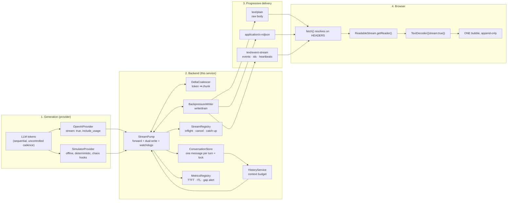

# Lecture 06: AI Streaming — Enterprise Streaming Microservice

Production TypeScript reference implementation for **Lecture 06: AI Streaming — From LLM Tokens to a Live Chat Experience**.

This service implements the entire streaming pipeline the lecture describes, with nothing hand-waved: token generation → provider deltas → backend chunks → progressive HTTP → browser `ReadableStream` → one growing assistant bubble.

> **The engineering thesis, executable:** streaming is not a feature you enable, it is a *pipeline that must stay unbroken at every layer*. This codebase ships the failure modes as tests — buffering regressions, mid-stream failures, stalls, cancellations and hostile byte fragmentation — so the pipeline can be proven, not asserted.

---

## 🧭 Architecture



---

## ✅ What makes this production-grade

| Concern | Implementation | Notes chapter |
| :--- | :--- | :--- |
| **Never buffer** | The pump writes every coalesced chunk immediately; the only buffer is the per-request history buffer | §6.3 inv. 1–2 |
| **Coalescing policy** | Boundary / size / time flush triggers — token ≠ provider delta ≠ chunk | §4.2, §10.1 |
| **Backpressure** | `res.write()` result + `drain` with a bounded wait, plus a hard socket-queue ceiling | §6.5 |
| **Three transports** | Raw `text/plain`, NDJSON, and the full SSE grammar (`event`/`id`/`data`/`retry`/`: keep-alive`) | §5.3, §5.5 |
| **Anti-buffering headers** | `X-Accel-Buffering: no`, `Cache-Control: no-transform`, `Content-Encoding: identity`, no `Content-Length` | §5.6, §10.2 |
| **Timeouts that fit streaming** | TTFT budget, idle watchdog, total ceiling, plus Node `requestTimeout` raised above the ceiling | §10.2 items 3–5 |
| **In-band error protocol** | After `200 OK`, failures arrive as `event: error` + `done{status:"interrupted"}` | §7.7 |
| **Cancellation propagation** | socket close → `AbortController` → provider signal; explicit `POST …/cancel`; graceful-shutdown drain | §6.6 |
| **Dual-write persistence** | Per-request buffer, ONE upsert by a pre-generated `messageId`, idempotent | §8.2, §8.7 |
| **Interrupted turns kept** | `status: "interrupted"` + finish reason + annotation in the next prompt | §8.5 |
| **Isolation** | Conversation-scoped state, per-conversation lock, concurrency caps | §7.8 |
| **Retry discipline** | Jittered retry only *before* the first token; never mid-stream | §7.9 item 5 |
| **Observability** | One structured log line per stream + Prometheus histograms + the `p95(clientTTFT − serverTTFT)` alert | §10.3 |
| **Recovery** | Bounded replay ring + `catch-up?fromSeq=` cursor endpoint | §5.3.1, §10.2 |
| **Client correctness** | ONE decoder with `{stream:true}`, frame carry buffers, lazy bubble, rAF rendering, sticky scroll, sanitised markdown | §9.3–§9.11 |

---

## 📡 Wire protocol

One frame taxonomy, three encodings. The client appends `delta.text` and nothing else.

| Frame | Purpose | NDJSON | SSE |
| :--- | :--- | :--- | :--- |
| `start` | requestId, conversationId, model, budgets | `{...}\n` | `event: start` + `data:` (+ `retry:`) |
| `delta` | append this text | `{...}\n` | `event: delta`, `id: <seq>` |
| `usage` | provider token usage (billing) | `{...}\n` | `event: usage` |
| `heartbeat` | keep-alive | `{...}\n` | `: keep-alive` comment |
| `error` | in-band failure + `partial` flag | `{...}\n` | `event: error` |
| `done` | status, finishReason, timings | `{...}\n` | `event: done`, `id: <chunks>` |

`text/plain` deliberately has **no frames**: termination is connection close, and errors use a NUL-delimited sentinel. That limitation is exactly why SSE and NDJSON exist, and the test suite asserts the difference.

---

## 📁 Directory structure

```text
Lecture 06/code/
├── public/                              # The BROWSER half of the pipeline
│   ├── index.html                       # Chat UI, telemetry HUD, wire inspector
│   ├── app.js                           # fetch + ReadableStream + TextDecoder + rAF render
│   └── styles.css
├── src/
│   ├── app.ts                           # Express factory, static mount, error boundary
│   ├── server.ts                        # Bootstrap, stream-aware graceful shutdown
│   ├── config/
│   │   └── env.ts                       # Zod-validated streaming knobs
│   ├── types/
│   │   └── stream.types.ts              # Provider contract, wire frames, store records
│   ├── lib/
│   │   ├── logger.ts                    # Structured one-line JSON + precise redaction
│   │   ├── metrics.ts                   # Counters/histograms, alerts, /metrics text
│   │   ├── text-codec.ts                # Byte accounting, frame encoders, LineSplitter
│   │   └── timing.ts                    # Abortable sleep, monotonic clock, jitter
│   ├── providers/
│   │   ├── provider.errors.ts           # Error taxonomy + classification
│   │   ├── openai.provider.ts           # Live streaming provider
│   │   ├── simulator.provider.ts        # Deterministic offline provider + chaos hooks
│   │   └── index.ts                     # Provider resolution / failover slot
│   ├── stream/
│   │   ├── delta-coalescer.ts           # provider deltas ➔ application chunks
│   │   ├── backpressure.ts              # write/drain/queue budget
│   │   └── stream-pump.ts               # THE pipeline engine (invariants 1–7)
│   ├── services/
│   │   ├── conversation.store.ts        # Dual-write target + per-conversation lock
│   │   ├── history.service.ts           # Context assembly + token budget
│   │   ├── stream-registry.ts           # In-flight registry, cancel, replay ring
│   │   └── chat.service.ts              # Orchestration, retry, buffered baseline
│   ├── routes/
│   │   ├── chat.routes.ts               # buffered · stream · events · cancel · catch-up
│   │   ├── conversation.routes.ts       # transcript, budget, purge
│   │   └── observability.routes.ts      # health, client-TTFT, reset
│   └── scripts/
│       ├── harness.ts                   # In-process server + byte-accurate consumer
│       ├── cli-stream-consumer.ts       # Live terminal stream with TTFT/ITL summary
│       ├── test-utf8-fragmentation.ts   # Torture test (1 byte at a time)
│       ├── test-pipeline-invariants.ts  # CI gate: 40+ streaming assertions
│       ├── test-cancellation.ts         # Abort → cancel → partial persistence
│       └── benchmark-latency.ts         # Transport × granularity latency matrix
├── implementations guide/               # Chapter-by-chapter walkthrough (00 → 16)
├── test-requests.http                   # 18 REST cases + curl diagnostics
└── package.json · tsconfig.json · .env.example
```

---

## ⚡ Quickstart

```bash
npm install
cp .env.example .env      # simulator mode works with no API key at all
npm run build             # typecheck + emit dist/
npm run dev               # http://localhost:8090  (UI at /)
```

Open **http://localhost:8090/** — the UI has transport and granularity selectors, chaos toggles (stall, mid-stream error, TTFT breach), a live telemetry HUD and a raw wire inspector. Tick **❌ Anti-pattern mode** to watch `await response.text()` destroy the experience and set client TTFT equal to total time.

Set a real `OPENAI_API_KEY` in `.env` to stream from OpenAI with `stream: true` and `include_usage`; nothing else in the pipeline changes.

---

## 🧪 Verification & demonstration scripts

```bash
npm run stream:cli                     # live terminal stream + TTFT/ITL/chars-per-sec summary
npm run stream:cli -- --transport=sse --granularity=token
npm run stream:cli -- --transport=text --prompt="Explain TPOT"

npm run test:utf8                      # UTF-8 torture test: 1 byte at a time, plus the naive-bug control
npm run test:invariants                # CI gate: 40+ assertions across all transports, chaos and telemetry
npm run test:cancel                    # abort → provider cancel → partial persistence → lock release
npm run bench:latency                  # transport × granularity latency matrix + buffered comparison

npm run verify                         # build + utf8 + invariants
```

Every script boots the app **in-process on an ephemeral port**, so the whole suite runs with no API key, no fixed port and no external services.

### Measured results (simulator, single local run)

| Check | Result |
| :--- | :--- |
| UTF-8 fragmentation | **42/42** fragment sizes (1–1024 bytes) reassemble byte-identically; the naive per-chunk decoder produced **17 corrupted combinations** with U+FFFD |
| Streaming invariant | 14 chunks for a 769-char answer; TTFT/total ratio **0.39 (SSE) · 0.49 (NDJSON)** — far below the 0.5 buffering threshold |
| Buffered baseline | client waited **726 ms** for the whole body vs **374 ms** TTFT when streaming, with nearly identical total time |
| Mid-stream failure | HTTP stayed `200`; an `error` frame with `partial: true` was delivered and the partial answer persisted |
| Idle watchdog | `upstream_stall` closed a silent stream after ~1.6 s (1.2 s budget) with 2 heartbeats emitted |
| TTFT budget | `provider_timeout` after 1.2 s, flagged `recoverable: true` |
| Cancellation | partial text persisted **byte-for-byte as delivered**, ONE assistant message, `finishReason: "client_abort"`, lock released, follow-up turn succeeded |
| Raw text + heartbeats | **0** heartbeat bytes injected into a `text/plain` body (they would corrupt it) |

---

## 📡 API endpoints

| Method | Endpoint | Description |
| :--- | :--- | :--- |
| `GET` | `/health` | Liveness + active provider/model |
| `GET` | `/metrics` | Prometheus exposition (TTFT, ITL, chunks, aborts, in-band errors, alerts) |
| `POST` | `/api/chat` | **Buffered** JSON completion (comparison baseline) |
| `POST` | `/api/chat/stream?transport=text\|ndjson\|sse` | Progressive streaming |
| `POST` | `/api/chat/events` | Streaming, forced to SSE |
| `POST` | `/api/chat/streams/:requestId/cancel` | Server-side cancellation |
| `GET` | `/api/chat/streams/:requestId/catch-up?fromSeq=N` | Cursor-based recovery of missed frames |
| `GET` | `/api/chat/streams` | In-flight stream inventory |
| `GET` | `/api/conversations` · `/:id` · `/:id/budget` | Transcripts, statuses and the next prompt's budget |
| `DELETE` | `/api/conversations/:id` | Purge a transcript |
| `GET` | `/api/observability` | Streaming health, latency percentiles, alerts |
| `POST` | `/api/observability/client-ttft` | Report client TTFT ⇒ drives the TTFT-gap alert |

---

## ⚙️ Streaming configuration (`.env`)

| Variable | Default | Meaning |
| :--- | :--- | :--- |
| `STREAM_GRANULARITY` | `sentence` | `token` · `word` · `sentence` · `random` (hostile fragmentation) |
| `STREAM_FLUSH_MS` | `40` | Time window before a partial chunk is force-flushed |
| `STREAM_MAX_CHUNK_CHARS` | `180` | Upper bound on chunk size |
| `STREAM_HEARTBEAT_MS` | `10000` | Keep-alive cadence (must be below every proxy idle timeout) |
| `STREAM_TTFT_BUDGET_MS` | `20000` | Fail the stream if no first token arrives |
| `STREAM_IDLE_TIMEOUT_MS` | `30000` | Fail the stream if the provider goes silent |
| `STREAM_TOTAL_TIMEOUT_MS` | `180000` | Hard ceiling per generation (also raises Node's `requestTimeout`) |
| `STREAM_MAX_CLIENT_QUEUE_BYTES` | `1048576` | Socket backlog ceiling before a slow client is dropped |
| `MAX_CONCURRENT_STREAMS_PER_CONVERSATION` | `1` | Serialises turns within a conversation |
| `MAX_CONCURRENT_STREAMS_GLOBAL` | `64` | Admission control |
| `HISTORY_MAX_TURNS` / `HISTORY_TOKEN_BUDGET` | `24` / `6000` | Context assembly budget (prompt length drives TTFT) |
| `TTFT_GAP_ALERT_MS` | `500` | Threshold for `p95(clientTTFT − serverTTFT)` |

---

## 📚 Mapping to the lecture notes

| Notes chapter | Where it lives in this code |
| :--- | :--- |
| 01 Autoregressive decoding | `providers/simulator.provider.ts` (pseudo-token loop, usage estimation) |
| 02 Generation vs delivery | `POST /api/chat` (buffered) vs `/api/chat/stream` — same service, same store |
| 03 TTFT · ITL · perceived latency | `stream-pump.ts` timings, `lib/metrics.ts`, `benchmark-latency.ts`, the UI HUD |
| 04 Granularity & bytes | `lib/text-codec.ts`, `delta-coalescer.ts`, `test-utf8-fragmentation.ts` |
| 05 HTTP mechanics (chunked/SSE/WS) | `lib/text-codec.ts` encoders + headers, `test-pipeline-invariants.ts` §7 |
| 06 End-to-end pipeline & invariants | `stream/stream-pump.ts` (invariants 1–7 enforced), `backpressure.ts` |
| 07 `.call()` vs `.stream()` / Flux | `providers/*` (`AsyncIterable` contract), `chat.service.ts` retry + buffered path |
| 08 History, buffering, persistence | `conversation.store.ts`, `history.service.ts` (dual-write, interrupted turns) |
| 09 Frontend `fetch`/`ReadableStream` | `public/app.js` (decoder discipline, carry buffers, rAF, abort, sticky scroll) |
| 10 Production hardening | `lib/metrics.ts`, `routes/observability.routes.ts`, chaos tests, this README |

**Companion documentation:** [`implementations guide/README.md`](./implementations%20guide/README.md) — a chapter-by-chapter walkthrough (00 → 16) containing the complete source of every file with block-by-block explanations.
