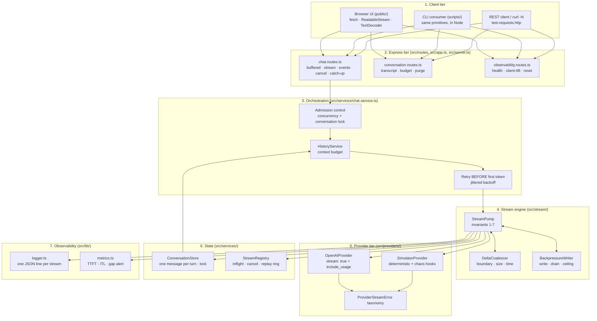

# Chapter 00: System Overview, Architectural Blueprint & File Structure

> **Chapter Goal:** Establish the architecture before a single line of code is read. Understand what the service does, how the streaming pipeline is decomposed into modules, which design patterns are applied, where every file lives, and which commands drive the system.

---

## 0.1 What This Codebase Is

An **enterprise AI streaming microservice**: a production-shaped backend plus its browser client that together implement the entire lecture pipeline.

```text
Generation → Provider Streaming → Backend Streaming → HTTP Streaming → Browser Streaming → Live UI
```

Everything else in this guide exists to make one of those six links correct, observable, and testable. The service ships **three delivery transports** (raw `text/plain`, NDJSON, SSE) because the lecture's central claim is that *streaming ≠ SSE* — a claim that is far more convincing when you can switch transports at runtime and watch the numbers change.

---

## 0.2 Architectural Blueprint



### Why this decomposition

| Layer | Owns | Must never |
| :--- | :--- | :--- |
| Provider | Turning a prompt into an `AsyncIterable` of deltas | Buffer, retry after the first token |
| Stream engine | Forwarding bytes, coalescing, backpressure, timeouts | Contain application state |
| Orchestration | Admission, budget, retry, persistence wiring | Write to the socket directly |
| Routes | Validation and status codes before the first byte | Touch the response body |
| State | Conversation-scoped records and locks | Share mutable history across users |
| Observability | Measurement | Sit on the hot path |

## 0.3 Design Patterns Applied

1. **AsyncIterable as the streaming contract (`Flux<String>` equivalent).** The provider returns a stream, not a `Promise<string>`. This is the single decision that makes buffering impossible above the provider layer.
2. **Producer/consumer with explicit flow control.** The pump consumes; `BackpressureWriter` translates `res.write()` backpressure into a *stall* with a bounded wait.
3. **Dual-write (stream out, buffer in).** Every chunk is forwarded *and* appended to a per-request buffer, persisted exactly once under a pre-generated id (idempotent upsert).
4. **Conversation-scoped state + mutex.** No shared `history` field anywhere; `runExclusive` serialises turns per conversation and releases in `finally`.
5. **Registry / admission control.** In-flight streams are first-class objects with an abort handle, a bounded replay ring, and concurrency caps.
6. **In-band error protocol.** Once `200 OK` is on the wire, failure is a *frame*, not a status code.
7. **Watchdogs.** Three independent timers (TTFT budget, idle, total) convert hangs into observable, classifiable failures.
8. **Chaos injection as a feature.** The simulator can stall, fail mid-stream, or breach the TTFT budget on demand — which is how failure paths are tested in CI.

---

## 0.4 File Structure

```text
Lecture 06/code/
├── public/
│   ├── index.html                       # Chat UI · telemetry HUD · wire inspector
│   ├── app.js                           # The browser half of the pipeline
│   └── styles.css
├── src/
│   ├── app.ts                           # Express factory, static mount, error boundary
│   ├── server.ts                        # Bootstrap + stream-aware graceful shutdown
│   ├── config/env.ts                    # Zod-validated streaming knobs
│   ├── types/stream.types.ts            # Provider contract · wire frames · store records
│   ├── lib/
│   │   ├── logger.ts                    # Structured JSON logging + precise redaction
│   │   ├── metrics.ts                   # Histograms, alerts, Prometheus exposition
│   │   ├── text-codec.ts                # Byte math, fragmentation, encoders, LineSplitter
│   │   └── timing.ts                    # Abortable sleep, monotonic clock, jitter
│   ├── providers/
│   │   ├── provider.errors.ts           # Error taxonomy + classification
│   │   ├── openai.provider.ts           # Live provider
│   │   ├── simulator.provider.ts        # Offline provider + chaos
│   │   └── index.ts                     # Resolution / failover slot
│   ├── stream/
│   │   ├── delta-coalescer.ts           # provider deltas ➔ application chunks
│   │   ├── backpressure.ts              # write / drain / queue ceiling
│   │   └── stream-pump.ts               # THE pipeline engine
│   ├── services/
│   │   ├── conversation.store.ts        # Records, lock, TTL sweep
│   │   ├── history.service.ts           # Context assembly + budget
│   │   ├── stream-registry.ts           # Inflight registry, cancel, replay
│   │   └── chat.service.ts              # Orchestration + buffered baseline
│   ├── routes/
│   │   ├── chat.routes.ts
│   │   ├── conversation.routes.ts
│   │   └── observability.routes.ts
│   └── scripts/
│       ├── harness.ts                   # In-process server + byte-accurate consumer
│       ├── cli-stream-consumer.ts       # Live terminal streaming demo
│       ├── test-utf8-fragmentation.ts   # Torture test
│       ├── test-pipeline-invariants.ts  # CI gate (40+ assertions)
│       ├── test-cancellation.ts         # Abort → cancel → partial persistence
│       └── benchmark-latency.ts         # Transport × granularity matrix
├── implementations guide/               # This guide
├── test-requests.http                   # 18 REST cases + curl diagnostics
└── package.json · tsconfig.json · .env.example · .gitignore
```

## 0.5 Prerequisites & Commands

**Prerequisites:** Node.js ≥ 18.17 (Node 20+ recommended), npm ≥ 9. No API key is required — without one the deterministic simulator drives every path.

```bash
npm install                # install dependencies
cp .env.example .env       # simulator defaults, no key needed
npm run build              # strict typecheck + emit dist/
npm run dev                # dev server with reload → http://localhost:8090
npm start                  # build then run from dist/

npm run stream:cli         # live streaming demo in the terminal
npm run test:utf8          # UTF-8 fragmentation torture test
npm run test:invariants    # pipeline invariants (CI gate)
npm run test:cancel        # cancellation + partial persistence
npm run bench:latency      # latency matrix + buffered comparison
npm run verify             # build + utf8 + invariants
```

---

## 0.6 How to Read This Guide

| Chapter | Files | Lecture link |
| :---: | :--- | :--- |
| 01 | `package.json`, `tsconfig.json`, `.gitignore`, `.env.example` | toolchain |
| 02 | `src/config/env.ts` | §10.2 knobs |
| 03 | `src/types/stream.types.ts` | §4, §5, §8 |
| 04 | `src/lib/logger.ts`, `src/lib/metrics.ts` | §3, §10.3 |
| 05 | `src/lib/text-codec.ts`, `src/lib/timing.ts` | §4, §5 |
| 06 | `src/providers/*` | §7.1–§7.4 |
| 07 | `src/stream/delta-coalescer.ts`, `src/stream/backpressure.ts` | §4.2, §6.5 |
| 08 | `src/stream/stream-pump.ts` | §6.3, §7.7 |
| 09 | `src/services/conversation.store.ts` | §8.2, §8.5, §8.7 |
| 10 | `src/services/history.service.ts` | §8.6 |
| 11 | `src/services/stream-registry.ts` | §7.8, §10.2 |
| 12 | `src/services/chat.service.ts` | §7.7, §7.9 |
| 13 | `src/routes/*`, `src/app.ts`, `src/server.ts` | §5.3, §5.6 |
| 14 | `public/*` | §9 |
| 15 | `src/scripts/*` | §10.5 |
| 16 | `test-requests.http` + checklists | §10.2, §10.5 |

Each chapter follows the same shape: **files covered → complete source → block-by-block explanation**. Read them in order; each builds on the contracts defined by the previous.

---

**Next:** [Chapter 01 — Project Initialization & TypeScript Setup](./01_Project_Initialization_and_TypeScript_Setup.md)
