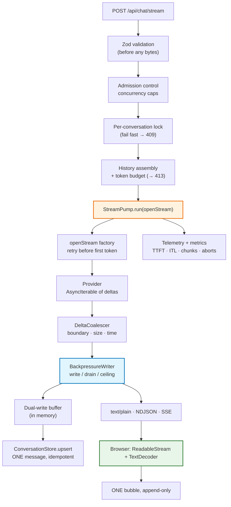
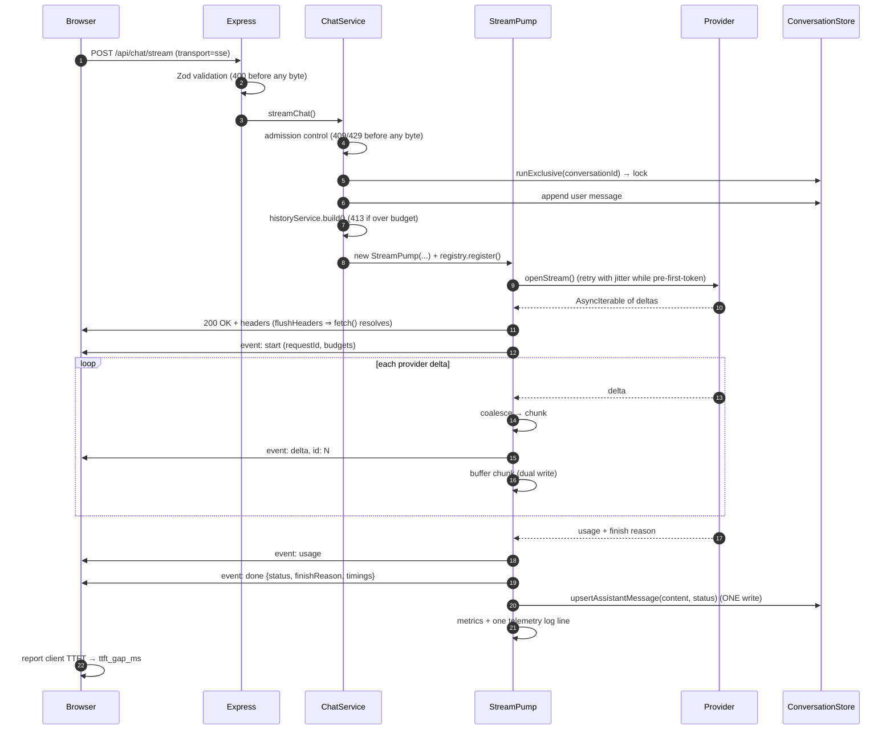

# Lecture 06: Complete Implementation Guide
## Enterprise AI Streaming Microservice — from LLM tokens to a live UI

> **Master engineering reference.** This document condenses Chapters 00–16 of the implementation guide into a single end-to-end manual: the architecture, the invariants, the reasoning behind every layer, and the commands that prove the whole thing works. Each section links to the chapter that contains the complete source of the files it discusses.

---

## 📑 Table of Contents

1. [The One-Paragraph Summary](#1-the-one-paragraph-summary)
2. [System Architecture](#2-system-architecture)
3. [The Seven Pipeline Invariants](#3-the-seven-pipeline-invariants)
4. [Layer-by-Layer Reference](#4-layer-by-layer-reference)
   - 4.1 [Toolchain & configuration](#41-toolchain--configuration-chapters-0102)
   - 4.2 [Contracts & observability primitives](#42-contracts--observability-primitives-chapters-0304)
   - 4.3 [Byte codec & provider layer](#43-byte-codec--provider-layer-chapters-0506)
   - 4.4 [The stream engine](#44-the-stream-engine-chapters-0708)
   - 4.5 [State, history & orchestration](#45-state-history--orchestration-chapters-0912)
   - 4.6 [HTTP surface & server](#46-http-surface--server-chapter-13)
   - 4.7 [The browser client](#47-the-browser-client-chapter-14)
   - 4.8 [Verification](#48-verification-chapters-1516)
5. [Data Flow: One Request, End to End](#5-data-flow-one-request-end-to-end)
6. [Failure Semantics Reference](#6-failure-semantics-reference)
7. [Measured Results](#7-measured-results)
8. [The Twenty-Point Hardening Checklist](#8-the-twenty-point-hardening-checklist)
9. [Engineering Takeaways](#9-engineering-takeaways)

---

## 1. The One-Paragraph Summary

An LLM emits tokens one at a time. The provider exposes them as deltas. Our backend forwards each delta **without buffering** while buffering them internally for history, HTTP carries them progressively in one of three framings, and the browser appends each decoded piece to **one** assistant message. This codebase implements exactly that chain, and — more importantly — it makes each link *testable*: 42 UTF-8 fragmentation combinations, 40+ pipeline assertions, a cancellation suite that verifies partial persistence byte-for-byte, and a latency benchmark that shows a **~350 ms** perceived-latency improvement with an identical total duration.

---

## 2. System Architecture

**Module responsibilities** (full sources in the linked chapters):

| Module | Owns | Never does |
| :--- | :--- | :--- |
| `providers/*` (ch. 06) | Prompt → `AsyncIterable<ProviderDelta>` | Buffer, retry mid-stream |
| `stream/stream-pump.ts` (ch. 08) | Forwarding, watchdogs, dual-write, in-band errors | Hold application state |
| `stream/delta-coalescer.ts` (ch. 07) | provider deltas → application chunks | Delay beyond the time window |
| `stream/backpressure.ts` (ch. 07) | write/drain/queue ceiling | Ignore a `false` from `write()` |
| `services/chat.service.ts` (ch. 12) | Admission, retry, wiring | Touch the response body |
| `services/conversation.store.ts` (ch. 09) | Records, lock, TTL | Store fragments as messages |
| `services/history.service.ts` (ch. 10) | Budgeted prompt assembly | Silently drop the newest turn |
| `services/stream-registry.ts` (ch. 11) | Inflight, cancel, replay | Leak an entry |
| `lib/*` (ch. 04, 05) | Logging, metrics, bytes, frames, time | Sit on the hot path |
| `public/*` (ch. 14) | Decoding, rendering, cancellation | `await response.text()` |

---

## 3. The Seven Pipeline Invariants

Each invariant, if violated at a single layer, silently converts a streaming system into a buffered one. The table gives the enforcement point and the test that fails when it breaks.

| # | Invariant | Enforcement | Regression test |
| :--- | :--- | :--- | :--- |
| 1 | **Forward, never accumulate** | `StreamPump.handleDelta` writes every coalesced chunk immediately; the only buffer is the dual-write one | `chunkCount > 2` for all three transports |
| 2 | **Flush per chunk** | `res.writeHead()` + `flushHeaders()` + one `write()` per chunk, no `Content-Length` | `clientTtft < 0.5 × total` |
| 3 | **Intermediaries must not buffer** | `X-Accel-Buffering: no`, `Cache-Control: no-transform`, `Content-Encoding: identity`, no compression middleware | header dump via `curl -sD -` |
| 4 | **The connection must not idle out** | heartbeat timer emitting `: keep-alive` (SSE) / `heartbeat` frames, below every configured timeout | `heartbeats >= 1` during an injected stall |
| 5 | **The client must read incrementally** | `response.body.getReader()` + one `TextDecoder` with `{ stream: true }` + carry buffers | fragmentation invariance at 1/3/17/1024-byte slices |
| 6 | **The UI must append, not replace** | one lazily created bubble, `rawText += chunk`, rAF-batched render | UI checklist (ch. 14) |
| 7 | **Cancellation must propagate** | `res.on('close')` → `AbortController` → provider `signal`; explicit cancel endpoint; graceful-shutdown drain | `test:cancel` (provider stopped early, partial persisted) |

> **Why "it works in my terminal" is not evidence:** `curl -N` bypasses proxies, compression and browsers, so it validates invariants 1, 2 and 4 only. Invariants 3, 5 and 6 fail *only* in real deployments — which is why the browser client ships with a wire inspector, a telemetry HUD and an executable anti-pattern toggle.

---

## 4. Layer-by-Layer Reference

### 4.1 Toolchain & configuration (Chapters 01–02)

| Decision | Rationale |
| :--- | :--- |
| Node ≥ 18.17, native ESM, `NodeNext` | Modern `ReadableStream`/`TextDecoder` semantics on both sides; `.js` import extensions required and correct |
| `strict: true` | `ttftMs: number \| null` cannot be read without a check — the compiler enforces "no first token yet" discipline |
| Zod-validated `env.ts` with `process.exit(1)` | A misconfigured streaming service that starts anyway fails mid-stream, in production |
| Custom `BooleanFromString` | `z.coerce.boolean()` parses the string `"false"` as `true` — a silent feature-flag bug |
| Three independent timeouts | `provider_timeout` (never started), `upstream_stall` (went silent), `total_timeout` (too long) need different messages and remedies |
| No compression dependency | gzip on a progressive body re-buffers it (hardening #2) |

### 4.2 Contracts & observability primitives (Chapters 03–04)

- **`stream.types.ts`** is the single source of truth for: the provider contract (`AsyncIterable`), the six-frame wire taxonomy (as a discriminated union, so every handler is exhaustiveness-checked), the persisted record (with `status`, `finishReason`, `firstTokenAt`, `completedAt`), and the telemetry line shape.
- **`logger.ts`** emits one JSON line per stream with correlation ids and *precise* redaction — a naive `/token/i` rule would mask `promptTokens` and `completionTokens`, the very fields the telemetry exists for.
- **`metrics.ts`** provides counters, gauges and histograms with both Prometheus buckets and a bounded in-process sample ring, so real percentiles (and the TTFT-gap alert) are available with no metrics backend. Cardinality is bounded by construction: no request ids as labels.

### 4.3 Byte codec & provider layer (Chapters 05–06)

- **`text-codec.ts`** is where "token ≠ provider delta ≠ network chunk ≠ decoded string" becomes executable: `utf8ByteLength`, `fragmentStringByBytes` (the torture-test generator), one encoder per transport (including the `null` return that keeps heartbeats out of raw text), the mandatory anti-buffering headers, and a carry-buffer `LineSplitter`.
- **Providers** return a **stream type**, never a `Promise<string>`. `ProviderStreamError.retryable` carries the retry policy; `classifyProviderError` normalises SDK failures at the boundary; `OpenAIProvider` disables SDK retries (`maxRetries: 0`) and enables `include_usage`; `SimulatorProvider` makes stalls, mid-stream failures and TTFT breaches reproducible.

### 4.4 The stream engine (Chapters 07–08)

- **`DeltaCoalescer`** — three flush triggers (boundary / size / time), because each solves a different problem: rendering quality, bounded work per write, and bounded latency.
- **`BackpressureWriter`** — `write()` returns whether the caller must stop, `drain()` resolves with a *reason* (`drained`/`timeout`/`closed`), and a queue ceiling converts an unbounded backlog into `client_slow`.
- **`StreamPump`** — the seven invariants in one class: an `openStream` factory so pre-first-byte failures get real statuses; a serialised write chain so `seq` stays monotonic; a single ticker doing coalescing flush, heartbeats and three watchdogs; explicit terminal frames for completed/interrupted/aborted; dual-write buffering with one persistence call; and full telemetry (server TTFT, ITL, chunks, TPS, bytes).

### 4.5 State, history & orchestration (Chapters 09–12)

- **`ConversationStore`** — conversation-scoped records, idempotent upsert by a pre-generated `messageId`, ordinal/createdAt preserved on update, TTL sweep, and a promise-chain mutex (`runExclusive`) that fails fast and always releases in `finally`.
- **`HistoryService`** — walks history backwards under a hard token budget, annotates interrupted turns so the model knows the previous answer was cut off, and reports `overBudget` so the request fails with `413` before spending a token.
- **`StreamRegistry`** — admission control (per conversation and global), first-class abort handles, and a bounded replay ring storing frames *verbatim* for cursor-based catch-up.
- **`ChatService`** — the ordering that matters: admission → lock → record user turn → budget → pump; retry only inside the pre-header factory; plus a buffered path for honest comparison.

### 4.6 HTTP surface & server (Chapter 13)

| Endpoint | Purpose |
| :--- | :--- |
| `POST /api/chat` | Buffered baseline (returns internal TTFT vs total) |
| `POST /api/chat/stream?transport=text\|ndjson\|sse` | Progressive delivery |
| `POST /api/chat/events` | Forced SSE |
| `POST /api/chat/streams/:requestId/cancel` | Server-side cancellation |
| `GET /api/chat/streams/:requestId/catch-up?fromSeq=N` | Cursor recovery |
| `GET /api/chat/streams` | In-flight inventory |
| `GET /api/conversations[/:id][/:id/budget]` | Transcript, statuses, next-prompt budget |
| `GET /api/observability`, `POST …/client-ttft` | Latency percentiles, alerts, the gap metric |
| `GET /metrics`, `GET /health` | Prometheus exposition, liveness |

Node specifics that decide whether long streams survive: `requestTimeout` raised above the generation ceiling (the 300 s default would kill healthy streams), `keepAliveTimeout` above the proxy idle timeout, and a shutdown handler that cancels every in-flight stream so partial turns are persisted instead of vanishing.

### 4.7 The browser client (Chapter 14)

| Requirement | Implementation |
| :--- | :--- |
| Read bytes incrementally | `response.body.getReader()` in a loop |
| Decode safely | ONE `TextDecoder` with `{ stream: true }`, flushed once at the end |
| Parse frames safely | carry buffers for NDJSON lines and SSE `\n\n` frames |
| One bubble | created lazily on first text, appended to forever |
| Smooth rendering | dirty flag + `requestAnimationFrame`, escaped-then-markdown render |
| Respectful scrolling | sticky-to-bottom with a "jump to latest" affordance |
| Cancellation | `AbortController` + explicit server cancel; `AbortError` handled as an outcome |
| Recovery | `catch-up?fromSeq=` cursor, frames replayed through the same dispatcher |
| Accessibility | `role="log"`, `aria-live="polite"`, `aria-busy` while streaming |
| Teachability | transport/granularity/chaos controls, telemetry HUD, wire inspector, anti-pattern toggle |

### 4.8 Verification (Chapters 15–16)

| Script | What it proves |
| :--- | :--- |
| `test:utf8` | 42 fragmentation combinations reassemble byte-identically; the naive per-chunk decoder corrupts 17 of them |
| `test:invariants` | 10 sections / 40+ assertions: streaming, buffered contrast, fragmentation invariance, in-band errors, idle watchdog, TTFT budget, heartbeats vs raw text, concurrency 409, telemetry, no leaks |
| `test:cancel` | abort → provider cancelled → ONE message persisted byte-for-byte → annotated in the next prompt → lock released |
| `bench:latency` | transport × granularity latency matrix and the buffered-vs-streaming contrast |
| `stream:cli` | the same client discipline in a terminal, with TTFT/ITL/chars-per-second and a non-zero exit on buffering |

---

## 5. Data Flow: One Request, End to End

**The critical ordering in that diagram:** validation, admission, locking and budgeting all happen **before** the `200 OK`, which is why they can produce real HTTP statuses; everything after it is expressed in-band.

---

## 6. Failure Semantics Reference

| Failure | Detected by | Status | Client sees | Persisted as |
| :--- | :--- | :--- | :--- | :--- |
| Invalid request body | Zod | `400` | JSON error | nothing |
| Conversation already streaming | lock / registry | `409` | JSON error | nothing |
| Global capacity reached | registry | `429` | JSON error | nothing |
| Prompt over budget | `HistoryService` | `413` | JSON error | nothing |
| Provider refused the call | `openStream` (pre-header) | `502`/`504` | JSON error | nothing (retried up to 3× with jitter) |
| Provider fails mid-answer | pump loop | `200` (frozen) | `error` frame + `done{interrupted}` | partial, `provider_error` |
| Provider goes silent | idle watchdog | `200` | `error` frame `upstream_stall` (after heartbeats) | partial, `upstream_stall` |
| No first token | TTFT watchdog | `200` | `error` frame `provider_timeout` (recoverable) | empty, `provider_timeout` |
| Generation too long | total watchdog | `200` | `error` frame `total_timeout` | partial, `total_timeout` |
| Client stops reading | queue ceiling / drain timeout | `200` | nothing (they stopped reading) | partial, `client_slow` |
| User presses Stop / closes tab | `res.on('close')` | — | partial text stays on screen | partial, `client_abort` |
| Server deploy (SIGTERM) | shutdown handler | `200` | `error` frame + `done{interrupted}` | partial — **never a vanished turn** |

---

## 7. Measured Results

Simulator mode, single local run (Node 24, one machine — the point is the *relative* comparison, not the absolute numbers):

| Measurement | Result |
| :--- | :--- |
| Chunks per 769-character answer | **14** (sentence granularity) |
| TTFT / total ratio | **0.39 (SSE)** · **0.49 (NDJSON)** · 0.08 (token granularity) |
| Buffered baseline | client waited **726 ms** for the whole body |
| Streaming | **374 ms** to the first visible text, near-identical total time |
| Throughput | ~2,300 chars/s (far above the ~60–80 chars/s reading-speed threshold) |
| UTF-8 fragmentation | **42/42** combinations byte-identical; the naive decoder corrupted **17** |
| Idle watchdog | `upstream_stall` at **1.6 s** (1.2 s budget) with **2 heartbeats** emitted |
| TTFT budget | `provider_timeout` at **1.2 s**, flagged `recoverable` |
| Cancellation | partial text persisted byte-for-byte, ONE message, `client_abort`, lock released |
| Raw text + stall | **0** heartbeat bytes injected into the `text/plain` body |

---

## 8. The Twenty-Point Hardening Checklist

| # | Requirement | Where it lives |
| :--- | :--- | :--- |
| 1 | Proxy buffering disabled | `X-Accel-Buffering: no` |
| 2 | Compression excluded | `Content-Encoding: identity`; no compression middleware |
| 3 | Idle timeout > longest chunk gap | `STREAM_IDLE_TIMEOUT_MS` + `server.keepAliveTimeout` |
| 4 | Heartbeats every 10–15 s | `STREAM_HEARTBEAT_MS` |
| 5 | Correct headers | `streamResponseHeaders()` |
| 6 | Stream return type, never `String` | `StreamProvider.stream()` |
| 7 | No collector operators | the `chunkCount > 2` assertion |
| 8 | Cancellation propagates | `AbortController` chain + cancel endpoint |
| 9 | Per-request buffer, persist once | `StreamPump.chunks` + `onPersist` |
| 10 | Partial failures persisted | `status: "interrupted"` + finish reason |
| 11 | Conversation-scoped state + lock | `ConversationStore.runExclusive` |
| 12 | Rate limits | `MAX_CONCURRENT_STREAMS_*` |
| 13 | Output caps | `AI_MAX_OUTPUT_TOKENS` |
| 14 | Retries only before the first token | `ChatService.openProviderStream` |
| 15 | Provider failover slot | `providers/index.ts` |
| 16 | Payload limits before dispatch | `HISTORY_TOKEN_BUDGET` → `413` |
| 17 | Secrets server-side only | the key never leaves the server; two-tier log redaction |
| 18 | Observability metrics | `/metrics`, `/api/observability` |
| 19 | The TTFT-gap alert | `metrics.alerts()` |
| 20 | Fragmentation-invariance in CI | `test:invariants` section 3 |

---

## 9. Engineering Takeaways

1. **The return type is the architecture.** `.call()` vs `.stream()` matters only because `String` becomes `AsyncIterable`. Everything else follows from that one type.
2. **Streaming is a pipeline, not a feature.** Six links; one buffering hop anywhere collapses the experience, and the failure is invisible to every backend dashboard.
3. **The first byte freezes the status.** Design the in-band error protocol *before* you need it, because after `200 OK` there is no other way to say "this failed".
4. **Chunks are not messages.** Buffer in memory, persist one reconstructed message idempotently, and flag partial turns instead of deleting them.
5. **Coalescing is a policy, not an accident.** Boundary for rendering, size for bounded work, time for bounded latency — observable and configurable.
6. **Backpressure stalls; it does not overflow.** `res.write()` returning `false` is an instruction, not a warning.
7. **Cancellation is a feature with a financial value.** Propagating it stops token spend; not propagating it is a silent, growing bill.
8. **Time is configuration.** TTFT budget, idle watchdog, total ceiling, heartbeat cadence — four numbers, three of which are failure detectors.
9. **`AbortError` is not an error**, a chunk is not a message, and `done` is not text. Those three distinctions remove most client-side streaming bugs.
10. **Measure the gap.** `p95(clientTTFT − serverTTFT)` catches proxy buffering, compression on SSE, a buffering middleware and a frontend regression — in one rule.
11. **Temporal bugs need temporal tests.** Fragmentation, stalls, aborts and mid-stream failures cannot be caught by asserting on a final value.
12. **Make the failure modes demonstrable.** Chaos injection plus an executable anti-pattern toggle is worth more than any amount of documentation — here it turns one line of naive client code into a visible ~350 ms regression.

---

**Back to:** [Implementation Guide index](./README.md) · **Full sources:** [Chapters 00–16](./00_Overview_and_File_Structure.md)
