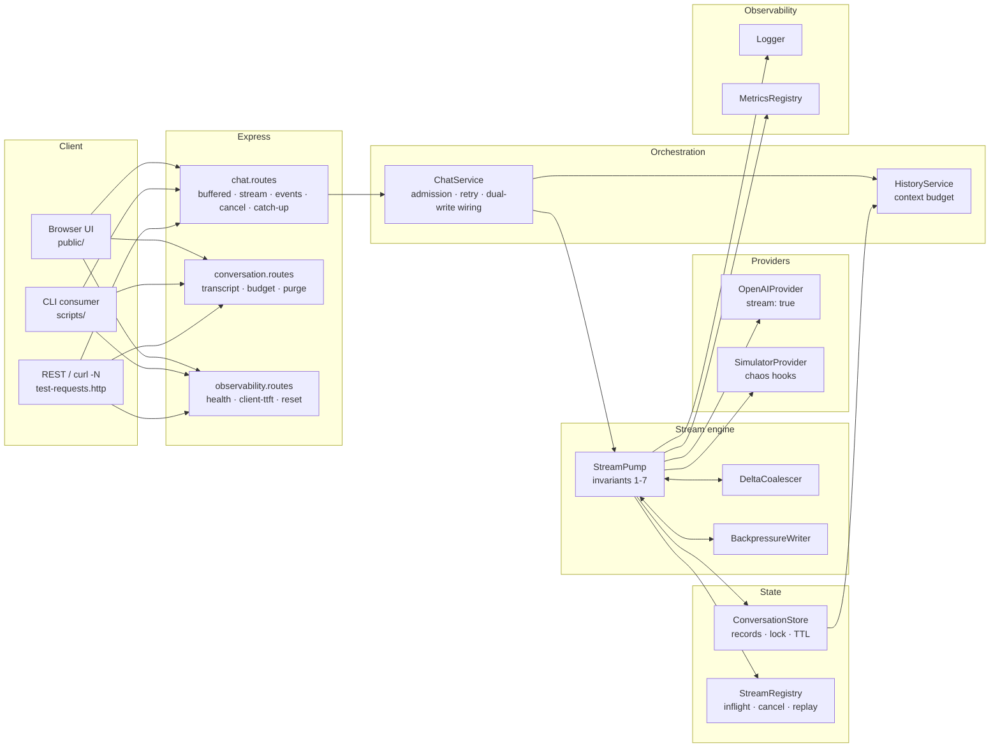

# Implementation Guide — Lecture 06: AI Streaming Microservice

Welcome to the chapter-by-chapter **Implementation Guide** for the **Lecture 06 production streaming codebase**.

This guide is a working manual, not a summary. Every chapter follows the same shape:

1. **Files covered** — what this chapter creates, and why.
2. **Complete source code** — the full, current contents of those files (generated directly from the repository, so the guide can never drift from the code).
3. **Block-by-block explanation** — what each block does and *how* it works, with the reasoning behind each decision.
4. **Verification** — the exact commands that prove the chapter works.

---

## 🧭 System Topology



---

## 📚 Chapter Navigation Index

| Chapter | Title | Files Covered |
| :---: | :--- | :--- |
| **[00](./00_Overview_and_File_Structure.md)** | **System Overview & Blueprint** | Architecture, decomposition rules, file tree, commands, reading order. |
| **[01](./01_Project_Initialization_and_TypeScript_Setup.md)** | **Project Initialization & Tooling** | `package.json`, `tsconfig.json`, `.gitignore`, `.env.example` — every dependency justified. |
| **[02](./02_Environment_Configuration_and_Validation.md)** | **Environment & Boot-Time Validation** | `src/config/env.ts` — every streaming knob, validated, with the boolean-coercion trap explained. |
| **[03](./03_Data_Contracts_Wire_Frames_and_Records.md)** | **Data Contracts** | `src/types/stream.types.ts` — provider contract, wire frames, store records, telemetry shape. |
| **[04](./04_Structured_Logging_and_Metrics_Registry.md)** | **Logging & Metrics** | `src/lib/logger.ts`, `src/lib/metrics.ts` — structured logs, histograms, the TTFT-gap alert. |
| **[05](./05_Byte_Codec_Frames_and_Timing.md)** | **Byte Codec & Timing** | `src/lib/text-codec.ts`, `src/lib/timing.ts` — byte math, three encoders, headers, carry buffers. |
| **[06](./06_Provider_Abstraction_Live_and_Simulator.md)** | **Provider Layer** | `src/providers/*` — the `AsyncIterable` contract, live provider, simulator, error taxonomy. |
| **[07](./07_Delta_Coalescing_and_Backpressure.md)** | **Coalescing & Backpressure** | `src/stream/delta-coalescer.ts`, `src/stream/backpressure.ts`. |
| **[08](./08_The_Stream_Pump.md)** | **The Stream Pump** | `src/stream/stream-pump.ts` — the seven invariants, dual-write, watchdogs, in-band errors, telemetry. |
| **[09](./09_Conversation_Store_and_Locking.md)** | **Conversation Store & Locking** | `src/services/conversation.store.ts` — idempotent upsert, TTL, per-conversation mutex. |
| **[10](./10_History_Assembly_and_Context_Budget.md)** | **History & Context Budget** | `src/services/history.service.ts` — backward budget walk, interrupted-turn annotation. |
| **[11](./11_Stream_Registry_Cancellation_and_Catch_Up.md)** | **Stream Registry** | `src/services/stream-registry.ts` — admission control, cancel, replay ring. |
| **[12](./12_Chat_Service_Orchestration.md)** | **ChatService Orchestration** | `src/services/chat.service.ts` — pre-flight checks, retry discipline, buffered baseline. |
| **[13](./13_API_Routing_App_and_Server.md)** | **Routing, App & Server** | `src/routes/*`, `src/app.ts`, `src/server.ts` — transports, control plane, timeout tuning, shutdown. |
| **[14](./14_Browser_Client_Fetch_ReadableStream_TextDecoder.md)** | **The Browser Client** | `public/*` — decoder discipline, frame parsing, rAF rendering, cancellation, recovery, anti-pattern mode. |
| **[15](./15_Verification_Scripts_and_Testing.md)** | **Verification Scripts** | `src/scripts/*` — harness, torture test, CI gate, cancellation suite, benchmark, CLI. |
| **[16](./16_End_to_End_Verification_and_HTTP_Testing.md)** | **End-to-End Verification** | `test-requests.http`, curl diagnostics, the 20-point checklist, troubleshooting matrix. |
| **[Consolidated](./Complete_Implementation_Guide.md)** | **Master Reference** | All chapters condensed into one document, with the architecture, invariants and results. |

---

## 🚦 Suggested Reading Paths

| If you want to… | Read |
| :--- | :--- |
| Understand the whole design first | **00 → 08 → 12 → 16** |
| Focus on the backend streaming engine | **03 → 05 → 07 → 08 → 11** |
| Focus on correctness of history | **09 → 10 → 12** |
| Focus on the frontend experience | **05 → 14** |
| Focus on production hardening & observability | **04 → 08 → 13 → 15 → 16** |
| Prove the claims yourself | run `npm run verify`, then read **15** and **16** |

---

## ✅ Verification status

```bash
npm run build             # strict typecheck, zero errors
npm run test:utf8         # ALL ASSERTIONS PASSED — 42 fragmentation combinations + naive-bug control
npm run test:invariants   # ALL ASSERTIONS PASSED — 10 sections, 40+ assertions
npm run test:cancel       # ALL ASSERTIONS PASSED — 6 sections
npm run bench:latency     # streaming TTFT ~374 ms vs buffered ~726 ms, near-identical total time
```

---

## 🧱 The seven pipeline invariants

Every chapter exists to make one of these true, and every one has a test:

| # | Invariant | Enforced in | Tested by |
| :--- | :--- | :--- | :--- |
| 1 | Every layer forwards, never accumulates | `StreamPump.handleDelta` | `chunkCount > 2` |
| 2 | The response flushes per chunk | `flushHeaders()` + one `write()` per chunk | `ttft < 0.5 × total` |
| 3 | Intermediaries must not buffer | headers in `text-codec.ts` | `curl -sD -` header dump |
| 4 | The connection must not idle out | heartbeat timer | `heartbeats >= 1` during a stall |
| 5 | The client must read incrementally | `public/app.js` reader loop | fragmentation invariance |
| 6 | The UI must append, not replace | `appendText` + `delta` frames | UI checklist (Chapter 14) |
| 7 | Cancellation must propagate | `AbortController` → provider signal | `test:cancel` |

---

## 🔁 The five cross-cutting themes

If you remember nothing else from this guide, remember that the same five ideas recur in every chapter:

1. **The return type is the architecture.** `AsyncIterable` instead of `Promise<string>` is what makes buffering impossible rather than merely discouraged.
2. **Once the first byte is written, the status is frozen.** Everything after it — success, failure, timeout — is a *frame*, not an HTTP status.
3. **Chunks are not messages.** The dual-write pattern buffers in memory and persists exactly one reconstructed message per turn.
4. **Time is a first-class input.** TTFT budgets, idle watchdogs, total ceilings and heartbeats are configuration, and they are all tested.
5. **Measure the gap, not the average.** `p95(clientTTFT − serverTTFT)` is the only metric that catches the whole class of buffering regressions.

---

**Start here:** [Chapter 00 — System Overview & Blueprint](./00_Overview_and_File_Structure.md)
