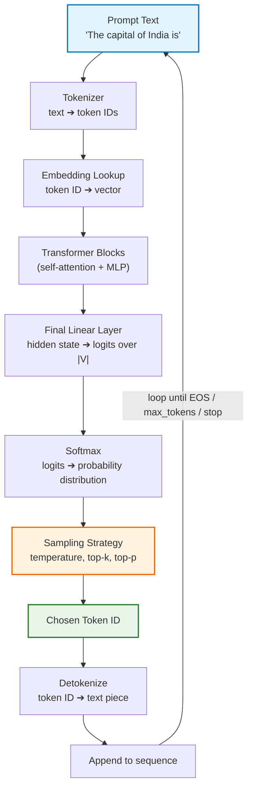
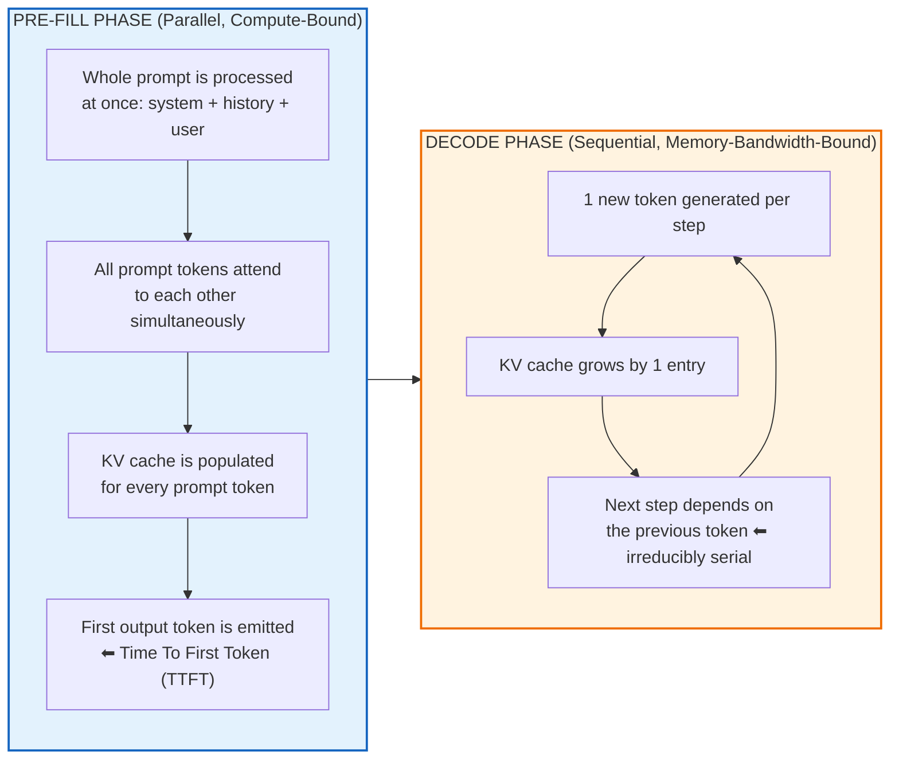

# Chapter 01: How an LLM Generates Text — Autoregressive Decoding

> **Chapter Goal:** Establish the mechanical root cause of streaming. Understand *why* an LLM physically cannot return a complete answer in one instant — tokenization, the forward pass, logits, sampling, the prefill phase, the decode loop, and the KV cache — and see how this sequential generation naturally produces a *stream of small pieces* instead of one atomic string.
>
> **Source Mapping:** `Notes.pdf` §1 *(How an LLM Generates Text)*, expanded in depth.

---

## 1.1 The Experiment: "The capital of India is"

Suppose we send a language model a single prompt:

```text
The capital of India is
```

An untrained intuition says the model "looks up" the answer and emits it whole:

```text
The capital of India is New Delhi.
```

That is **not** what happens. What actually happens is an iterative loop in which the model produces *one token at a time*, appends it to the sequence, and runs the entire prediction machinery **again** for the next token.

```text
The capital of India is
        ↓
   Predict next token
        ↓
       "New"

The capital of India is New
        ↓
   Predict next token
        ↓
      "Delhi"

The capital of India is New Delhi
        ↓
   Predict next token
        ↓
        "."

The capital of India is New Delhi.
```

So generation is intrinsically sequential:

```text
Token 1 → Token 2 → Token 3 → Token 4 → ... → [EOS]
```

> **The Cardinal Insight:** *A language model is a next-token predictor, not an answer generator.* It has no concept of "an answer" as a whole object. "The answer" is an emergent artifact of many tiny prediction steps chained together — and that is exactly why streaming is not a hack bolted onto LLMs, but a **natural consequence of how they compute.**

---

## 1.2 The Complete Mental Model of One Decoding Step

The one-line diagram from the source material expands into a full pipeline:



### 1.2.1 Step 1 — Tokenization

Text is first split into **tokens** by a subword tokenizer (typically BPE — Byte Pair Encoding). Tokens are frequently *not* words:

```text
"The capital of India is"  ➔  ["The", " capital", " of", " India", " is"]
"Spring Boot is great"     ➔  ["Spring", " Boot", " is", " great"]
"tokenization"             ➔  ["token", "ization"]
```

> **Why this matters for streaming:** Tokens are the *atomic unit of generation*, but they are almost never the atomic unit of *delivery*. A `"New"` and a `" Delhi"` arriving separately would look broken in a UI — hence APIs group tokens into chunks, and UIs must never assume a chunk equals a token. See **Chapter 04**.

### 1.2.2 Step 2 — The Forward Pass and Logits

Every embedding is passed through stacked transformer blocks and then through a final projection head, producing one **logit** per vocabulary entry (a raw, unnormalized score):

$$\text{logits} = h_{\text{last}} \cdot W_{\text{vocab}}^{T} \quad \in \mathbb{R}^{|V|}$$

For a modern model, $|V| \approx 100{,}000$ — so a single decoding step computes roughly 100,000 numbers just to pick **one** token.

### 1.2.3 Step 3 — Softmax and Sampled Diversity

Logits are converted into a probability distribution:

$$P(t_i) = \frac{e^{z_i / T}}{\sum_{j} e^{z_j / T}}$$

where $T$ is the **temperature**. The next token is then *sampled* from this distribution:

| Setting | Behaviour | Consequence for streaming UX |
| :--- | :--- | :--- |
| `temperature = 0` | Greedy / near-deterministic | Stable, repeatable text; may still vary across provider versions |
| `top_p < 1` | Nucleus sampling restricts candidates | Cuts nonsensical tail tokens |
| `top_k = 5` | Only 5 candidates considered | Very stable but repetitive |
| High `temperature` | Flatter distribution | More surprising text; identical arrival cadence |

> **Crucial correlation:** Generation *speed* is a function of model size, hardware, and batch load — **not of temperature**. Temperature changes *which* token is picked, not *how fast* it is picked. Streaming-latency engineering operates on a completely different axis from sampling tuning.

---

## 1.3 The Two Phases of Inference: Prefill vs. Decode

This is the single most important distinction for latency work, and the source PDF touches it in §6 ("Input Processing Happens Before Output"). We formalize it here.



| Property | Pre-fill (input) | Decode (output) |
| :--- | :--- | :--- |
| Work pattern | All prompt tokens in parallel (one big matmul) | One token per step, strictly serial |
| Bottleneck | Compute (FLOPs) | Memory bandwidth (reading weights + KV cache) |
| Scales with | Prompt length | Output length |
| User-visible effect | Drives **TTFT** | Drives **tokens/second** and total time |
| Cancellable cheaply? | No — must finish to be useful | Yes — stop anytime, partial output is still valid |

### 1.3.1 Why Decode Is Serial (and Cannot Be Parallelized)

Token $n+1$ depends on the probability distribution computed *after* token $n$ was appended and re-attended. There is no way to produce token $n+5$ before $n+1$ exists — except via *speculative decoding* (a small draft model proposes, the large model verifies), which is an optimization internal to the provider and invisible to your application.

### 1.3.2 The KV Cache: Why Long Conversations Are Expensive

To avoid recomputing attention over the entire history at every step, the model caches the **Key** and **Value** matrices for all previously processed tokens:

$$\text{KV cache size} \approx 2 \times L_{\text{tokens}} \times n_{\text{layers}} \times d_{\text{model}} \times \text{bytes per element}$$

Engineering consequences:

1. **Memory grows linearly with conversation length** — a 10-turn chat consumes far more VRAM than a fresh one.
2. **Throughput drops as context grows** — each decode step must read a larger KV cache from memory.
3. **TTFT and ITL both degrade as history accumulates** — which is *why* context management (summarization, sliding windows, retrieval) is a **latency optimization** as much as a cost optimization (see Lecture 04, Chapter 02).

> **Engineering Insight — Provider Meaning of "Chunk".** Because decode is serial but prefill is parallel, providers interleave many users' requests on one GPU. This is why **your output speed varies with the provider's overall load**, and why a chunk may suddenly become large: providers coalesce several decode steps before flushing bytes to the network. You cannot control this — you can only design the UI so it does not care (Chapters 04 and 09).

---

## 1.4 Pseudocode: The Autoregressive Decode Loop

*(JS/TS-style pseudocode — illustrating mechanics, not a runnable inference kernel.)*

```typescript
// ---------------------------------------------------------------------------
// PSEUDOCODE: the essence of autoregressive decoding
// ---------------------------------------------------------------------------
function generate(prompt: string, config: GenerationConfig): string {
  let sequence = tokenize(prompt);              // text ➔ token IDs
  const output: TokenId[] = [];

  // Loop bound: EOS token, max tokens, or a caller-supplied stop sequence
  while (output.length < config.maxTokens) {
    const logits = forwardPass(sequence);       // uses KV cache internally
    const probs  = softmax(logits, config.temperature);
    const next   = sample(probs, config.topP, config.topK);

    if (next === EOS_TOKEN) break;              // natural stop

    output.push(next);
    sequence.push(next);                        // append and run again
  }

  return detokenize(output);
}
```

The **streaming variant** of the same loop simply *exposes* each iteration's output instead of accumulating it privately:

```typescript
// ---------------------------------------------------------------------------
// PSEUDOCODE: the same loop, but yielding instead of accumulating
// ---------------------------------------------------------------------------
async function* generateStream(prompt: string, config: GenerationConfig) {
  let sequence = tokenize(prompt);

  while (sequence.length < config.maxTokens) {
    const logits = forwardPass(sequence);
    const next   = sample(softmax(logits, config.temperature), config.topP, config.topK);

    if (next === EOS_TOKEN) return;

    sequence.push(next);
    yield detokenize([next]);   // ⬅ the ONLY difference: emit immediately
  }
}
```

> **The One-Line Truth:** *Streaming is not a different generation algorithm; it is the same autoregressive loop with the accumulator replaced by an async iterator.* This is why every streaming API in existence (`stream: true`, `Flux<String>`, `ReadableStream`, `AsyncIterator`) ultimately exposes the same shape: **zero, one, or many values over time.**

---

## 1.5 What the Model Actually Optimizes (and What It Does Not)

The model is trained on next-token cross-entropy:

$$\mathcal{L} = -\frac{1}{N}\sum_{n=1}^{N} \log P(w_n \mid w_{<n})$$

It learns **statistical continuation** — not truth, not intent, and not formatting guarantees. Two direct consequences for streaming systems:

| Learned property | Streaming-relevant consequence |
| :--- | :--- |
| Local fluency is optimized at every step | The *first* token can be confidently wrong — you stream wrongness smoothly |
| No global planning objective exists | The model may revise direction mid-stream; early chunks may be contradicted by later ones |
| Formatting is a *tendency*, not a guarantee | You cannot naively `JSON.parse` partial content (Chapters 08 and 09) |

---

## 1.6 Common Pitfalls in Reasoning About Generation

| # | Pitfall | Reality |
| :--- | :--- | :--- |
| 1 | "The model computes the full answer, then sends it." | It computes **one token**, appends it, then recomputes. |
| 2 | "Streaming makes the model faster." | Total time is essentially unchanged; **perceived** latency collapses. |
| 3 | "One token in equals one token out of the API." | Providers coalesce tokens into arbitrary chunks. |
| 4 | "A longer prompt only affects cost." | It also raises TTFT, because prefill is proportional to prompt length. |
| 5 | "Streaming means the model remembers the stream." | The **model** is stateless; continuity is reconstructed by your app each turn. |
| 6 | "With `temperature = 0` I get byte-identical output forever." | False in practice: batching, kernel nondeterminism, and provider version changes introduce variance. |

---

## 1.7 Chapter Summary & Key Engineering Takeaways

1. **LLMs are next-token predictors.** Generation is a loop, not a lookup; the loop is *irreducibly sequential* during decode.
2. **One step = tokenize ➔ forward pass ➔ logits ➔ softmax ➔ sample ➔ append ➔ repeat.** Every iteration produces a *small piece* — the raw material of streaming.
3. **Two phases govern latency:** parallel **prefill** (sets TTFT, scales with input length) and serial **decode** (sets tokens/second, scales with output length).
4. **The KV cache is the hidden tax on conversation length** — longer history means more memory, lower throughput, worse latency.
5. **Streaming is the same algorithm with `yield` instead of `append`.** No new model capability is involved.
6. **Sampling settings change *what* is generated; hardware and load change *how fast*.** Keep these two axes separate.
7. **The model optimizes plausibility per token, not truth per answer** — a stream of locally fluent tokens can still be globally wrong.
8. **Boundaries of a piece are an implementation detail**, never a contract your UI should depend on.

**Next:** [Chapter 02 — Generation vs. Delivery, Non-Streaming vs. Streaming Responses](./02_Generation_vs_Delivery_Non_Streaming_and_Streaming_Responses.md)
