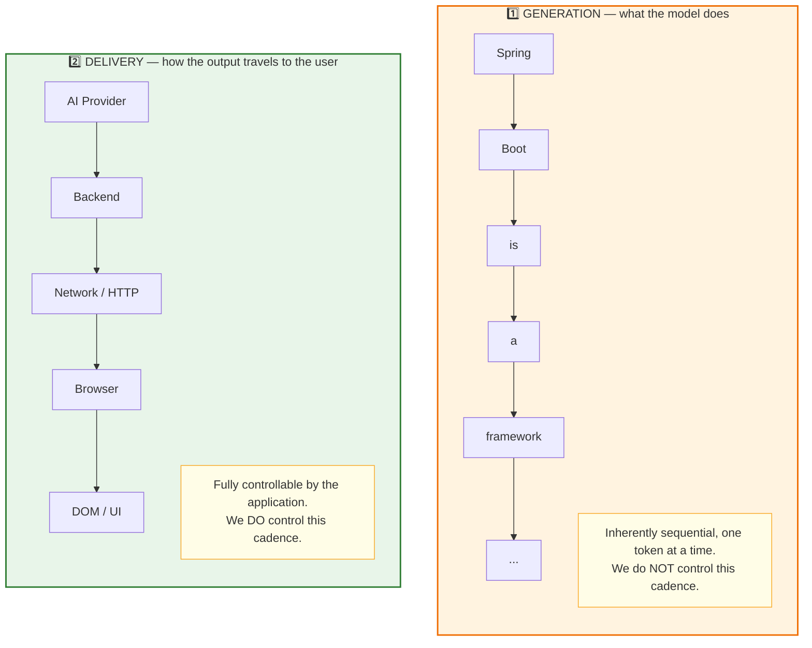
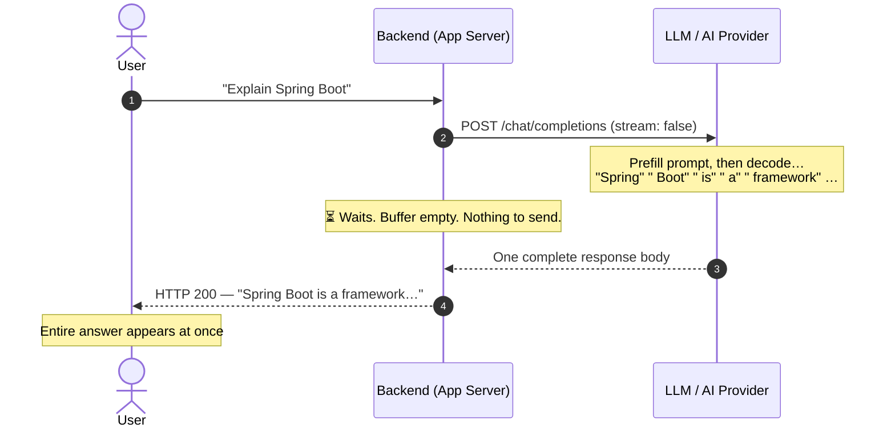
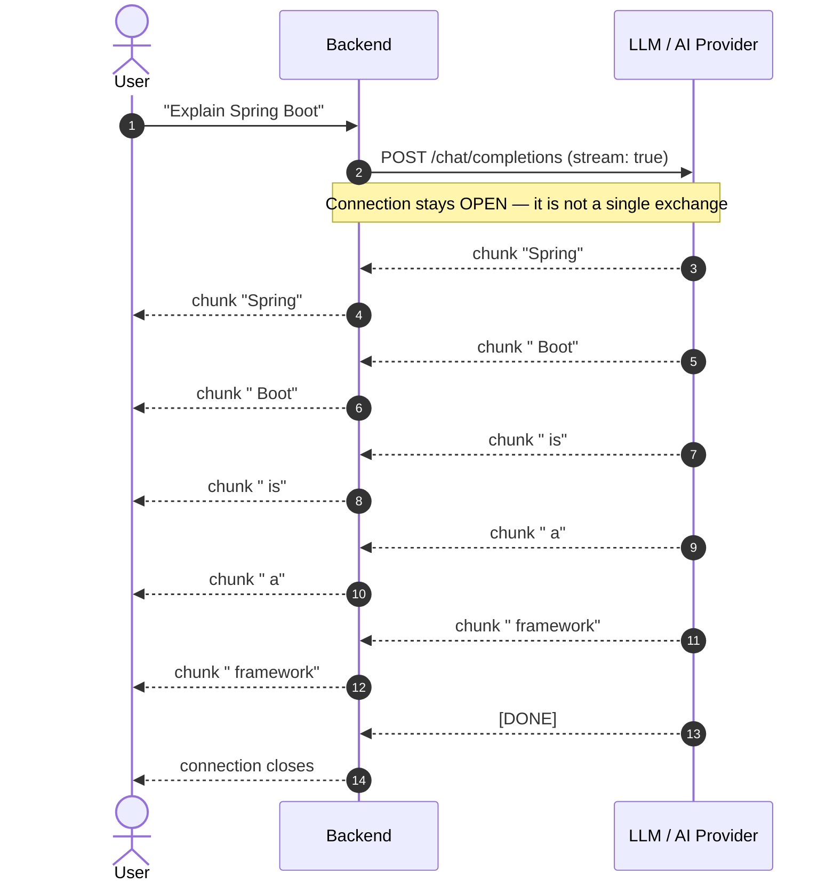
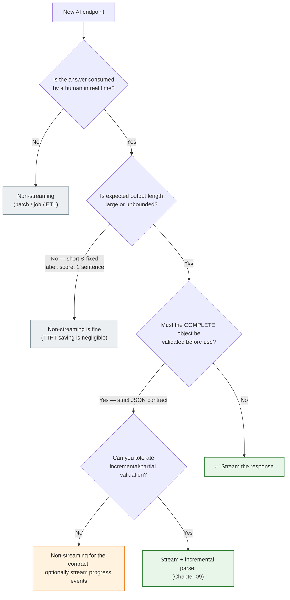

# Chapter 02: Generation vs. Delivery — Non-Streaming and Streaming Responses

> **Chapter Goal:** Separate the two independent processes inside every AI application — **generation** (what the model does) and **delivery** (how the output travels). Then contrast the **non-streaming** and **streaming** response lifecycles, quantify the perceived-latency difference, and identify when *not* to stream.
>
> **Source Mapping:** `Notes.pdf` §2 *(Generation and Delivery Are Different Things)*, §3 *(Non-Streaming Response)*, §4 *(Streaming Response)*. Expanded with delivery-path taxonomy and decision criteria.

---

## 2.1 Two Independent Processes

The source material states it plainly: **two independent processes are happening in an AI application.**



> **The Most Important Sentence in This Lecture:** *Streaming mainly changes how generated output is **delivered** to the user. It does not fundamentally change the autoregressive way in which the model **generates** text.*

### Why This Separation Matters Architecturally

| Layer | Who controls it | Can we make it faster? | Can we make it *visible* faster? |
| :--- | :--- | :--- | :--- |
| Model decode rate | Provider (GPU, batching, model size) | Only by model choice / tier upgrade | No |
| Provider ➔ Backend transport | Provider + SDK + your network | Partially (region, connection reuse) | Yes — consume chunks as they arrive |
| Backend processing | **You** | Yes (avoid re-buffering) | Yes — forward immediately |
| Backend ➔ Browser transport | **You** (+ proxies/CDN) | Yes (disable proxy buffering) | Yes — flush per chunk |
| Browser rendering | **You** | Yes (batched DOM writes) | Yes — incremental append |

**The lesson:** every fix available to a Forward Deployed Engineer lives in the **delivery** column. Trying to fix streaming by "making the model faster" is attacking the wrong layer.

---

## 2.2 The Non-Streaming (Buffered) Response Lifecycle

A conventional AI request looks like this:



The model *still* generates `Spring → Boot → is → a → framework` internally. The difference is that the **backend deliberately discards the intermediate structure** and waits for the final concatenation.

### What the user experiences

```text
Send
  ↓
............        ← 8 seconds of nothing
............
............
  ↓
Entire answer appears
```

### The hidden costs of buffering

| Cost | Explanation |
| :--- | :--- |
| **Perceived latency ≈ total latency** | Nothing to read until the last token is generated. |
| **All-or-nothing failure** | A timeout or token-limit ceiling at second 25 means the user gets a *generic error* instead of 24 seconds of valid content. |
| **Higher timeout pressure** | Long generations force HTTP client timeouts upward, which increases gateway/proxy tuning burden and orphaned-connection risk. |
| **No early feedback for long prompts + long answers** | Prefill + full decode must both complete before any value is shown. |
| **Poor perceived reliability** | A spinner that lasts 30 seconds feels broken even when the backend is healthy. |

> **Why non-streaming still exists:** it is *simpler to build and simpler to validate*. Structured extraction, classification, moderation, batch enrichment, and any pipeline that must validate the **whole** object before use are legitimately better served by one complete response.

---

## 2.3 The Streaming Response Lifecycle

With streaming, generated output is forwarded **as it becomes available**:



### The user progressively builds the answer

```text
Spring
   ↓
Spring Boot
   ↓
Spring Boot is
   ↓
Spring Boot is a framework...
```

> **The Critical Nuance:** the complete answer might still take eight seconds to generate. The difference is that **useful output begins appearing after roughly one second.** The user is reading while the model is still writing.

### Side-by-side comparison

| Dimension | Non-Streaming (Buffered) | Streaming |
| :--- | :--- | :--- |
| Time to first visible output | ≈ total generation time | ≈ TTFT (prefill + 1 step) |
| Total generation time | Unchanged | Unchanged |
| Perceived responsiveness | Poor for long outputs | Excellent |
| Failure mode on mid-flight error | Nothing delivered | Partial answer delivered, then error notice |
| Backend complexity | Low (one string) | Medium (iterator + flush + buffering + abort handling) |
| Frontend complexity | Low (`await response.text()`) | Medium (`ReadableStream` reader loop) |
| Gateway/proxy tuning needed | Rarely | Almost always (disable buffering, extend idle timeouts) |
| Persistence complexity | Trivial (store the string) | Non-trivial (accumulate, then store — Chapter 08) |
| Cancellation economics | Cannot cancel usefully | Can stop and stop paying for tokens |
| Best for | Structured extraction, batch, moderation, jobs | Conversational UX, long-form generation, agents |

---

## 2.4 The Same Answer, Two Response Shapes (Wire View)

**Non-streaming** — one JSON body, `stream: false`:

```json
{
  "id": "chatcmpl-9x8y",
  "choices": [
    {
      "index": 0,
      "message": { "role": "assistant", "content": "Spring Boot is a framework..." },
      "finish_reason": "stop"
    }
  ],
  "usage": { "prompt_tokens": 18, "completion_tokens": 47, "total_tokens": 65 }
}
```

**Streaming** — a sequence of frames, `stream: true`, each carrying a **delta**:

```text
data: {"choices":[{"delta":{"role":"assistant","content":""},"finish_reason":null}]}

data: {"choices":[{"delta":{"content":"Spring"},"finish_reason":null}]}

data: {"choices":[{"delta":{"content":" Boot"},"finish_reason":null}]}

data: {"choices":[{"delta":{"content":" is"},"finish_reason":null}]}

data: {"choices":[{"delta":{},"finish_reason":"stop"}]}

data: [DONE]
```

Three structural facts worth internalizing:

1. **`delta` replaces `message`.** Each frame carries only the *increment*, never the whole answer so far. This is what makes streaming bandwidth-efficient.
2. **The first frame often has an empty content string** (role announcement only). Real text starts on frame two.
3. **`[DONE]` (or `finish_reason`) is a protocol terminator**, not content. A client that blindly appends raw frames would render the sentinel into the chat bubble — a classic beginner bug.

---

## 2.5 Decision Framework: Should This Endpoint Stream?



### A pragmatic hybrid: stream *progress events*, deliver a final validated object

For long-running agentic or RAG tasks, decouple "is it alive?" feedback from the structured payload:

```typescript
// PSEUDOCODE (TS): stream progress events while the final object stays whole
type StreamEvent =
  | { type: "status"; phase: "retrieving" | "reranking" | "generating" }
  | { type: "token";  text: string }
  | { type: "final";  payload: ReportPayload }   // validated only here
  | { type: "error";  message: string };

async function* runReportJob(query: string): AsyncGenerator<StreamEvent> {
  yield { type: "status", phase: "retrieving" };
  const docs = await retrieve(query);

  yield { type: "status", phase: "generating" };
  let buffer = "";
  for await (const piece of llmStream({ query, docs })) {
    buffer += piece;
    yield { type: "token", text: piece };          // UX value immediately
  }

  const parsed = safeParseReport(buffer);
  if (!parsed.ok) yield { type: "error", message: "Invalid model output" };
  else            yield { type: "final", payload: parsed.value };  // contract value
}
```

This gives you the best of both worlds: **early perceived progress** for the human, and **late, atomic, validated data** for the system.

---

## 2.6 The Delivery-Path Taxonomy

"Streaming" is not one thing. These are the distinct delivery paths you can choose between, and they are frequently confused:

| Mode | Shape | Boundaries visible to client? | Typical use |
| :--- | :--- | :--- | :--- |
| **Buffered JSON** | One body | N/A | Extraction, classification, batch |
| **Chunked raw text** | Bytes over time | Yes (raw) | Simplest chat streaming (Chapter 05) |
| **SSE (`text/event-stream`)** | Named, framed events | Yes (framed) | Chat + tool/status events; resumable |
| **WebSocket** | Bidirectional frames | Yes | Voice, collaboration, multi-agent control |
| **Progress polling** | Repeated GETs | No (poll interval) | Legacy systems, very long jobs |
| **Webhook callback** | Server pushes later | No | Async batch pipelines |

> **Naming trap:** In the source PDF, the simplest approach for the Tomato chatbot is **raw text streaming** (`text/plain`) — *not* SSE. Streaming and SSE are different concepts: `Streaming = data arrives progressively` vs. `SSE = one particular protocol/format for delivering events`. Always be explicit about which one you mean in design docs and PR reviews.

---

## 2.7 Common Pitfalls

| # | Pitfall | Consequence | Fix |
| :--- | :--- | :--- | :--- |
| 1 | Believing streaming makes the model faster | Wrong optimization target | Optimize delivery + TTFT, not decode rate |
| 2 | Streaming internally but buffering at the edge | Zero UX improvement | Verify every hop (Chapter 06) |
| 3 | Appending raw SSE frames (incl. `data:` / `[DONE]`) to the UI | Garbage text in the chat bubble | Parse frames; strip the sentinel |
| 4 | Using streaming for strict-JSON contracts | Broken parser mid-stream | Stream tokens, validate only at the end |
| 5 | Forgetting the non-streaming path entirely | Batch clients pay 3× latency | Offer both modes behind one service |
| 6 | Treating partial output as authoritative | Users act on an incomplete answer | Mark a "still generating" state in the UI |

---

## 2.8 Chapter Summary & Key Engineering Takeaways

1. **Generation and delivery are separate processes.** You cannot make the model decode faster; you *can* stop hiding its output.
2. **The non-streaming path is not "no chunks exist"** — it is "the backend chose to throw the chunks away and wait."
3. **Streaming preserves the natural time-structure of generation**: the user reads while the model writes.
4. **Total generation time is roughly constant; perceived latency collapses.** That is the entire value proposition.
5. **Streaming changes failure semantics** — partial answers arrive before errors do. Design for "partial + error," not just "success."
6. **Streaming is not free:** it costs persistence complexity, transport tuning, and client complexity.
7. **Raw text streaming vs. SSE are different tools.** Choose deliberately.
8. **Use a decision framework, not fashion.** Short outputs and strict contracts are often better served by buffered responses — optionally with streamed *progress* events.

**Next:** [Chapter 03 — Latency Anatomy: TTFT, ITL & Perceived Performance](./03_Latency_Anatomy_TTFT_ITL_and_Perceived_Performance.md)
