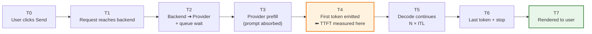
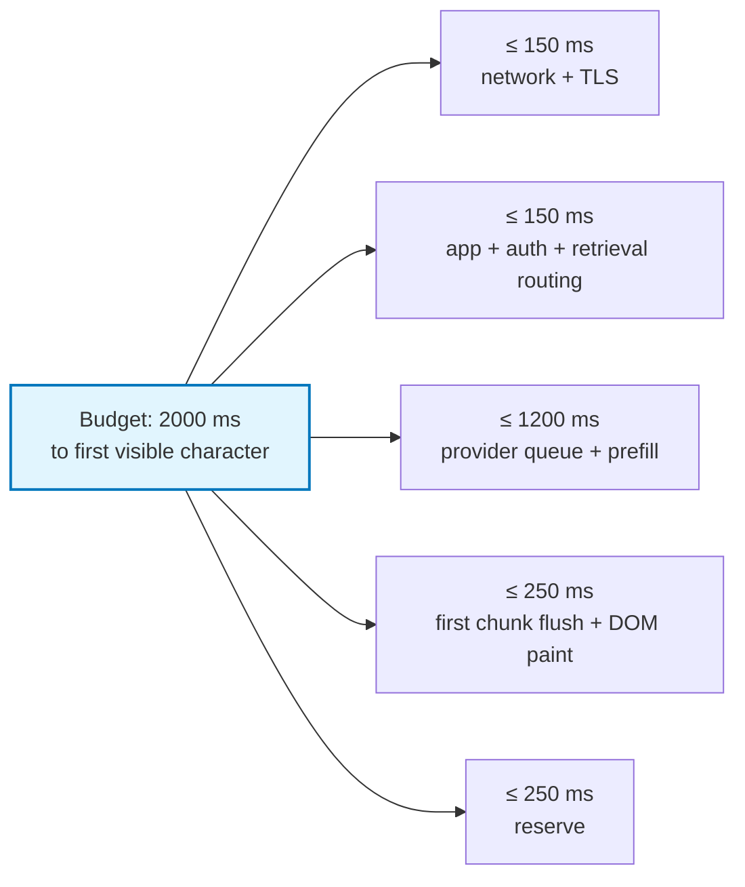

# Chapter 03: Latency Anatomy — TTFT, ITL & Perceived Performance

> **Chapter Goal:** Turn "it feels slow" into measurable, engineeable numbers. Decompose end-to-end latency into input processing, time-to-first-token, inter-token latency, and network/rendering overhead; understand which phase streaming can and cannot improve; and learn how to set latency budgets and SLAs for a streaming chat product.
>
> **Source Mapping:** `Notes.pdf` §5 *(Time to First Token vs Total Response)* and §6 *(Input Processing Happens Before Output)*, greatly expanded with a full latency budget model.

---

## 3.1 The Eight-Second Example

The source material gives one concrete timeline:

```text
0 sec      User clicks Send
1 sec      First output arrives
2 sec      More output
3 sec      More output
...
8 sec      Complete answer
```

And it identifies exactly two different measurements hiding in that timeline:

| Metric | Value here | Definition | What it controls |
| :--- | :--- | :--- | :--- |
| **Time to First Token (TTFT)** | ≈ 1 second | Delay from request to the first visible piece of output | *Perceived responsiveness* — "is this thing alive?" |
| **Total Generation Time** | ≈ 8 seconds | Delay from request to the final token | *Task completion* — how long until the user can act |

### Visual contrast

Without streaming — a single long dead period followed by everything:

```text
|──────────────── 8 sec ────────────────|
                                        ANSWER
```

With streaming — output begins at second 1 and grows continuously:

```text
|--1 sec--| Spring
                   Boot
                       makes
                            building
                                    ...
                                     COMPLETE at 8 sec
```

> **The Key Sentence from the PDF:** *The total generation time may remain similar, but the perceived latency is dramatically lower. That is one of the major reasons streaming is so useful for conversational interfaces.*

---

## 3.2 The Full Latency Decomposition

Real systems have far more than two components. The honest budget is:



Formally:

$$\underbrace{T_{\text{TTFT}}}_{\text{perceived responsiveness}} = T_{\text{network up}} + T_{\text{queue}} + T_{\text{prefill}} + T_{\text{first step}}$$

$$\underbrace{T_{\text{total}}}_{\text{completion}} = T_{\text{TTFT}} + (N_{\text{out}} - 1)\cdot \underbrace{T_{\text{ITL}}}_{\text{inter-token latency}} + T_{\text{tail}}$$

### Component-by-component engineering table

| Component | Typical culprit | Can streaming help? | Mitigations |
| :--- | :--- | :--- | :--- |
| `T_network up` | Geolocation, TLS setup, cold connections | No | Edge termination, connection reuse, HTTP/2 |
| `T_queue` | Provider rate limits, GPU saturation | No | Higher tier, provisioned throughput, retry with jitter |
| `T_prefill` | Long prompt: system + history + RAG + tools | No | Shrink prompt, prompt caching, prune history, cut tool schemas |
| `T_first step` | Model size, sampling overhead | No | Smaller/faster model, speculative decoding (provider-side) |
| `N_out × T_ITL` | Output length, KV-cache growth, load | No (but *hides* it) | Cap `max_tokens`, stream visibly, batch rendering |
| `T_tail` (backend→UI) | Proxy buffering, `await response.text()`, heavy re-render | **Yes — this is yours** | Flush per chunk, disable proxy buffering, batched DOM writes |

> **Engineering Insight — the "1-second cliff".** Human perception research consistently places noticeable-interaction-feedback at roughly 100–300 ms, "still feels responsive" at about 1 second, and "my attention is lost" beyond ~10 seconds. Streaming converts a 10-second task into a 1-second *perceived* response with a 10-second *completion*, moving the product from the losing category into the winning one — **without any model change.**

---

## 3.3 Throughput Metrics: TPS and TPOT

Beyond TTFT, two rate metrics describe the steady state of generation:

| Metric | Formula | Meaning | Healthy chat range |
| :--- | :--- | :--- | :--- |
| **TPS (Tokens per Second)** | $N_{\text{out}} / (T_{\text{total}} - T_{\text{TTFT}})$ | Raw decode throughput of the provider | 30–120 TPS (varies wildly) |
| **TPOT (Time Per Output Token)** | $1 / \text{TPS}$ | Average gap between consecutive tokens | 8–35 ms typical |

A useful practical rule: **human reading speed is roughly 4–5 words/second (~6–8 tokens/second).** Therefore:

- Below ~10 TPS, the model is *slower than the reader* → visible "typing lag" (feels thoughtful but slow).
- Above ~10 TPS, the stream outpaces reading → the bottleneck moves entirely to **UI responsiveness**, not the model.

This produces a genuinely counter-intuitive engineering conclusion: **past a modest TPS threshold, further provider speed improvements yield almost no UX gain, whereas fixing a single 2-second proxy-buffer bug yields a massive gain.** Always profile the delivery path before paying for a faster model.

---

## 3.4 Input Processing Happens Before Output

The PDF's §6 makes a point that is easy to underestimate: **the model usually cannot generate the first output token immediately, because it must first absorb the input context.**

That context is not just the user's message. It is:

```text
System Prompt
      +
Previous Conversation
      +
Current User Message
      (+ retrieved documents, + tool schemas, + tool results, in real systems)
```

Conceptually:

```text
System + History + User Message
            ↓
     Process the context
            ↓
   --------------------------------
            ↓
     Generate output 1
            ↓
     Generate output 2
            ↓
     Generate output 3
            ↓
           ...
```

So there are broadly two phases:

```text
Input processing  ➔  Output generation
```

> **The PDF's exact conclusion:** *Streaming becomes useful once output generation begins.* Everything before that first token is a **fixed latency tax** that streaming cannot remove — it can only be *shortened* by reducing what you send.

### Why this reframes prompt engineering as latency engineering

Every item you add to the context window has a measurable TTFT cost:

| Context contributor | Typical size | Effect on TTFT | Reduction lever |
| :--- | :--- | :--- | :--- |
| System prompt | 200–3,000 tokens | Moderate | Compress instructions; cache them |
| Conversation history | Grows every turn | **Severe — quadratic across a session** | Sliding window, summarization, retrieval |
| RAG chunks | 1,000–8,000 tokens | Severe | Retrieve fewer, rerank harder, truncate smartly |
| Tool / function schemas | 100–2,000 tokens | Moderate | Expose only relevant tools per turn |
| User message | Small | Minor | — |

A chat that feels fast on turn 1 and sluggish by turn 20 is almost never a model problem: it is **prompt growth**. Streaming still helps at turn 20, but the *first* visible token keeps sliding later unless you manage context.

### The instrumentation pseudocode

```typescript
// PSEUDOCODE (TS): measure the two phases separately
async function timedStream(prompt: PromptPayload, callProvider: CallProvider) {
  const t0 = performance.now();

  let ttftMs: number | null = null;
  let tokens = 0;
  let chars = 0;

  for await (const piece of callProvider.stream(prompt)) {
    if (ttftMs === null) ttftMs = performance.now() - t0;   // ⬅ the metric that matters
    tokens += 1;
    chars += piece.length;
    yield piece;
  }

  const totalMs = performance.now() - t0;
  return {
    ttftMs,
    totalMs,
    itlMs: tokens > 1 ? (totalMs - (ttftMs ?? 0)) / (tokens - 1) : null,
    tps: (tokens / (totalMs - (ttftMs ?? 0))) * 1000,
    charsPerToken: chars / Math.max(tokens, 1),   // validates your chunk assumptions
  };
}
```

> **Observability rule:** never log only "request took 7.4s". Log **TTFT, ITL, TPS, prompt tokens, completion tokens.** A single total-latency number cannot tell you whether to fix the prompt, the model tier, the network, or the UI.

---

## 3.5 Latency Budgets: Setting an SLA for a Chat Product

A defensible budget for a customer-facing assistant:



| Tier | TTFT target | Rationale |
| :--- | :--- | :--- |
| Interactive chat (consumer) | < 1.0 s | Must feel conversational |
| Internal enterprise assistant | < 2.0 s | Users tolerate slight pause |
| Batch / nightly enrichment | not applicable | Throughput matters, not TTFT |
| Long-form document drafting | < 2.5 s | Start writing early; completion is expected to be slow |

Production hardening for these budgets (heartbeats, idle timeouts, keep-alives) is covered in **Chapter 10**.

---

## 3.6 Common Pitfalls

| # | Pitfall | Consequence | Fix |
| :--- | :--- | :--- | :--- |
| 1 | Conflating TTFT with total time | You "fix" latency by shrinking answers, not by streaming | Measure both, separately |
| 2 | Measuring TTFT at the UI but not at the backend | You blame the model for a proxy buffer delay | Instrument every hop |
| 3 | Ignoring prompt growth | Slow turn-20 responses blamed on "model quality" | Track prompt tokens per turn |
| 4 | Optimizing TPS when TPS already exceeds reading speed | Zero UX gain for real cost | Benchmark TPS vs. perceived quality first |
| 5 | Assuming streaming fixes prefill | First token still waits for the entire prompt | Shrink context, enable prompt caching |
| 6 | No latency budget in the design doc | Unbounded regressions ship silently | Write the budget table before writing code |

---

## 3.7 Chapter Summary & Key Engineering Takeaways

1. **Two metrics, two purposes:** TTFT governs *perceived responsiveness*; total generation time governs *task completion*.
2. **Streaming attacks TTFT and perceived latency, not total time.**
3. **Every prompt token is a latency tax on TTFT** — input processing always precedes the first output token.
4. **Model throughput (TPS/TPOT) is only relevant up to human reading speed (~6–8 tokens/s).** Beyond that, the UI is the bottleneck.
5. **Latency is a pipeline sum**, not a single number — `T_network + T_queue + T_prefill + N × ITL + T_tail`.
6. **Instrument TTFT, ITL, TPS, prompt tokens, and completion tokens** — one aggregate number is diagnostically useless.
7. **Longer conversations degrade TTFT and ITL together** because the KV cache and prompt both grow.
8. **Write the latency budget down** and assign each hop an owner; unowned milliseconds are where products die.

**Next:** [Chapter 04 — Token, Chunk, Network Packet & Byte: Four Layers of Granularity](./04_Token_Chunk_Network_and_Byte_Granularity.md)
