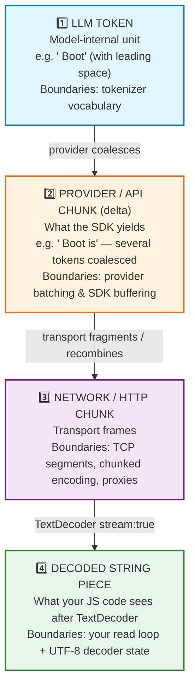
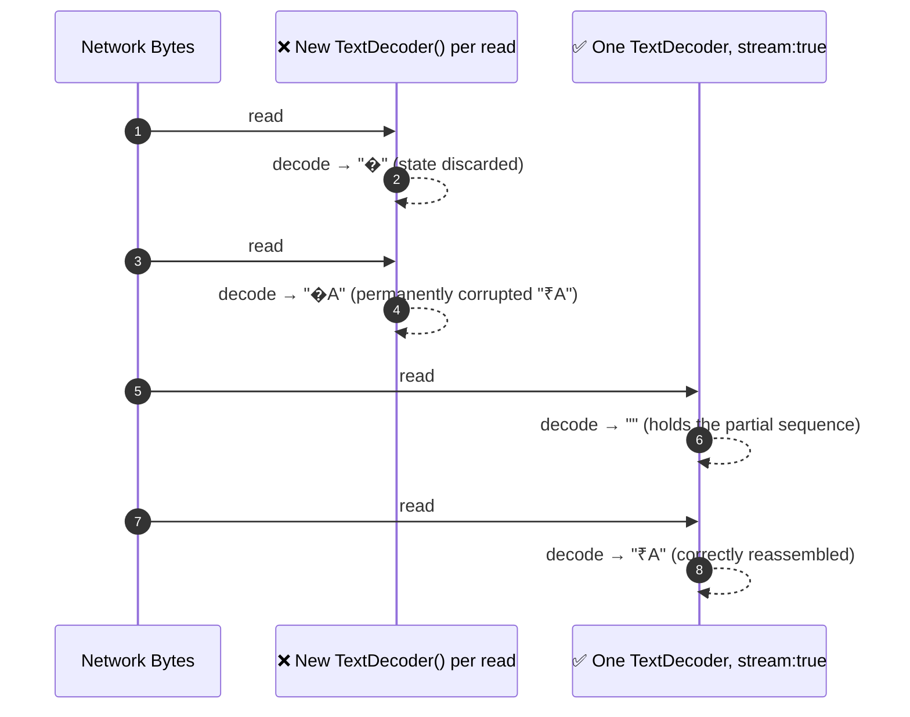

# Chapter 04: Token, Provider Chunk, Network Chunk & Byte — Four Layers of Granularity

> **Chapter Goal:** Eliminate the single most common source of streaming bugs: conflating four different units that all look like "a small piece of text." Understand why boundaries shift at every layer, how UTF-8 multi-byte characters can be split across network reads, and why the correct UI contract is *"append whatever text you currently have"* — never *"expect a token, a word, or a sentence."*
>
> **Source Mapping:** `Notes.pdf` §7 *(Tokens Are Not the Same as Streamed Chunks)* and §35 *(Token vs Provider Chunk vs Network Chunk)*, expanded with the byte-encoding layer.

---

## 4.1 The Four Layers



The source material's formal statement:

```text
LLM Token  ≠  API Provider Chunk  ≠  HTTP / Network Chunk  ≠  reader.read() Result
```

> **There is no guarantee that the same chunk boundaries remain intact through every layer.** — `Notes.pdf` §35

---

## 4.2 Layer 1 ➔ Layer 2: Tokens Are Coalesced into Deltas

The model may internally generate:

```text
T1 = "Spring"
T2 = " Boot"
T3 = " is"
T4 = " great"
```

The provider might expose them as:

```text
"Spring"
" Boot"
" is great"
```

Three observable consequences:

| Observation | Why it happens | Design rule |
| :--- | :--- | :--- |
| Some chunks contain multiple tokens | Provider batches decode steps before flushing (reduces HTTP overhead) | Never count chunks to count tokens |
| Some chunks may split a token's printed form | Byte-level BPE can emit partial UTF-8 sequences | Always decode with a *streaming* decoder |
| Timing is irregular | GPU scheduling and continuous batching | Never animate based on an assumed token cadence |

> **Correction of a common beginner belief:** "streaming gives me tokens one at a time." It does not. **Streaming gives you whatever the provider chooses to flush, whenever it chooses to flush it.** A streamed piece might contain `"Spring"`, or `"Spring Boot"`, or `"Spring Boot makes"`. The exact grouping depends on the provider, framework, networking layer, buffering, and protocol.

---

## 4.3 Layer 2 ➔ Layer 3: Transport Fragmentation (The Classic Frontend Bug)

Developers routinely assume `reader.read()` returns one API delta. It does not, for two independent reasons.

### Reason A — TCP/HTTP is a byte stream, not a message stream

HTTP does not deliver "messages." It delivers **ordered bytes**. A single `read()` may return:

- **part** of one SSE frame,
- **exactly** one frame,
- **several** frames concatenated,
- or, at the very end, everything that was buffered.

### Reason B — Proxies, compression, and protocols re-frame the stream

| Middleware | Effect on chunk boundaries |
| :--- | :--- |
| Nginx (buffering on — the default) | Holds chunks until a buffer threshold → **destroys streaming** |
| Nginx (`proxy_buffering off`) | Passes chunks through promptly |
| `gzip` / `brotli` compression | Groups bytes into compression blocks → larger, irregular chunks |
| HTTP/1.1 ↔ HTTP/2 translation | HTTP/2 has no chunked encoding; frame sizes differ |
| Load balancer with idle timeout | May close the connection mid-generation |
| Corporate TLS-inspecting proxies | Frequently buffer aggressively |
| CDNs (Cloudflare, Fastly) | Usually fine for SSE, but may buffer `text/plain` unless told not to |

> **This is why the UI must never parse "the next chunk is a complete JSON object" without a framing buffer.** Chapter 09 provides the buffering algorithm (an incremental SSE frame decoder) that reassembles frames from arbitrary byte fragments.

---

## 4.4 Layer 3 ➔ Layer 4: Bytes, Characters, and UTF-8

At the network level, HTTP transfers **bytes**. Text must be encoded to travel:

```text
"Spring"
   ↓  UTF-8 encoding
83 112 114 105 110 103
   ↓
Network
```

So `value` from `reader.read()` is usually a **`Uint8Array`**, not a string:

```text
[83, 112, 114, 105, 110, 103]
```

### The multi-byte trap

ASCII characters occupy 1 byte, but the vast majority of the world's characters are **multi-byte in UTF-8**:

| Character | UTF-8 bytes | Byte sequence |
| :--- | :--- | :--- |
| `A` | 1 | `41` |
| `é` | 2 | `C3 A9` |
| `₹` | 3 | `E2 82 B9` |
| `😀` | 4 | `F0 9F 98 80` |

If a network read ends **in the middle of a multi-byte sequence**, naive decoding produces replacement characters (`�`) that are then permanently baked into the UI text:



Two hard rules follow (they reappear in Chapter 09):

1. **Create exactly ONE `TextDecoder` per response** — never per chunk. Per-chunk instantiation discards the partial-sequence buffer.
2. **Always pass `{ stream: true }`** for intermediate reads, and call `decoder.decode()` once with no arguments at the very end to flush any residual bytes.

```typescript
// PSEUDOCODE (TS): correct decoding discipline
const decoder = new TextDecoder(); // ONE per response, created outside the loop

while (true) {
  const { value, done } = await reader.read();
  if (done) break;

  const chunk = decoder.decode(value, { stream: true }); // mid-stream mode
  appendToUi(chunk);
}

const tail = decoder.decode();  // flush: emits any held multi-byte remainder
if (tail) appendToUi(tail);
```

---

## 4.5 The Boundary-Agnostic Contract

Since boundaries are unstable across every layer, the only safe client contract is:

> **Whenever more text becomes available, append it to the current assistant message.** — `Notes.pdf` §35

The UI's responsibility is therefore *not* about tokens, words, sentences, or lines. It is about **accumulation**:

```typescript
// PSEUDOCODE (TS): the entire client contract, expressed as a state machine
type BubbleState = {
  text: string;              // everything received so far
  started: boolean;          // have we created the DOM node yet?
};

function onTextPiece(state: BubbleState, piece: string): BubbleState {
  if (!state.started) createAssistantBubble();   // lazily, on FIRST piece only
  state.text += piece;                           // append — never replace
  return { text: state.text, started: true };
}
```

Everything else — markdown re-rendering, syntax highlighting, citation parsing, sticky auto-scroll — must be layered **on top of** this blind accumulator, never in place of it.

### Why "boundary-agnostic" is a testable property

A boundary-agnostic client produces **identical final text** regardless of how the transport fragments the stream. You can verify this by injecting artificial fragmentation:

```typescript
// PSEUDOCODE (TS): a fragmentation torture test — the same output must always result
async function tortureTest(fullText: string, strategies: FragmentStrategy[]) {
  const expected = fullText;

  for (const strategy of strategies) {
    const pieces = strategy.split(fullText);      // e.g. 1 byte at a time!
    const state  = { text: "", started: false };
    for (const piece of pieces) onTextPiece(state, piece);
    assert(state.text === expected, `Failed with ${strategy.name}`);
  }
}

// Strategies worth testing:
//   • one chunk = whole body
//   • one chunk = one character
//   • one chunk = one byte (⚠️ guarantees multi-byte splits)
//   • random 1–64 byte chunks, seeded for reproducibility
//   • chunks that split exactly on \r\n / \n\n boundaries
```

> **This test catches the three most common client defects at once:** (1) per-chunk `TextDecoder` instantiation, (2) SSE/JSON frame parsing without a leftover buffer, and (3) UI code that replaces `textContent` instead of appending. If a streaming client passes the one-byte-at-a-time case, it is transport-independent.

### A useful production metric: chars per chunk

Because chunk sizes vary wildly, tracking the distribution of decoded piece lengths is diagnostic:

| Observation | Likely meaning |
| :--- | :--- |
| `charsPerChunk` ≈ 1–3 | Provider streaming at fine granularity (or `TextDecoder` splitting per byte) |
| `charsPerChunk` ≈ 5–40 | Normal token/small-bundle cadence |
| `charsPerChunk` in the hundreds every ~1 s | Someone is buffering and flushing periodically |
| One chunk, then `done` | Streaming is broken somewhere in the pipeline (Chapter 06) |

---

## 4.6 Common Pitfalls

| # | Pitfall | Consequence | Fix |
| :--- | :--- | :--- | :--- |
| 1 | Assuming one chunk = one token | Token counters and rate meters are wrong | Count tokens via usage APIs, not chunks |
| 2 | Creating a `TextDecoder` inside the loop | Corrupted multi-byte characters (`�`) | One decoder per response + `stream: true` |
| 3 | Appending `value` as if it were a string (`+=` on `Uint8Array`) | Silent garbage / type coercion bugs | Decode *before* concatenating |
| 4 | Splitting a buffer on `\n\n` and discarding the remainder | Dropped or duplicated text | Keep the leftover tail in a buffer |
| 5 | Assuming a chunk ends at a word/sentence boundary | Broken markdown, mid-word syntax errors | Layer rendering on top of blind accumulation |
| 6 | Assuming chunk size is stable for animation timing | Janky typewriter effects | Animate on the *rendered* text, not on arrivals |
| 7 | Forgetting the final `decoder.decode()` flush | Last multi-byte character of the answer is lost | Add the flush call after the loop |
| 8 | Treating `done: true` as "we received text" | Empty bubble on an empty/errored stream | Handle `done` before touching the DOM |

---

## 4.7 Chapter Summary & Key Engineering Takeaways

1. **Four granularities exist**: LLM token ⇒ provider delta ⇒ network chunk ⇒ decoded string piece. **None of their boundaries are stable** across layers.
2. **One provider delta may contain several tokens; one network chunk may contain part of a delta.** Never build logic on the assumption of a 1:1 mapping.
3. **Bytes, not characters, travel the wire.** UTF-8 characters are 1–4 bytes, so a read can split a character.
4. **Use ONE `TextDecoder` with `{ stream: true }` per response**, and flush it at the end.
5. **The only correct client contract is blind accumulation**: append whatever text arrives to the current assistant message.
6. **Fragmentation is testable.** A one-byte-at-a-time torture test proves your client is transport-independent.
7. **Chunk-size distribution is a first-class diagnostic metric** for detecting hidden buffering in the pipeline.
8. **Rendering (markdown, code fences, citations) must be layered *above* the accumulator**, never entangled with framing decisions.

**Next:** [Chapter 05 — HTTP Streaming Mechanics: Chunked Encoding, SSE & WebSockets](./05_HTTP_Streaming_Mechanics_Chunked_Encoding_SSE_and_WebSockets.md)
