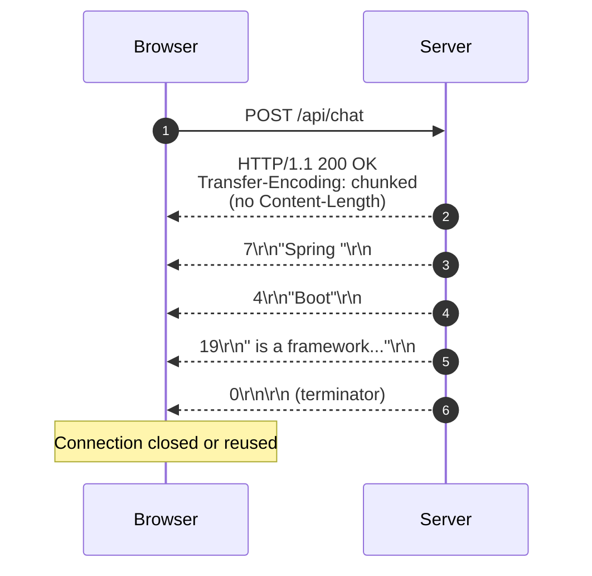
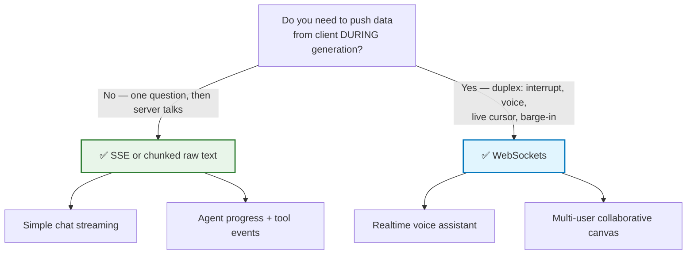
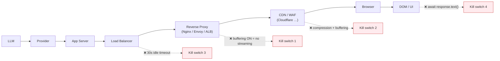

# Chapter 05: HTTP Streaming Mechanics — Chunked Encoding, SSE & WebSockets

> **Chapter Goal:** Understand streaming as a *transport* phenomenon rather than an AI phenomenon. Learn how an HTTP response can begin before it is finished (`Transfer-Encoding: chunked`), the exact Server-Sent Events wire grammar, the real differences between SSE and WebSockets, and the infrastructure (proxies, compression, timeouts) that silently destroys streaming in production.
>
> **Source Mapping:** `Notes.pdf` §8 *(What Is API Streaming?)*, §9 *(Streaming Is Still an HTTP Response)*, §10 *(SSE and WebSockets)*, §18 *(What About text/event-stream?)* — expanded with the full protocol specification and infrastructure failure modes.

---

## 5.1 Conventional HTTP vs. Streaming HTTP

A conventional HTTP API behaves like a vending machine:

```text
REQUEST
   ↓
SERVER WORKS
   ↓
SERVER FINISHES
   ↓
RESPONSE
```

For example, `GET /users/10` returns one completed object:

```json
{ "id": 10, "name": "Rohit" }
```

AI responses are different because **the result naturally develops over time**. We want the connection to stay open and deliver data repeatedly:

```text
REQUEST
   ↓
Connection remains open
   ↓
data
   ↓
data
   ↓
data
   ↓
data
   ↓
DONE
```

**That is streaming.**

> **The PDF's clarifying statement:** *Streaming does not mean abandoning HTTP.* The server simply begins an HTTP response without waiting to construct the entire response body.

| | Conventional | Streaming |
| :--- | :--- | :--- |
| HTTP Response | `[ COMPLETE BODY ]` | `HTTP Response begins` → `chunk` → `chunk` → `chunk` → `HTTP Response ends` |
| Body arrives | All at once | Progressively |
| `Content-Length` | Present | Usually absent |
| `Transfer-Encoding` | Not needed | `chunked` |

---

## 5.2 How HTTP Can Send an Incomplete Response: Chunked Transfer Encoding

HTTP/1.1 solves an obvious problem: *how do I send a body when I don't know its final length?*

The answer is **chunked transfer encoding**: the body is split into self-describing chunks, each prefixed by its size in hexadecimal, terminated by a zero-length chunk.

```text
HTTP/1.1 200 OK
Content-Type: text/plain; charset=utf-8
Transfer-Encoding: chunked
Cache-Control: no-cache, no-transform
Connection: keep-alive
X-Accel-Buffering: no

7\r\n
Spring \r\n
4\r\n
Boot\r\n
19\r\n
 is a framework for...\r\n
0\r\n
\r\n
```



Key implications:

1. **No `Content-Length` means the client cannot know the total size in advance** — it must read until the terminator. This is exactly what `ReadableStream` is designed for.
2. **HTTP/2 has no chunked encoding** — it uses DATA frames instead. The *semantics* (progressive body) are identical, but the wire format differs. This is why you should never hand-parse chunk headers below the `fetch` layer.
3. **`Connection: keep-alive` plus an idle-timeout mismatch** is the classic cause of streams dying at 30 s / 60 s / 100 s. Fix by heartbeats (Chapter 10) or by reversing the timeout configuration.

---

## 5.3 Server-Sent Events (SSE)

SSE stands for **Server-Sent Events**. Its primary direction is strictly:

```text
SERVER  ──event──►  CLIENT
SERVER  ──event──►  CLIENT
```

A single HTTP connection delivers many **events**; the client progressively assembles them:

```text
data: Spring

data: Boot

data: is

data: awesome
```

becomes, in the UI:

```text
Spring Boot is awesome
```

### 5.3.1 The exact SSE wire grammar

An SSE stream is a `text/event-stream` body in which each event is:

```text
field: value\n
field: value\n
\n                 ← blank line DISPATCHES the event
```

| Field | Purpose | Notes |
| :--- | :--- | :--- |
| `data:` | Payload line(s) | Multiple `data:` lines are joined with `\n` |
| `event:` | Event type name | Maps to `addEventListener("token", …)` |
| `id:` | Last-Event-ID for resumption | Enables reconnect-and-resume |
| `retry:` | Reconnect delay (ms) | Browser hint |
| `:` (leading colon) | Comment / heartbeat | Keeps intermediaries from idling the connection |

A production-shaped SSE stream for a chat assistant:

```text
: heartbeat

event: status
data: {"phase":"retrieving"}

event: token
id: 41
data: {"text":"Spring"}

event: token
id: 42
data: {"text":" Boot"}

event: usage
data: {"prompt_tokens":210,"completion_tokens":64}

event: done
data: {"finish_reason":"stop"}

```

> **Critical parser rule:** SSE framing uses **double newline (`\n\n`) as the event delimiter**, and the framing is *line-oriented*. Because network chunks can split anywhere (§4.3), a robust client must buffer bytes, split on `\n\n`, and keep the trailing partial frame for the next read. Naively doing `chunk.split("\n\n")` on each read **will** corrupt output. The full algorithm appears in Chapter 09.

### 5.3.2 SSE response headers (the ones that matter)

```http
HTTP/1.1 200 OK
Content-Type: text/event-stream; charset=utf-8
Cache-Control: no-cache, no-transform
Connection: keep-alive
X-Accel-Buffering: no
Transfer-Encoding: chunked
```

| Header | Why it is mandatory |
| :--- | :--- |
| `text/event-stream` | Tells the client/proxies this is an SSE body |
| `Cache-Control: no-cache, no-transform` | Prevents caching and prevents proxies from rewriting the body |
| `X-Accel-Buffering: no` | **Nginx-specific: disables response buffering.** Without it, Nginx accumulates the entire body and streaming vanishes |
| `charset=utf-8` | Multi-byte safety for non-ASCII output |

---

## 5.4 SSE vs. WebSockets — Choosing the Right Pipe

The PDF contrasts the two canonical real-time transport options:

| | **SSE (Server-Sent Events)** | **WebSockets** |
| :--- | :--- | :--- |
| Direction | `SERVER ➔ CLIENT` (unidirectional) | `CLIENT ↔ SERVER` (bidirectional) |
| Protocol | Plain HTTP | Upgraded TCP (`ws://` / `wss://`) |
| Framing | Text lines, `\n\n`-delimited | Own frame protocol |
| Auto-reconnect | **Built in** (browser `EventSource`) | Manual |
| Message replay / resume | Supported via `Last-Event-ID` | Manual |
| Binary support | Poor (text-oriented) | Native |
| Proxies / firewalls | Very friendly (it is just HTTP) | Sometimes blocked; needs upgrade support |
| Browser API | `EventSource` (simple) or `fetch` (flexible) | `WebSocket` |
| Server resources | One long-lived HTTP request | Persistent socket per client |
| Best for | **AI token streaming**, notifications, feeds | Voice, collaboration, multiplayer, duplex control |

### The decision rule from the source material

> Once the user sends a prompt, **most continuous data flows in one direction**:
> ```text
> Client → Question
> Server → answer chunk
> Server → answer chunk
> Server → answer chunk
> ```
> *For simple AI answer streaming, WebSockets are usually unnecessary.* — `Notes.pdf` §10



> **Progress note:** The **Fetch + `ReadableStream`** approach (Chapter 09) is a hybrid: it uses a *plain HTTP request* (so it is easy to authorize with headers, unlike `EventSource`) while still giving you manual, frame-by-frame consumption. This is the dominant modern pattern in production AI chat clients.

---

## 5.5 Raw Text Streaming vs. `text/event-stream`

The PDF devotes §18 to a distinction that trips up many engineers:

```text
Streaming = data arrives progressively

SSE       = one particular protocol/format for delivering events
```

If we deliberately use SSE, the endpoint must produce:

```text
MediaType.TEXT_EVENT_STREAM_VALUE   →   Content-Type: text/event-stream
```

But for a simple chatbot, **raw text is enough**:

```text
produces = MediaType.TEXT_PLAIN_VALUE
```

| Aspect | Raw text (`text/plain`) | SSE (`text/event-stream`) |
| :--- | :--- | :--- |
| Body format | Arbitrary text fragments | `field: value` events, `\n\n` framed |
| Client parser needed | None — append directly | Yes — SSE frame reassembly |
| Typed events (status, tokens, usage) | Not supported (needs convention) | Native via `event:` |
| Resume after disconnect | No | Yes, with `id:` + `Last-Event-ID` |
| Heartbeats | Manual blank writes | `: comment` lines |
| Complexity | Minimal | Moderate |
| Right for | Simple demo chat, single-stream answers | Product-grade assistants, agents, observability |

> **Engineering guidance:** start with raw text (it teaches the essentials with zero framing bugs), then graduate to SSE when you need *event types* (tool calls, citations, usage stats, errors) or *resumable* streams. A very common production pattern is **raw text for the token channel, plus a separate JSON control channel** — but SSE unifies both in one connection.

---

## 5.6 Infrastructure That Silently Breaks Streaming

This section is not in the PDF, but it is the reason most "streaming doesn't work" tickets exist. Streaming is an **end-to-end property**: any component that buffers, rewrites, or times out the body will collapse it.



| Layer | Failure | Symptom | Fix |
| :--- | :--- | :--- | :--- |
| App server | Framework serializes the whole body | Nothing until the end | Return a stream/iterator type, not a string |
| Nginx | `proxy_buffering on` (default) | Whole answer at once | `proxy_buffering off;` + `X-Accel-Buffering: no` |
| Nginx | `proxy_read_timeout 60s` | Stream dies after 60 s | Raise timeout **or** send heartbeats every 10–15 s |
| ALB / Envoy | Idle timeout on the connection | Connection reset mid-answer | Increase idle timeout; add heartbeats |
| Compression middleware | `gzip` buffers to fill blocks | Choppy, delayed delivery | Exclude `text/event-stream` from compression |
| CDN / WAF | Response buffering or HTML injection | Unexpected latency; injected scripts | Bypass CDN for streaming routes |
| App middleware | Logging/body-parsing middleware reads the body | Stream consumed twice; empty UI | Exclude streaming routes from body parsers |
| Browser code | `await response.text()` | Perfect backend, broken UX | Use `response.body.getReader()` (Chapter 09) |
| HTTP client library | Client buffers chunks by default | Same as above on the server side | Stream-enabled SDK/`ReadableStream` consumption |

> **Debugging heuristic:** put a `curl -N` (no-buffering) call directly against the backend. If `curl -N` streams but the browser does not, the problem is **after** the backend. If `curl -N` does *not* stream, the problem is **inside** the backend (or the provider SDK).

```bash
# Curl shows you the truth, unbuffered, byte by byte
curl -N -X POST http://localhost:8080/api/chat \
     -H "Content-Type: text/plain" \
     --data "Explain Spring Boot"
```

---

## 5.7 Common Pitfalls

| # | Pitfall | Consequence | Fix |
| :--- | :--- | :--- | :--- |
| 1 | Assuming `Content-Length` will be present | Broken progress indicators | Read until done; never size-based |
| 2 | Parsing SSE by splitting raw chunks on `\n\n` | Silently dropped/corrupted tokens | Maintain a leftover buffer |
| 3 | Leaving proxy buffering on | Streaming works locally, dies behind Nginx | Disable buffering + `X-Accel-Buffering: no` |
| 4 | Using `EventSource` when you need `POST` + headers | Auth tokens cannot be attached cleanly | Use `fetch` + `ReadableStream` |
| 5 | Ignoring idle timeouts | Streams die at 30/60/100 s, exactly | Heartbeats + explicit timeout config |
| 6 | Compressing `text/event-stream` | Choppy or delayed chunk delivery | Exclude SSE from compression |
| 7 | Assuming HTTP/2 keeps HTTP/1.1 chunk framing | Parser written against the wrong layer | Treat `fetch` as the framing boundary |
| 8 | No `charset=utf-8` | Mojibake for non-ASCII languages | Always declare UTF-8 |

---

## 5.8 Chapter Summary & Key Engineering Takeaways

1. **Streaming is HTTP with an incomplete, progressive body** — normally via `Transfer-Encoding: chunked` and **no `Content-Length`**.
2. **SSE is a *format* over HTTP**, not a different transport: `data:`/`event:`/`id:`/`retry:` fields, `\n\n`-delimited frames, `Content-Type: text/event-stream`.
3. **SSE is unidirectional (server ➔ client) and therefore ideal for AI output**, which is itself unidirectional after the prompt.
4. **WebSockets are for duplex interaction** (voice, collaboration, barge-in) — usually unnecessary for simple answer streaming.
5. **Streaming ≠ SSE.** Raw `text/plain` chunked streaming is a valid, simpler choice and is what the PDF's Tomato chatbot uses.
6. **`EventSource` is convenient but limited** (`GET` only, no custom headers); `fetch` + `ReadableStream` is the production default.
7. **The infrastructure is the usual culprit.** Proxy buffering, compression, and idle timeouts break streaming far more often than model or code issues.
8. **Never parse below `fetch`.** Chunk framing is not a stable contract; treat `ReadableStream` as your framing boundary.

**Next:** [Chapter 06 — The Complete End-to-End Streaming Architecture](./06_End_to_End_Streaming_Architecture_and_Pipeline_Invariants.md)
