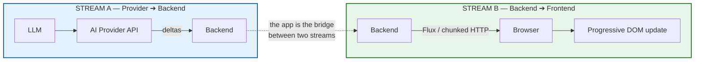
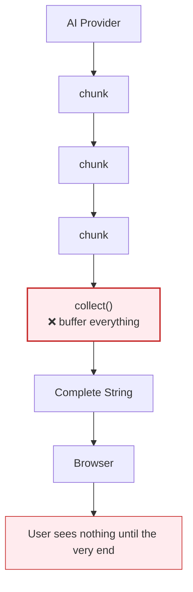
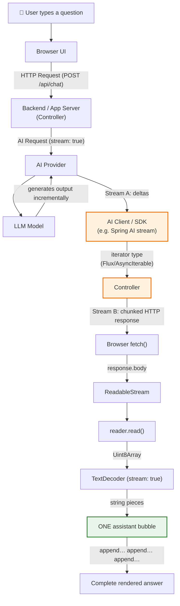
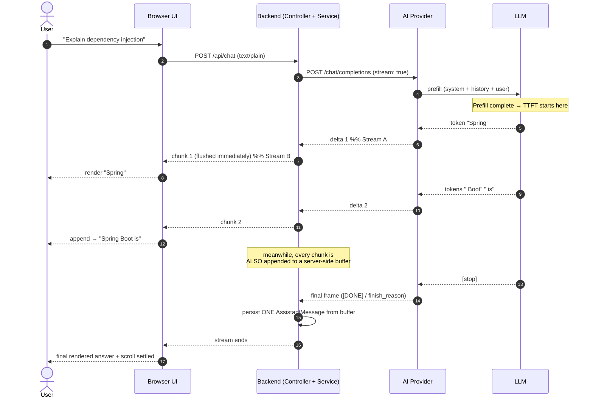
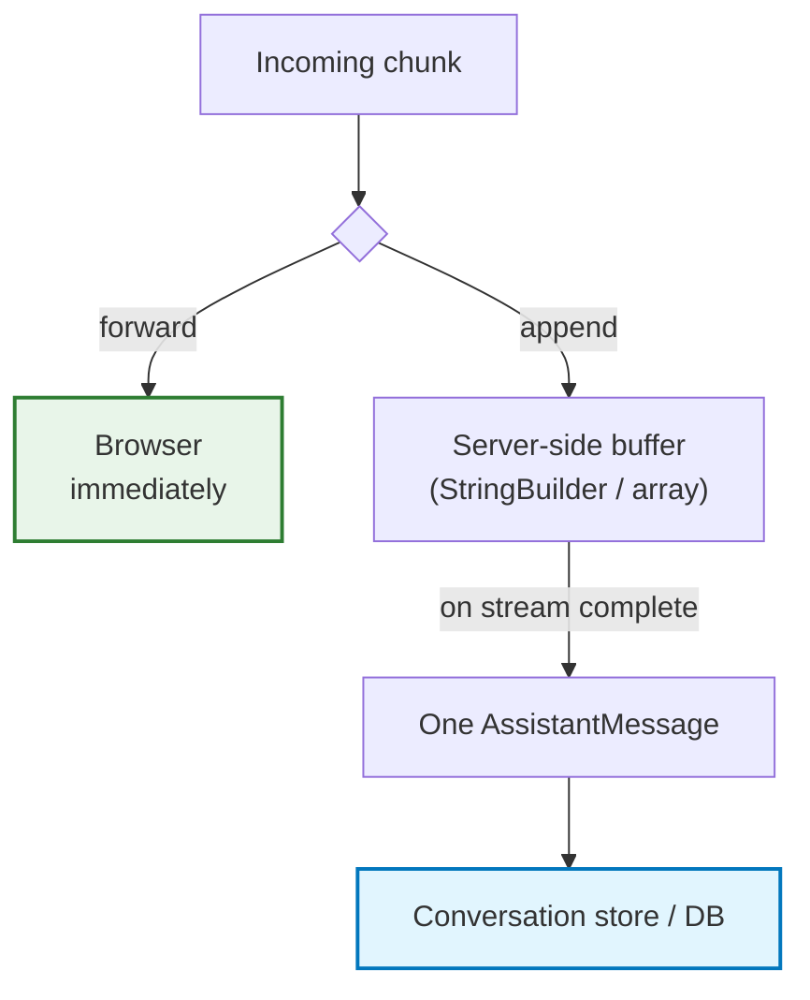
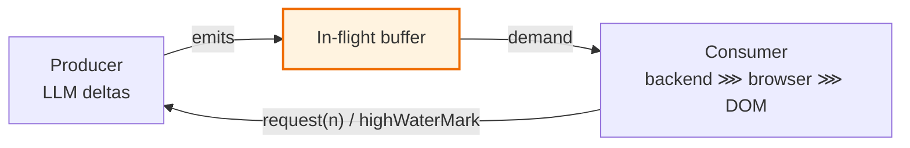
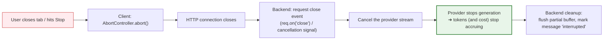

# Chapter 06: The Complete End-to-End Streaming Architecture

> **Chapter Goal:** Assemble every previous chapter into one pipeline. Identify the **two independent streams** (provider ➔ backend, backend ➔ browser), prove why **streaming is an end-to-end property** that any single buffering hop can destroy, and establish the pipeline invariants, backpressure model, cancellation propagation, and observability required of a production streaming system.
>
> **Source Mapping:** `Notes.pdf` §11 *(The Complete Streaming Architecture)*, §12 *(Streaming Must Survive the Entire Pipeline)*, §36 *(Final End-to-End Mental Model)*, §37 *(The Core Idea)*.

---

## 6.1 The Two Streams — and Why Both Must Stay Streamed

From the application's perspective there are exactly **two** important streams:

```text
Stream A:  AI Provider ➔ Backend      (consumption stream)
Stream B:  Backend ➔ Frontend         (production stream)
```



> **The PDF's exact framing:** *From our application's perspective, there are really two important streams… **Both must remain streamed.***

A backend that consumes Stream A eagerly and releases Stream B lazily is a **buffer**, not a bridge:



The mirror image is equally fatal — a perfectly streamed backend wasted by a client that waits:

```text
Backend could stream perfectly,
but if JavaScript waits for the complete body before displaying anything,
streaming disappears again.
```

---

## 6.2 The Full End-to-End Pipeline

Combining the PDF's architecture diagram (§11) with its pipeline diagram (§12):



### The pipeline as a chain of "must not break" links

```text
LLM
 ↓   must not be awaited as a whole
AI Provider
 ↓   must be consumed as a stream
AI Client / SDK
 ↓   must not be collected into a collection
Controller / HTTP Response
 ↓   must flush each write
JavaScript fetch
 ↓   must not call response.text()
DOM
```

The PDF states the invariant directly:

> *Streaming is an end-to-end property of the application, not just an LLM feature.*

---

## 6.3 The 7 Pipeline Invariants

Each invariant is a rule that, if violated at any single layer, silently converts your "streaming" system into a buffered one.

| # | Invariant | Violated by | Detection |
| :--- | :--- | :--- | :--- |
| 1 | **Every layer must forward, not accumulate** | `collect()`, `List<String>`, `join()` | TTFT ≈ total time |
| 2 | **The response must flush per chunk** | Framework auto-serialization | `curl -N` shows one blob |
| 3 | **Intermediaries must not buffer** | Nginx default, CDN, compression | Works locally, breaks in staging/prod |
| 4 | **The connection must not idle out** | 30/60/100 s timeouts | Stream dies at suspiciously round times |
| 5 | **The client must read incrementally** | `await response.text()` | Backend logs show streaming; UI does not |
| 6 | **The UI must append, not replace** | Re-creating the bubble per chunk | Flicker, duplicated messages, lost scroll |
| 7 | **Cancellation must propagate upstream** | Closing the tab but still paying for tokens | Provider usage billing exceeds user sessions |

> **Engineering Insight — "Streaming works in my terminal."** `curl -N` bypasses proxies, compression, and browsers, so it validates invariants 1–2 and 4 only. Most production failures live in invariants 3, 5, and 6 — which is why a **staging environment with the real proxy topology** is mandatory test infrastructure for streaming features.

---

## 6.4 End-to-End Sequence Diagram (Both Streams)



Note the two concurrent responsibilities of the backend during the stream:



Chapter 08 develops this dual-write pattern (stream out, buffer in) in full.

---

## 6.5 Backpressure and Flow Control

A stream is not just "data pushed out." It is a **flow-controlled** pipeline: if the consumer cannot keep up, a well-built stream slows the producer instead of buffering to infinity in memory.



| Layer | Backpressure mechanism | What happens when ignored |
| :--- | :--- | :--- |
| Reactive (Reactor) | Subscriber `request(n)` demand | `MissingBackpressureException` or unbounded buffering |
| Web Streams (`ReadableStream`) | `highWaterMark`, `desiredSize`, `pull()` | Memory growth, GC pressure, stalled UI |
| `fetch` response body | TCP receive window / stream controller | OS-level buffering; chunk coalescing |
| Provider SDK | Iterator pacing | You "pull" faster than tokens exist — you simply await |
| **Practical reality** | The provider is almost always slower than your consumer | Backpressure bugs appear as *mid-stream stalls*, not overflows |

> **Engineering Insight — pull vs. push.** In AI streaming the model is the bottleneck, so backpressure rarely manifests as overflow. It manifests as **stalls**: if a downstream layer is slow (a heavy markdown re-render on every chunk, for example), reads stop and the browser's receive buffer fills, which then makes chunks arrive *coalesced* — degrading the UX even though the provider is generating smoothly. The fix is on the UI side: **decouple network reads from rendering** (read as fast as possible into a string; render on an animation frame). This is covered in Chapter 09.

---

## 6.6 Cancellation Propagation: Stop Paying for Abandoned Answers

Streaming makes cancellation economically meaningful: a generation can be stopped mid-flight, and providers bill for what was produced (or not produced at all). Production systems must therefore propagate cancellation **upstream**:



| Failure to propagate | Consequence |
| :--- | :--- |
| Client aborts, backend keeps consuming | **You pay for tokens nobody will ever read** |
| Backend cancels, partial text discarded | Conversation history loses what the user actually saw |
| No cancellation at all | "Stop" button is cosmetic; GPU time is wasted |
| Cancellation without cleanup | Leaked subscriptions/connections, degraded pool health |

---

## 6.7 The Final End-to-End Mental Model

The PDF's closing flow diagram (§36), annotated with the layer that owns each hop:

```text
USER
 │  "Explain dependency injection"
 ▼
BROWSER                      ── owns: cancellation, header auth
 │  HTTP Request
 ▼
BACKEND / APP SERVER         ── owns: streaming return type, flush, buffering, persistence
 │  AI Request
 ▼
AI PROVIDER                  ── owns: delta framing, rate limits, usage reporting
 │
 ▼
LLM                          ── owns: prefill + serial decode (the only uncontrollable part)
 │  Generates output incrementally
 ▼
AI PROVIDER
 │  Streams chunks
 ▼
AI CLIENT / SDK              ── owns: exposing deltas as an iterator
 │  Flux<String> / AsyncIterable<String>
 ▼
CONTROLLER
 │  Streaming HTTP response
 ▼
BROWSER
 │  ReadableStream
 ▼
STREAM READER
 │  Uint8Array
 ▼
TEXT DECODER                 ── owns: multi-byte safety
 │  String chunks
 ▼
ONE ASSISTANT BUBBLE          ── owns: accumulation, rendering, scroll
 │  append... append... append...
 ▼
COMPLETE RESPONSE
```

And in parallel, the backend's second responsibility:

```text
Incoming Chunk
     │
     ├────────→ Browser            (latency path)
     │
     └────────→ StringBuilder      (correctness path)
                     ↓
              Stream Complete
                     ↓
              AssistantMessage
                     ↓
            Conversation History
```

### The PDF's core idea, in five sentences (§37)

> - The **LLM** generates tokens incrementally.
> - The **AI provider** exposes generated output as chunks or deltas.
> - **The backend** represents those streamed values with a stream abstraction (`Flux<String>`, `AsyncIterable`, …).
> - **HTTP** carries them progressively, and the **browser** exposes the incoming response as `response.body`, a `ReadableStream`.
> - **JavaScript** reads the incoming bytes, decodes them into text, and continuously appends that text to **one** assistant message.

Resulting in one continuous pipeline:

```text
Generation → Provider Streaming → Backend Streaming → HTTP Streaming → Browser Streaming → Live UI Rendering
```

> **And that is what creates the familiar experience of an AI assistant appearing to type its answer in real time.**

---

## 6.8 Naïve vs. Production Streaming Pipeline

| Concern | Naïve implementation | Production implementation |
| :--- | :--- | :--- |
| Backend return type | `String` (buffers) | Stream type (`Flux` / `AsyncIterable` / `ReadableStream`) |
| Provider consumption | `await` full response | Incremental deltas |
| Proxy configuration | Defaults | Buffering off, UTF-8, idle timeout raised |
| Heartbeats | None | `: comment` every 10–15 s (SSE) / periodic whitespace |
| Cancellation | Ignored | `AbortController` → upstream cancel → cost stops |
| History persistence | One message per chunk (or nothing) | Dual-write: forward + buffer, persist once on completion |
| Partial failure | Message lost or duplicated | Persist partial with `interrupted` flag |
| Client consumption | `await response.text()` | `getReader()` loop with one `TextDecoder` |
| UI updates | Rebuild bubble per chunk | Append to one bubble, render on animation frame |
| Observability | Total latency only | TTFT, ITL, TPS, tokens, chunk sizes, abort rate |
| Multi-user state | Shared mutable list | Session-scoped, isolated conversation state |

---

## 6.9 Common Pitfalls

| # | Pitfall | Consequence | Fix |
| :--- | :--- | :--- | :--- |
| 1 | Assuming the model is the bottleneck | Optimizing the wrong layer | Measure each hop's TTFT contribution |
| 2 | "Streaming is on" because the SDK call used `stream: true` | Delivery still buffered | Verify invariants 1–7 end to end |
| 3 | No cancellation propagation | Paying for abandoned generations | Wire close/abort events to the provider |
| 4 | Persisting only on success | Cancelled/aborted chats vanish from history | Persist partial text with a flag |
| 5 | Ignoring backpressure-induced stalls | Coalesced chunks, janky UX | Decouple reads from rendering |
| 6 | No heartbeats | Mid-stream disconnects at proxy timeouts | Send periodic keep-alives |
| 7 | No end-to-end test | Works in dev, breaks behind the gateway | `curl -N` + staging proxy topology tests |

---

## 6.10 Chapter Summary & Key Engineering Takeaways

1. **There are two streams** — provider ➔ backend and backend ➔ browser — and **both must remain streamed**.
2. **The backend is a bridge, not a buffer.** Mapping and forwarding is the job; collecting defeats the purpose.
3. **Streaming is an end-to-end property**, verifiable through seven invariants spanning code, infrastructure, and UI.
4. **The pipeline has an owner per hop** — name them in design reviews, because streaming failures are always *someone's* buffering choice.
5. **Backpressure in AI streaming shows up as stalls and chunk coalescing**, so it is usually a UI-rendering problem, not a producer problem.
6. **Cancellation must propagate upstream** or you pay for tokens nobody reads.
7. **A streamed answer and a stored answer are two different objects produced from the same data** (Chapter 08's dual-write pattern).
8. **Observability is the only way to prove streaming works** — TTFT at every hop, chunk-size distribution, and abort rate.

**Next:** [Chapter 07 — Backend Streaming: `.call()` vs `.stream()` and the `Flux` Abstraction](./07_Backend_Streaming_Call_vs_Stream_and_Flux.md)
