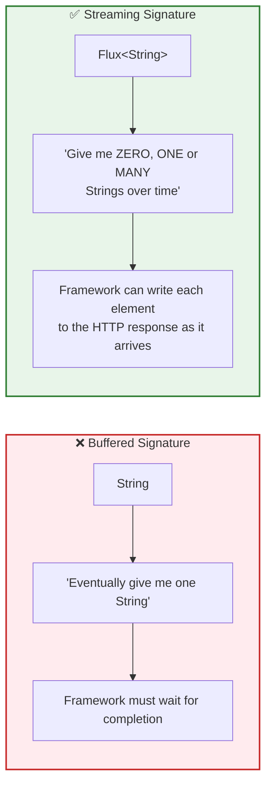
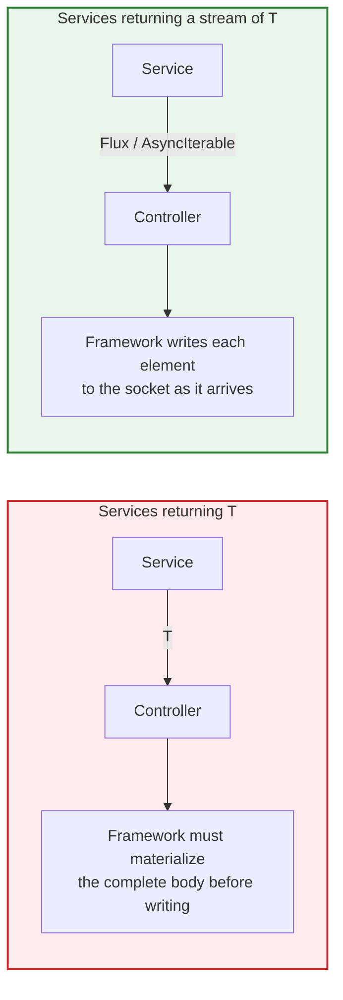
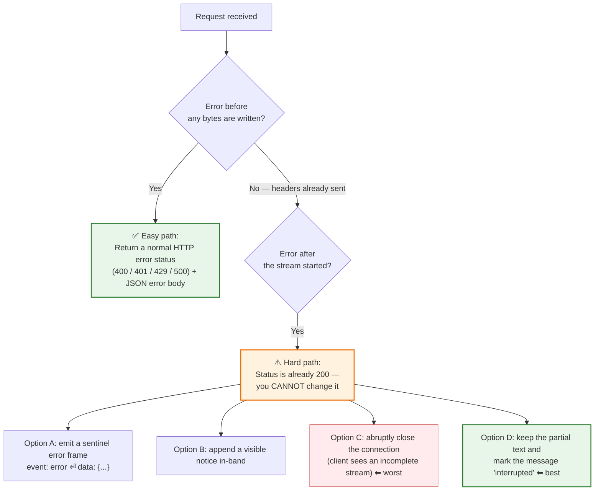

# Chapter 07: Backend Streaming — `.call()` vs `.stream()` and the `Flux` Abstraction

> **Chapter Goal:** Understand the backend half of streaming. Learn why the *real* change between buffered and streamed generation is not the method name but the **return type**, internalize the publisher/subscriber mental model behind `Flux<String>` (and its equivalents in other ecosystems), and know exactly how a streamed response reaches the browser over HTTP.
>
> **Source Mapping:** `Notes.pdf` §13 *(Spring AI: .call() vs .stream())*, §14 *(Switching to .stream())*, §15 *(Understanding Flux<String>)*, §16 *(Spring AI Streaming Service)*, §17 *(Streaming from Spring Boot to the Browser)*. Expanded with Reactive Streams semantics, operator catalogue, error handling, and multi-user safety.

> **Note on language:** the source PDF uses **Java / Spring AI** (`Flux<String>`, `ChatClient`). The concepts are language-agnostic, so each one is paired below with its **TypeScript/Node.js equivalent**, which is the environment used for the pseudocode in these notes.

---

## 7.1 The Starting Point: A Normal (Buffered) AI Call

A normal AI call looks like this:

```text
public String chat(String message) {
    return chatClient.prompt()
            .user(message)
            .call()
            .content();
}
```

Decomposing the chain:

| Element | Meaning |
| :--- | :--- |
| `chatClient.prompt()` | Starts constructing the prompt (a builder) |
| `.user(message)` | Adds the user's message to the conversation being sent |
| `.call()` | Requests the **normal, non-streaming** interaction |
| `.content()` | Extracts the generated content from the response object |
| Return type `String` | **One completed value**, delivered when everything is finished |

Conceptually:

```text
String answer;   // ⬅ one complete thing, arriving at one moment in time
```

> **The architectural significance is the return type, not the method name.** `String` is a *single-value* contract: it tells every caller in the codebase (and the framework itself) "there is exactly one object, and it exists only after completion." That type is the reason buffering happens — not the network, not the model.

---

## 7.2 Switching to Streaming

For streaming, the change is:

```text
.call()   ➔   .stream()
```

```text
public Flux<String> chat(String message) {
    return chatClient.prompt()
            .user(message)
            .stream()
            .content();
}
```

> **The PDF's key observation:** *The important change is not just `.call()` ➔ `.stream()`. The important change is the return type: `String` becomes `Flux<String>`.*



---

## 7.3 Understanding `Flux<String>` — Box vs. Conveyor Belt

The PDF's mental models are worth preserving exactly, because they explain reactive types better than any specification:

### `String` is a box

```text
┌────────────────────────────────────┐
│ Hello Rohit, how can I help?       │
└────────────────────────────────────┘
```

One value. One moment. Fully materialized.

### `Flux<String>` is a conveyor belt

```text
time ─────────────────────────────────────────→

"Hello"  →  " Rohit"  →  ", how"  →  " can"  →  " I help?"
```

```text
→ ["Hello"] → [" Rohit"] → [", how"] → [" can"] → [" I help?"]
```

| Concept | `String` | `Flux<String>` |
| :--- | :--- | :--- |
| Cardinality | Exactly 1 | 0, 1, or N |
| Timing | One instant | Spread over time |
| Memory profile | Whole value resident | Element-at-a-time |
| Backpressure | Impossible | First-class (subscriber requests N) |
| Terminal signals | Return | `onComplete` / `onError` |
| Cancellation | Not meaningful | `Disposable` / `abort()` |

### The cross-language translation table (from §15)

| Ecosystem | Streaming abstraction | Consuming idiom |
| :--- | :--- | :--- |
| Java / Reactor | `Flux<T>` | `.subscribe(...)` / `WebFlux` return type |
| JavaScript / Node | `ReadableStream`, `AsyncIterable` | `for await (const x of stream)` |
| Python | `AsyncIterator`, `AsyncGenerator` | `async for x in stream` |
| Go | channel `chan T` | `for v := range ch` |
| Kotlin | `Flow<T>` | `.collect { }` |
| C# / .NET | `IAsyncEnumerable<T>` | `await foreach` |

> **The PDF's unifying statement:** *The syntax changes, but the underlying concept remains: **values become available progressively over time**.* In one sentence, that is the entire mental model of backend streaming.

---

## 7.4 The Streaming Service: One Method, One Return Type Change

The PDF's streaming service is deliberately tiny:

```text
@Service
public class ChatService {
    private final ChatClient chatClient;

    public ChatService(ChatClient.Builder builder) {
        this.chatClient = builder.build();
    }

    public Flux<String> chat(String message) {
        return chatClient.prompt()
                .user(message)
                .stream()
                .content();
    }
}
```

> **Why the method is so short is the point:** *Instead of waiting for one complete String, the service exposes pieces of generated text as they arrive.* The service does not buffer, does not join, does not loop — it hands the caller a **handle to a time-series**, not a value.

### The architectural consequence



**Rule of thumb:** *the moment a service method returns `String` (or `Promise<FullResponse>`), streaming is already dead for that path* — regardless of how the model was invoked. The return type is the contract, and it is decided in the service layer, not the controller.

**TypeScript equivalent (pseudocode):**

```typescript
// ❌ Buffered service — streaming is impossible for any caller
async function chat(message: string): Promise<string> {
  let full = "";
  for await (const piece of providerStream(message)) full += piece;
  return full;
}

// ✅ Streaming service — hands the caller a time-series
function chatStream(message: string): AsyncIterable<string> {
  return providerStream(message);   // no buffering, no joining
}
```

---

## 7.5 Streaming from the App Server to the Browser

There are multiple ways to expose streaming over HTTP. For the Tomato chatbot the PDF chooses the simplest: **raw text streaming**.

```text
@PostMapping(
    value = "/api/chat",
    consumes = MediaType.TEXT_PLAIN_VALUE,
    produces = MediaType.TEXT_PLAIN_VALUE
)
public Flux<String> chat(@RequestBody String message) {
    return chatService.chat(message);
}
```

> **The important part is that the controller returns `Flux<String>` instead of `String`.** Spring then progressively writes those emitted pieces into the HTTP response.

### If SSE is deliberately chosen instead

```text
produces = MediaType.TEXT_EVENT_STREAM_VALUE
```

which corresponds roughly to:

```text
Content-Type: text/event-stream
```

> *That is useful when we want actual Server-Sent Events. However, **streaming itself does not require SSE.*** For a simple chatbot, raw text is enough.

### Framework mapping table (how the same idea is expressed per stack)

| Stack | Return type that enables streaming | Framework behaviour |
| :--- | :--- | :--- |
| Spring WebFlux (Java) | `Flux<T>` / `Mono<T>` | Reactive HTTP writer flushes each element |
| Spring MVC (Java, non-reactive) | `ResponseBodyEmitter`, `SseEmitter`, `StreamingResponseBody` | Async servlet container writes incrementally |
| Node.js / Express (TS) | `res.write(chunk)` on the raw response | Manual flush; must disable buffering explicitly |
| Next.js / Web Fetch (TS) | `new Response(readableStream)` | Streams the body through |
| FastAPI (Python) | `StreamingResponse`, `AsyncGenerator` | Serializes each yielded item |
| Go (net/http) | Direct `w.Write` + `Flusher.Flush()` | Requires explicit `Flush()` calls |

---

## 7.6 The Operators You Actually Need (and Their Purpose)

`Flux` is a stream with a rich operator vocabulary. In production streaming chat only a handful matter, and each exists to solve a *specific* problem from earlier chapters:

| Operator | Purpose | Solves |
| :--- | :--- | :--- |
| `doOnNext(piece -> …)` | Observe each element as it passes | **Buffering for history** (Chapter 08) and metrics |
| `doOnComplete(() -> …)` | Run when the stream finishes normally | Persist the assembled answer; clear "generating" state |
| `doOnError(err -> …)` | Observe failure | Log, emit a user-visible error, mark the turn failed |
| `onErrorResume(...)` | Recover with a fallback stream | Provider outage → stream a graceful message |
| `timeout(Duration)` | Fail if no element arrives in time | Mid-stream stalls (proxy/timeout defence) |
| `retryWhen(...)` | Retry with backoff | Transient provider 429/5xx before the first token |
| `doFinally(signal -> …)` | Cleanup regardless of outcome | Release resources, close subscriptions, metrics |
| `map` / `filter` / `buffer` / `concatWith` | Transform, gate, or coalesce | Content filtering, batching, final markers |

```typescript
// PSEUDOCODE (TS): the same operator roles expressed with an async generator
async function* streamWithLifecycle(message: string, session: Session) {
  let buffer = "";

  try {
    for await (const piece of providerStream(message)) {   // the stream itself
      buffer += piece;                                     // doOnNext equivalent
      yield piece;                                         // forward to client
    }
    await session.appendAssistantMessage(buffer);          // doOnComplete equivalent
  } catch (err) {
    await session.markTurnFailed(err);                     // doOnError equivalent
    yield "\n\n[The response was interrupted. Please try again.]";
  } finally {
    session.releaseStreamingLock();                        // doFinally equivalent
  }
}
```

> **Engineering Insight — never put heavy work inside `doOnNext`.** Because `doOnNext` runs on the emission path, doing a synchronous DB write, a network call, or an expensive re-render there **directly throttles the stream** (see the backpressure discussion in §6.5). Append to an in-memory buffer on the emission path; do I/O in `doOnComplete` / `doFinally`.

### Reading a stream on the server side

| Language | Idiom | Note |
| :--- | :--- | :--- |
| Java / Reactor | `.subscribe(...)` | Only the framework (WebFlux) should subscribe; manual subscribe in a service breaks backpressure |
| Java | `Flux.blockLast()` | ⚠️ **Anti-pattern in a streaming path** — converts the stream back into a blocking value |
| TS / Node | `for await (const piece of stream)` | Natural, backpressure-aware |
| TS | `stream.pipe(res)` | Efficient passthrough for Node `Readable` streams |

---

## 7.7 Error Handling: What Happens When Failure Occurs Mid-Stream?

This is the most under-designed aspect of streaming systems. Errors fall into two categories by *when* they occur:



**Why the second category is hard:** once `200 OK` and the first chunk have left the server, the HTTP status is immutable. The client's `response.ok` is `true`, and there is no way to retroactively say "actually, this failed." You must therefore design an **in-band error protocol**:

```text
event: token
data: {"text":"Spring Boot is"}

event: error
data: {"code":"upstream_timeout","recoverable":true,"partial":true}

event: done
data: {"finish_reason":"error"}
```

| Failure mode | Where it happens | Recommended handling |
| :--- | :--- | :--- |
| Invalid input / auth / rate limit | Before the first byte | Real HTTP status + JSON body |
| Provider 429 / 5xx | Before the first token | Server-side retry with jitter, then HTTP error |
| Provider disconnect mid-answer | After the first token | In-band `error` event + persist partial |
| Proxy idle timeout | Mid-stream | Heartbeats + raised timeout; client reconnects (SSE `Last-Event-ID`) |
| Client network drop | Any time | Client retries with a new request; server marks interruption |
| Downstream consumer aborts | Any time | Propagate cancellation; persist partial |

> **Design rule:** *never* return `200 OK` before you are certain the *response shape* is valid. Validate the request, authorize it, and confirm the provider accepted the call **before** flushing headers. Everything after the first byte must be signalled in-band.

---

## 7.8 Multi-User Isolation and Thread Safety

The PDF's own production warning (§22):

> *A shared `ArrayList` and mutable conversation history like this are useful for teaching but are **not suitable as-is for a real multi-user application**. Production applications need proper **conversation isolation** and **thread-safe state management**.*

| Anti-pattern | Failure it causes |
| :--- | :--- |
| One shared `List<Message> history` in the service | User A sees User B's answers; prompts cross-contaminate |
| A `StringBuilder` field on a singleton service | Interleaved halves of two different answers |
| Mutable per-request state on a `@Service` singleton | Race conditions under concurrent streaming |
| `ThreadLocal` used with async/reactive pipelines | Wrong thread → wrong context, silently cleared |
| Assuming reactive callbacks run on the request thread | Data races and lost state |

### The correct shape

```typescript
// PSEUDOCODE (TS): isolation by conversation key, buffer created per request
type ConversationKey = string;                     // conversationId (never userId alone)

async function* chat(conversationId: ConversationKey, userMessage: string) {
  // 1. Load history SCOPED to this conversation
  const history = await conversationStore.load(conversationId);

  // 2. The buffer lives on the REQUEST, not on the service instance
  const buffer: string[] = [];

  // 3. Guard against concurrent generations in the same conversation
  await conversationStore.withLock(conversationId, async () => {
    history.push({ role: "user", content: userMessage });

    for await (const piece of providerStream(history)) {
      buffer.push(piece);
      yield piece;
    }

    history.push({ role: "assistant", content: buffer.join("") });
    await conversationStore.save(conversationId, history);   // atomic, idempotent
  });
}
```

> **Two rules prevent almost all multi-user streaming bugs:**
> 1. **State lives per-request / per-conversation — never on a shared singleton.**
> 2. **Per-conversation concurrency control is mandatory** — otherwise two parallel tabs interleave writes into the same history and permanently corrupt it.

---

## 7.9 Common Pitfalls

| # | Pitfall | Consequence | Fix |
| :--- | :--- | :--- | :--- |
| 1 | Returning `String` from the service "but streaming in the controller" | Impossible — the buffer happens earlier | Change the **service** return type |
| 2 | `collectList()` / `blockLast()` / `join()` somewhere in the chain | Whole response buffered, streaming gone | Audit for collector operators on the streaming path |
| 3 | Heavy work inside `doOnNext` | Throttles the stream; janky output | Buffer only; do I/O on completion |
| 4 | Returning `200` before validating the request | Cannot signal failures properly | Validate/auth first, then flush headers |
| 5 | Mid-stream retry | Duplicated text fragments in the answer | Retry only before the first token |
| 6 | No heartbeat / no idle-timeout alignment | Silent disconnects at proxy timeouts | Heartbeats every 10–15 s |
| 7 | Shared conversation state | Cross-user leakage | Conversation-scoped state + locks |
| 8 | Unhandled stream error | Client sees a truncated answer with no explanation | In-band `error` event + partial persistence |
| 9 | Forgetting `doFinally` cleanup | Leaked submissions, exhausted connections | Always release resources |
| 10 | No usage capture in stream mode | Billing blind spot | Enable usage in the stream, or estimate |

---

## 7.10 Chapter Summary & Key Engineering Takeaways

1. **The method name is cosmetic; the *return type* is the architecture.** `String` buffers; a stream type forwards.
2. **`Flux<String>` means "zero, one, or many values over time"** — a conveyor belt, not a box.
3. **All ecosystems express the same idea**: `Flux`, `Flow`, `AsyncIterable`, `ReadableStream`, `IAsyncEnumerable`, `chan`.
4. **A streaming service stays tiny** because it does no buffering, joining, or assembling — that work belongs to the consumer.
5. **The controller simply returns the stream**, and the framework writes each element to the HTTP response as it is emitted.
6. **`doOnNext` / `doOnComplete` / `doOnError` / `doFinally` are the four operators that matter** for buffering, persistence, error signalling, and cleanup.
7. **Errors after the first byte cannot change the HTTP status** — design an in-band error protocol.
8. **Isolation and concurrency control are required for multi-user correctness**, and the PDF's `ArrayList` example is explicitly a teaching-only pattern.

**Next:** [Chapter 08 — Conversation History, Buffering & Persistence in Streaming Systems](./08_Conversation_History_Buffering_and_Persistence.md)
