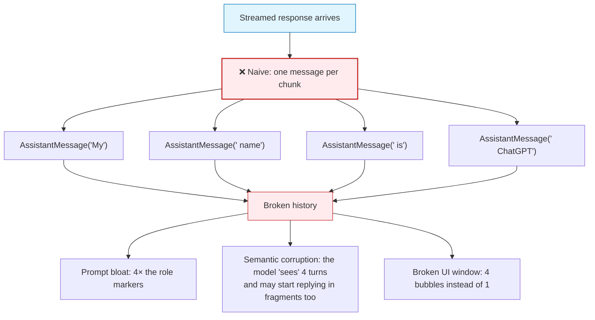
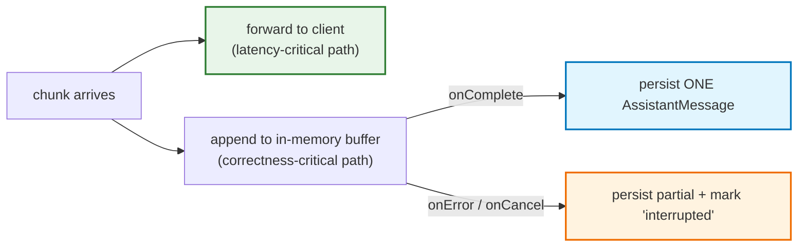
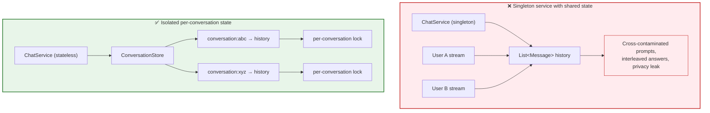
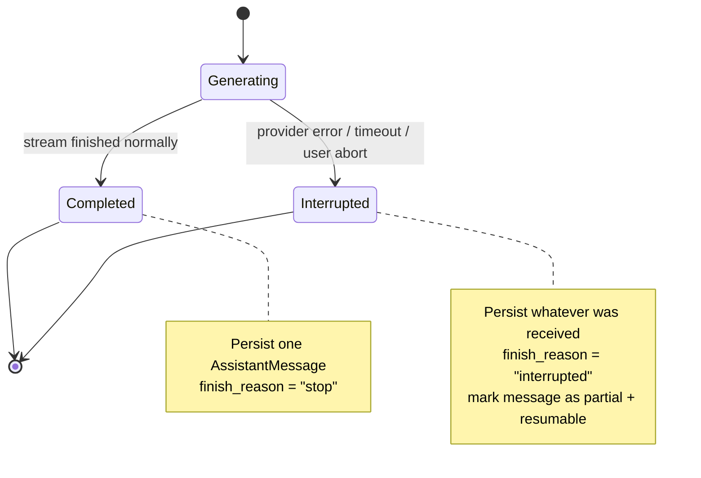
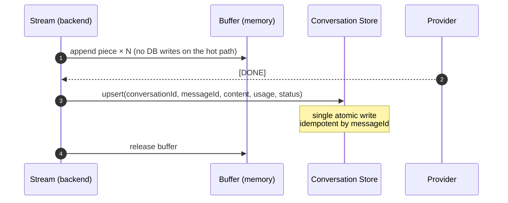

# Chapter 08: Conversation History, Buffering & Persistence in Streaming Systems

> **Chapter Goal:** Solve the problem streaming *creates*: if the assistant's answer arrives as many fragments, what exactly do you store as history for the next turn? Learn why transport chunks must never become conversation messages, master the **dual-write pattern** (stream out while buffering in), and handle the hard cases — partial failure, multi-user isolation, token accounting, and idempotent persistence.
>
> **Source Mapping:** `Notes.pdf` §19 *(Conversation History Creates Another Problem)*, §20 *(Don't Store Every Chunk as a Separate Message)*, §21 *(Stream to the Browser and Buffer at the Same Time)*, §22 *(Streaming with Conversation History)*. Expanded with session isolation, failure semantics, and persistence engineering.

---

## 8.1 The Problem Streaming Introduces

Non-streaming code makes history trivial — the assistant response is already one complete `String`:

```text
history.add(new UserMessage("My name is Rohit"));
String response = "...";                       // complete value
history.add(new AssistantMessage(response));   // store it
```

Streaming changes this. The response arrives as many fragments:

```text
"My"        " name"        " is"        " ChatGPT"
```

and the naive adaptation collapses:



> **The PDF's rule:** *Those are transport chunks. Logically, the model generated **one** assistant message:* `"My name is ChatGPT"`. *Our conversation history should therefore contain:*
> ```text
> UserMessage(...)
> AssistantMessage("My name is ChatGPT")
> ```

**Where the naive approach is even worse than it looks:** each extra message adds role tokens (`assistant:`), so a 200-chunk answer inflates the prompt with 200 redundant role markers every subsequent turn. The cost is not linear annoyance — it is compounding **prompt bloat**.

---

## 8.2 The Dual-Write Pattern: Stream Out, Buffer In

The fix is that **every chunk must perform two jobs**:

```text
                        chunk
                          │
              ┌───────────┴───────────┐
              ↓                       ↓
      Send to browser          Append to buffer
        immediately
```

Illustrated concretely:

```text
"Java"        ├──→ Browser        └──→ Buffer
" is"         ├──→ Browser        └──→ Buffer
" a"          ├──→ Browser        └──→ Buffer
" language"   ├──→ Browser        └──→ Buffer
```

When generation completes:

```text
Buffer
  ↓
"Java is a language"
  ↓
Store ONE AssistantMessage
```

This yields **both** properties at once:

- **Real-time output for the user** (the browser sees each chunk instantly), and
- **Correct conversation history for future prompts** (the DB sees one message).



---

## 8.3 Reference Pattern: Streaming *and* Maintaining History

The PDF provides a minimal teaching implementation (§22):

```text
public Flux<String> chat(String userMessage) {

    history.add(new UserMessage(userMessage));

    StringBuilder fullResponse = new StringBuilder();

    return chatClient.prompt()
            .messages(history)
            .stream()
            .content()
            .doOnNext(fullResponse::append)
            .doOnComplete(() -> {
                history.add(
                    new AssistantMessage(fullResponse.toString())
                );
            });
}
```

Decomposing it line by line — this pattern is worth memorizing verbatim:

| Line | What it does | Why it matters |
| :--- | :--- | :--- |
| `history.add(new UserMessage(userMessage))` | Record the user turn **before** calling the model | The prompt must contain the new turn |
| `StringBuilder fullResponse = new StringBuilder()` | Allocate one accumulator for this request | One buffer per request — never shared |
| `.messages(history)` | Send the full conversation | Context for coreference resolution |
| `.stream().content()` | Get a stream of text pieces | The streaming contract |
| `.doOnNext(fullResponse::append)` | *Whenever another chunk arrives, append it to the local buffer* | **The streaming-to-buffered bridge** |
| `.doOnComplete(…)` | *When the stream finishes successfully, convert the buffered output into one assistant message and save it* | Correct history, one message |

> **The PDF's note on the pattern:** *The stream itself continues flowing to the controller and browser.* — i.e. `doOnNext`/`doOnComplete` are **observers**, not terminators. They do not intercept or buffer the outward flow.

### TypeScript equivalent (pseudocode)

```typescript
// PSEUDOCODE (TS): dual-write with an explicit accumulator and completion hook
async function* chatWithHistory(session: Session, userMessage: string) {
  session.history.push({ role: "user", content: userMessage });

  const pieces: string[] = [];        // per-request accumulator

  try {
    for await (const piece of providerStream(session.history)) {
      pieces.push(piece);             // buffer (correctness path)
      yield piece;                    // forward (latency path)
    }
    // completion hook: exactly ONE assistant message
    session.history.push({ role: "assistant", content: pieces.join("") });
    await session.persist();
  } catch (err) {
    // failure hook: keep what the user already saw
    await session.persistInterrupted(pieces.join(""), err);
    throw err;
  }
}
```

---

## 8.4 The Production Warning: Shared Mutable State

The PDF flags this immediately after the teaching example (§22 "Production Note"):

> *A shared `ArrayList` and mutable conversation history like this are useful for teaching but are not suitable as-is for a real multi-user application. Production applications need proper **conversation isolation** and **thread-safe state management**.*



Concrete requirements for a multi-user streaming chat backend:

| Requirement | Implementation shape |
| :--- | :--- |
| Conversation isolation | Key all state by `conversationId`, never by service instance |
| Request-scoped buffers | Create the accumulator inside the request handler |
| Concurrency control | A lock (or optimistic version check) per conversation |
| Stateless services | No mutable fields on singleton services |
| Idempotent persistence | Upsert by `(conversationId, messageId)` |
| Cancellation-aware cleanup | Free the lock in a `finally` block |

---

## 8.5 Partial Failure: What About an Interrupted Answer?

Streaming introduces a state that buffered systems never had: **the answer that was 80% delivered and then died.**



| Decision | Options | Recommendation |
| :--- | :--- | :--- |
| Discard partial text? | Drop it / keep it | **Keep it** — the user already read it; history must match what they saw |
| How to mark it? | Silent / flagged | **Flag it** (`status: "interrupted"`) so the UI and the model both know |
| Retry automatically? | Yes / no | Only *before* the first token; mid-answer retries produce duplicated fragments |
| Allow the user to continue? | Regenerate full answer / continue | Offer "Continue" (resume) or "Regenerate" (replace) |
| Include partial in the next prompt? | Yes / no | Yes, with the flag — otherwise the model sees a silent gap |

```typescript
// PSEUDOCODE (TS): persisting an interrupted turn without corrupting history
await messageStore.upsert({
  conversationId,
  messageId,                            // stable id ⇒ idempotent retries
  role: "assistant",
  content: partialText,                 // exactly what the user saw
  status: "interrupted",                // analytics + UI badge
  finishReason: "upstream_error",
  tokenUsage: { prompt: usagePrompt, completion: usageCompletionEstimate },
  completedAt: null,
});
```

---

## 8.6 Token Accounting and Context Management During Streaming

Streaming makes one accounting detail tempting-but-wrong: **counting chunks as tokens.** Chunks are not tokens (Chapter 04), and they are not billed. Keep the two ledgers separate — as established in **Lecture 04, Chapter 02**.

| Metric | How to obtain it correctly | Pitfall |
| :--- | :--- | :--- |
| `prompt_tokens` | From the usage object of the request | Estimating by character count |
| `completion_tokens` | From the final usage frame (when the provider emits it) or an accurate tokenizer | Counting chunks |
| Session cost | Σ prompt + completion per turn | Forgetting that history re-bills every turn |
| Context pressure | `prompt_tokens / model_context_limit` | Discovering overflow only when the API errors |

> **Provider note:** many APIs return usage **only in the final frame** when streaming (or require opting in), because token totals are not known until generation ends. Do not assume every stream carries usage; design a fallback (tokenizer estimate) and reconcile later.

### Context management is a *streaming* concern too

Because prompt length drives TTFT (§3.4) and KV-cache pressure (§1.3.2), the context window must be managed on a schedule — not reactively:

```typescript
// PSEUDOCODE (TS): decide the context strategy BEFORE streaming the answer
async function prepareContext(history: Message[], incoming: string): Promise<Message[]> {
  const candidate = [...history, { role: "user", content: incoming }];

  // 1. Hard budget check
  const tokens = countTokens(candidate);
  if (tokens < CONTEXT_BUDGET * 0.7) return candidate;      // comfortable

  // 2. Progressive degradation strategies, cheapest first
  const windowed = keepSystemPlusRecentTurns(candidate, { turns: 8 });
  if (countTokens(windowed) < CONTEXT_BUDGET) return windowed;

  const summarized = await summarizeOlderTurns(windowed);  // costs an extra call
  if (countTokens(summarized) < CONTEXT_BUDGET) return summarized;

  return truncateWithMarker(summarized, CONTEXT_BUDGET);    // last resort, told to the user
}
```

| Strategy | Extra cost | Preserves | Use when |
| :--- | :--- | :--- | :--- |
| Sliding window (last N turns) | None | Recent context | Usually the right default |
| Pinned system + sliding | None | Instructions + recent | Almost always better than plain sliding |
| Rolling summarization | 1 extra call | Long-range gist | Long sessions, project work |
| Semantic retrieval of old turns | Embeddings | Topic-relevant history | Multi-topic long-lived chats |
| Hard truncation | None (quality loss) | Nothing reliably | Emergency fallback only |

---

## 8.7 Persistence Engineering: Writing History Correctly

Streaming makes persistence a *late-bound* operation: the content is only known when the stream ends. That creates ordering, idempotency, and concurrency requirements.



| Requirement | Why | Implementation shape |
| :--- | :--- | :--- |
| **No DB writes on the emission path** | Each write would throttle the stream (backpressure, §6.5) | Buffer in memory; write once on completion |
| **Stable `messageId`** | Retries after a network failure must not duplicate the turn | Generate the ID **before** streaming; upsert by it |
| **Atomic single write** | A half-written conversation is worse than a missing one | One transaction/upsert per turn, or a commit-on-complete |
| **Ordering guarantee** | Interleaved writes corrupt the transcript | Per-conversation lock or monotonic sequence numbers |
| **Usage capture** | Billing and analytics need per-turn tokens | Persist the usage object from the final frame |
| **Timestamps** | Auditability and "generation duration" metrics | Store `createdAt`, `firstTokenAt`, `completedAt` |
| **Retention & redaction** | Compliance and log hygiene | Configurable TTL; redact secrets/PII at write time |
| **Crash safety** | Server restart mid-stream must not lose the user's text | Periodic checkpoint for very long generations |

### The three storage layers worth distinguishing

```text
┌─────────────────────────────────────────────────────────────┐
│ 1. HOT BUFFER (in memory, per request)                      │
│    Lifetime: one generation. Purpose: assemble the answer.  │
├─────────────────────────────────────────────────────────────┤
│ 2. CONVERSATION STORE (DB / cache)                          │
│    Lifetime: the conversation. Purpose: next-turn context.   │
├─────────────────────────────────────────────────────────────┤
│ 3. ANALYTICS LEDGER (append-only, async)                    │
│    Lifetime: forever. Purpose: cost, latency, quality        │
│    analytics. NEVER on the critical path.                    │
└─────────────────────────────────────────────────────────────┘
```

> **Anti-pattern:** writing every chunk to the database "so nothing is lost." It converts a 2-second answer into 200 transactions, saturates the connection pool, and simultaneously *slows the stream the user is watching*. Buffer in memory; checkpoint only for genuinely long (multi-minute) generations.

---

## 8.8 Common Pitfalls

| # | Pitfall | Consequence | Fix |
| :--- | :--- | :--- | :--- |
| 1 | Storing one message per chunk | Prompt bloat, "fragment" assistant behaviour, UI clutter | Buffer, then persist once |
| 2 | Persisting only on success | Cancelled/aborted turns vanish; the model loses what the user saw | Persist partial with `status: "interrupted"` |
| 3 | Shared mutable `history` in a singleton service | Cross-user contamination and privacy leaks | Conversation-scoped state + locks |
| 4 | Blocking DB writes inside the emission callback | Stream throttling / stalls | Buffer on the hot path; write on completion |
| 5 | No `messageId` (insert-only) | Duplicate turns on retry | Upsert by a pre-generated ID |
| 6 | Counting chunks as tokens | Wrong billing, wrong context budgeting | Use provider usage + a real tokenizer |
| 7 | Sending the *streamed fragments* back as history | The model mimics broken formatting | Send the reconstructed message |
| 8 | No context budget | Provider errors or degraded TTFT at turn 20 | Enforce a token budget before dispatch |
| 9 | Forgetting `finish_reason` | Cannot distinguish "complete" from "cut off by max_tokens" | Store finish reason with the message |
| 10 | No cleanup on abort | Locks leak; conversation becomes permanently stuck | Release in a `finally` block |

---

## 8.9 Chapter Summary & Key Engineering Takeaways

1. **Streaming breaks the 1:1 mapping between "chunks received" and "messages stored."** One logical assistant message can arrive as hundreds of transport fragments.
2. **Never store chunks as messages.** Store exactly one assistant message per turn, reconstructed from the buffer.
3. **The dual-write pattern is mandatory:** forward each chunk to the client *and* append it to a per-request buffer.
4. **Persistence happens at stream completion** (plus a failure hook) — never on the hot path.
5. **Interrupted answers still belong in history**, flagged as partial; the user already read them.
6. **Chunk count is not token count**, and history tokens are re-billed every turn — measure, don't guess.
7. **Context management is a latency *and* cost concern** because prompt length drives TTFT and KV-cache pressure.
8. **Multi-user isolation plus per-conversation concurrency control** are non-negotiable; the PDF's `ArrayList` teaching example is explicitly not production-safe.

**Next:** [Chapter 09 — Frontend Streaming: `fetch`, `ReadableStream` & `TextDecoder`](./09_Frontend_Streaming_Fetch_ReadableStream_TextDecoder.md)
