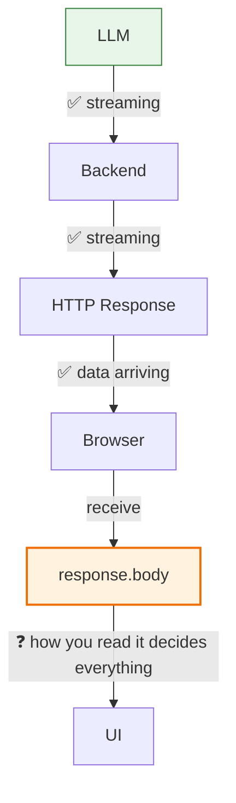
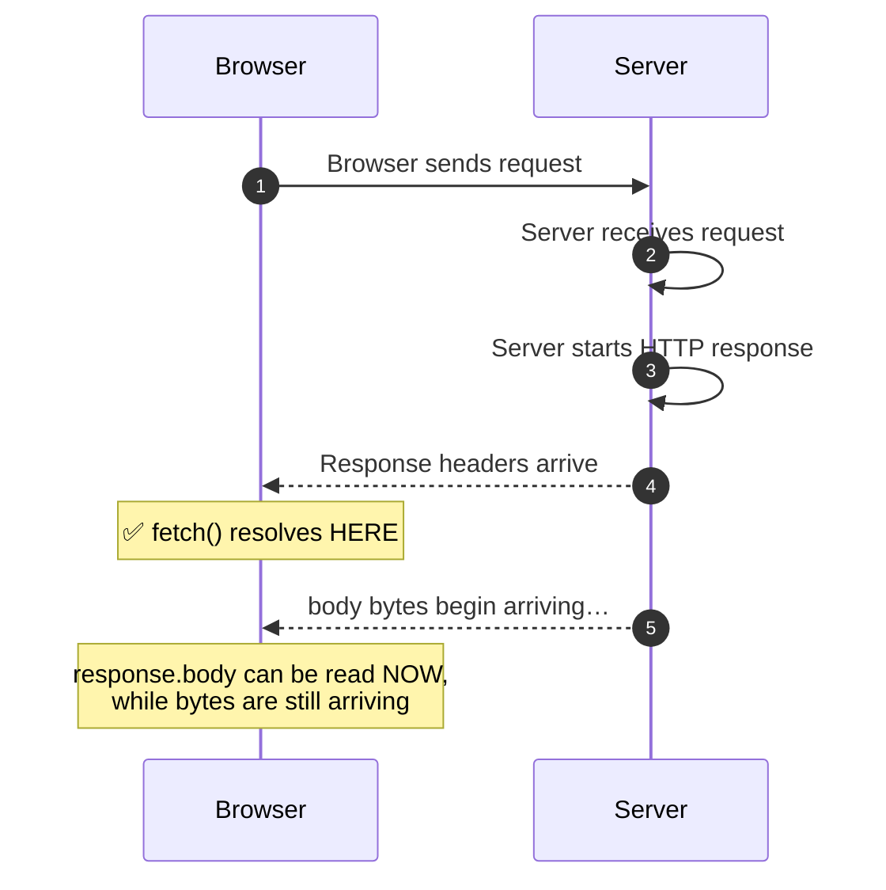
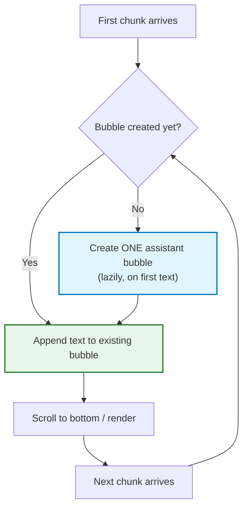
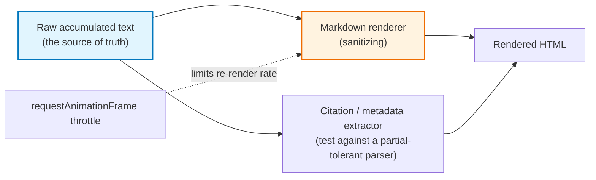

# Chapter 09: Frontend Streaming — `fetch`, `ReadableStream` & `TextDecoder`

> **Chapter Goal:** Complete the pipeline in the browser. Understand what `await fetch()` *actually* waits for, how to consume `response.body` as a `ReadableStream`, why `reader.read()` returns bytes rather than text, and how to build the exact ChatGPT-style experience: one growing assistant bubble, decoded incrementally, scrolled smoothly, and safely cancelled.
>
> **Source Mapping:** `Notes.pdf` §23 *(Backend Streaming Is Only Half the Work)* through §34 *(Why Call scrollToBottom() After Every Chunk?)*. Expanded with markdown rendering, performance, accessibility, XSS, and framework integration.

> **Note:** All snippets in this chapter are **JS/TS-style pseudocode** written for clarity of mechanism, not as a drop-in production module.

---

## 9.1 Backend Streaming Is Only Half the Work

At the end of the backend effort:

```text
AI Provider ➔ App Server      ✅ streaming
```

But we still need:

```text
App Server ➔ Browser          ❓
```

> **The PDF's warning:** *If the browser waits for the complete HTTP body, the user still sees the entire answer appear at once.*



Everything you built on the server can be erased by **one line** of client code.

---

## 9.2 The Common Frontend Mistake

Suppose the backend correctly emits:

```text
"Spring"
" Boot"
" is"
" a"
" framework"
```

But the frontend does this:

```javascript
const assistantReply = await response.text();
```

Then the browser effectively says:

> *Read the complete response body, combine everything, convert it to text, and give it to me only after it has finished.*

Resulting in:

```text
LLM                                 ✅ streaming
 ↓
App Server                          ✅ streaming
 ↓
HTTP                                ✅ streaming
 ↓
Browser                             ✅ receiving data
  ↓
response.text()                     ❌ waits for the complete body
 ↓
UI                                  ⛔ nothing until the end
```

> **One line has removed the visible streaming experience.** This is the most common "streaming doesn't work" bug in production, and it is invisible to every backend log and dashboard.

---

## 9.3 What Does `await fetch()` Actually Wait For?

Consider:

```javascript
const response = await fetch(API_URL, {
  method: "POST",
  headers: { "Content-Type": "text/plain" },
  body: message
});
```

A very common misconception:

```text
❌ await fetch()  waits until the complete response body has been downloaded
```

Conceptually, it does **not**. The real flow:



At the moment `fetch()` resolves:

```text
response
   │
   ├── status: 200
   ├── headers: {...}
   └── body:  ← still arriving…
```

`await fetch()` resolves **when the response headers are received** — long before the body is complete. The bug is that `await response.text()` then *drains and concatenates* that body anyway.

| Call | What it does | Streaming-friendly? |
| :--- | :--- | :--- |
| `await fetch(url)` | Resolves on **headers** | ✅ |
| `await response.text()` | Reads & concatenates the **entire** body | ❌ |
| `await response.json()` | Same, then parses | ❌ |
| `response.body` | The raw byte stream | ✅ |
| `response.body.getReader()` | A cursor over the stream | ✅ |

---

## 9.4 `response.body` — The `ReadableStream`

The actual stream is available through:

```text
response
   │
   ├── status
   ├── headers
   └── body  ↓
        ReadableStream
```

A `ReadableStream` represents **data that can become available progressively over time**. We obtain a reader:

```javascript
const reader = response.body.getReader();
```

```text
HTTP Response Body  →  ReadableStream  →  getReader()  →  Reader
```

| Concept | Role |
| :--- | :--- |
| `ReadableStream` | The body as a *pull-based source of bytes over time* |
| `getReader()` | Acquires a **cursor**; only one reader at a time (locked stream) |
| `reader.read()` | Returns a `Promise<{ value, done }>` for the next fragment |
| `reader.cancel()` | Releases the stream (also useful for early termination) |
| `releaseLock()` | Frees the lock for reuse |
| **Lock rule** | Calling `getReader()` twice without releasing throws `TypeError` — a common bug in React StrictMode/dev double-effects |

---

## 9.5 Reading the Stream

We repeatedly ask the reader for more data:

```javascript
const { value, done } = await reader.read();
```

The result looks like:

```javascript
{ value: Uint8Array(6), done: false }   // mid-stream
{ value: Uint8Array(9), done: false }   // more data
{ value: undefined,     done: true }    // stream finished
```

So the natural structure is:

```javascript
while (true) {
  const { value, done } = await reader.read();
  if (done) break;
  // Process incoming data
}
```

> **Now the browser is actively consuming the response while it is still arriving.** This loop is the single most important piece of client-side streaming code.

---

## 9.6 Why Isn't `value` Already a String?

At the network level, HTTP transfers **bytes**:

```text
"Spring"  →  UTF-8 Encoding  →  83 112 114 105 110 103  →  Network
```

So `value` is byte data represented as a **`Uint8Array`**:

```text
[83, 112, 114, 105, 110, 103]
```

Our UI needs text. Therefore:

```text
Bytes  →  Decode  →  Text
```

### `TextDecoder`

JavaScript provides `TextDecoder` for this job. Create it **once**:

```javascript
const decoder = new TextDecoder();
```

Then decode every incoming piece:

```javascript
const chunk = decoder.decode(value, { stream: true });
```

```text
Uint8Array  →  TextDecoder  →  "Spring"
```

> **Why `{ stream: true }` is non-negotiable:** it tells the decoder to hold any *incomplete* multi-byte sequence internally until the next read supplies the remaining bytes (see the ₹ example in §4.4). The decoder must also be created **once per response**, outside the loop.

The complete loop:

```javascript
const reader = response.body.getReader();
const decoder = new TextDecoder();

while (true) {
  const { value, done } = await reader.read();
  if (done) break;

  const chunk = decoder.decode(value, { stream: true });
  console.log(chunk);
}
```

The console might gradually show:

```text
Spring
 Boot
 makes
 building
 Java
 applications
 easier
```

> **Reminder:** *A browser chunk is not guaranteed to be one token or one word.* It might receive `"Spring Boot"`, then `" makes building"`, then `" Java applications"`. **The UI should not depend on chunk boundaries.**

---

## 9.7 One Assistant Bubble, Not One Bubble per Chunk

Suppose the response arrives as:

```text
"Spring"     " Boot"     " is"     " great"
```

We should **not** create:

```text
[Spring]  [ Boot]  [ is]  [ great]
```

> **These are not four assistant messages. They are four pieces of ONE assistant message.**

The correct approach:

```text
Create assistant bubble once
          ↓
     Append chunk
          ↓
   Append next chunk
          ↓
   Append next chunk
          ↓
   Complete message
```

The UI gradually changes from:

```text
Spring  →  Spring Boot  →  Spring Boot is  →  Spring Boot is great
```



### Reusing the Existing Chat UI

If your existing helper returns the newly created row:

```javascript
return row;
```

then create one empty assistant message:

```javascript
const assistantRow = addMessage("assistant", "");
```

and get its message bubble:

```javascript
const assistantBubble = assistantRow.querySelector(".message");
```

Whenever text arrives:

```javascript
assistantBubble.textContent += chunk;   // the same bubble keeps growing
```

> **Why laziness matters:** creating the bubble on the *first text piece* (rather than before the request) avoids an empty bubble if the request fails before producing any output — one fewer edge case in the UI.

---

## 9.8 The Complete `sendMessage()` Flow

Reproduced from the PDF (§32–§33) as pseudocode, with the flow made explicit:

```javascript
async function sendMessage() {
  const message = messageInput.value.trim();
  if (!message) return;

  addMessage("user", message);
  messageInput.value = "";
  messageInput.focus();

  sendButton.disabled = true;
  showTyping();

  let assistantRow = null;
  let assistantBubble = null;
  let hasStartedStreaming = false;

  try {
    const response = await fetch(API_URL, {
      method: "POST",
      headers: { "Content-Type": "text/plain" },
      body: message
    });

    if (!response.ok) throw new Error("Request failed");

    const reader = response.body.getReader();
    const decoder = new TextDecoder();

    while (true) {
      const { value, done } = await reader.read();
      if (done) break;

      const chunk = decoder.decode(value, { stream: true });

      // ---- Create the bubble ONCE, on the first real text ----
      if (!hasStartedStreaming) {
        hideTyping();
        assistantRow = addMessage("assistant", "");
        assistantBubble = assistantRow.querySelector(".message");
        hasStartedStreaming = true;
      }

      assistantBubble.textContent += chunk;   // append, never replace
      scrollToBottom();
    }

    // ---- Flush any bytes still held inside the decoder ----
    const remainingText = decoder.decode();
    if (remainingText && assistantBubble) {
      assistantBubble.textContent += remainingText;
    }

  } catch (error) {
    hideTyping();

    if (assistantRow) assistantRow.remove();   // discard the partial bubble

    addMessage(
      "assistant",
      "Sorry, I couldn't connect to Tomato Support. Please try again.",
      "error"
    );
  } finally {
    hideTyping();
    sendButton.disabled = false;
  }
}
```

### What Happens, Step by Step (§33)

```text
User submits message
        ↓
Show typing indicator
        ↓
Send HTTP request
        ↓
Receive response headers          ← fetch() resolves here
        ↓
Get response.body
        ↓
Create stream reader
        ↓
Wait for first chunk
        ↓
Hide typing indicator
        ↓
Create ONE assistant bubble
        ↓
Decode chunk
        ↓
Append text
        ↓
Read next chunk
        ↓
Append text
        ↓
...
        ↓
Stream completes
```

> **This produces the familiar ChatGPT-style experience where the answer appears progressively.** — `Notes.pdf` §33

---

## 9.9 Auto-Scrolling: Why `scrollToBottom()` After Every Chunk?

As the response grows:

```text
Line 1
Line 2
Line 3
Line 4
Line 5
...
```

the assistant bubble becomes taller. **Without updating the scroll position, newly generated content may move outside the visible area.** Calling:

```javascript
scrollToBottom();
```

after each chunk keeps the latest generated output visible.

> **The PDF's production caveat:** *For production applications, we may want smarter behavior so that automatic scrolling stops if the user manually scrolls upward. For a basic chatbot demo, continuous scrolling is sufficient.*

### The smarter policy (used by real assistants)

```typescript
// PSEUDOCODE (TS): sticky auto-scroll that respects the user's intent
const scrollState = { pinnedToBottom: true };

container.addEventListener("scroll", () => {
  const distanceFromBottom =
    container.scrollHeight - container.scrollTop - container.clientHeight;
  scrollState.pinnedToBottom = distanceFromBottom < 40;   // near the bottom?
});

function onChunkAppended() {
  if (scrollState.pinnedToBottom) scrollToBottom();
  else showScrollToLatestAffordance();   // a "jump to latest" button
}
```

| Policy | Behaviour | When to use |
| :--- | :--- | :--- |
| Always scroll | Every chunk jumps to the bottom | Short answers, demos |
| Sticky (pin unless user scrolls up) | Respects reading | **Production default** |
| Never auto-scroll | User scrolls manually | Long-form document generation, side-by-side review |
| Scroll on sentence/paragraph boundaries | Smoother, less jittery | Polished products |

> **Accessibility note:** every scroll triggered by new content is a visual *and* screen-reader *and* motion event. Respect `prefers-reduced-motion` and throttle scrolls to one per animation frame.

---

## 9.10 Rendering Rich Content While It Is Still Arriving

Plain `textContent += chunk` is correct, fast, and safe. The moment you render **markdown**, **code blocks**, or **citations**, new problems appear — because **partial text is frequently invalid syntax**:

| Stage in the stream | What the raw text looks like | Naive markdown renderer output |
| :--- | :--- | :--- |
| Mid-code-fence | ` ```js\nconst a = 1` (no closing fence) | Broken/unclosed `<pre>` |
| Mid-table | `\| Name \| Rol` (row incomplete) | Malformed table |
| Mid-bold | `**import` | Literal asterisks or flashing bold |
| Mid-link | `[docs](https://exa` | Broken anchor / XSS surface |

### The recommended rendering architecture



Four rules that keep streaming rendering correct and cheap:

1. **Never delete or "fix" the raw text.** The raw accumulated string is canonical; the rendered HTML is a *projection* of it, regenerated (or incrementally patched) as text arrives.
2. **Re-render at a bounded rate**, not per chunk. Re-parsing markdown 200 times per answer burns main-thread time and causes visible jank (and, per §6.5, can even slow the stream).
3. **Use a partial-tolerant markdown renderer**, or explicitly close open fences/blocks before rendering the tail.
4. **Always sanitize.** Streaming output is untrusted input the moment it can contain HTML, links, or images.

```typescript
// PSEUDOCODE (TS): one render per animation frame, never per chunk
let pendingText = "";
let frameQueued = false;

function onChunk(piece: string, bubble: Bubble) {
  pendingText += piece;                       // accumulate raw text
  bubble.raw = pendingText;

  if (!frameQueued) {
    frameQueued = true;
    requestAnimationFrame(() => {             // ⬅ decouples rendering from network
      frameQueued = false;
      bubble.innerHTML = sanitize(renderMarkdown(pendingText));
      if (scrollState.pinnedToBottom) scrollToBottom();
    });
  }
}
```

> **Security warning (XSS):** model output can contain `<script>`, ``, `javascript:` URLs, or markdown links to malicious domains. Because streaming writes directly into a live DOM, a single unsanitized intermediate render is a **remote code execution surface in the user's browser**. Sanitize on every render, and never use `innerHTML` with unsanitized model output.

---

## 9.11 Cancelling Generation (the "Stop" Button)

Users expect a stop button, and the server should stop paying for tokens (§6.6). The client primitive is `AbortController`:

```javascript
// PSEUDOCODE (TS): abortable streaming request
const controller = new AbortController();

stopButton.onclick = () => controller.abort();   // wire the Stop button

const response = await fetch(API_URL, {
  method: "POST",
  headers: { "Content-Type": "text/plain" },
  body: message,
  signal: controller.signal,          // ⬅ propagates cancellation
});

try {
  for await (const piece of readTextPieces(response.body)) {
    appendToBubble(piece);
  }
} catch (err) {
  if (err.name === "AbortError") {
    keepPartialText();                // the user already read it!
    markBubbleAsStopped();
  } else {
    showErrorState(err);
  }
}
```

| Concern | Behaviour to implement |
| :--- | :--- |
| Preserve partial text | Abort ≠ delete. Keep what was rendered and flag it as stopped |
| Persist the partial turn | Notify the server (or rely on backend close detection) so history stays consistent |
| Dispose of the reader | `reader.cancel()` if you still hold the lock, to free the stream |
| Prevent double aborts | Guard the abort handler; aborts are idempotent but the UI should be too |
| Reset for the next turn | A fresh `AbortController` per request — never reuse one |

> **Naming caution:** an abort is **not** an error. Treating `AbortError` as a failure produces spurious error toasts every time a user presses Stop.

---

## 9.12 Performance, Framework Patterns & Accessibility

### 9.12.1 Performance rules

| Rule | Why |
| :--- | :--- |
| Read as fast as possible; **render on `requestAnimationFrame`** | Decouples network I/O from main-thread work (§6.5) |
| Batch DOM writes; avoid layout thrash | Reading `scrollHeight` after every write forces reflow |
| Never re-parse markdown per chunk | 200 parses per answer ⇒ jank and dropped frames |
| Cap DOM size for very long answers | Huge single nodes are expensive to repaint |
| Virtualize long conversations | Only render visible messages |
| Keep the input enabled while streaming | Users should be able to queue the next message |
| Show a subtle streaming cursor | Communicates "still generating" without blocking |

### 9.12.2 React (and similar state-manager) patterns

```typescript
// PSEUDOCODE (TSX): the idiomatic React streaming shape
function useChatStream() {
  const [text, setText] = useState("");          // accumulated content
  const [phase, setPhase] = useState<"idle"|"streaming"|"error"|"stopped">("idle");
  const controllerRef = useRef<AbortController | null>(null);

  async function send(message: string) {
    setText("");
    setPhase("streaming");
    controllerRef.current = new AbortController();

    try {
      const res = await fetch(URL, {
        method: "POST", body: message, signal: controllerRef.current.signal,
      });
      const reader = res.body!.getReader();
      const decoder = new TextDecoder();

      while (true) {
        const { value, done } = await reader.read();
        if (done) break;
        const piece = decoder.decode(value, { stream: true });
        setText(prev => prev + piece);            // append-only update
      }
      setPhase("idle");
    } catch (e: any) {
      setPhase(e.name === "AbortError" ? "stopped" : "error");
    }
  }

  const stop = () => controllerRef.current?.abort();
  return { text, phase, send, stop };
}
```

Two framework-specific traps worth memorising:

1. **React StrictMode double-invokes effects in development.** If your effect calls `response.body.getReader()`, the second invocation throws `TypeError: ReadableStream is locked`. Acquire readers in event handlers, or release/guard explicitly.
2. **Never store an entire conversation in one state blob updated per chunk.** Use a dedicated append-only slice (or imperative DOM writes) so a single token does not re-render the whole message list.

### 9.12.3 Accessibility

| Requirement | Implementation |
| :--- | :--- |
| Announce streaming progress | `aria-live="polite"` on the assistant region (never `assertive` — it would interrupt constantly) |
| Rate-limit announcements | Screen readers must not be flooded per token; update at sentence granularity |
| Show a "generating" state | `aria-busy="true"` while streaming |
| Respect motion preferences | Honour `prefers-reduced-motion` for typing/scroll animations |
| Focus management | Keep focus in the input; do not steal focus as text arrives |
| Keyboard access to Stop | Stop must be reachable and clearly labelled |
| Final state announcement | Announce completion once, with the message role |

> **Why this matters more in streaming than in classic UIs:** the DOM changes dozens of times per second. An `aria-live` region updated per chunk makes a screen reader unusable; updated per sentence, it mirrors the visual experience.

---

## 9.13 Common Pitfalls

| # | Pitfall | Consequence | Fix |
| :--- | :--- | :--- | :--- |
| 1 | `await response.text()` | All backend streaming wasted | `response.body.getReader()` |
| 2 | `TextDecoder` created per chunk | Corrupted multi-byte characters | One decoder + `{ stream: true }` |
| 3 | New bubble per chunk | Message list polluted with fragments | One bubble, append-only |
| 4 | Replacing (`textContent =`) instead of appending (`+=`) | Only the last piece remains | Append |
| 5 | Treating `AbortError` as a failure | Error toasts on every Stop press | Handle abort separately |
| 6 | Unconditional `scrollToBottom()` | User cannot read while scrolled up | Sticky-scroll policy |
| 7 | Unsanitized `innerHTML` of streamed markdown | XSS from model or injected content | Sanitize every render |
| 8 | Re-parsing markdown per chunk | Jank, dropped frames, slower streams | Render on animation frame |
| 9 | Ignoring `done` before touching the DOM | Empty or ghost bubbles | Create the bubble on first text |
| 10 | No reader-lock handling in React effects | `ReadableStream is locked` in dev | Acquire readers in handlers; guard/release |
| 11 | Forgetting the final `decoder.decode()` flush | Last character(s) silently dropped | Flush after the loop |
| 12 | No `aria-live` or an unruly one | Invisible or unusable for screen readers | Polite live region, sentence-granular updates |

---

## 9.14 Chapter Summary & Key Engineering Takeaways

1. **The frontend can undo the entire backend.** One `await response.text()` reverts to zero perceived streaming.
2. **`await fetch()` resolves on response headers, not on body completion** — the body arrives afterwards.
3. **`response.body` is a `ReadableStream` of bytes**; `getReader()` gives a cursor with `{ value, done }` results.
4. **Decode with exactly one `TextDecoder`, using `{ stream: true }`, and flush at the end** — this is what makes multi-byte characters safe.
5. **Create exactly one assistant bubble and append to it forever.** Chunks are not messages.
6. **Create the bubble lazily on the first text piece** so failures cannot leave ghost bubbles.
7. **Cancellation is a first-class feature** (`AbortController`) and must preserve, not discard, partial text.
8. **Auto-scroll must be respectful** — sticky-to-bottom with a "jump to latest" affordance.
9. **Rich rendering must be sanitized and rate-limited**, because partial text is invalid syntax and streamed content is untrusted input.
10. **`done` is not text, `AbortError` is not an error, and a chunk is not a message.** These three distinctions prevent most client-side streaming bugs.

**Next:** [Chapter 10 — Production Hardening, Observability & Key Takeaways](./10_Production_Hardening_Observability_and_Takeaways.md)
