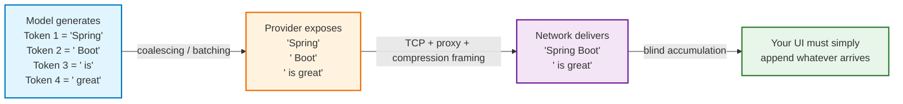
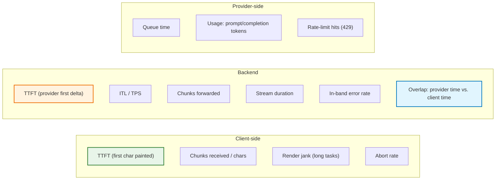
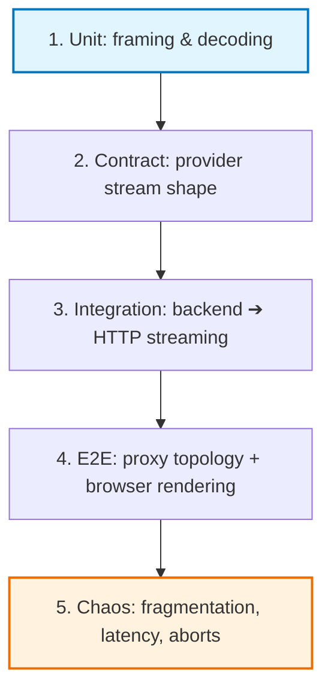
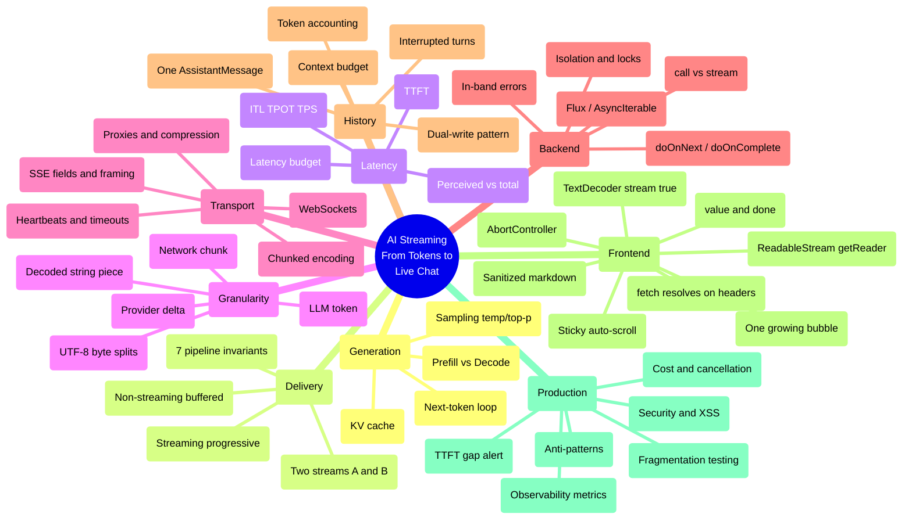

# Chapter 10: Production Hardening, Observability & Key Takeaways

> **Chapter Goal:** Turn a working streaming demo into a production system. Consolidate the granularity model, catalogue the hardening checklist (timeouts, heartbeats, retries, limits, security), define the observability metrics that actually detect streaming regressions, present the testing strategy, and distill the lecture into a final set of engineering principles.
>
> **Source Mapping:** `Notes.pdf` §35 *(Token vs Provider Chunk vs Network Chunk)* and §37 *(The Core Idea)*, combined with production-engineering material derived from every preceding chapter.

---

## 10.1 The Granularity Model (Consolidated)

The most useful single distinction in this entire lecture:

```text
LLM Token   ≠   API Provider Chunk   ≠   HTTP / Network Chunk   ≠   reader.read() Result
```



> **The PDF's closing contract:** *Its responsibility is simply: whenever more text becomes available, append it to the current assistant message.*

---

## 10.2 The Production Hardening Checklist

| # | Area | Requirement | Why |
| :--- | :--- | :--- | :--- |
| 1 | Proxy | `proxy_buffering off` + `X-Accel-Buffering: no` | Otherwise streaming silently disappears |
| 2 | Compression | Exclude `text/event-stream` from `gzip`/`br` | Compression blocks buffer output |
| 3 | Timeouts | Idle timeout > longest expected gap between chunks | Streams must not die at 60 s |
| 4 | Heartbeats | `: keep-alive` comment / whitespace every 10–15 s | Keeps intermediaries and clients from idling out |
| 5 | Headers | `Content-Type: text/event-stream; charset=utf-8`, `Cache-Control: no-cache, no-transform` | Correct framing + no middlebox rewriting |
| 6 | Backend return type | Stream type, never `String`/`Promise<string>` | The contract that makes streaming possible |
| 7 | No `blockLast()` / no `collect()` | Forbidden on the streaming path | Recreates the buffering bug |
| 8 | Cancellation | `AbortController` (client) → cancellation signal (server) → provider cancel | Stops token spend on abandoned answers |
| 9 | Buffering | Per-request accumulator + persist on completion | Correct history (§8.2) |
| 10 | Partial failure | Persist with `status: "interrupted"` | Nothing the user read should vanish |
| 11 | Multi-user | Conversation-scoped state + per-conversation lock | Prevents cross-contamination |
| 12 | Rate limits | Per-user and per-conversation stream concurrency caps | One user must not saturate the GPU quota |
| 13 | Model limits | `max_tokens` / output caps + stop sequences | Bounded cost and bounded wait |
| 14 | Retries | Only *before* the first token; jittered backoff | Mid-stream retries duplicate text |
| 15 | Provider failover | Secondary model/provider behind a flag | A single provider outage should not kill chat |
| 16 | Payload limits | Max prompt tokens enforced **before** dispatch | Fail fast with a clear error, not a provider error |
| 17 | Secrets | Provider keys server-side only | Never expose API keys to the browser |
| 18 | PII | Redaction before dispatch + retention policy | Compliance, plus log hygiene |
| 19 | Idempotency | Stable `messageId` + upsert | Safe retries after network failures |
| 20 | Rollout | Feature flag streaming separately from the UI | Enables instant rollback of a UX-visible change |

---

## 10.3 Observability: The Metrics That Detect Streaming Regressions

A buffered endpoint and a broken-streaming endpoint look **identical** in aggregate latency dashboards. You need streaming-specific telemetry, measured **per hop**.



| Metric | Definition | Diagnostic value |
| :--- | :--- | :--- |
| **Server TTFT** | Request received → first provider delta | Separates provider latency from your pipeline |
| **Client TTFT** | Click → first painted character | **The number the user feels** |
| **TTFT gap** | Client TTFT − Server TTFT | If large → proxy buffering or render blocking |
| **ITL / TPOT** | Mean gap between successive pieces | Detects stalls and provider throttling |
| **Chunks forwarded** | Count per response | Distribution exposes coalescing/buffering |
| **Chunk size distribution** | p50/p95 bytes per chunk | A single huge chunk = broken streaming |
| **In-band error rate** | `event: error` / total streams | Catches mid-stream failures invisible in HTTP status |
| **Abort rate** | Client-cancelled / started | UX signal; also drives cost savings measurement |
| **Reuse vs. overlap** | `serverDuration − clientDuration` | Large positive gap = wasted generation |
| **Prompt tokens trend** | Per-turn prompt size | Explains creeping TTFT in long sessions |

### The single most valuable alert

```text
ALERT if  p95(client_ttft - server_ttft) > 500 ms
```

This one rule catches, in production: proxy buffering regressions, a middleware that buffers the body, a CDN misconfiguration, compression being re-enabled on SSE, and a frontend refactor that accidentally reintroduced `await response.text()`. **Nothing else in your dashboard detects that class of regressions.**

### Logging shape (per stream)

```json
{
  "event": "stream.completed",
  "conversationId": "conv_7fa1",
  "requestId": "req_9d2c",
  "ttftMs": 812,
  "totalMs": 7430,
  "chunks": 214,
  "avgChunkBytes": 37,
  "promptTokens": 1284,
  "completionTokens": 612,
  "finishReason": "stop",
  "clientAborted": false,
  "provider": "primary",
  "model": "gpt-4o-mini"
}
```

> **Rule:** one structured log line per stream, always including TTFT, chunk count, token usage, and finish reason. Streaming bugs are statistical (p95 tails), not average-case — averages hide them entirely.

---

## 10.4 Cost, Security & Privacy in Streamed Systems

### 10.4.1 The cost model

Because streaming exposes partial output, it creates a *new* cost category: **wasted generation**.

$$\text{Cost}_{\text{turn}} = \underbrace{c_{\text{in}}\cdot T_{\text{prompt}}}_{\text{re-billed history}} + \underbrace{c_{\text{out}}\cdot T_{\text{completion}}}_{\text{produced tokens}}$$

| Cost lever | Effect | Implementation |
| :--- | :--- | :--- |
| Prompt size | Re-billed **every turn** | Context windowing (§8.6) |
| `max_tokens` cap | Bounds worst-case completion cost | Set per route, not globally |
| Cancellation propagation | Eliminates payment for unread output | §6.6 |
| Model tiering | Big cost win for easy turns | Route by difficulty (small model first) |
| Prompt prefix caching | Reduces repeated system-prompt cost | Provider-level feature; keep prefixes stable |
| Streaming vs. buffered | No inherent cost difference | Do not "optimize cost" by removing streaming |

> **The subtle economic point:** streaming *reduces* cost when users abandon long answers, because cancellation stops generation. A non-streaming endpoint must finish (and bill) even when the user has already navigated away.

### 10.4.2 Security and privacy checklist

| Risk | Description | Mitigation |
| :--- | :--- | :--- |
| **XSS via streamed markdown** | Partial renders injected into the live DOM | Sanitize every render; no raw `innerHTML` |
| **Prompt injection in retrieved content** | RAG text instructs the model | Instruction/data separation, tool allow-lists, output validation |
| **Cross-user context leakage** | Shared conversation state | Conversation-scoped isolation + locks |
| **Provider key exposure** | Keys in the browser | Server-side proxies only; never client-side keys |
| **PII in logs / telemetry** | Prompts and answers in log pipelines | Redaction, sampling, retention limits, field-level encryption |
| **Data residency** | Streamed content crossing regions | Region-pinned provider endpoints and logs |
| **Model output as commands** | Agentic streaming executing plans | HITL approval gates for high-impact actions (Lecture 05, Ch. 07) |
| **Denial-of-wallet** | Many parallel streams consume quota | Per-user concurrency caps + rate limits |
| **Log injection** | Newlines/ANSI in streamed text corrupting logs | Structured logging with escaped fields |

---

## 10.5 Testing Strategy for Streaming Systems

Streaming is hard to test because it is **temporal**: correctness depends on *how* data is fragmented over time, not just its final value.



| Level | What to test | Technique |
| :--- | :--- | :--- |
| 1. Framing / decoding | Multi-byte splits, partial SSE frames, `[DONE]` handling | **Fragmentation torture test** (§4.5): 1 byte at a time, random sizes |
| 2. Provider contract | Delta schema, empty first frame, usage frames, error frames | Recorded fixtures; mock streams with injected anomalies |
| 3. Backend | Return type is a stream; no collector operators; flush timing | Assert **TTFT ≪ total** in an integration test; assert ≥ 2 chunks received |
| 4. End-to-end | Real proxy config, compression off, heartbeats, timeouts | Staging environment with production topology; `curl -N` smoke test |
| 5. Chaos / resilience | Aborts, provider drops, slow clients, mid-stream 429 | Inject latency/disconnect; verify partial persistence and lock release |
| 6. UI | One bubble, appended text, auto-scroll, error state | Component tests over a scripted fragment sequence |
| 7. Regression | The TTFT gap alert | Synthetic canary chat every minute with `p95(TTFT gap)` measured |

### Two high-value assertions to put in CI

```typescript
// PSEUDOCODE (TS): the two assertions that catch almost all streaming regressions

// 1) Backend actually streams (not buffered)
const { chunkCount, ttftMs, totalMs } = await measureStream("/api/chat", "Explain DI");
assert(chunkCount > 2, "Response arrived in a single chunk — buffering somewhere!");
assert(ttftMs < totalMs * 0.5, "TTFT is close to total latency — stream is buffered");

// 2) Final text is fragmentation-invariant
for (const size of [1, 3, 17, 1024]) {
  const text = await consumeWithFragmentSize("/api/chat", "Explain DI", size);
  assert(text === canonicalAnswer, `Fragmentation size ${size} changed the output`);
}
```

---

## 10.6 Anti-Pattern Catalogue

| # | Anti-Pattern | Symptom the user sees | Root cause | Correct pattern |
| :--- | :--- | :--- | :--- | :--- |
| 1 | **The `text()` collapse** | Loading spinner, then everything at once | `await response.text()` in the client | `ReadableStream` reader loop |
| 2 | **The proxy buffer** | Works locally, fails in staging | `proxy_buffering on` by default | Buffering off + `X-Accel-Buffering: no` |
| 3 | **The collector service** | Always one big chunk | `collectList()` / `join()` / `String` return type | Stream all the way down |
| 4 | **The chunk-per-message store** | Prompt bloat; the bot replies in fragments | Persisting each chunk as a message | Buffer, persist once |
| 5 | **The ghost bubble** | Empty bubble on failure | Bubble created before the first token | Create lazily on first text |
| 6 | **The locked stream** | `TypeError: locked` in dev | `getReader()` called twice (StrictMode) | Guard/release the reader |
| 7 | **The zombie generation** | Provider bill exceeds usage records | No cancellation propagation | `AbortController` + upstream cancel |
| 8 | **The vanishing turn** | Cancelled chats missing from history | Persist only on success | Persist partial with a flag |
| 9 | **The leaky conversation** | Users see each other's messages | Shared mutable history | Conversation-scoped state + locks |
| 10 | **The mid-stream retry** | A sentence repeated twice | Retry after the first token | Retry only before the first token |
| 11 | **The silent truncation** | The answer just stops | Unhandled stream error, no in-band signal | `event: error` + finish reason |
| 12 | **The janky renderer** | Stuttering, dropped frames | Markdown parsed per chunk | Render on `requestAnimationFrame` |
| 13 | **The ID-less insert** | Duplicate turns | Insert-only persistence | Upsert with a stable `messageId` |
| 14 | **The chunk-as-token counter** | Wildly wrong cost dashboards | Chunks treated as tokens | Provider usage / real tokenizer |
| 15 | **The unlocked frame parser** | Random `�` or dropped text | `TextDecoder` per chunk; no frame buffer | One decoder + leftover frame buffer |

---

## 10.7 Key Engineering Takeaways — The Consolidated List

**Foundations (generation):**
1. **LLMs generate one token at a time**; generation is sequential and cannot be parallelised during decode.
2. **Prefill is parallel and compute-bound** (drives TTFT); **decode is serial and bandwidth-bound** (drives tokens/second).
3. **The KV cache makes long conversations slower and more expensive**, every single turn.
4. **Generation and delivery are independent processes.** You control delivery; you only *influence* generation through prompt size, model choice, and tier.

**Latency:**
5. **Streaming does not shorten total generation time — it collapses perceived latency.**
6. **TTFT is the UX metric that matters**, and every prompt token is a tax on it.
7. **Instrument TTFT, ITL, TPS, token usage, and chunk sizes** — aggregates hide streaming regressions.

**Granularity:**
8. **Token ≠ provider chunk ≠ network chunk ≠ decoded string piece.** Boundaries shift at every layer.
9. **Four granularities must never be conflated** when debugging, billing, or testing.
10. **Bytes travel; characters are decoded.** One `TextDecoder` with `{ stream: true }`, flushed at the end.
11. **The only safe client contract is blind accumulation** — append whatever text arrives to the current message.

**Transport:**
12. **Streaming is still HTTP** — a progressive body, typically `Transfer-Encoding: chunked` with no `Content-Length`.
13. **SSE is a format, not a transport**; raw `text/plain` streaming is a legitimate and simpler choice.
14. **SSE is unidirectional and ideal for AI output**; WebSockets are for duplex interaction (voice, collaboration).
15. **Infrastructure kills streaming more often than code**: proxy buffering, compression, and idle timeouts.

**Architecture:**
16. **Two streams must both stay streamed** — provider ➔ backend and backend ➔ browser.
17. **The backend is a bridge, not a buffer.** `collect()`, `blockLast()`, and `String` return types are streaming killers.
18. **Streaming is an end-to-end property**, verifiable through seven concrete invariants.
19. **Cancellation must propagate upstream**, or you pay for tokens nobody reads.
20. **Backpressure manifests as stalls and chunk coalescing**, which is usually a UI-rendering problem, not a producer problem.

**State & persistence:**
21. **Never store transport chunks as conversation messages** — buffer and persist exactly once per turn.
22. **The dual-write pattern (forward + buffer)** is the heart of correct streaming persistence.
23. **Interrupted answers belong in history**, flagged as partial — the user already read them.
24. **Multi-user isolation and per-conversation locking are mandatory**; teaching examples are explicitly not production code.

**Client:**
25. **`await fetch()` resolves on headers; `await response.text()` destroys streaming.**
26. **One bubble, appended forever** — created lazily on the first text piece.
27. **`AbortError` is not an error**, and partial text on abort must be preserved, not deleted.
28. **Rich rendering must be sanitized and rate-limited**, because partial text is invalid and streamed content is untrusted.

**The one-sentence summary of the lecture:**

> *An LLM emits tokens one at a time; the provider exposes them as deltas; your backend forwards them without buffering while buffering them internally for history; HTTP carries them progressively; and the browser appends each decoded piece to a single assistant message — and that continuous, unbroken pipeline is what makes an AI appear to type in real time.*

---

## 10.8 The Complete Concept Mindmap



---

## 10.9 Closing Statement

The PDF's final paragraph is the best possible summary of this lecture, and worth ending on verbatim:

> *AI streaming becomes much easier to understand once we separate the layers. The LLM generates tokens incrementally. The AI provider exposes generated output as chunks or deltas. [The backend] represents those streamed values using a stream type. [The app server] progressively sends them through the HTTP response. The browser exposes the incoming response through `response.body`, which is a `ReadableStream`. JavaScript reads the incoming bytes, decodes them into text and continuously appends that text to one assistant message. The entire application therefore behaves like one continuous pipeline:*
>
> ```text
> Generation → Provider Streaming → Backend Streaming → HTTP Streaming → Browser Streaming → Live UI Rendering
> ```
>
> *And that is what creates the familiar experience of an AI assistant appearing to type its answer in real time.*

**Previous:** [Chapter 09 — Frontend Streaming: `fetch`, `ReadableStream` & `TextDecoder`](./09_Frontend_Streaming_Fetch_ReadableStream_TextDecoder.md) · **Index:** [Lecture 06 README](./README.md) · **Master:** [Lecture 06 Complete Notes](./Lecture_06_Complete_Notes.md)
