# Lecture 06: AI Streaming — From LLM Tokens to a Live Chat Experience
## Complete Consolidated Course Notes & Architectural Reference

> **Course:** Forward Deployed Engineer (FDE) & Generative AI Systems
> **Topic:** AI Streaming — From LLM Tokens to a Live Chat Experience
> **Source Material:** [`Notes.pdf`](./Notes.pdf) (44 pages, 37 sections) and [`Excalidraw-Notes.svg`](./Excalidraw-Notes.svg)
> **Snippet Style:** JS/TS-style pseudocode (Node.js / browser runtime), with Java / Spring AI reference shapes where the source slides use them
> **Diagram Format:** Mermaid only

---

## 📑 Table of Contents

- [Executive Summary & The Core Paradigm](#executive-summary--the-core-paradigm)
- [Chapter 01: How an LLM Generates Text — Autoregressive Decoding](#chapter-01-how-an-llm-generates-text--autoregressive-decoding)
  - [1.1 Prefill vs. Decode — the Latency Duality](#11-prefill-vs-decode--the-latency-duality)
  - [1.2 The Only Difference Called "Streaming"](#12-the-only-difference-called-streaming)
  - [1.3 Chapter Summary & Key Engineering Takeaways](#13-chapter-summary--key-engineering-takeaways)
- [Chapter 02: Generation vs. Delivery — Non-Streaming and Streaming Responses](#chapter-02-generation-vs-delivery--non-streaming-and-streaming-responses)
  - [2.1 Non-Streaming (Buffered)](#21-non-streaming-buffered)
  - [2.2 Streaming](#22-streaming)
  - [2.3 Wire View](#23-wire-view)
  - [2.4 Decision Rule](#24-decision-rule)
  - [2.5 Chapter Summary & Key Engineering Takeaways](#25-chapter-summary--key-engineering-takeaways)
- [Chapter 03: Latency Anatomy — TTFT, ITL & Perceived Performance](#chapter-03-latency-anatomy--ttft-itl--perceived-performance)
  - [3.1 The Two Metrics](#31-the-two-metrics)
  - [3.2 The Full Decomposition](#32-the-full-decomposition)
  - [3.3 Throughput: TPS, TPOT and the Reading-Speed Threshold](#33-throughput-tps-tpot-and-the-reading-speed-threshold)
  - [3.4 Input Processing Precedes Output](#34-input-processing-precedes-output)
  - [3.5 Latency Budget](#35-latency-budget-example)
  - [3.6 Chapter Summary & Key Engineering Takeaways](#36-chapter-summary--key-engineering-takeaways)
- [Chapter 04: Token, Chunk, Network Chunk & Byte — Four Layers of Granularity](#chapter-04-token-chunk-network-chunk--byte--four-layers-of-granularity)
  - [4.1 Chapter Summary & Key Engineering Takeaways](#41-chapter-summary--key-engineering-takeaways)
- [Chapter 05: HTTP Streaming Mechanics — Chunked Encoding, SSE & WebSockets](#chapter-05-http-streaming-mechanics--chunked-encoding-sse--websockets)
  - [5.1 Conventional vs. Streaming HTTP](#51-conventional-vs-streaming-http)
  - [5.2 Chunked Transfer Encoding](#52-chunked-transfer-encoding)
  - [5.3 Server-Sent Events (SSE)](#53-server-sent-events-sse)
  - [5.4 SSE vs. WebSockets](#54-sse-vs-websockets)
  - [5.5 Streaming ≠ SSE](#55-streaming--sse)
  - [5.6 Infrastructure Kill-Switches](#56-infrastructure-kill-switches)
  - [5.7 Chapter Summary & Key Engineering Takeaways](#57-chapter-summary--key-engineering-takeaways)
- [Chapter 06: The Complete End-to-End Streaming Architecture](#chapter-06-the-complete-end-to-end-streaming-architecture)
  - [6.1 The Two Streams](#61-the-two-streams)
  - [6.2 The Full Pipeline](#62-the-full-pipeline)
  - [6.3 The 7 Pipeline Invariants](#63-the-7-pipeline-invariants)
  - [6.4 Backpressure Reality](#64-backpressure-reality)
  - [6.5 Cancellation Propagation](#65-cancellation-propagation)
  - [6.6 The Final Mental Model](#66-the-final-mental-model)
  - [6.7 Chapter Summary & Key Engineering Takeaways](#67-chapter-summary--key-engineering-takeaways)

- [Chapter 07: Backend Streaming — `.call()` vs `.stream()` and the `Flux` Abstraction](#chapter-07-backend-streaming--call-vs-stream-and-the-flux-abstraction)
  - [7.1 The Buffered Call](#71-the-buffered-call)
  - [7.2 Switching to Streaming](#72-switching-to-streaming)
  - [7.3 Understanding `Flux`](#73-understanding-flux)
  - [7.4 Service and Controller](#74-service-and-controller)
  - [7.5 Operators, Errors and Isolation](#75-operators-errors-and-isolation)
  - [7.6 Chapter Summary & Key Engineering Takeaways](#76-chapter-summary--key-engineering-takeaways)
- [Chapter 08: Conversation History, Buffering & Persistence](#chapter-08-conversation-history-buffering--persistence)
  - [8.1 The Problem Streaming Introduces](#81-the-problem-streaming-introduces)
  - [8.2 The Dual-Write Pattern](#82-the-dual-write-pattern)
  - [8.3 The Reference Implementation](#83-the-reference-implementation)
  - [8.4 Isolation, Partial Failure and Persistence](#84-isolation-partial-failure-and-persistence)
  - [8.5 Chapter Summary & Key Engineering Takeaways](#85-chapter-summary--key-engineering-takeaways)
- [Chapter 09: Frontend Streaming — `fetch`, `ReadableStream` & `TextDecoder`](#chapter-09-frontend-streaming--fetch-readablestream--textdecoder)
  - [9.1 The Collapse of Streaming on the Client](#91-the-collapse-of-streaming-on-the-client)
  - [9.2 What `await fetch()` Actually Waits For](#92-what-await-fetch-actually-waits-for)
  - [9.3 The Reader Loop](#93-the-reader-loop)
  - [9.4 Decoding Bytes into Text](#94-decoding-bytes-into-text)
  - [9.5 One Growing Assistant Bubble](#95-one-growing-assistant-bubble)
  - [9.6 The Complete `sendMessage()` Flow](#96-the-complete-sendmessage-flow)
  - [9.7 Scrolling, Rendering, Cancellation, Accessibility](#97-scrolling-rendering-cancellation-accessibility)
  - [9.8 Chapter Summary & Key Engineering Takeaways](#98-chapter-summary--key-engineering-takeaways)
- [Chapter 10: Production Hardening, Observability & Key Takeaways](#chapter-10-production-hardening-observability--key-takeaways)
  - [10.1 The Consolidated Granularity Model](#101-the-consolidated-granularity-model)
  - [10.2 Production Hardening Checklist](#102-production-hardening-checklist)
  - [10.3 Observability](#103-observability)
  - [10.4 Cost, Security & Testing](#104-cost-security--testing)
  - [10.5 Anti-Pattern Catalogue](#105-anti-pattern-catalogue-top-10)
  - [10.6 The 28 Key Engineering Takeaways](#106-the-28-key-engineering-takeaways)
  - [10.7 Concept Mindmap & Closing Statement](#107-concept-mindmap--closing-statement)

---

## Executive Summary & The Core Paradigm

### The One-Line Thesis

> **An LLM cannot produce an answer instantly — it produces a *sequence of small pieces over time*. Streaming is the engineering discipline of never destroying that natural time-structure as the data travels from the model to the user's eyes.**

### The Core Pipeline

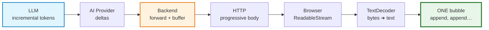

### The Four Governing Equations

| Concept | Formula | Meaning |
| :--- | :--- | :--- |
| Next-token sampling | $P(t_i)=\dfrac{e^{z_i/T}}{\sum_j e^{z_j/T}}$ | Generation is probabilistic and one token at a time |
| If token count is $N$ | $T_{\text{total}} \approx T_{\text{TTFT}} + (N-1)\cdot T_{\text{ITL}}$ | Latency is a sum, not a single number |
| KV cache | $\approx 2 L_{\text{tok}} n_{\text{layers}} d_{\text{model}} b$ | Long conversations cost memory, speed, and money |
| Granularity | $\text{Token} \neq \text{Delta} \neq \text{Net Chunk} \neq \text{Decoded Piece}$ | Never trust boundaries across layers |

### The Five Sentences That Define the Lecture

> 1. *Streaming mainly changes how generated output is **delivered**, not how the model **generates**.*
> 2. *Streaming does not necessarily make the model finish faster. It makes the application **feel** faster.*
> 3. *The browser chunk is not guaranteed to be one token or one word — the UI should not depend on chunk boundaries.*
> 4. *Streaming is an **end-to-end** property of the application, not just an LLM feature.*
> 5. *Whenever more text becomes available, **append it** to the current assistant message.*

---

## Chapter 01: How an LLM Generates Text — Autoregressive Decoding

**The core fact:** the model does not produce `"The capital of India is New Delhi."` in one operation. It predicts **one token**, appends it, and runs the entire prediction machinery again.

```text
"The capital of India is"            → predict → "New"
"The capital of India is New"        → predict → "Delhi"
"The capital of India is New Delhi"  → predict → "."
```

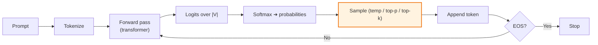

### 1.1 Prefill vs. Decode — the Latency Duality

| Property | Prefill (input) | Decode (output) |
| :--- | :--- | :--- |
| Work pattern | All prompt tokens in parallel | One token per step, strictly serial |
| Bottleneck | Compute (FLOPs) | Memory bandwidth |
| Scales with | Prompt length | Output length |
| Drives | **TTFT** | **tokens/second** |
| Cancellable? | No (must finish to be useful) | Yes (partial output is still valid) |

**KV cache consequences:** memory grows linearly with conversation length; each decode step reads a larger cache; therefore **TTFT and ITL both degrade as history grows** — which is why context management is a latency optimization, not only a cost one.

### 1.2 The Only Difference Called "Streaming"

```typescript
// Buffered: accumulate privately
function generate(prompt, cfg) {
  let seq = tokenize(prompt), out = [];
  while (out.length < cfg.maxTokens) {
    const next = sample(softmax(forwardPass(seq), cfg.temperature), cfg.topP, cfg.topK);
    if (next === EOS) break;
    out.push(next); seq.push(next);
  }
  return detokenize(out);          // ⬅ one value, at the end
}

// Streaming: emit each piece as it is produced
async function* generateStream(prompt, cfg) {
  let seq = tokenize(prompt);
  while (seq.length < cfg.maxTokens) {
    const next = sample(softmax(forwardPass(seq), cfg.temperature), cfg.topP, cfg.topK);
    if (next === EOS) return;
    seq.push(next);
    yield detokenize([next]);      // ⬅ the ONLY change
  }
}
```

> **Streaming is not a different generation algorithm — it is the same loop with the accumulator replaced by an async iterator.**

### 1.3 Chapter Summary & Key Engineering Takeaways
1. LLMs are **next-token predictors**; generation is sequential during decode.
2. **Prefill sets TTFT (parallel, compute-bound); decode sets tokens/second (serial, bandwidth-bound).**
3. **The KV cache taxes long conversations** in memory, latency, and money.
4. **Streaming = same loop + `yield`.** No new model capability is involved.
5. Sampling settings change *what* is generated; hardware and load change *how fast*.
6. The model optimizes **per-token plausibility, not per-answer truth**.
7. Piece boundaries are an **implementation detail**, never a UI contract.

---

## Chapter 02: Generation vs. Delivery — Non-Streaming and Streaming Responses

**The separation:** *generation* is what the model does (uncontrollable cadence); *delivery* is how output travels (fully controllable).

| Layer | Controllable? | Why it matters |
| :--- | :--- | :--- |
| Model decode rate | ❌ No | Provider GPU, batching, model size |
| Provider ➔ Backend | Partially | Consume deltas as they arrive |
| Backend processing | ✅ Yes | Never re-buffer; forward immediately |
| Backend ➔ Browser | ✅ Yes | Flush per chunk; disable proxy buffering |
| Browser rendering | ✅ Yes | Append incrementally, batched |

### 2.1 Non-Streaming (Buffered)

```text
Send → …………8 seconds of nothing……… → entire answer appears
```

The model still generates `Spring → Boot → is → a → framework` internally; the backend **deliberately discards** that structure and waits for the concatenation.

**Hidden costs:** perceived latency ≈ total latency; all-or-nothing failure; higher timeout pressure; no early feedback; a healthy backend feels broken.

### 2.2 Streaming

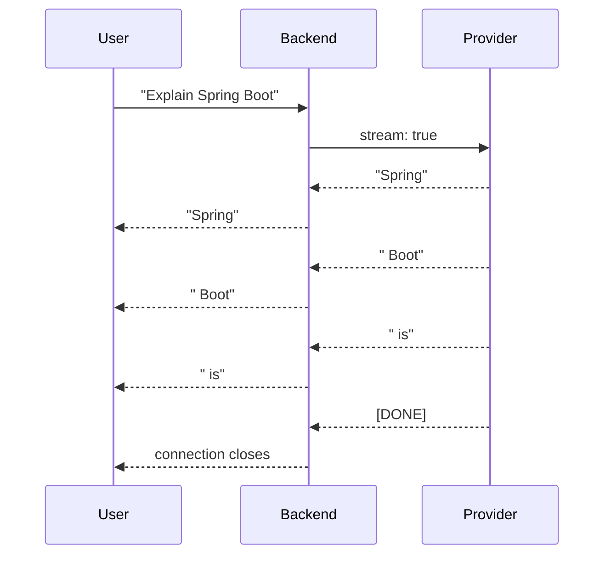

> *The complete answer might still require eight seconds. The important difference is that useful output may begin appearing after only one second.*

| Dimension | Non-Streaming | Streaming |
| :--- | :--- | :--- |
| First visible output | ≈ total time | ≈ TTFT |
| Total generation time | Unchanged | Unchanged |
| Mid-flight failure | Nothing delivered | Partial answer + error notice |
| Backend complexity | Low | Medium |
| Client complexity | Low (`response.text()`) | Medium (reader loop) |
| Persistence | Trivial | Needs buffering (Chapter 08) |
| Best for | Strict JSON, batch, classification | Conversational UX, long-form, agents |

### 2.3 Wire View

Non-streaming returns `choices[].message.content` as one string. Streaming returns frames containing **only deltas**:

```text
data: {"choices":[{"delta":{"content":"Spring"},"finish_reason":null}]}
data: {"choices":[{"delta":{"content":" Boot"},"finish_reason":null}]}
data: {"choices":[{"delta":{},"finish_reason":"stop"}]}
data: [DONE]
```

Three traps: the first frame is often empty (role only); `[DONE]` is a terminator, not content; partial JSON is **not** parseable mid-stream.

### 2.4 Decision Rule

Stream when a **human reads in real time** and the answer is **long/unbounded**. Do not stream when the whole object must be **validated before use** — or stream *progress events* and validate the final payload at the end.

| Delivery path | Use when |
| :--- | :--- |
| Buffered JSON | Extraction, classification, batch |
| Chunked raw text | Simplest chat streaming (the PDF's Tomato chatbot) |
| SSE (`text/event-stream`) | Typed events, resumability, agent progress |
| WebSockets | Duplex interaction (voice, collaboration) |
| Polling / webhooks | Legacy systems, very long async jobs |

### 2.5 Chapter Summary & Key Engineering Takeaways
1. Generation and delivery are separate; only delivery is yours to optimize.
2. Non-streaming is not "no chunks" — it is "the chunks were discarded."
3. Streaming preserves the natural time-structure: the user reads while the model writes.
4. **Total time is constant; perceived latency collapses.**
5. Streaming changes **failure semantics** — design for partial + error.
6. Streaming costs persistence, transport tuning, and client complexity.
7. **Raw text streaming and SSE are different tools.**
8. Use a decision framework; short outputs and strict contracts may be better buffered.

---

## Chapter 03: Latency Anatomy — TTFT, ITL & Perceived Performance

The PDF's eight-second timeline:

```text
0s  User clicks Send
1s  First output arrives          ⬅ TTFT ≈ 1s
2s  More output
3s  More output
...
8s  Complete answer               ⬅ Total generation ≈ 8s
```

### 3.1 The Two Metrics

| Metric | Definition | Controls |
| :--- | :--- | :--- |
| **TTFT** (Time to First Token) | Request → first visible piece | Perceived responsiveness |
| **Total generation time** | Request → final token | Task completion |

Without streaming:

```text
|──────────────── 8 sec ────────────────|
                                        ANSWER
```

With streaming:

```text
|--1 sec--| Spring
                   Boot
                       makes
                            building
                                    ... COMPLETE at 8 sec
```

> *The total generation time may remain similar, but the perceived latency is dramatically lower.*

### 3.2 The Full Decomposition

$$T_{\text{TTFT}} = T_{\text{network}} + T_{\text{queue}} + T_{\text{prefill}} + T_{\text{first step}}$$

$$T_{\text{total}} = T_{\text{TTFT}} + (N_{\text{out}}-1)\cdot T_{\text{ITL}} + T_{\text{tail}}$$

| Component | Culprit | Streaming helps? | Mitigation |
| :--- | :--- | :--- | :--- |
| Network up | Geolocation, TLS, cold connections | ❌ | Edge termination, HTTP/2, connection reuse |
| Queue | Provider rate limits, GPU saturation | ❌ | Higher tier, jittered retry |
| Prefill | Long prompt (system + history + RAG + tools) | ❌ | Shrink prompt, prompt caching, prune history |
| First step | Model size, sampling overhead | ❌ | Faster model, speculative decoding |
| N×ITL | Output length, KV growth, load | ❌ (but hides it) | Cap `max_tokens`, stream visibly |
| Tail (backend→UI) | Proxy buffering, `response.text()`, re-render | ✅ **yours** | Flush per chunk, buffering off, batched DOM |

### 3.3 Throughput: TPS, TPOT and the Reading-Speed Threshold

$$\text{TPS} = \frac{N_{\text{out}}}{T_{\text{total}}-T_{\text{TTFT}}} \qquad\quad \text{TPOT} = \frac{1}{\text{TPS}}$$

Human reading speed ≈ 4–5 words/s ≈ **6–8 tokens/s**. Therefore below ~10 TPS the model is slower than the reader; above it, **the UI is the bottleneck, not the model**. A 2-second proxy-buffer bug hurts far more than a provider upgrade helps.

### 3.4 Input Processing Precedes Output

```text
System + History + User Message → Process the context → output 1 → 2 → 3 → …
```

Every context contributor is a TTFT tax: system prompt (moderate), history (**severe, grows every turn**), RAG chunks (severe), tool schemas (moderate). A chat that feels fast at turn 1 and slow at turn 20 is a **prompt-growth** problem, not a model problem.

### 3.5 Latency Budget (example)

| Hop | Budget |
| :--- | :--- |
| Network + TLS | ≤ 150 ms |
| App + auth + retrieval routing | ≤ 150 ms |
| Provider queue + prefill | ≤ 1200 ms |
| First chunk flush + paint | ≤ 250 ms |
| Reserve | ≤ 250 ms |
| **Total TTFT target** | **≤ 2000 ms** (consumer chat: < 1000 ms) |

**Instrument per stream:** TTFT, ITL, TPS, prompt tokens, completion tokens — never just a total.

### 3.6 Chapter Summary & Key Engineering Takeaways
1. **TTFT governs perceived responsiveness; total time governs completion.**
2. **Streaming attacks TTFT and perceived latency, not total time.**
3. **Every prompt token is a latency tax on TTFT.**
4. **TPS matters only up to human reading speed.**
5. **Latency is a pipeline sum**, not a single number.
6. **Instrument TTFT, ITL, TPS and token counts separately.**
7. **Long conversations degrade TTFT and ITL together** (KV cache + prompt growth).
8. **Write the latency budget down and assign owners per hop.**

---

## Chapter 04: Token, Chunk, Network Chunk & Byte — Four Layers of Granularity

The most useful distinction in the entire lecture:

```text
LLM Token ≠ API Provider Chunk ≠ HTTP / Network Chunk ≠ reader.read() Result
```

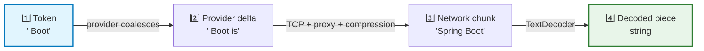

**Layer 1 ➔ 2:** providers batch decode steps; a delta may hold several tokens or a partial one; timing is irregular. *(You cannot count chunks to count tokens.)*

**Layer 2 ➔ 3:** HTTP is a **byte stream, not a message stream**. A single `read()` may return part of a frame, one frame, or several frames. Nginx buffering, gzip/brotli, HTTP/2 translation, load-balancer timeouts, and TLS-inspecting proxies all re-frame the stream.

**Layer 3 ➔ 4:** text travels as UTF-8 **bytes**; characters occupy 1–4 bytes, so a read can split a character:

| Character | UTF-8 bytes |
| :--- | :--- |
| `A` | `41` |
| `é` | `C3 A9` |
| `₹` | `E2 82 B9` |
| `😀` | `F0 9F 98 80` |

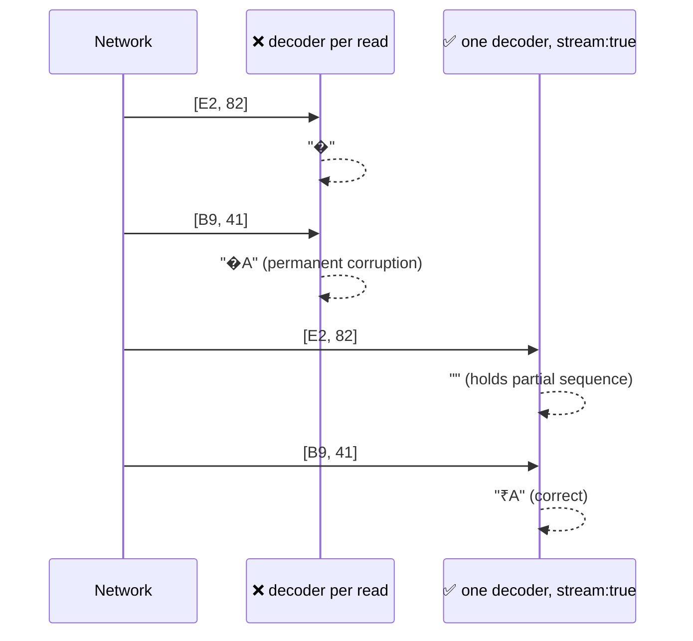

```typescript
// ONE decoder per response — created OUTSIDE the loop
const decoder = new TextDecoder();

while (true) {
  const { value, done } = await reader.read();
  if (done) break;
  const chunk = decoder.decode(value, { stream: true });  // holds partial sequences
  appendToUi(chunk);
}
const tail = decoder.decode();   // flush any held remainder
if (tail) appendToUi(tail);
```

**The boundary-agnostic contract:**

> *Whenever more text becomes available, append it to the current assistant message.*

**Prove it with the fragmentation torture test** — the same final text must result for: one chunk = whole body; one chunk = one character; one chunk = **one byte** (guarantees multi-byte splits); random 1–64-byte chunks; and splits exactly on `\r\n` / `\n\n` boundaries.

### 4.1 Chapter Summary & Key Engineering Takeaways
1. **Four granularities exist; none of their boundaries are stable.**
2. **One delta may hold several tokens; one network chunk may hold part of a delta.**
3. **Bytes travel; characters are decoded** — one `TextDecoder` with `{ stream: true }`, flushed at the end.
4. **The only correct client contract is blind accumulation.**
5. **Fragmentation is testable** — a one-byte-at-a-time test proves transport independence.
6. **Chunk-size distribution is a first-class diagnostic metric** for hidden buffering.
7. **Rendering must be layered above the accumulator**, never entangled with framing decisions.

---

## Chapter 05: HTTP Streaming Mechanics — Chunked Encoding, SSE & WebSockets

### 5.1 Conventional vs. Streaming HTTP

```text
Conventional:  REQUEST → SERVER WORKS → SERVER FINISHES → RESPONSE      (one body, Content-Length known)
Streaming:     REQUEST → connection open → data → data → data → DONE     (progressive body, no length)
```

> *Streaming does not mean abandoning HTTP.* The server simply begins an HTTP response without waiting to construct the entire body.

### 5.2 Chunked Transfer Encoding

```http
HTTP/1.1 200 OK
Content-Type: text/plain; charset=utf-8
Transfer-Encoding: chunked
Cache-Control: no-cache, no-transform
Connection: keep-alive
X-Accel-Buffering: no

7\r\n
Spring \r\n
4\r\n
Boot\r\n
0\r\n
\r\n
```

Consequences: **no `Content-Length`** (clients must read until the terminator); **HTTP/2 uses DATA frames instead** (same semantics, different wire format — never hand-parse below `fetch`); keep-alive + idle-timeout mismatches cause streams to die at round numbers (30 s / 60 s / 100 s).

### 5.3 Server-Sent Events (SSE)

Direction is strictly `SERVER ➔ CLIENT`, one HTTP connection, many events.

```text
data: Spring

data: Boot

data: is

data: awesome
```

| Field | Purpose |
| :--- | :--- |
| `data:` | Payload (multiple lines joined with `\n`) |
| `event:` | Event type (maps to `addEventListener("token", …)`) |
| `id:` | Last-Event-ID, enabling reconnect-and-resume |
| `retry:` | Reconnect delay hint |
| `:` line | Comment / heartbeat — keeps intermediaries from idling out |

Framing rule: **a blank line (`\n\n`) dispatches an event**, and framing is *line-oriented* — since network chunks split anywhere, a robust client must buffer bytes, split on `\n\n`, and keep the trailing partial frame. `chunk.split("\n\n")` per read **will** corrupt output.

```http
Content-Type: text/event-stream; charset=utf-8
Cache-Control: no-cache, no-transform
Connection: keep-alive
X-Accel-Buffering: no
```

### 5.4 SSE vs. WebSockets

| | SSE | WebSockets |
| :--- | :--- | :--- |
| Direction | Server ➔ client | Client ↔ server |
| Protocol | Plain HTTP | Upgraded TCP (`ws://`) |
| Auto-reconnect / resume | Built in / `Last-Event-ID` | Manual |
| Binary | Poor | Native |
| Firewalls/proxies | Very friendly | Sometimes blocked |
| Best for | **AI token streaming**, progress events | Voice, collaboration, duplex control |

> *Once the user sends a prompt, most continuous data flows in one direction… For simple AI answer streaming, WebSockets are usually unnecessary.*

### 5.5 Streaming ≠ SSE

```text
Streaming = data arrives progressively
SSE       = one particular protocol/format for delivering events
```

The PDF's Tomato chatbot uses **raw `text/plain`** streaming: no framing, no parser, minimal complexity. SSE becomes worth its cost when you need typed events, resumability, or heartbeats.

### 5.6 Infrastructure Kill-Switches

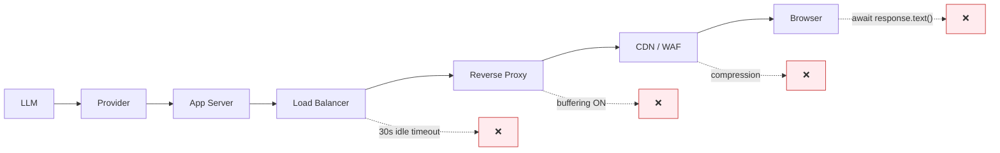

| Layer | Failure | Fix |
| :--- | :--- | :--- |
| Nginx | `proxy_buffering on` (default) | `proxy_buffering off;` + `X-Accel-Buffering: no` |
| Nginx | `proxy_read_timeout 60s` | Raise timeout **or** heartbeat every 10–15 s |
| ALB / Envoy | Idle timeout | Raise idle timeout; add heartbeats |
| Compression | `gzip` buffers to fill blocks | Exclude `text/event-stream` |
| CDN / WAF | Buffering, HTML injection | Bypass CDN for streaming routes |
| Middleware | Body-parsing/logging consumes the stream | Exclude streaming routes |
| Browser | `await response.text()` | `response.body.getReader()` |

**Debugging heuristic:** `curl -N` directly against the backend. If it streams there but not in the browser, the problem is *after* the backend; if it does not stream there either, the problem is *inside*.

### 5.7 Chapter Summary & Key Engineering Takeaways
1. **Streaming is HTTP with a progressive body** (typically chunked, no `Content-Length`).
2. **SSE is a format over HTTP**, not a different transport: `data`/`event`/`id`/`retry`, `\n\n` framing.
3. **SSE is unidirectional — a perfect fit for AI output.**
4. **WebSockets are for duplex interaction**, rarely needed for answer streaming.
5. **Streaming ≠ SSE**; raw `text/plain` is legitimate and simpler.
6. **`EventSource` is limited (GET, no custom headers)**; `fetch` + `ReadableStream` is the production default.
7. **Infrastructure breaks streaming more often than code does.**
8. **Never parse below `fetch`** — treat `ReadableStream` as the framing boundary.

---

## Chapter 06: The Complete End-to-End Streaming Architecture

### 6.1 The Two Streams

```text
Stream A:  AI Provider ➔ Backend       (consumption)
Stream B:  Backend     ➔ Frontend      (production)
```

> *From our application's perspective, there are really two important streams… **Both must remain streamed.***

A backend that consumes eagerly but releases lazily is a **buffer**, not a bridge:

```text
Provider → chunk → chunk → chunk → collect() → Complete String → Browser
                                                                      ⛔ nothing until the end
```

The mirror-image failure: a perfect backend stream wasted by a client that waits before rendering.

### 6.2 The Full Pipeline

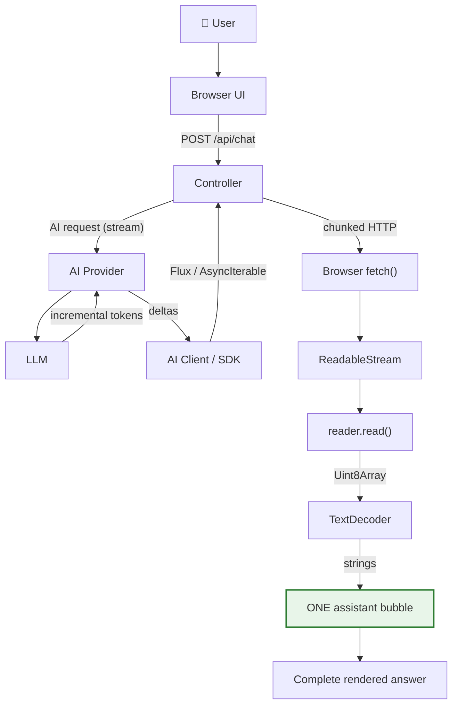

> *Streaming is an end-to-end property of the application, not just an LLM feature.*

### 6.3 The 7 Pipeline Invariants

| # | Invariant | Violated by | Symptom |
| :--- | :--- | :--- | :--- |
| 1 | Every layer forwards, not accumulates | `collect()`, `List`, `join()` | TTFT ≈ total time |
| 2 | The response flushes per chunk | Framework auto-serialization | `curl -N` shows one blob |
| 3 | Intermediaries do not buffer | Nginx default, CDN, compression | Works locally, fails in prod |
| 4 | The connection does not idle out | 30/60/100 s timeouts | Dies at suspiciously round times |
| 5 | The client reads incrementally | `await response.text()` | Backend streams, UI does not |
| 6 | The UI appends, never replaces | Recreating the bubble per chunk | Flicker, duplicate messages |
| 7 | Cancellation propagates upstream | Tab closed but still billing | Provider usage exceeds sessions |

### 6.4 Backpressure Reality

| Layer | Mechanism | When ignored |
| :--- | :--- | :--- |
| Reactor | Subscriber `request(n)` | Unbounded buffering / errors |
| Web Streams | `highWaterMark`, `desiredSize` | Memory growth, jank |
| `fetch` body | TCP window / stream controller | Chunk coalescing |
| Practical reality | The model is the slowest producer | Bugs appear as **stalls**, not overflows |

> **Insight:** a slow UI (e.g. markdown re-parsed per chunk) stops reads, which fills the receive buffer, which **coalesces chunks** — degrading UX even though the provider is generating smoothly. Fix the UI, not the provider.

### 6.5 Cancellation Propagation

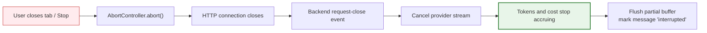

### 6.6 The Final Mental Model

```text
USER → BROWSER → BACKEND → AI PROVIDER → LLM
                                   ↓ (+ prefill, serial decode)
                    AI PROVIDER → deltas
                                   ↓
                    BACKEND → Flux / AsyncIterable
                                   ↓
                    CONTROLLER → chunked HTTP
                                   ↓
                    BROWSER → response.body (ReadableStream)
                                   ↓
                    READER → Uint8Array
                                   ↓
                    TEXT DECODER → string pieces
                                   ↓
                    ONE ASSISTANT BUBBLE → append, append, append
                                   ↓
                    COMPLETE RESPONSE
```

And in parallel, on the server:

```text
Incoming Chunk ──┬──→ Browser          (latency path)
                 └──→ StringBuilder    (correctness path)
                            ↓ on complete
                     AssistantMessage → Conversation History
```

### 6.7 Chapter Summary & Key Engineering Takeaways
1. **Two streams; both must stay streamed.**
2. **The backend is a bridge, not a buffer.**
3. **Streaming is an end-to-end property** — seven verifiable invariants.
4. **Name the owner of every hop** in design reviews.
5. **Backpressure shows up as stalls and coalescing** — usually a UI problem.
6. **Cancellation must propagate upstream** or you pay for unread tokens.
7. **A streamed answer and a stored answer are two objects from one data flow.**
8. **Only observability proves streaming works** — TTFT per hop, chunk distribution, abort rate.

---

## Chapter 07: Backend Streaming — `.call()` vs `.stream()` and the `Flux` Abstraction

> The source PDF uses Java / Spring AI (`ChatClient`, `Flux<String>`). The concept is language-agnostic; TS equivalents are shown alongside.

### 7.1 The Buffered Call

```text
public String chat(String message) {
    return chatClient.prompt()
            .user(message)
            .call()
            .content();
}
```

| Element | Meaning |
| :--- | :--- |
| `chatClient.prompt()` | Starts constructing the prompt |
| `.user(message)` | Adds the user's message |
| `.call()` | Requests the **non-streaming** interaction |
| `.content()` | Extracts the generated content |
| Return type `String` | **One completed value** — the type *is* the buffering decision |

### 7.2 Switching to Streaming

```text
public Flux<String> chat(String message) {
    return chatClient.prompt()
            .user(message)
            .stream()          // ⬅ .call() ➔ .stream()
            .content();
}
```

> *The important change is not just `.call()` → `.stream()`. The important change is the return type: `String` becomes `Flux<String>`.*

### 7.3 Understanding `Flux`

| | `String` (a box) | `Flux<String>` (a conveyor belt) |
| :--- | :--- | :--- |
| Cardinality | Exactly 1 | 0, 1 or N |
| Timing | One instant | Spread over time |
| Memory | Whole value resident | Element at a time |
| Backpressure | Impossible | First-class |
| Terminal signals | Return | `onComplete` / `onError` |
| Cancellation | Meaningless | `Disposable` |

```text
String:           ┌────────────────────────────────┐
                  │ Hello Rohit, how can I help?   │
                  └────────────────────────────────┘

Flux<String>:  → ["Hello"] → [" Rohit"] → [", how"] → [" can"] → [" I help?"]
                  t1           t2           t3           t4          t5
```

| Ecosystem | Abstraction | Consumption idiom |
| :--- | :--- | :--- |
| Java / Reactor | `Flux<T>` | WebFlux return type / `.subscribe()` |
| Kotlin | `Flow<T>` | `.collect { }` |
| JavaScript / Node | `ReadableStream`, `AsyncIterable` | `for await (const x of stream)` |
| Python | `AsyncIterator` | `async for x in stream` |
| C# / .NET | `IAsyncEnumerable<T>` | `await foreach` |
| Go | `chan T` | `for v := range ch` |

> *The syntax changes, but the underlying concept remains: values become available progressively over time.*

### 7.4 Service and Controller

```text
@Service
public class ChatService {
    private final ChatClient chatClient;

    public ChatService(ChatClient.Builder builder) { this.chatClient = builder.build(); }

    public Flux<String> chat(String message) {
        return chatClient.prompt().user(message).stream().content();
    }
}
```

```text
@PostMapping(
    value = "/api/chat",
    consumes = MediaType.TEXT_PLAIN_VALUE,
    produces = MediaType.TEXT_PLAIN_VALUE      // or TEXT_EVENT_STREAM_VALUE for SSE
)
public Flux<String> chat(@RequestBody String message) {
    return chatService.chat(message);
}
```

> *The important part is that the controller returns `Flux<String>` instead of `String`.* For SSE, use `MediaType.TEXT_EVENT_STREAM_VALUE` → `Content-Type: text/event-stream` — *however, streaming itself does not require SSE.*

TypeScript equivalent:

```typescript
// ❌ Buffered service — streaming impossible for any caller
async function chat(message: string): Promise<string> {
  let full = "";
  for await (const piece of providerStream(message)) full += piece;
  return full;
}

// ✅ Streaming service — hands the caller a time-series
function chatStream(message: string): AsyncIterable<string> {
  return providerStream(message);
}
```

### 7.5 Operators, Errors and Isolation

| Operator | Purpose |
| :--- | :--- |
| `doOnNext` | Observe each piece → **buffer for history**, metrics |
| `doOnComplete` | Persist the assembled answer; clear "generating" |
| `doOnError` | Log, emit a user-visible error, mark the turn failed |
| `onErrorResume` | Recover with a fallback stream |
| `timeout` | Fail on a mid-stream stall |
| `retryWhen` | Retry with backoff (before the first token only) |
| `doFinally` | Cleanup regardless of outcome |

**Error taxonomy:** failures *before* the first byte → real HTTP status + JSON body. Failures *after* the first byte → status is already `200` and immutable, so use an **in-band error protocol**:

```text
event: token
data: {"text":"Spring Boot is"}

event: error
data: {"code":"upstream_timeout","recoverable":true,"partial":true}
```

**Isolation warning (the PDF's own production note):** *A shared `ArrayList` and mutable conversation history are useful for teaching but not suitable as-is for a real multi-user application.* State must be per-request/per-conversation, with per-conversation locking. Never store per-request state on a singleton service; never rely on `ThreadLocal` across async/reactive boundaries.

### 7.6 Chapter Summary & Key Engineering Takeaways
1. **The return type is the architecture**: `String` buffers, a stream forwards.
2. **`Flux<String>` = zero, one, or many values over time** — a conveyor belt, not a box.
3. **All ecosystems express the same idea** (`Flux`, `Flow`, `AsyncIterable`, `ReadableStream`).
4. **A streaming service stays tiny** because it never buffers or joins.
5. **The controller returns the stream**, and the framework writes elements as they arrive.
6. **`doOnNext` / `doOnComplete` / `doOnError` / `doFinally`** are the four operators that matter.
7. **Errors after the first byte cannot change the HTTP status** — design in-band signalling.
8. **Isolation + concurrency control** are mandatory for multi-user correctness.

---

## Chapter 08: Conversation History, Buffering & Persistence

### 8.1 The Problem Streaming Introduces

Buffered code makes history trivial: the response is already one `String`, so you store it. Streaming breaks that:

```text
"My"   " name"   " is"   " ChatGPT"     ⬅ four transport chunks…
```

…but **one** logical assistant message:

```text
UserMessage(...)
AssistantMessage("My name is ChatGPT")
```

Storing one message per chunk causes **prompt bloat** (extra role markers every turn), **semantic corruption** (the model "sees" fragments and may reply in fragments), and **UI clutter** (four bubbles instead of one).

### 8.2 The Dual-Write Pattern

Every chunk must perform **two jobs**:

```text
                        chunk
                          │
              ┌───────────┴───────────┐
              ↓                       ↓
      Send to browser          Append to buffer
        immediately
```

```text
"Java"      ├──→ Browser    └──→ Buffer
" is"       ├──→ Browser    └──→ Buffer
" a"        ├──→ Browser    └──→ Buffer
" language" ├──→ Browser    └──→ Buffer
                          ↓ on complete
             "Java is a language" → ONE AssistantMessage
```

This gives **both** real-time output for the user **and** correct history for the next prompt.

### 8.3 The Reference Implementation

```text
public Flux<String> chat(String userMessage) {

    history.add(new UserMessage(userMessage));

    StringBuilder fullResponse = new StringBuilder();

    return chatClient.prompt()
            .messages(history)
            .stream()
            .content()
            .doOnNext(fullResponse::append)        // ⬅ buffer every chunk
            .doOnComplete(() -> {                  // ⬅ persist ONCE, at the end
                history.add(new AssistantMessage(fullResponse.toString()));
            });
}
```

| Line | Purpose |
| :--- | :--- |
| `history.add(new UserMessage(...))` | Record the user turn **before** calling the model |
| `new StringBuilder()` | One accumulator per request — never shared |
| `.messages(history)` | Send the full conversation for context |
| `.stream().content()` | The streaming contract |
| `.doOnNext(fullResponse::append)` | *Whenever another chunk arrives, append it to the local buffer* |
| `.doOnComplete(...)` | *When the stream finishes successfully, convert the buffered output into one assistant message and save it* |

> *The stream itself continues flowing to the controller and browser.* — `doOnNext`/`doOnComplete` are **observers**, not terminators.

TypeScript equivalent:

```typescript
async function* chatWithHistory(session: Session, userMessage: string) {
  session.history.push({ role: "user", content: userMessage });
  const pieces: string[] = [];                    // per-request accumulator

  try {
    for await (const piece of providerStream(session.history)) {
      pieces.push(piece);                         // correctness path
      yield piece;                                // latency path
    }
    session.history.push({ role: "assistant", content: pieces.join("") });
    await session.persist();
  } catch (err) {
    await session.persistInterrupted(pieces.join(""), err);
    throw err;
  }
}
```

### 8.4 Isolation, Partial Failure and Persistence

**Isolation (the PDF's production note):** a shared `ArrayList` in a singleton service is *teaching-only*. Production needs **conversation isolation** and **thread-safe state**: state per request/conversation, a per-conversation lock, stateless services, and idempotent upserts.

**Partial failure:** streaming creates the "80% delivered, then died" state.

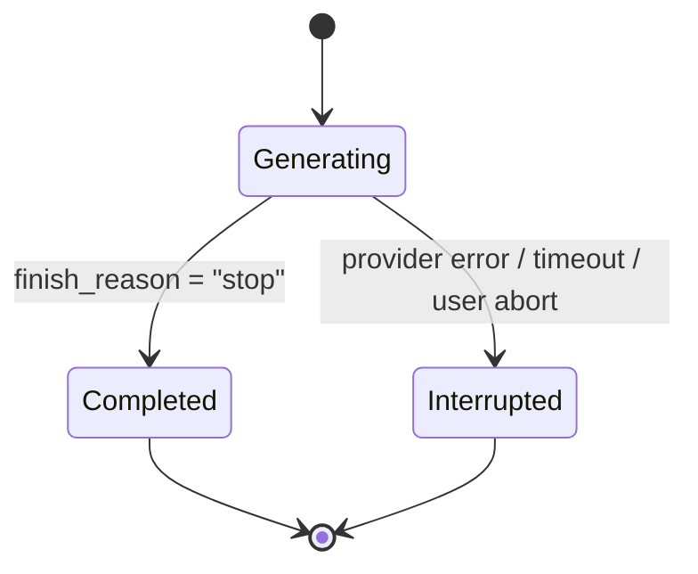

| Decision | Recommendation |
| :--- | :--- |
| Discard partial text? | **Keep it** — the user already read it; history must match what they saw |
| Mark it? | **Flag it** (`status: "interrupted"`) |
| Auto-retry? | Only *before* the first token; mid-answer retries duplicate fragments |
| Next prompt? | Include the partial, flagged, so the model sees no silent gap |

**Persistence rules:** no DB writes on the emission path (buffer in memory; write once on completion); stable `messageId` for idempotent upserts; one atomic write per turn; per-conversation ordering; capture usage; store `createdAt` / `firstTokenAt` / `completedAt`; checkpoint only for multi-minute generations.

**Three storage layers:** (1) hot in-memory buffer (one generation), (2) conversation store (the conversation — next-turn context), (3) analytics ledger (append-only, async, never on the critical path).

**Token accounting:** count chunks ≠ count tokens. Use provider usage (often emitted **only in the final frame**) or a real tokenizer; history is re-billed every turn; enforce a token budget **before** dispatch (sliding window → pinned system + sliding → rolling summarization → semantic retrieval → hard truncation as last resort).

### 8.5 Chapter Summary & Key Engineering Takeaways
1. **Streaming breaks the 1:1 mapping between chunks received and messages stored.**
2. **Never store chunks as messages** — one assistant message per turn.
3. **The dual-write pattern is mandatory**: forward *and* buffer.
4. **Persist at completion** (plus a failure hook), never on the hot path.
5. **Interrupted answers belong in history**, flagged as partial.
6. **Chunk count is not token count**, and history is re-billed every turn.
7. **Context management is a latency and cost concern** (TTFT + KV cache).
8. **Multi-user isolation and per-conversation locking are non-negotiable.**

---

## Chapter 09: Frontend Streaming — `fetch`, `ReadableStream` & `TextDecoder`

> All snippets are **JS/TS-style pseudocode**.

### 9.1 The Collapse of Streaming on the Client

Backend pipeline (all correct):

```text
LLM ✅ streaming → App Server ✅ streaming → HTTP ✅ streaming → Browser ✅ receiving data
```

…then:

```javascript
const assistantReply = await response.text();   // ❌ waits for the COMPLETE body
```

> **One line has removed the visible streaming experience.**

### 9.2 What `await fetch()` Actually Waits For

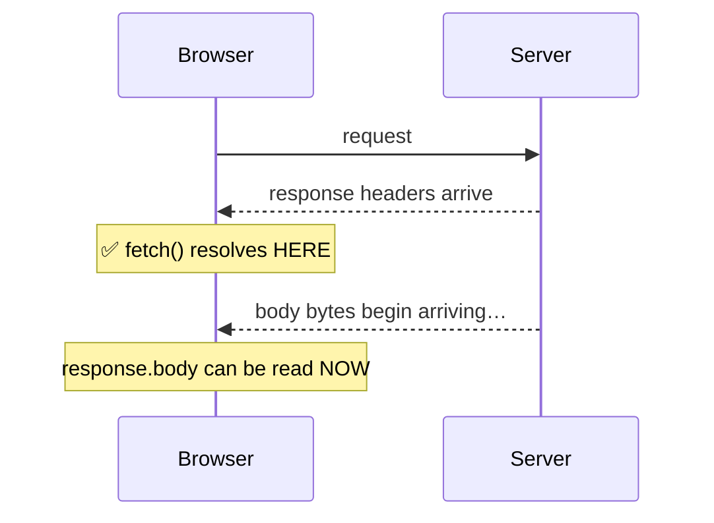

`await fetch()` resolves on **headers**, not on body completion.

| Call | Behaviour | Streaming-friendly |
| :--- | :--- | :--- |
| `await fetch(url)` | Resolves on headers | ✅ |
| `await response.text()` | Reads & concatenates the entire body | ❌ |
| `await response.json()` | Same, then parses | ❌ |
| `response.body` | Raw byte stream | ✅ |
| `response.body.getReader()` | A cursor over the stream | ✅ |

### 9.3 The Reader Loop

```javascript
const reader = response.body.getReader();

while (true) {
  const { value, done } = await reader.read();
  if (done) break;
  // process value (a Uint8Array)
}
```

```text
{ value: Uint8Array(6), done: false }
{ value: Uint8Array(9), done: false }
{ value: undefined,     done: true  }
```

> **Now the browser is actively consuming the response while it is still arriving.**

### 9.4 Decoding Bytes into Text

```text
"Spring" → UTF-8 → [83,112,114,105,110,103] → Network → Uint8Array → TextDecoder → "Spring"
```

```javascript
const decoder = new TextDecoder();                       // ONE per response

const chunk = decoder.decode(value, { stream: true });   // holds partial sequences
```

**Why `{ stream: true }` is mandatory:** it retains incomplete multi-byte sequences across reads (see Chapter 04). Without it, non-ASCII text is corrupted with `�`.

### 9.5 One Growing Assistant Bubble

`"Spring"  " Boot"  " is"  " great"` are **not four messages** — they are four pieces of **one** message.

```text
Create assistant bubble once → append chunk → append next chunk → … → complete message

Spring → Spring Boot → Spring Boot is → Spring Boot is great
```

```javascript
const assistantRow = addMessage("assistant", "");
const assistantBubble = assistantRow.querySelector(".message");
assistantBubble.textContent += chunk;      // the SAME bubble keeps growing
```

Create the bubble **lazily** on the first text piece, so a failed request cannot leave a ghost bubble.

### 9.6 The Complete `sendMessage()` Flow

```javascript
async function sendMessage() {
  const message = messageInput.value.trim();
  if (!message) return;

  addMessage("user", message);
  messageInput.value = ""; messageInput.focus();
  sendButton.disabled = true; showTyping();

  let assistantRow = null, assistantBubble = null, hasStartedStreaming = false;

  try {
    const response = await fetch(API_URL, {
      method: "POST",
      headers: { "Content-Type": "text/plain" },
      body: message
    });
    if (!response.ok) throw new Error("Request failed");

    const reader = response.body.getReader();
    const decoder = new TextDecoder();

    while (true) {
      const { value, done } = await reader.read();
      if (done) break;

      const chunk = decoder.decode(value, { stream: true });

      if (!hasStartedStreaming) {                 // create the bubble ONCE, on first text
        hideTyping();
        assistantRow = addMessage("assistant", "");
        assistantBubble = assistantRow.querySelector(".message");
        hasStartedStreaming = true;
      }

      assistantBubble.textContent += chunk;       // append, never replace
      scrollToBottom();
    }

    const remainingText = decoder.decode();       // flush the decoder
    if (remainingText && assistantBubble) assistantBubble.textContent += remainingText;

  } catch (error) {
    hideTyping();
    if (assistantRow) assistantRow.remove();
    addMessage("assistant", "Sorry, I couldn't connect. Please try again.", "error");
  } finally {
    hideTyping();
    sendButton.disabled = false;
  }
}
```

Flow: submit → typing indicator → HTTP request → **headers arrive (`fetch` resolves)** → `response.body` → create reader → wait for first chunk → hide typing → create **ONE** bubble → decode → append → next chunk → append → … → stream completes.

### 9.7 Scrolling, Rendering, Cancellation, Accessibility

| Concern | Rule |
| :--- | :--- |
| **Auto-scroll** | `scrollToBottom()` per chunk for demos; **sticky-to-bottom** in production (stop auto-scrolling when the user scrolls up) plus a "jump to latest" affordance |
| **Markdown / code** | Partial text is **invalid syntax** (unclosed fences, tables, links). Keep the raw text canonical, render a *projection*, and re-render at a bounded rate on `requestAnimationFrame` — never per chunk |
| **XSS** | Streamed model output is untrusted input: sanitize on **every** render; never `innerHTML` raw output |
| **Cancellation** | `AbortController` per request; on abort keep the partial text and mark it "stopped"; `AbortError` is **not** an error |
| **Accessibility** | `aria-live="polite"` (never assertive), `aria-busy="true"` while streaming, sentence-granular announcements, respect `prefers-reduced-motion`, keep focus in the input |
| **React** | StrictMode double-effects cause `ReadableStream is locked` — acquire readers in handlers; never re-render the whole message list per token |

### 9.8 Chapter Summary & Key Engineering Takeaways
1. **The frontend can undo the whole backend** with `await response.text()`.
2. **`await fetch()` resolves on headers**, not on body completion.
3. **`response.body` is a `ReadableStream` of bytes**; `getReader()` yields `{ value, done }`.
4. **One `TextDecoder` per response with `{ stream: true }`, flushed at the end.**
5. **One assistant bubble, appended forever**, created lazily on the first text piece.
6. **Cancellation is first-class** (`AbortController`) and preserves partial text.
7. **Auto-scroll must be respectful** (sticky + jump-to-latest).
8. **Rich rendering must be sanitized and rate-limited.**
9. **`done` is not text, `AbortError` is not an error, and a chunk is not a message.**

---

## Chapter 10: Production Hardening, Observability & Key Takeaways

### 10.1 The Consolidated Granularity Model

```text
LLM Token   ≠   API Provider Chunk   ≠   HTTP / Network Chunk   ≠   reader.read() Result
```

```text
Model: "Spring" " Boot" " is" " great"
Provider: "Spring" | " Boot" | " is great"
Network:  "Spring Boot" | " is great"
UI:       append whatever arrives → correct final text
```

### 10.2 Production Hardening Checklist

| # | Area | Requirement |
| :--- | :--- | :--- |
| 1 | Proxy | `proxy_buffering off` + `X-Accel-Buffering: no` |
| 2 | Compression | Exclude `text/event-stream` from gzip/brotli |
| 3 | Timeouts | Idle timeout > longest expected inter-chunk gap |
| 4 | Heartbeats | `: keep-alive` every 10–15 s |
| 5 | Headers | `text/event-stream; charset=utf-8`, `Cache-Control: no-cache, no-transform` |
| 6 | Return type | Stream type — never `String` / `Promise<string>` |
| 7 | No collectors | `collectList()`, `blockLast()`, `join()` forbidden on the stream path |
| 8 | Cancellation | Client abort → server cancel → provider cancel |
| 9 | Buffering | Per-request accumulator; persist on completion |
| 10 | Partial failure | Persist with `status: "interrupted"` |
| 11 | Multi-user | Conversation-scoped state + per-conversation lock |
| 12 | Rate limits | Per-user / per-conversation stream concurrency caps |
| 13 | Model limits | `max_tokens` caps + stop sequences |
| 14 | Retries | Only before the first token; jittered backoff |
| 15 | Failover | Secondary provider behind a flag |
| 16 | Payload limits | Enforce a max prompt budget before dispatch |
| 17 | Secrets | Provider keys server-side only |
| 18 | PII | Redaction before dispatch + retention policy |
| 19 | Idempotency | Stable `messageId` + upsert |
| 20 | Rollout | Flag streaming independently of the UI |

### 10.3 Observability

| Metric | Diagnostic value |
| :--- | :--- |
| **Server TTFT** | Separates provider latency from your pipeline |
| **Client TTFT** | The number the user actually feels |
| **TTFT gap** (client − server) | Detects proxy buffering / render blocking |
| **ITL / TPOT** | Detects stalls and provider throttling |
| **Chunk count & size distribution** | A single huge chunk = broken streaming |
| **In-band error rate** | Catches mid-stream failures invisible in HTTP status |
| **Abort rate** | UX signal and cost-saving measurement |
| **Prompt-token trend** | Explains creeping TTFT in long sessions |

**The single most valuable alert:** `p95(client_TTFT − server_TTFT) > 500 ms` — it detects proxy buffering, middleware body-buffering, CDN misconfiguration, re-enabled compression, and a frontend refactor that reintroduced `await response.text()`.

### 10.4 Cost, Security & Testing

| Cost lever | Effect |
| :--- | :--- |
| Prompt size | Re-billed **every turn** |
| `max_tokens` cap | Bounds worst-case completion cost |
| Cancellation propagation | Eliminates paying for unread output |
| Model tiering | Large savings on easy turns |
| Prompt prefix caching | Reduces repeated system-prompt cost |

> **Economic nuance:** streaming *reduces* cost when users abandon long answers, because cancellation stops generation; a buffered endpoint must finish and bill regardless.

**Security/privacy:** XSS via streamed markdown, prompt injection in retrieved content, cross-user context leakage, provider key exposure, PII in logs, data residency, agentic output as commands, denial-of-wallet, log injection.

**Testing levels:** (1) framing/decoding unit tests with fragmentation, (2) provider contract fixtures, (3) backend integration asserting TTFT ≪ total and ≥ 2 chunks, (4) end-to-end behind the real proxy topology, (5) chaos (aborts, drops, slow clients), (6) UI component tests over scripted fragments, (7) a synthetic canary measuring the TTFT gap.

```typescript
// The two assertions that catch almost all streaming regressions
const { chunkCount, ttftMs, totalMs } = await measureStream("/api/chat", "Explain DI");
assert(chunkCount > 2, "Single chunk — buffering somewhere!");
assert(ttftMs < totalMs * 0.5, "TTFT ≈ total — stream is buffered");

for (const size of [1, 3, 17, 1024]) {
  assert(await consumeWithFragmentSize("/api/chat", "Explain DI", size) === canonicalAnswer);
}
```

### 10.5 Anti-Pattern Catalogue (Top 10)

| Anti-Pattern | Root cause | Correct pattern |
| :--- | :--- | :--- |
| The `text()` collapse | `await response.text()` | `ReadableStream` reader loop |
| The proxy buffer | Nginx buffering default | Buffering off + `X-Accel-Buffering: no` |
| The collector service | `collectList()` / `String` return type | Stream all the way down |
| The chunk-per-message store | Persisting each chunk | Buffer, persist once |
| The ghost bubble | Bubble created before first token | Create lazily on first text |
| The zombie generation | No cancellation propagation | `AbortController` + upstream cancel |
| The vanishing turn | Persist only on success | Persist partial with a flag |
| The leaky conversation | Shared mutable history | Conversation-scoped state + locks |
| The janky renderer | Markdown parsed per chunk | Render on `requestAnimationFrame` |
| The unlocked frame parser | `TextDecoder` per chunk, no frame buffer | One decoder + leftover buffer |

### 10.6 The 28 Key Engineering Takeaways

**Foundations (generation):**
1. LLMs generate **one token at a time**; decode is strictly sequential.
2. **Prefill drives TTFT; decode drives tokens/second.**
3. **The KV cache taxes long conversations** in memory, latency and cost.
4. Generation and delivery are independent; you control delivery.

**Latency:**
5. Streaming does not shorten generation — it **collapses perceived latency**.
6. **TTFT is the UX metric**, and every prompt token is a tax on it.
7. Instrument **TTFT, ITL, TPS, token usage and chunk sizes** separately.

**Granularity:**
8. Token ≠ delta ≠ network chunk ≠ decoded piece.
9. Never conflate the four granularities in code, billing, or debugging.
10. Bytes travel; characters are decoded — one `TextDecoder`, `{ stream: true }`, flushed.
11. The only safe client contract is **blind accumulation**.

**Transport:**
12. Streaming is still HTTP with a progressive, length-less body.
13. **SSE is a format, not a transport**; raw `text/plain` is a valid simpler choice.
14. SSE is unidirectional and ideal for AI output; WebSockets are for duplex.
15. **Infrastructure breaks streaming more often than code.**

**Architecture:**
16. **Two streams must both stay streamed.**
17. The backend is a **bridge, not a buffer**.
18. Streaming is an **end-to-end property** with seven invariants.
19. **Cancellation must propagate upstream.**
20. Backpressure manifests as **stalls and coalescing** (usually a UI problem).

**State & persistence:**
21. Never store transport chunks as conversation messages.
22. The **dual-write pattern** (forward + buffer) is mandatory.
23. Interrupted answers belong in history, flagged as partial.
24. Multi-user isolation and per-conversation locking are non-negotiable.

**Client:**
25. **`await fetch()` resolves on headers; `response.text()` destroys streaming.**
26. **One bubble, appended forever**, created lazily.
27. `AbortError` is not an error; preserve partial text on abort.
28. Rich rendering must be **sanitized and rate-limited**.

> **The one-sentence summary:** *An LLM emits tokens one at a time; the provider exposes them as deltas; your backend forwards them without buffering while buffering them internally for history; HTTP carries them progressively; and the browser appends each decoded piece to a single assistant message — and that continuous, unbroken pipeline is what makes an AI appear to type in real time.*

### 10.7 Concept Mindmap & Closing Statement

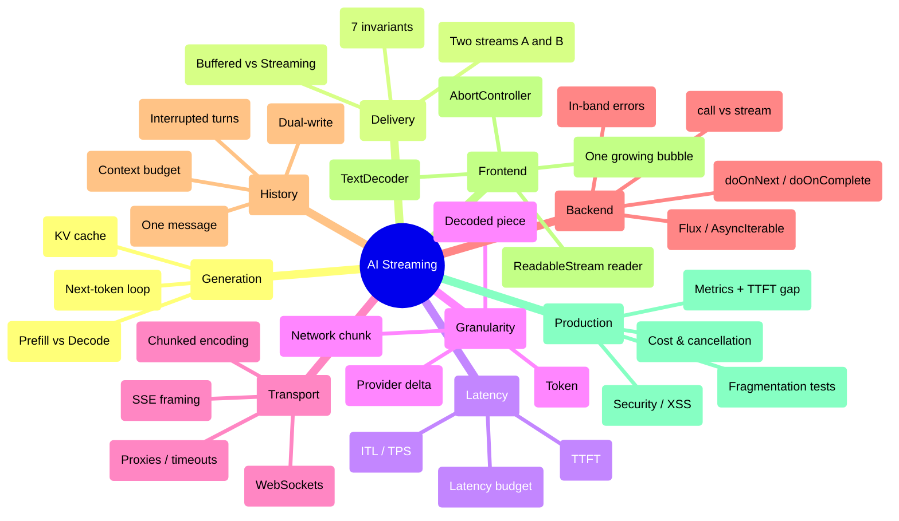

### Closing Statement

The PDF's final paragraph is the best possible summary, and worth ending on verbatim:

> *AI streaming becomes much easier to understand once we separate the layers. The LLM generates tokens incrementally. The AI provider exposes generated output as chunks or deltas. [The backend] represents those streamed values using a stream type. [The app server] progressively sends them through the HTTP response. The browser exposes the incoming response through `response.body`, which is a `ReadableStream`. JavaScript reads the incoming bytes, decodes them into text and continuously appends that text to one assistant message. The entire application therefore behaves like one continuous pipeline:*
>
> ```text
> Generation → Provider Streaming → Backend Streaming → HTTP Streaming → Browser Streaming → Live UI Rendering
> ```
>
> *And that is what creates the familiar experience of an AI assistant appearing to type its answer in real time.*

---

## 📎 Document Map & Cross-References

| Chapter | Deep-dive file | Source sections |
| :--- | :--- | :--- |
| 01 | [`01_How_LLMs_Generate_Text.md`](./01_How_LLMs_Generate_Text.md) | §1 |
| 02 | [`02_Generation_vs_Delivery_Non_Streaming_and_Streaming_Responses.md`](./02_Generation_vs_Delivery_Non_Streaming_and_Streaming_Responses.md) | §2, §3, §4 |
| 03 | [`03_Latency_Anatomy_TTFT_ITL_and_Perceived_Performance.md`](./03_Latency_Anatomy_TTFT_ITL_and_Perceived_Performance.md) | §5, §6 |
| 04 | [`04_Token_Chunk_Network_and_Byte_Granularity.md`](./04_Token_Chunk_Network_and_Byte_Granularity.md) | §7, §35 |
| 05 | [`05_HTTP_Streaming_Mechanics_Chunked_Encoding_SSE_and_WebSockets.md`](./05_HTTP_Streaming_Mechanics_Chunked_Encoding_SSE_and_WebSockets.md) | §8, §9, §10, §18 |
| 06 | [`06_End_to_End_Streaming_Architecture_and_Pipeline_Invariants.md`](./06_End_to_End_Streaming_Architecture_and_Pipeline_Invariants.md) | §11, §12, §36, §37 |
| 07 | [`07_Backend_Streaming_Call_vs_Stream_and_Flux.md`](./07_Backend_Streaming_Call_vs_Stream_and_Flux.md) | §13–§17 |
| 08 | [`08_Conversation_History_Buffering_and_Persistence.md`](./08_Conversation_History_Buffering_and_Persistence.md) | §19–§22 |
| 09 | [`09_Frontend_Streaming_Fetch_ReadableStream_TextDecoder.md`](./09_Frontend_Streaming_Fetch_ReadableStream_TextDecoder.md) | §23–§34 |
| 10 | [`10_Production_Hardening_Observability_and_Takeaways.md`](./10_Production_Hardening_Observability_and_Takeaways.md) | §35–§37 + production topics |

**Related lectures:** [Lecture 04, Chapter 04 — Real-Time Streaming Architecture & SSE Protocols](../../Lecture%2004/notes/04_Real_Time_Streaming_Architecture_and_SSE_Protocols.md) · [Lecture 05 — AI Agents, Tools & Autonomous Loops](../../Lecture%2005/notes/README.md)

**Companion deliverables (planned):** `Lecture 06/code` — TypeScript reference implementation and chapter-wise Implementation Guide, derived from these notes.

**Back to:** [Lecture 06 Notes Index](./README.md)
