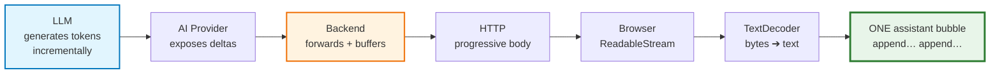

# Lecture 06 Notes: AI Streaming — From LLM Tokens to a Live Chat Experience

Welcome to the comprehensive, enterprise-grade course notes for **Lecture 06: AI Streaming — From LLM Tokens to a Live Chat Experience**.

These notes synthesize, formalize, and substantially expand upon the concepts introduced in [`Notes.pdf`](./Notes.pdf) and the architectural sketches in [`Excalidraw-Notes.svg`](./Excalidraw-Notes.svg). Every diagram is authored in **Mermaid**, and every illustrative snippet is **JS/TS-style pseudocode** — the notes deliberately contain no production code, focusing instead on mechanism, contracts, and failure modes.

---

## 🧭 The Core Idea in One Diagram

### The Two Foundational Formulas

$$\text{AI Streaming} = \underbrace{\text{Incremental Generation}}_{\text{model}} \;\longrightarrow\; \underbrace{\text{Progressive Delivery}}_{\text{application}}$$

$$\mathbf{Streaming} \neq \mathbf{SSE} \qquad\quad \text{Token} \neq \text{Provider Chunk} \neq \text{Network Chunk} \neq \text{Decoded Piece}$$

### The Most Important Sentences of the Lecture

> - *Streaming mainly changes how generated output is **delivered**, not how the model **generates**.*
> - *Streaming does not necessarily make the model finish faster. It makes the application **feel** faster.*
> - *Streaming is an **end-to-end** property of the application, not just an LLM feature.*
> - *The only safe UI contract: **whenever more text becomes available, append it to the current assistant message**.*

---

## 📚 Chapter Navigation Index

| Chapter | Module Title | Core Topics & Key Engineering Concepts |
| :--- | :--- | :--- |
| **[Chapter 01](./01_How_LLMs_Generate_Text.md)** | **How an LLM Generates Text — Autoregressive Decoding** | Tokenization and BPE boundaries; logits and softmax; temperature, top-k, top-p; the per-token decoding loop; **prefill vs. decode** phases; compute-bound vs. memory-bandwidth-bound inference; **KV cache** growth and its latency/cost tax; cross-entropy objective vs. truth; streaming as the same loop with `yield` instead of `append`. |
| **[Chapter 02](./02_Generation_vs_Delivery_Non_Streaming_and_Streaming_Responses.md)** | **Generation vs. Delivery — Non-Streaming and Streaming Responses** | The two independent processes (generation vs. delivery); buffered response lifecycle and its hidden costs; streaming response lifecycle and progressive assembly; wire-level comparison (`message` vs. `delta` frames, `[DONE]`); the endpoint decision framework; hybrid "stream progress, deliver validated object" pattern; the delivery-path taxonomy (buffered JSON, raw chunked text, SSE, WebSockets, polling, webhooks). |
| **[Chapter 03](./03_Latency_Anatomy_TTFT_ITL_and_Perceived_Performance.md)** | **Latency Anatomy — TTFT, ITL & Perceived Performance** | **Time-to-First-Token vs. total generation time**; full latency decomposition (`network + queue + prefill + N×ITL + tail`); TPS and TPOT; human reading speed as the throughput threshold; **input processing precedes output**, turning prompt engineering into latency engineering; formal latency budgets and TTFT SLAs; per-hop instrumentation. |
| **[Chapter 04](./04_Token_Chunk_Network_and_Byte_Granularity.md)** | **Token, Provider Chunk, Network Chunk & Byte — Four Layers of Granularity** | The four-layer granularity model; token coalescing into deltas; transport re-framing by TCP, proxies, compression, and HTTP/2; **UTF-8 multi-byte splits** and the `TextDecoder` `stream: true` discipline; the boundary-agnostic client contract; the **fragmentation torture test**; `charsPerChunk` as a diagnostic metric. |
| **[Chapter 05](./05_HTTP_Streaming_Mechanics_Chunked_Encoding_SSE_and_WebSockets.md)** | **HTTP Streaming Mechanics — Chunked Encoding, SSE & WebSockets** | Conventional vs. progressive HTTP; `Transfer-Encoding: chunked` and the absence of `Content-Length`; the exact **SSE grammar** (`data`/`event`/`id`/`retry`, `\n\n` framing, heartbeats) and mandatory headers; SSE vs. WebSockets decision matrix; raw `text/plain` vs. `text/event-stream`; infrastructure kill-switches (proxy buffering, compression, idle timeouts) and the `curl -N` debugging heuristic. |
| **[Chapter 06](./06_End_to_End_Streaming_Architecture_and_Pipeline_Invariants.md)** | **The Complete End-to-End Streaming Architecture** | **Two streams that must both stay streamed**; the full pipeline from click to rendered DOM; the **7 pipeline invariants**; backpressure and flow-control reality (stalls, not overflows); cancellation propagation and orphaned-generation economics; the final end-to-end mental model and the core idea restated. |
| **[Chapter 07](./07_Backend_Streaming_Call_vs_Stream_and_Flux.md)** | **Backend Streaming — `.call()` vs `.stream()` and the `Flux` Abstraction** | Why the **return type** (`String` ➔ `Flux<String>`) is the real architectural change; the box-vs-conveyor-belt mental model; cross-language stream abstractions; the minimal streaming service; controller wiring for `text/plain` vs. `text/event-stream`; the operator catalogue (`doOnNext`, `doOnComplete`, `doOnError`, `onErrorResume`, `timeout`, `retryWhen`, `doFinally`); **in-band error protocols** after the first byte; multi-user isolation and thread safety. |
| **[Chapter 08](./08_Conversation_History_Buffering_and_Persistence.md)** | **Conversation History, Buffering & Persistence in Streaming Systems** | Why streaming breaks conversation history; **never store chunks as messages**; the **dual-write pattern** (stream out, buffer in); the reference `doOnNext`/`doOnComplete` pattern line by line; the production warning about shared mutable state; partial/interrupted turn persistence; token accounting vs. chunk counting; context budgeting strategies; persistence engineering (idempotent upsert, atomic write, three storage layers). |
| **[Chapter 09](./09_Frontend_Streaming_Fetch_ReadableStream_TextDecoder.md)** | **Frontend Streaming — `fetch`, `ReadableStream` & `TextDecoder`** | Why backend streaming is only half the work; the `await response.text()` collapse; what `await fetch()` actually waits for; `response.body`, `getReader()`, `{ value, done }`; bytes vs. characters; the complete `sendMessage()` implementation; **one growing assistant bubble** (created lazily); sticky auto-scroll; `AbortController` cancellation; markdown/code rendering hazards and **XSS sanitization**; animation-frame rendering; React patterns and the StrictMode lock trap; accessibility and `aria-live`. |
| **[Chapter 10](./10_Production_Hardening_Observability_and_Takeaways.md)** | **Production Hardening, Observability & Key Takeaways** | The consolidated granularity model; the 20-point production hardening checklist; streaming-specific observability metrics and the **TTFT-gap alert**; cost, security, and privacy in streamed systems; a six-level testing strategy including the fragmentation torture test and CI assertions; the 15-row anti-pattern catalogue; the 28-point consolidated takeaway list; and the complete concept mindmap. |

---

## 📄 Master Consolidated Document

For an end-to-end reading experience with all chapters merged into a single reference, see:
👉 **[Lecture 06 Complete Consolidated Notes](./Lecture_06_Complete_Notes.md)**

---

## 🛠 Architectural Highlights of this Lecture

- **Granularity-First Thinking:** The lecture's central discipline is distinguishing four layers that everyone conflates — **LLM token, provider delta, network chunk, decoded string piece** — and never building logic on boundaries that no layer guarantees.
- **Latency as a Sum, Not a Number:** TTFT, ITL, TPS, and total time are decomposed per hop, with an explicit budget table and a single high-value production alert (`client_TTFT − server_TTFT`).
- **End-to-End Invariants:** Streaming is treated as a *property of the whole system*, expressed as seven verifiable invariants spanning code, infrastructure, and UI — with `curl -N` and the fragmentation torture test as the primary verification tools.
- **JS/TS Pseudocode Throughout:** All snippets use JavaScript/TypeScript-style pseudocode on a modern Node.js/browser runtime. Java/Spring AI reference shapes (`Flux<String>`, `.call()` vs `.stream()`, `doOnNext`/`doOnComplete`) appear exactly where the source PDF uses them, always paired with their ecosystem equivalents.
- **Mermaid Diagrams for Every Mechanism:** Generation loops, prefill/decode phases, sequence diagrams for both streams, the UTF-8 split failure, the SSE vs. WebSocket decision tree, the dual-write pattern, persistence state machines, the fragmentation test, and a complete concept mindmap.
- **Production Reality:** Deliberately covers what the slides omit — proxy buffering, compression, idle timeouts, cancellation economics, partial-failure persistence, multi-user isolation, XSS in streamed markdown, accessibility, and the anti-pattern catalogue.

---

## 📎 Source Materials

| Artifact | Location | Role in these notes |
| :--- | :--- | :--- |
| Slide deck | [`Notes.pdf`](./Notes.pdf) — *"AI Streaming: From LLM Tokens to a Live Chat Experience"* (44 pages, 37 sections) | Primary source; every section is mapped to a chapter |
| Concept sketches | [`Excalidraw-Notes.svg`](./Excalidraw-Notes.svg) | Client ➔ App ➔ Provider ➔ LLM topology; generation vs. delivery; TTFT vs. total generation time; `POST /chat` request/response shapes; SSE/Streaming-HTTP vs. WebSockets; `{ value, done }` chunk frames |
