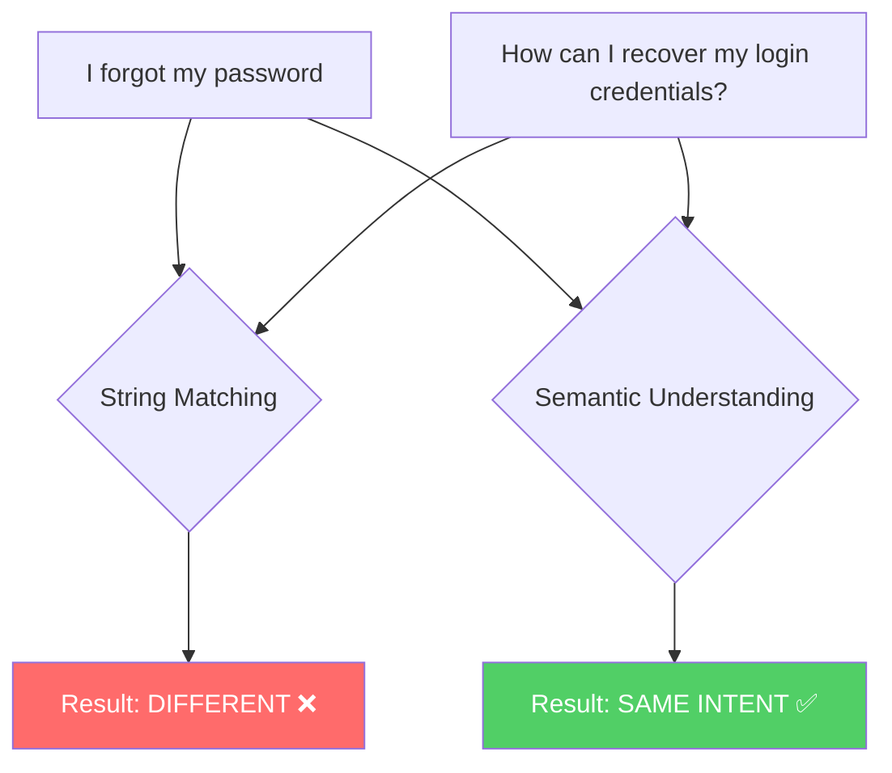
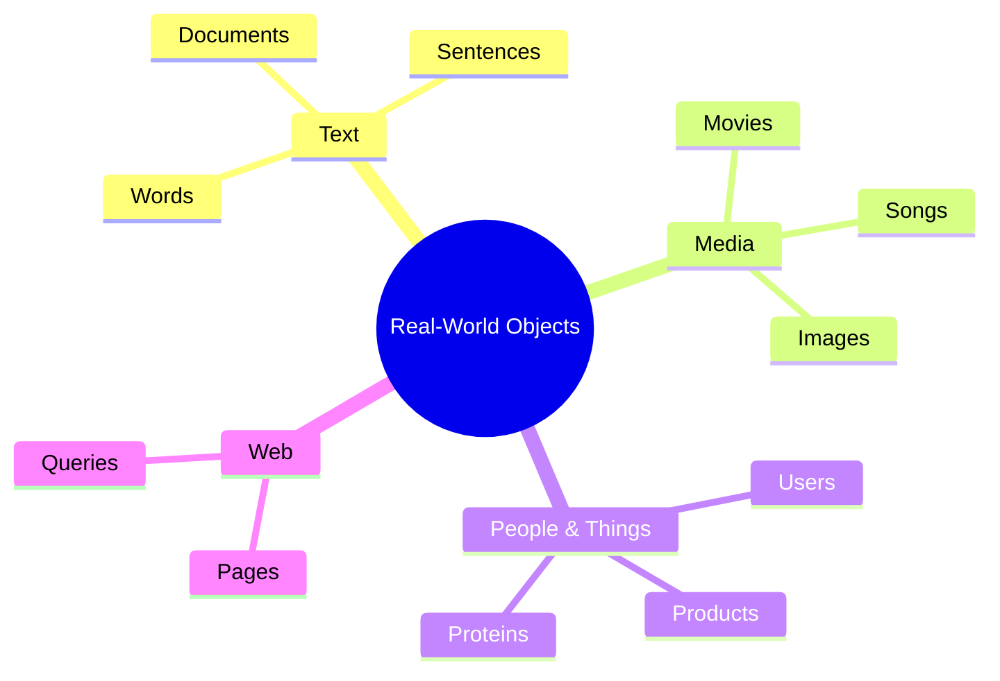
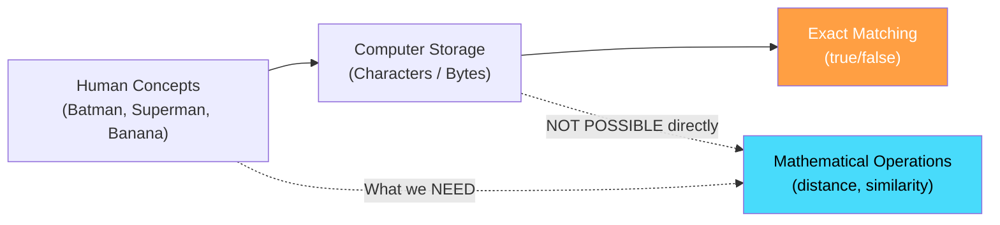

# Chapter 01: The Problem of Meaning in Computers

> **Chapter Goal:** Understand *why* computers cannot inherently understand meaning, why pure symbolic representation fails, and why we need a mathematical bridge between human concepts and machine computation. This chapter establishes the core motivation for everything that follows — vector embeddings.

---

## 1.1 The Gap Between Symbol and Meaning

Consider the word:

```
Batman
```

For a human, this single word instantly activates a **rich web of associations**:

| Association | Type |
|---|---|
| Superhero | Category |
| Bruce Wayne | Identity |
| Gotham | Setting |
| Dark / Serious | Tone |
| Crime / Vigilante | Theme |
| Rich / Action | Attributes |

A computer, at its lowest level, works with **binary representations** (0s and 1s). It can store the characters `B`, `a`, `t`, `m`, `a`, `n` — but storing a *symbol* is fundamentally different from understanding *meaning*.

> **Core Insight:** Representing symbols is NOT the same as representing meaning.

---

## 1.2 Identity Matching vs. Semantic Similarity

Traditional computer systems excel at **exact matching**:

```js
// Exact string identity matching
const s1 = "Batman";
const s2 = "Batman";

if (s1 === s2) {
  // true — they are identical
}

if (s1 === "Superman") {
  // false — they are different strings
}
```

This tells us whether two strings are **identical**. It does NOT tell us whether they are **conceptually related**.

### The Real Problem

Consider these two sentences:

```
"I forgot my password."
"How can I recover my login credentials?"
```

As strings → they are **very different**.  
In meaning → they represent **almost the same intent**.

A system based purely on string matching sees them as completely different. A human immediately recognizes they are asking the same thing.



This is the **central problem**: How do we convert *meaning* into something mathematics can operate on?

---

## 1.3 Why Mathematics Requires Numbers

Machine-learning models, neural networks, and mathematical algorithms **fundamentally operate on numbers**.

There is no useful mathematics we can directly perform on:

```
Batman
Superman
Interstellar
Pizza
```

But once things become **numbers**, we can perform:

| Operation | What It Enables |
|---|---|
| Addition | Combining features |
| Multiplication | Scaling and weighting |
| Distance | Measuring similarity |
| Angles | Directional comparison |
| Probabilities | Uncertainty reasoning |
| Matrix operations | Neural network computation |

So our **first requirement** is:

> **Turn real-world things into numerical representations.**

---

## 1.4 The Scope of the Problem

This is not just about words. The problem applies to almost everything computers need to reason about:



This problem **existed long before modern LLMs**. The challenge of turning real-world objects into numbers that carry meaning has been a core challenge of machine learning from the start.

### What a Random Number Doesn't Solve

Simply assigning a random number to every object doesn't help:

```
Batman      → 43
Superman    → 23
Banana      → 12
```

The numbers don't represent any *meaningful relationship* between the objects. `43` and `23` being close in value says nothing about Batman and Superman being related concepts.

> **The requirement is not just any number — it's a number (or set of numbers) that encodes meaningful relationships.**

---

## 1.5 Summary



The chapter establishes:
1. **Computers store symbols, not meanings**
2. **String matching fails for semantic understanding**
3. **Mathematical operations require numbers**
4. **Randomly assigned numbers don't carry relational information**

This motivates the entire concept of **vector representations** — the topic of Chapter 02.
