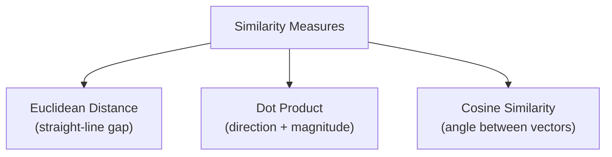
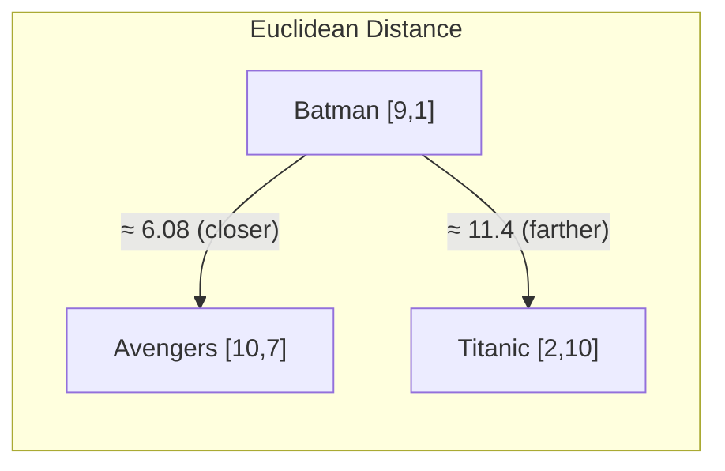
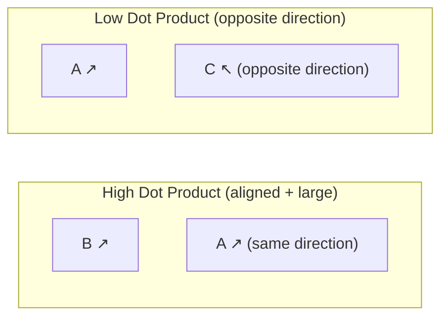
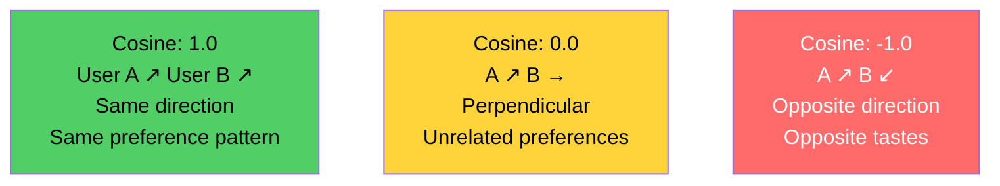
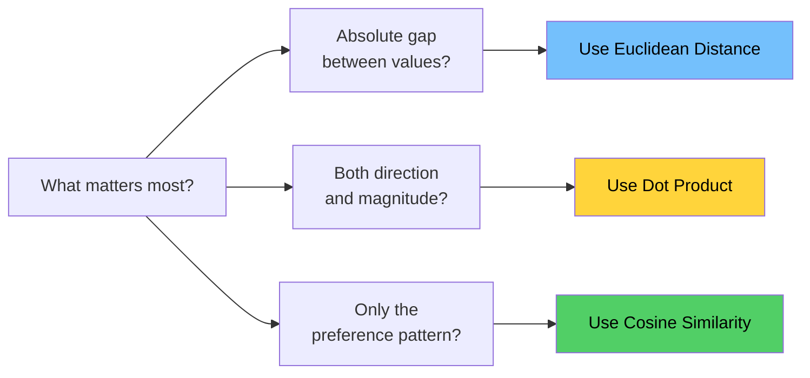
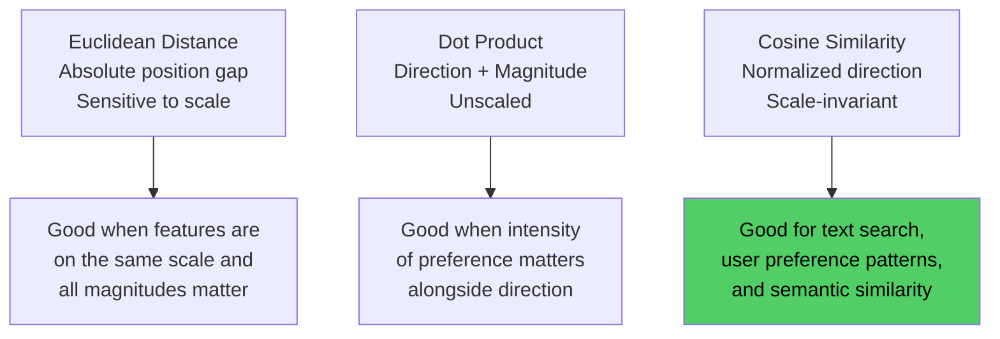

# Chapter 03: Measuring Similarity Between Vectors

> **Chapter Goal:** Understand the three primary mathematical approaches to measuring how similar or different vectors are — Euclidean Distance, Dot Product, and Cosine Similarity. Learn the intuition behind each and when to prefer one over another.

---

## 3.1 Why We Need a Similarity Measure

Once objects exist inside a mathematical space as vectors, we need a way to **compare them**.

Given:
```
Batman       = [9, 1]
Avengers     = [10, 7]
Titanic      = [2, 10]
```

We want to answer: *"Which movie is most similar to Batman?"*

Three key approaches exist:



> **The important part is understanding the intuition — not memorizing formulas.**

---

## 3.2 Euclidean Distance

Euclidean distance is the **normal idea of straight-line distance** between two points in space.

### Intuition

```
Smaller distance → closer → more similar
Larger distance  → farther → less similar
```

### How It Works

For two points in 2D:

```
Distance = sqrt((x2 - x1)² + (y2 - y1)²)
```

For our movies (action, comedy):

```
Batman    = [9,  1]
Avengers  = [10, 7]
Titanic   = [2, 10]

Batman ↔ Avengers : sqrt((10-9)² + (7-1)²)  = sqrt(1 + 36)  = sqrt(37)  ≈ 6.08
Batman ↔ Titanic  : sqrt((2-9)²  + (10-1)²) = sqrt(49 + 81) = sqrt(130) ≈ 11.4
```

Batman is **closer** to Avengers than to Titanic ✅



### The Critical Warning: Representation Matters

Euclidean distance is **mathematically correct but semantically useless** if the features were badly chosen.

```js
// Bad feature choice example
const Batman  = [6, 7];  // [letters_in_title=6, release_month=7]
const Titanic = [7, 12]; // [letters_in_title=7, release_month=12]
const Jaws    = [4, 6];  // [letters_in_title=4, release_month=6]
```

Batman might accidentally appear close to `Jaws` just because both titles have similar letter counts. The distance calculation is correct, but the result is meaningless.

> **The usefulness of vector similarity depends entirely on the quality of the representation. Garbage features → garbage similarity.**

---

## 3.3 Why Direction Sometimes Matters More Than Distance

Consider two users with action/romance preferences:

```
User A = [9,  1]   → slightly prefers action over romance
User B = [90, 10]  → also strongly prefers action over romance
```

**Euclidean distance** would say they are **very far apart** — the numbers differ by a factor of 10.

But look at the **ratio**:
```
User A: 9:1  = 9x more action than romance
User B: 90:10 = 9x more action than romance
```

Both users have the **exact same preference pattern**. Euclidean distance misses this because it's sensitive to magnitude.

Geometrically, both vectors **point in the same direction**:

```
User B   ↗
        /
       /
User A ↗  (same direction, different length)
```

This is where **Cosine Similarity** becomes the better tool.

---

## 3.4 Dot Product

The **dot product** of two vectors combines information about both **direction** and **magnitude**.

### How It Works

```
A = [2, 3]
B = [4, 5]

A · B = (2 × 4) + (3 × 5)
      = 8 + 15
      = 23
```

Multiply corresponding elements, then sum them all up.

### The Geometric Meaning

```
A · B = |A| × |B| × cos(θ)

where θ = angle between the vectors
```

This tells us:
- **Direction component**: `cos(θ)` — how aligned are they?
- **Magnitude component**: `|A| × |B|` — how large are they?

### Intuition



- **Large positive** dot product → vectors point in similar directions AND have large magnitudes
- **Near zero** → vectors are roughly perpendicular (unrelated)
- **Large negative** → vectors point in opposite directions

### When to Use Dot Product

Use dot product when **both** the *direction* (type of preference) and *magnitude* (strength of preference) matter.

For example, in recommendation:
- A user who rated 100 movies highly AND prefers action is different from a user who rated 5 movies highly AND prefers action — the dot product captures this difference.

---

## 3.5 Cosine Similarity

Cosine similarity asks:

> **"How similar is the *direction* of these two vectors — regardless of their size?"**

### Formula

```
cosine_similarity(A, B) = (A · B) / (|A| × |B|)
```

It's the dot product **normalized** by the magnitudes — this removes the effect of vector size.

### Output Range

```
+1.0 → vectors point in exactly the same direction (identical preference pattern)
 0.0 → vectors are perpendicular (completely unrelated)
-1.0 → vectors point in opposite directions (opposite preferences)
```

### Back to User A vs User B

```
User A = [9,  1]
User B = [90, 10]

Cosine Similarity(A, B) = ?

A · B = (9 × 90) + (1 × 10) = 810 + 10 = 820
|A|   = sqrt(9² + 1²)        = sqrt(82)  ≈ 9.06
|B|   = sqrt(90² + 10²)      = sqrt(8200) ≈ 90.6

Cosine = 820 / (9.06 × 90.6) ≈ 820 / 820.8 ≈ 0.999
```

**Near perfect cosine similarity!** ✅ — Both users have the same taste pattern.

### Visual Comparison



---

## 3.6 Comparison Table

| Measure | What It Captures | Sensitive To Size? | Best For |
|---|---|---|---|
| Euclidean Distance | Absolute geometric distance | ✅ Yes | When magnitude of values matters equally |
| Dot Product | Direction AND magnitude | ✅ Yes | When both pattern and strength matter |
| Cosine Similarity | Direction (angle) only | ❌ No | When preference *pattern* matters more than size |



---

## 3.7 A Practical Summary with Pseudo-Code

```js
// Euclidean Distance
function euclideanDistance(a, b) {
  const sumOfSquares = a.reduce((sum, val, i) => sum + (val - b[i]) ** 2, 0);
  return Math.sqrt(sumOfSquares);
}

// Dot Product
function dotProduct(a, b) {
  return a.reduce((sum, val, i) => sum + val * b[i], 0);
}

// Cosine Similarity
function cosineSimilarity(a, b) {
  const dot = dotProduct(a, b);
  const magA = Math.sqrt(dotProduct(a, a));
  const magB = Math.sqrt(dotProduct(b, b));
  return dot / (magA * magB);
}

// Usage example
const batman   = [9, 1];
const avengers = [10, 7];
const titanic  = [2, 10];

console.log(cosineSimilarity(batman, avengers));  // High → similar taste profile
console.log(cosineSimilarity(batman, titanic));   // Lower → different taste profile
```

---

## 3.8 Summary

The three similarity measures work at different levels:



> **In practice, cosine similarity dominates in NLP and embedding-based search because text embeddings often vary in magnitude but their directional patterns carry the true semantic meaning.**

The next critical question: who decides what the dimensions of these vectors should be? That's the problem of **feature engineering** — covered in Chapter 04.
