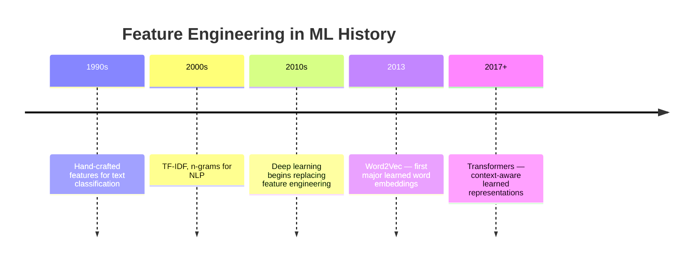
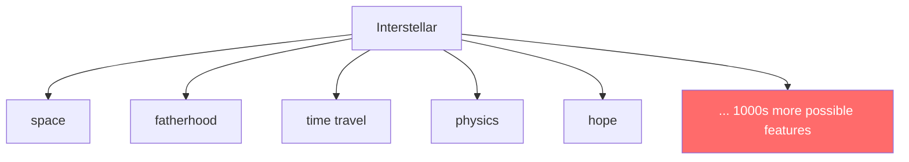
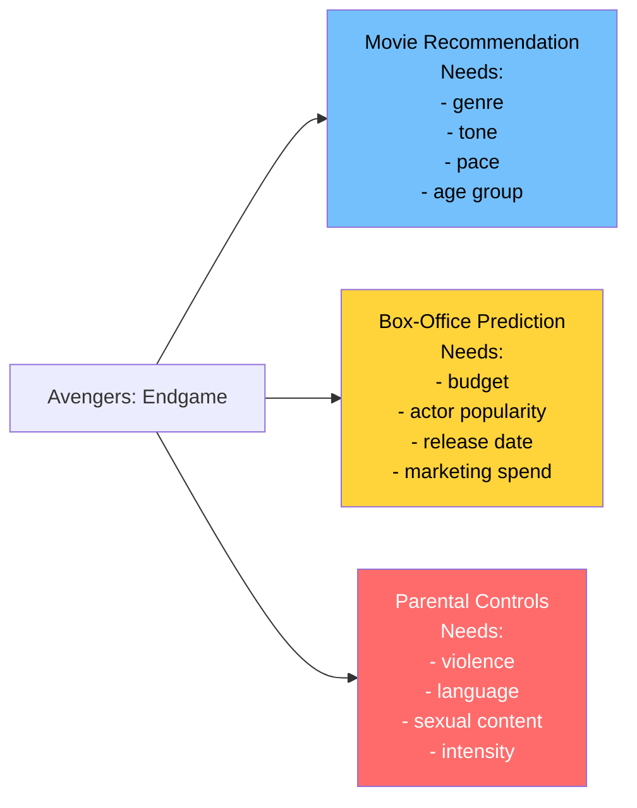
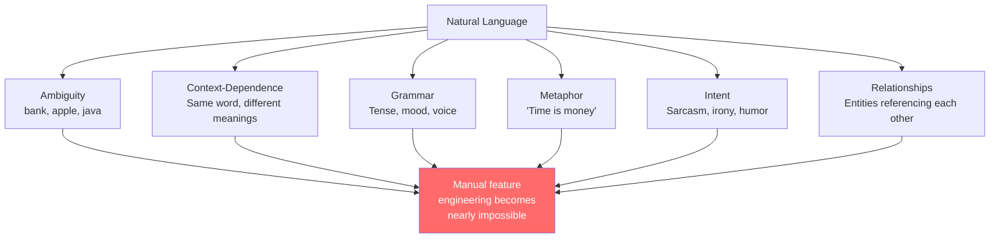
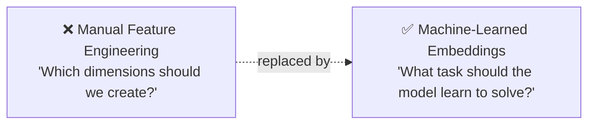
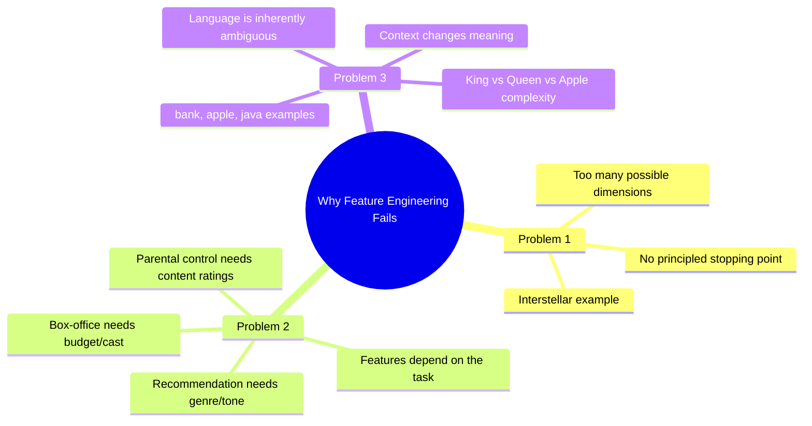

# Chapter 04: The Failure of Hand-Crafted Features

> **Chapter Goal:** Understand why manually designing vector dimensions (feature engineering) is fundamentally limited at scale. This chapter examines three core problems with hand-crafted features and builds the case for letting machines *learn* the right representations automatically.

---

## 4.1 The Setup: We Are Still Choosing the Dimensions

So far, every vector we've built was **manually designed**:

```js
// A human decided these are the right dimensions
const Batman = [
  9,  // action
  2,  // romance
  3,  // comedy
  9   // darkness
];
```

**Who decided** these four dimensions?  
→ We did.

This is called **feature engineering** — the practice of manually defining which characteristics to measure.

> **Feature engineering can work extremely well... but it has severe limitations at scale.**

---

## 4.2 A Brief History: Feature Engineering in ML

Historically, a large portion of machine learning was about feature engineering:



For decades, teams of domain experts would spend months designing the right features for their specific problems. This approach had a ceiling.

---

## 4.3 Problem 1 — How Many Dimensions Should We Create?

Consider the movie `Interstellar`. What features should represent it?

```
space?          ✓
science?        ✓
family?         ✓
fatherhood?     ✓
time travel?    ✓
love?           ✓
survival?       ✓
philosophy?     ✓
physics?        ✓
sadness?        ✓
adventure?      ✓
visual spectacle? ✓
hope?           ✓
sacrifice?      ✓
isolation?      ✓
```

Different humans would describe the **same movie** using completely different characteristics. There could be **thousands** of meaningful properties, and humans must decide which ones matter.



There is no principled way to know when to **stop**. And every new concept you add requires:
- Defining it precisely
- Deciding how to score it
- Maintaining consistency across all items

This becomes unmanageable at scale.

---

## 4.4 Problem 2 — Features Depend on the Task

The **same movie** requires completely different features depending on what you're trying to solve:



The same object. Three completely different feature sets. There is **no universally correct feature list** that works for all use cases.

This means:
- You need different feature engineering for every application
- Features optimized for one task may be misleading for another
- Maintaining separate feature sets is expensive and error-prone

---

## 4.5 Problem 3 — Language Makes Feature Engineering Nearly Impossible

### Words Have Many Meanings

Consider the word:

```
bank
```

```
"I deposited money at the bank."  → financial institution
"The fisherman sat on the river bank."  → edge of a river
```

Same word. Completely different meaning. Any static feature set for "bank" must somehow capture both meanings — or pick one and be wrong half the time.

### Words Change Meaning by Context

```
Apple  →  fruit (food context)
Apple  →  tech company (business context)

Java   →  programming language (developer context)
Java   →  island in Indonesia (geography context)
Java   →  coffee (cafe context)
```

A manually designed feature vector for "Apple" must include:
- fruit, food, red, sweet, round ← for food context
- technology, company, iPhone, software ← for tech context

These features can contradict each other, and their weights change completely depending on context.

### The King Example

```
King  → [human=1, male=1, royalty=1, authority=1, wealth=1, adult=1, leader=1, politics=1, power=1, ...]
Queen → [human=1, female=1, royalty=1, authority=1, wealth=1, adult=1, leader=1, politics=1, power=1, ...]
```

How many dimensions do we need? What's the "correct" gender score? What about gender-neutral monarchs? What about "queen" in chess? In music (Freddie Mercury)?



---

## 4.6 The Scale Problem

Even if we could perfectly design features for one domain, consider the **scope** of the problem:

```
Every word in every language
Every sentence ever written
Every movie ever made
Every song ever recorded
Every product ever sold
Every user profile ever created
Every image ever taken
Every protein structure ever studied
```

A team of humans cannot maintain a universal, correct feature list for all of these domains simultaneously. The combinatorial explosion is too vast.

---

## 4.7 Limitations Summary Table

| Limitation | Description | Impact |
|---|---|---|
| **Scale** | Too many possible dimensions to enumerate | Features always incomplete |
| **Task Specificity** | Right features depend on problem | Need new feature sets per task |
| **Ambiguity** | Same word, multiple meanings | Can't statically assign values |
| **Context** | Meaning shifts based on surrounding words | Static features can't adapt |
| **Subjectivity** | Different humans assign different values | Inconsistent representations |
| **Maintenance** | Features must be updated as language evolves | Extremely high ongoing cost |

---

## 4.8 The Question That Changes Everything

We know we want:

```
Batman       → vector
Superman     → vector
Titanic      → vector

king         → vector
queen        → vector
dog          → vector
```

And we want the resulting space to behave like this:

```
Batman ≈ Superman   (both superheroes)
dog    ≈ puppy      (same animal)
king   ≈ queen      (both royalty)

Batman ≠ banana     (completely unrelated)
dog    ≠ database   (completely unrelated)
```

But we do **not** want humans to manually design thousands of dimensions.

The only scalable solution is:



> **Instead of asking "Which dimensions should we create?", we ask "What task should the system learn to solve?" The correct representations emerge as a by-product of learning.**

---

## 4.9 Summary



Feature engineering is not *wrong* — it's just fundamentally limited for the scale and variety of real-world data. This limitation motivates the breakthrough concept explored in Chapter 05: **learning vector representations automatically through training**.
