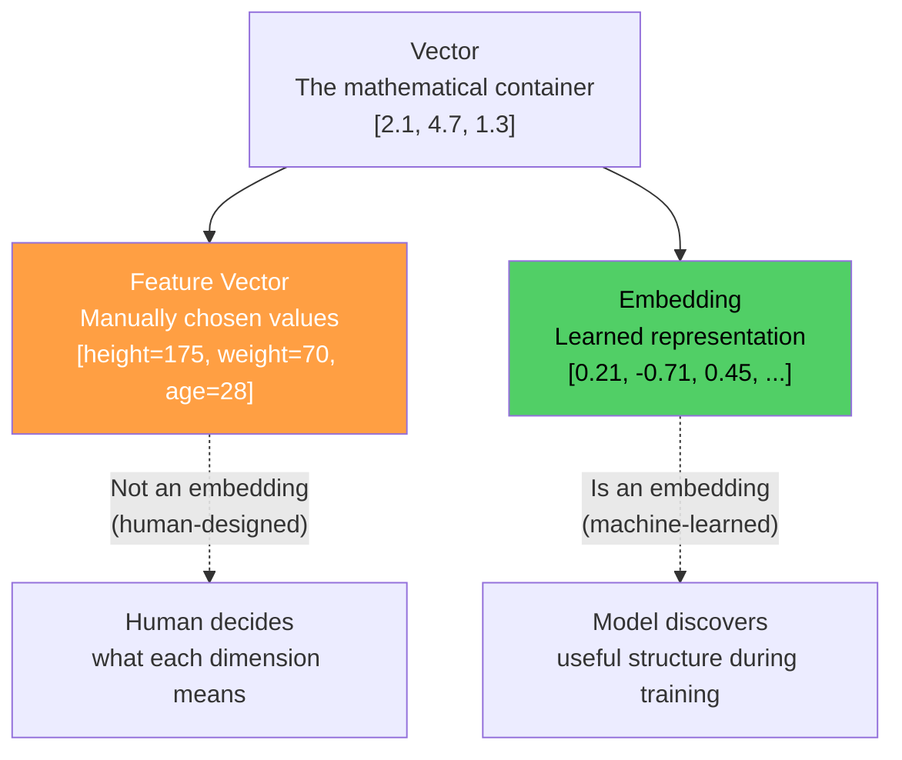
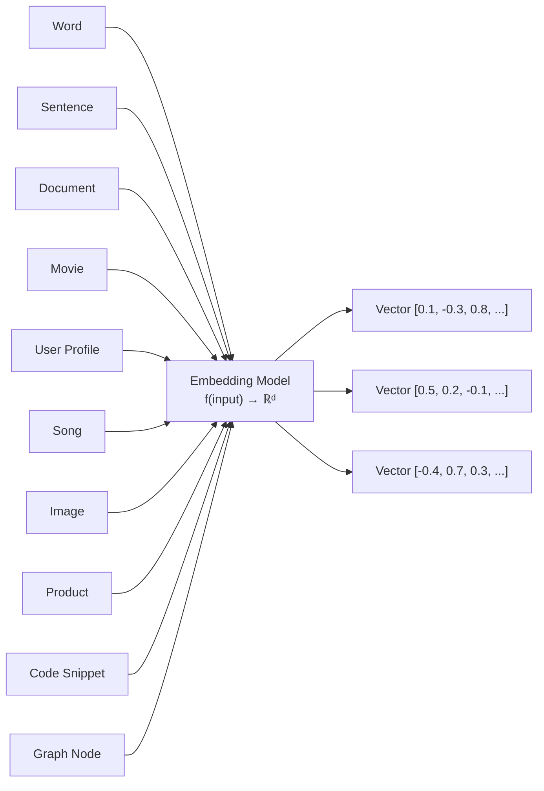
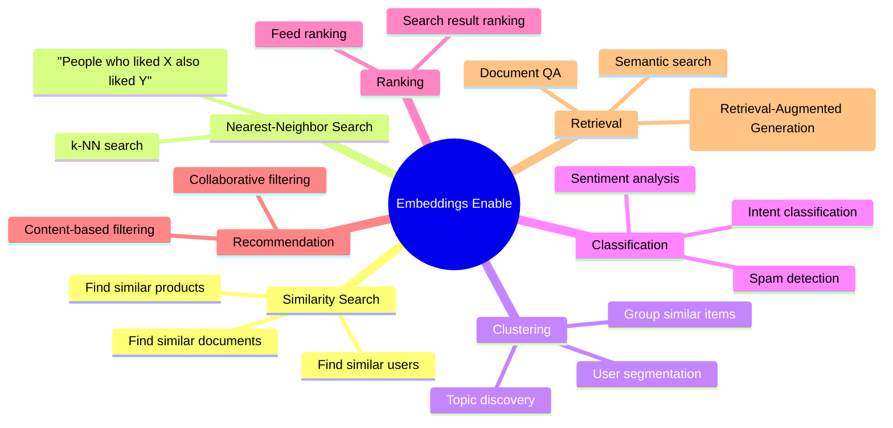
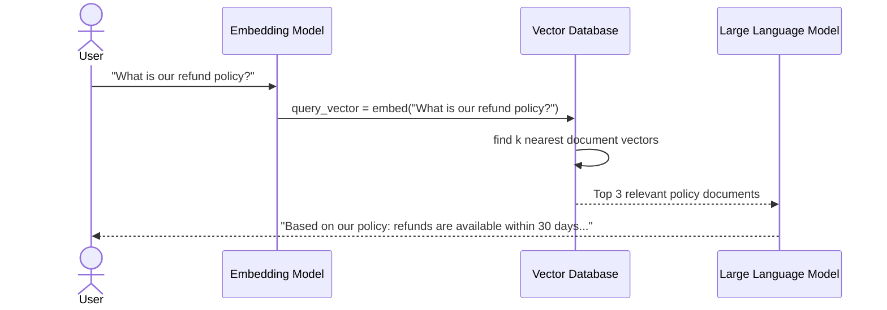
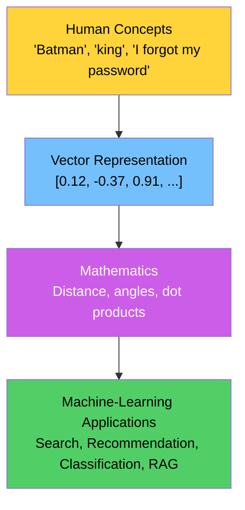
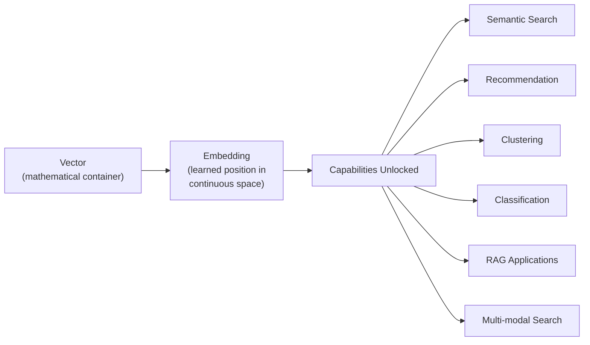

# Chapter 06: Vector vs Embedding — What Can We Do With Them?

> **Chapter Goal:** Clarify the distinction between a raw vector and an embedding, understand what kinds of things can be embedded, and explore the full range of tasks that become possible once objects are represented as embeddings. This chapter connects theory to real-world AI applications.

---

## 6.1 The Critical Distinction: Vector vs Embedding

This distinction is extremely important and frequently confused.

### Vector

A **vector** is the mathematical container — simply an ordered list of numbers:

```
[2.1, 4.7, 1.3]
```

Any collection of numbers is a vector. If those numbers were **manually chosen** by a human to describe features, we typically call it a **feature vector**.

### Embedding

An **embedding** is a **learned representation** that places an object inside a **continuous vector space**:

```
king = [0.21, -0.71, 0.45, ...]
```

The key word is **learned** — the values were not manually assigned. They emerged from training on a large dataset.



### The Rule

```
Every embedding IS a vector.
NOT every vector IS an embedding.
```

| Type | Example | How Created |
|---|---|---|
| Feature Vector | `[height, weight, age]` | Manually chosen dimensions |
| Embedding | `[0.21, -0.71, 0.45, ...]` | Learned during training |

---

## 6.2 Almost Anything Can Be Embedded

Embeddings are **not** limited to individual words. The embedding function can take **any input** that a model can process:



### Examples of Embeddings in Practice

| Object Type | What Gets Embedded | Use Case |
|---|---|---|
| Word | "king", "queen" | NLP, search |
| Sentence | "I forgot my password" | Semantic search |
| Document | An entire news article | Document retrieval |
| Movie | Avengers metadata + reviews | Recommendation |
| User | Purchase history + behavior | Personalization |
| Song | Audio waveform features | Music recommendation |
| Image | Pixel values via CNN | Image search |
| Product | Description + attributes | E-commerce search |
| Code | Source code tokens | Code search, completion |

The critical question for any embedding system is:

> **"Can we learn a useful mathematical space in which relationships between these objects become accessible through geometry?"**

---

## 6.3 The Embedding Model as a Function

Formally, an embedding model is:

```
f : Input → ℝᵈ
```

Where `d` is the embedding **dimensionality** — a fixed design choice of the model.

### Text Example

```
Input: "Batman is a dark superhero movie"
         ↓
   Embedding Model
         ↓
[0.12, -0.37, 0.91, 0.44, 0.02, ..., 0.22]
                 (768 dimensions)
```

### Multi-Modal Example (Vision-Language Models)

```
Input: Image of a cat
         ↓
   Embedding Model (CLIP, etc.)
         ↓
[0.55, -0.22, 0.18, ...]    ← same vector space as text embeddings!

Input: "A photo of a cat"
         ↓
   Embedding Model
         ↓
[0.53, -0.19, 0.21, ...]    ← geometrically close to the image vector
```

This is called a **shared embedding space** — different modalities (text and images) can be compared directly through their embeddings.

---

## 6.4 What Can We Do With Embeddings?

Once real-world objects become vectors, an entire class of operations becomes possible:



### 1. Similarity Search

Given a query, find the most semantically similar items:

```
Query: "I forgot my password"
         ↓ embed
         ↓ find nearest vectors
Results:
  "How do I recover my login credentials?" (similarity: 0.94)
  "Reset account access" (similarity: 0.87)
  "Password recovery options" (similarity: 0.85)
```

String-matching approaches would return no results. Embedding search returns semantically relevant results.

### 2. Recommendation Systems

```js
// Pseudo-code: Movie recommendation using embeddings
function recommendMovies(userId, allMovies) {
  const userVector = embed(getUserProfile(userId));
  
  return allMovies
    .map(movie => ({
      movie,
      similarity: cosineSimilarity(userVector, embed(movie))
    }))
    .sort((a, b) => b.similarity - a.similarity)
    .slice(0, 10);  // top 10 recommendations
}
```

### 3. Clustering

Group similar items without labels:

```
Documents about "sports" → cluster together
Documents about "finance" → cluster together
Documents about "technology" → cluster together
```

### 4. Retrieval-Augmented Generation (RAG)

The most important use case for modern LLM applications:



Without embeddings, this would require exact keyword matching — missing any document that uses slightly different wording.

---

## 6.5 The Bridge That Embeddings Create

Embeddings serve as a **bridge** between human concepts and machine-learning applications:



This bridge is why embeddings are considered **foundational** to modern AI systems.

---

## 6.6 Common Embedding Models and Dimensions

| Model | Dimensions | Type | Use Case |
|---|---|---|---|
| `text-embedding-ada-002` (OpenAI) | 1536 | Text | General-purpose text |
| `text-embedding-3-small` (OpenAI) | 1536 | Text | Cost-effective text |
| `text-embedding-3-large` (OpenAI) | 3072 | Text | High-quality text |
| BERT (base) | 768 | Text | Classification, search |
| BERT (large) | 1024 | Text | Higher quality NLP |
| CLIP | 512 | Text + Image | Multi-modal search |
| Word2Vec | 100-300 | Word | Word-level embeddings |
| GloVe | 50-300 | Word | Pre-trained word vectors |

> **The dimensionality is a design choice — higher dimensions can capture more nuance but are more expensive to compute and store.**

---

## 6.7 Practical Pseudo-Code: Using an Embedding API

```js
// Pseudo-code: Embedding workflow in a TypeScript/Node.js environment

// 1. Generate embeddings for a batch of documents
async function embedDocuments(texts: string[]): Promise<number[][]> {
  const response = await embeddingAPI.embed({
    model: "text-embedding-3-small",
    input: texts
  });
  return response.embeddings;  // array of float arrays
}

// 2. Store in a vector database
async function indexDocuments(documents: Document[]) {
  const texts = documents.map(d => d.content);
  const vectors = await embedDocuments(texts);
  
  await vectorDB.upsert(
    documents.map((doc, i) => ({
      id: doc.id,
      vector: vectors[i],
      metadata: { title: doc.title, url: doc.url }
    }))
  );
}

// 3. Query using semantic search
async function semanticSearch(query: string, topK: number = 5) {
  const queryVector = await embedDocuments([query]);
  
  const results = await vectorDB.query({
    vector: queryVector[0],
    topK,
    includeMetadata: true
  });
  
  return results.map(r => ({
    document: r.metadata,
    similarity: r.score
  }));
}
```

---

## 6.8 Summary



**Key Points:**
1. **Every embedding is a vector, but not every vector is an embedding**
2. **Embeddings are learned** — not manually designed
3. **Almost anything can be embedded** — text, images, audio, users, products
4. **Embeddings unlock a full suite of ML operations** — search, recommendation, clustering, RAG
5. **The embedding model is a function** mapping inputs to a fixed-dimensional continuous space
6. **The bridge** from human concepts → vectors → math → applications is why embeddings are foundational

---

## 6.9 Looking Ahead: The Complete Picture

The final chapter ties everything together — showing the complete journey from a real-world object to an embedding, and the definitive definition of what an embedding truly is.
