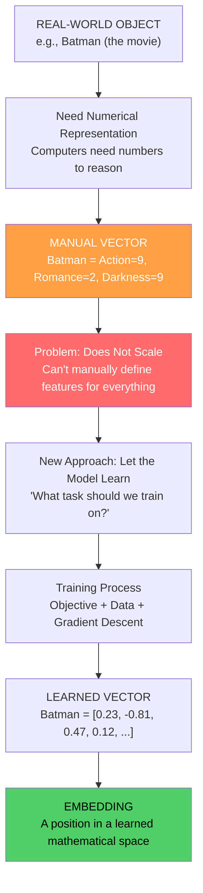
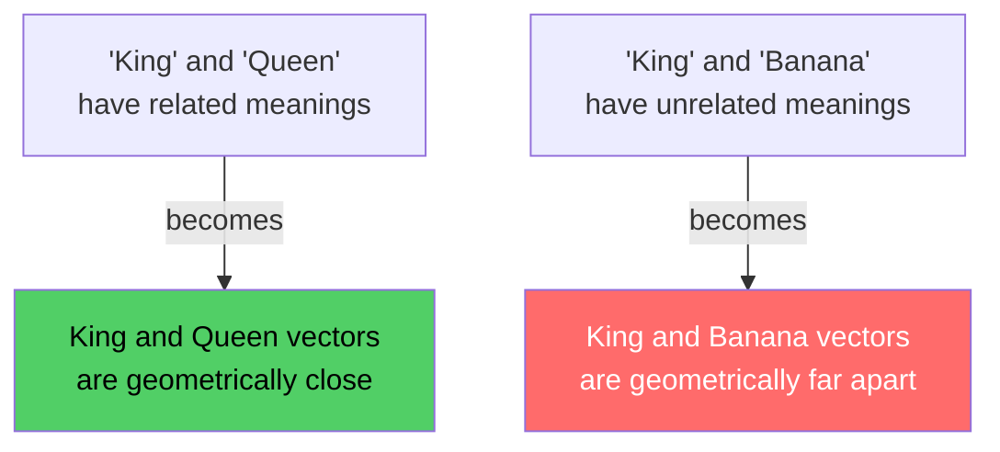
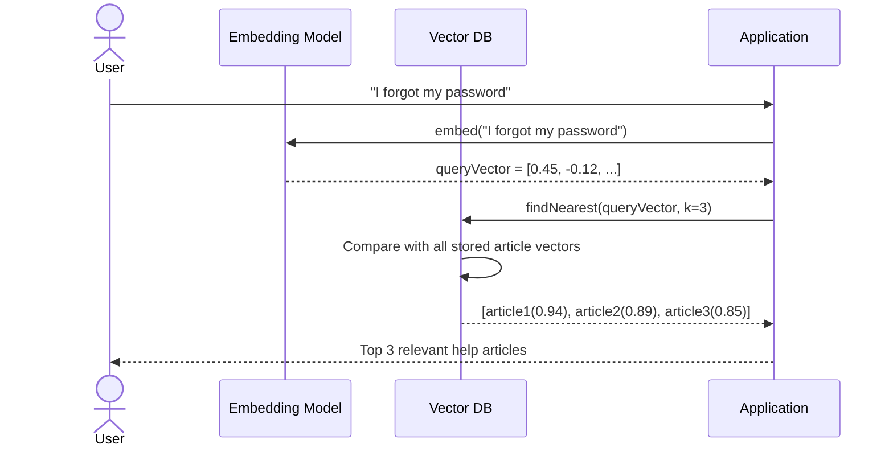
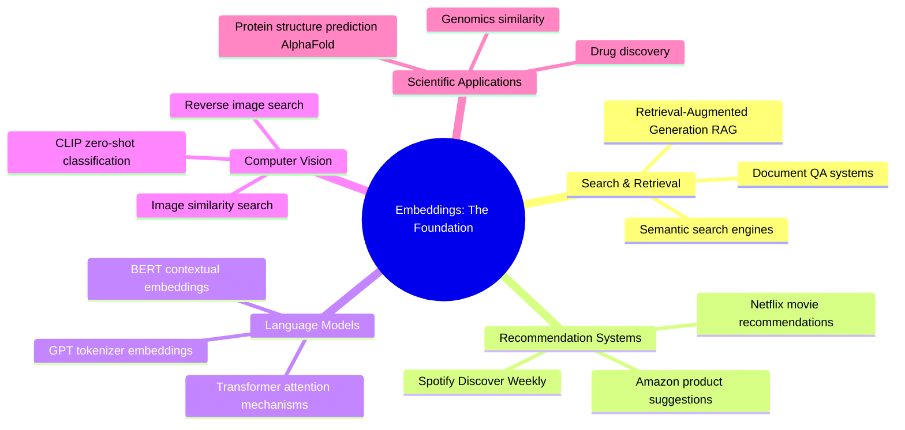
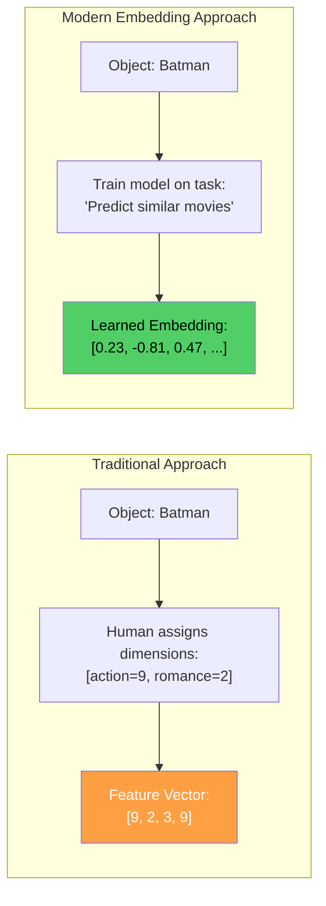
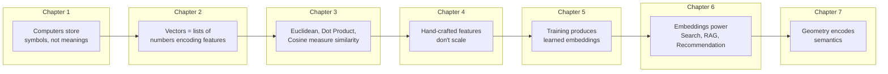

# Chapter 07: The Complete Journey — From Objects to Embeddings

> **Chapter Goal:** Synthesize everything covered in this lecture into a single coherent picture. Trace the complete journey from a real-world object all the way to a meaningful embedding, state the definitive definition, and understand why this idea is so central to modern AI.

---

## 7.1 Where We Started

We began with a simple, concrete problem:

```
Batman
```

A computer can **store** this word (as characters, tokens, or bytes).  
A computer does NOT automatically **understand** what it means.

Humans have rich associations — Superhero, Gotham, Bruce Wayne, Dark, DC Comics. A computer has none of these without learning.

---

## 7.2 The First Attempt: Manual Vectors

Our first solution was to **manually assign numbers** to relevant properties:

```js
const Batman = {
  action:   9,
  romance:  2,
  darkness: 9
};

// As a vector:
// Batman = [9, 2, 9]
```

This **worked** — similarity became computable, a vector space existed, and mathematical operations became possible.

But it **didn't scale**:
- Humans cannot define every useful characteristic of every word, sentence, movie, image, product, and person
- Features depend on the task
- Language is ambiguous and context-dependent
- There are potentially millions of objects to represent

---

## 7.3 The Insight That Changes Everything

Instead of asking:
```
"Which dimensions should we manually create?"
```

We changed the question to:
```
"What task should the system learn to solve?"
```

The useful internal representations **emerge as a consequence** of learning to perform a useful task on large amounts of data.

---

## 7.4 The Complete Progression



---

## 7.5 The Final Definition

> **An embedding is not the meaning itself. It is a *position* inside a learned mathematical space where useful relationships in meaning or behavior become relationships in geometry.**

Let's unpack this carefully:

| Part of the Definition | What It Means |
|---|---|
| "not the meaning itself" | The vector `[0.23, -0.81, ...]` doesn't *contain* Batman's meaning — it's a coordinate |
| "position inside a space" | It's a location in a high-dimensional coordinate system |
| "learned mathematical space" | The space's structure was discovered by training, not designed by humans |
| "useful relationships in meaning..." | Similar movies, similar words, similar intents |
| "...become relationships in geometry" | Close in meaning → close in position |



---

## 7.6 A Complete End-to-End Example

Let's trace through a real scenario: **Semantic Search in a Support Ticket System**

### Setup Phase (Indexing)

```js
// Pseudo-code: Build a searchable knowledge base

const articles = [
  { id: 1, text: "How to reset your password" },
  { id: 2, text: "Changing your login credentials" },
  { id: 3, text: "Account recovery options" },
  { id: 4, text: "Adding items to your shopping cart" },
  { id: 5, text: "Checkout and payment methods" }
];

// Embed each article → get vectors
const articleVectors = articles.map(article => ({
  id: article.id,
  vector: embeddingModel.embed(article.text)
}));

// Store in vector database
vectorDB.insert(articleVectors);
```

### Query Phase (Search)

```js
// User types: "I forgot my password"
const userQuery = "I forgot my password";
const queryVector = embeddingModel.embed(userQuery);

// Find nearest neighbors by cosine similarity
const results = vectorDB.findNearest(queryVector, topK = 3);

// Results (by similarity):
// 1. "How to reset your password"       → similarity: 0.94 ✅
// 2. "Changing your login credentials"  → similarity: 0.89 ✅
// 3. "Account recovery options"         → similarity: 0.85 ✅
// (Shopping cart and payment: ~0.1)     → NOT returned ✅
```

No exact string match was needed. The **semantic content** drove the results.



---

## 7.7 Why This Single Idea Explains So Much

The embedding concept — **geometry encodes semantics** — is the foundation of:



---

## 7.8 Key Differences Across the Lecture



| Aspect | Feature Engineering | Embeddings |
|---|---|---|
| **Who decides dimensions** | Humans | Model (via training) |
| **Number of dimensions** | Typically small (tens) | Typically large (768, 1536, 3072) |
| **Interpretability** | High (human-readable) | Low (latent/opaque) |
| **Scalability** | Poor | Excellent |
| **Task Specificity** | Requires redesign per task | Often transferable |
| **Context Sensitivity** | None (static) | High (contextual embeddings) |
| **Quality** | Depends on domain expertise | Depends on training data and objective |

---

## 7.9 One Final Thought

The most elegant insight of this entire lecture is this:

We started with:
```
Batman
```

A word that carries no mathematical meaning on its own.

We ended with:
```
Batman = [0.23, -0.81, 0.47, 0.12, -0.55, ..., 0.19]   (768 numbers)
```

A point in a 768-dimensional space where:
- **Batman is close to Superman** (both dark superhero movies)
- **Batman is close to The Dark Knight** (same franchise)
- **Batman is far from Titanic** (completely different genre)
- **Batman is far from banana** (completely unrelated)

And we got there **without anyone telling the model** what action means, what genre means, or what a superhero is.

> **The geometry learned itself from the patterns in data. That is the power of embeddings.**

---

## 7.10 Complete Summary of the Entire Lecture



| Chapter | Core Question | Answer |
|---|---|---|
| 1 | Why can't computers understand meaning? | They store symbols, not concepts |
| 2 | How can we represent meaning as numbers? | Feature vectors in d-dimensional space |
| 3 | How do we compare vectors? | Euclidean distance, Dot product, Cosine similarity |
| 4 | Who designs the dimensions? | Nobody can do it at scale — it fails |
| 5 | How do machines learn the right dimensions? | Through training objectives on data |
| 6 | What can we do with embeddings? | Search, RAG, Recommendation, Clustering |
| 7 | What is the core insight? | Geometry encodes semantics |

> **"An embedding is a position inside a learned mathematical space where useful relationships in meaning or behavior become relationships in geometry."**
