# Lecture 07: Vector Embeddings — From First Principles
## Complete Consolidated Course Notes & Engineering Reference

> **Course:** Forward Deployed Engineer (FDE) & Generative AI Systems
> **Topic:** Vector Embeddings — From Symbols to Geometry to Applications
> **Source Material:** [`Notes.pdf`](./Notes.pdf) (41 pages, 37 sections) and [`Excalidraw-Notes.svg`](./Excalidraw-Notes.svg)
> **Snippet Style:** JS / TypeScript-style pseudocode (Node.js runtime) — illustrative, not production code
> **Diagram Format:** Mermaid only
> **Consolidates:** Chapters [01](./01_The_Problem_of_Meaning_in_Computers.md) → [07](./07_The_Complete_Journey_Synthesis.md) of this folder

---

## 📑 Table of Contents

- [Executive Summary: Why Meaning Needs Geometry](#executive-summary-why-meaning-needs-geometry)
  - [The One-Line Thesis](#the-one-line-thesis)
  - [The Core Progression](#the-core-progression)
  - [The Governing Equations](#the-governing-equations)
  - [The Eight Sentences That Define the Lecture](#the-eight-sentences-that-define-the-lecture)
- [Chapter 01: The Problem of Meaning in Computers](#chapter-01-the-problem-of-meaning-in-computers)
  - [1.1 The Gap Between Symbol and Meaning](#11-the-gap-between-symbol-and-meaning)
  - [1.2 Identity Matching vs Semantic Similarity](#12-identity-matching-vs-semantic-similarity)
  - [1.3 Why Mathematics Requires Numbers](#13-why-mathematics-requires-numbers)
  - [1.4 The Traps of Naive Numeric Encoding](#14-the-traps-of-naive-numeric-encoding)
  - [1.5 The Scope of the Problem](#15-the-scope-of-the-problem)
  - [1.6 Chapter Summary and Key Takeaways](#16-chapter-summary-and-key-takeaways)
- [Chapter 02: From Numbers to Vectors](#chapter-02-from-numbers-to-vectors)
  - [2.1 First Attempt: One Number](#21-first-attempt-one-number)
  - [2.2 The Limitation of a Single Dimension](#22-the-limitation-of-a-single-dimension)
  - [2.3 Adding a Second Dimension](#23-adding-a-second-dimension)
  - [2.4 Order Matters: Vectors Are Not Sets](#24-order-matters-vectors-are-not-sets)
  - [2.5 Adding More Dimensions](#25-adding-more-dimensions)
  - [2.6 What Is a Dimension](#26-what-is-a-dimension)
  - [2.7 Vector Space and Continuous Similarity](#27-vector-space-and-continuous-similarity)
  - [2.8 From One Vector to a Matrix](#28-from-one-vector-to-a-matrix)
  - [2.9 Chapter Summary and Key Takeaways](#29-chapter-summary-and-key-takeaways)
- [Chapter 03: Measuring Similarity Between Vectors](#chapter-03-measuring-similarity-between-vectors)
  - [3.1 The Comparison Problem](#31-the-comparison-problem)
  - [3.2 Euclidean Distance](#32-euclidean-distance)
  - [3.3 Why Direction Sometimes Matters More](#33-why-direction-sometimes-matters-more)
  - [3.4 Dot Product](#34-dot-product)
  - [3.5 Cosine Similarity](#35-cosine-similarity)
  - [3.6 Choosing the Right Measure](#36-choosing-the-right-measure)
  - [3.7 Reference Pseudocode and Metric Pairing](#37-reference-pseudocode-and-metric-pairing)
  - [3.8 Chapter Summary and Key Takeaways](#38-chapter-summary-and-key-takeaways)
- [Chapter 04: The Failure of Hand-Crafted Features](#chapter-04-the-failure-of-hand-crafted-features)
  - [4.1 We Are Still Choosing the Dimensions](#41-we-are-still-choosing-the-dimensions)
  - [4.2 A Short History of Feature Engineering](#42-a-short-history-of-feature-engineering)
  - [4.3 Problem 1: How Many Dimensions Should We Create](#43-problem-1-how-many-dimensions-should-we-create)
  - [4.4 Problem 2: Features Depend on the Task](#44-problem-2-features-depend-on-the-task)
  - [4.5 Problem 3: Language Makes Feature Design Impossible](#45-problem-3-language-makes-feature-design-impossible)
  - [4.6 The Scale and Maintenance Problem](#46-the-scale-and-maintenance-problem)
  - [4.7 Why Bigger Sparse Encodings Do Not Save Us](#47-why-bigger-sparse-encodings-do-not-save-us)
  - [4.8 The Question That Changes Everything](#48-the-question-that-changes-everything)
  - [4.9 Chapter Summary and Key Takeaways](#49-chapter-summary-and-key-takeaways)

- [Chapter 05: What Are Embeddings](#chapter-05-what-are-embeddings)
  - [5.1 The Key Insight: Let the Machine Learn](#51-the-key-insight-let-the-machine-learn)
  - [5.2 The Formal Definition](#52-the-formal-definition)
  - [5.3 Where Do Embedding Numbers Come From](#53-where-do-embedding-numbers-come-from)
  - [5.4 Meaning Through Context](#54-meaning-through-context)
  - [5.5 A Toy Training Objective](#55-a-toy-training-objective)
  - [5.6 The Embedding Table](#56-the-embedding-table)
  - [5.7 How Training Changes the Embeddings](#57-how-training-changes-the-embeddings)
  - [5.8 Vector Arithmetic and the Geometry of Meaning](#58-vector-arithmetic-and-the-geometry-of-meaning)
  - [5.9 Does the Machine Discover Features](#59-does-the-machine-discover-features)
  - [5.10 Embeddings as Coordinates on a Map](#510-embeddings-as-coordinates-on-a-map)
  - [5.11 Why This Matters for a Neural Network](#511-why-this-matters-for-a-neural-network)
  - [5.12 Latent Dimensions and Latent Space](#512-latent-dimensions-and-latent-space)
  - [5.13 Chapter Summary and Key Takeaways](#513-chapter-summary-and-key-takeaways)
- [Chapter 06: Vector vs Embedding and What They Unlock](#chapter-06-vector-vs-embedding-and-what-they-unlock)
  - [6.1 The Critical Distinction](#61-the-critical-distinction)
  - [6.2 Almost Anything Can Be Embedded](#62-almost-anything-can-be-embedded)
  - [6.3 The Embedding Model as a Function](#63-the-embedding-model-as-a-function)
  - [6.4 Shared Embedding Spaces and Multi-Modality](#64-shared-embedding-spaces-and-multi-modality)
  - [6.5 The Application Taxonomy](#65-the-application-taxonomy)
  - [6.6 The Bridge Embeddings Create](#66-the-bridge-embeddings-create)
  - [6.7 Reference Table of Embedding Models](#67-reference-table-of-embedding-models)
  - [6.8 Reference Workflow in Pseudocode](#68-reference-workflow-in-pseudocode)
  - [6.9 Operational Rules That Follow From This Chapter](#69-operational-rules-that-follow-from-this-chapter)
  - [6.10 Chapter Summary and Key Takeaways](#610-chapter-summary-and-key-takeaways)
- [Chapter 07: The Complete Journey](#chapter-07-the-complete-journey)
  - [7.1 Where We Started](#71-where-we-started)
  - [7.2 The First Attempt: Manual Vectors](#72-the-first-attempt-manual-vectors)
  - [7.3 The Insight That Changes Everything](#73-the-insight-that-changes-everything)
  - [7.4 The Complete Progression](#74-the-complete-progression)
  - [7.5 The Final Definition Unpacked](#75-the-final-definition-unpacked)
  - [7.6 End-to-End Worked Example: Support Ticket Routing](#76-end-to-end-worked-example-support-ticket-routing)
  - [7.7 Feature Engineering vs Embeddings](#77-feature-engineering-vs-embeddings)
  - [7.8 The Seven Ideas in Seven Sentences](#78-the-seven-ideas-in-seven-sentences)
  - [7.9 One Final Thought](#79-one-final-thought)
  - [7.10 Complete Lecture Summary Table](#710-complete-lecture-summary-table)
- [Appendix A: Formula Sheet](#appendix-a-formula-sheet)
- [Appendix B: Glossary](#appendix-b-glossary)
- [Appendix C: Common Misconceptions](#appendix-c-common-misconceptions)
- [Appendix D: Self-Check Questions](#appendix-d-self-check-questions)
- [Appendix E: Twenty Cardinal Takeaways](#appendix-e-twenty-cardinal-takeaways)
- [Appendix F: How Lecture 07 Connects to Lectures 08 and 09](#appendix-f-how-lecture-07-connects-to-lectures-08-and-09)
- [Appendix G: Reading Order and Revision Map](#appendix-g-reading-order-and-revision-map)

---

## Executive Summary: Why Meaning Needs Geometry

### The One-Line Thesis

> **A computer cannot store meaning; it can only store numbers. An embedding is the bridge: a *position* inside a learned mathematical space where useful relationships in meaning or behaviour become relationships in geometry.**

Everything in this lecture follows from that sentence. The lecture is not about a library, an API, or a database — it is about *why* the vector is the correct data type for meaning.

### The Core Progression

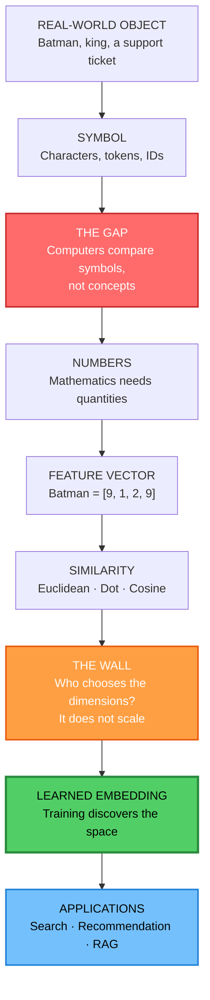

### The Governing Equations

| Concept | Formula | Engineering Meaning |
| :--- | :--- | :--- |
| Euclidean distance | $d(\mathbf{a},\mathbf{b})=\sqrt{\sum_{i=1}^{d}(a_i-b_i)^2}$ | Absolute geometric gap; sensitive to scale |
| Dot product | $\mathbf{a}\cdot\mathbf{b}=\sum_{i=1}^{d}a_ib_i=\lVert\mathbf{a}\rVert\lVert\mathbf{b}\rVert\cos\theta$ | Alignment of direction *and* magnitude |
| Cosine similarity | $\cos\theta=\dfrac{\mathbf{a}\cdot\mathbf{b}}{\lVert\mathbf{a}\rVert\,\lVert\mathbf{b}\rVert}$ | Pure directional similarity, scale-invariant |
| Embedding model | $f:\mathcal{X}\rightarrow\mathbb{R}^{d}$ | Any object becomes a fixed-length vector |
| Embedding matrix | $E\in\mathbb{R}^{V\times d}$ | One learned row per vocabulary item |
| Lookup | $\mathbf{v}_t=E[t]$ | "Embedding" is literally a row read |
| Gradient step | $\theta\leftarrow\theta-\eta\nabla_\theta L$ | How random vectors become meaningful |
| Analogy | $\mathbf{v}_{\text{king}}-\mathbf{v}_{\text{man}}+\mathbf{v}_{\text{woman}}\approx\mathbf{v}_{\text{queen}}$ | Relationships become directions |

### The Eight Sentences That Define the Lecture

> 1. *Representing a symbol is not the same as representing meaning.*
> 2. *Similarity can only be computed on numbers — so meaning must first become numbers.*
> 3. *One number captures one property; a vector captures many properties at once.*
> 4. *Every similarity metric embeds an assumption about what "similar" should mean.*
> 5. *Hand-crafted features fail not because humans are bad at features, but because the space of possible features is unbounded, task-dependent, and ambiguous.*
> 6. *We do not design an embedding; we design a training objective and let the geometry emerge.*
> 7. *Every embedding is a vector, but not every vector is an embedding.*
> 8. *An embedding is not the meaning — it is a coordinate in a space where meaning has been turned into distance.*

---

## Chapter 01: The Problem of Meaning in Computers

> **Chapter goal:** Establish why a computer cannot "understand" a word, why string equality is not similarity, why mathematics forces us into numbers, and why naive numeric encodings fail. This chapter defines the problem that the remaining six chapters solve.

### 1.1 The Gap Between Symbol and Meaning

Give a computer the word:

```
Batman
```

For a human, that single token instantly activates a dense web of associations:

| Association | Type | Example |
| :--- | :--- | :--- |
| Superhero | Category | belongs to the superhero class |
| Bruce Wayne | Identity | alter ego |
| Gotham | Setting | fictional city |
| DC | Publisher | franchise membership |
| Dark / Serious | Tone | emotional register |
| Crime / Vigilante | Theme | narrative content |
| Action | Genre | viewing expectation |
| Rich | Attribute | character background |

A computer has none of this. At the lowest level it stores *characters*, *codepoints*, *bytes*, or *tokens*:

```
B  a  t  m  a  n
66 97 116 109 97 110      (ASCII)
```

It can reproduce the string perfectly and still know nothing about what `Batman` represents.

> **Core insight:** Representing a symbol is not the same as representing meaning.

This distinction is the entire motivation for the lecture. The symbol is a *label*; the meaning is a *position in a conceptual space*. Labels support lookup. Positions support arithmetic.

### 1.2 Identity Matching vs Semantic Similarity

Traditional systems are extremely good at one operation: **exact matching**.

```js
// Pseudocode: identity, not similarity
const a = "Batman";
const b = "Batman";
const c = "Superman";

a === b;   // true  → identical strings
a === c;   // false → different strings
```

That answer is correct and completely useless for the question we usually care about. It tells us whether two strings are **the same object**, not whether they are **related concepts**.

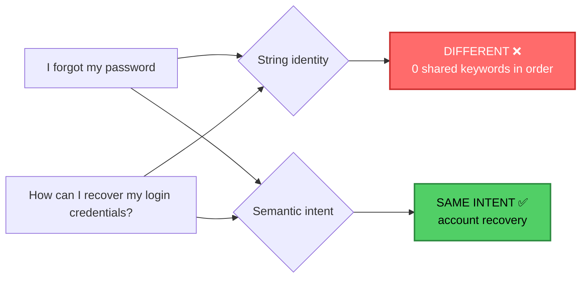

| Question | Exact matching answers | Business needs |
| :--- | :--- | :--- |
| Are these the same string? | ✅ | rarely asked |
| Do these mean the same thing? | ❌ | asked constantly |
| How similar are they, on a scale? | ❌ | ranking, thresholds, top-k |
| Which of 10 million items is closest? | ❌ (no ordering) | search, recommendation |

Two support tickets written by two customers can share **zero** words and describe the **same** problem. A keyword system returns nothing; a customer waits; the ticket escalates.

> **The central problem of the lecture:** *How do we convert meaning into something mathematics can operate on?*

### 1.3 Why Mathematics Requires Numbers

Machine-learning models, neural networks, and optimisation algorithms operate on numbers — specifically on vectors, matrices, and tensors of real numbers.

There is no useful arithmetic we can perform directly on:

```
Batman
Superman
Interstellar
Pizza
```

Once those become numbers, an enormous toolkit becomes available:

| Operation | What it unlocks |
| :--- | :--- |
| Addition / subtraction | composing and contrasting concepts |
| Multiplication | weighting, scaling, projection |
| Distance | "how close are these two things?" |
| Angle | "do these point the same way?" |
| Probability | calibrated ranking and uncertainty |
| Matrix multiplication | neural network forward passes, batch scoring |
| Gradient | learning representations from data |

So the first requirement is:

> **Turn real-world things into numerical representations.**

The second, harder requirement is implicit: those numbers must **preserve the relationships we care about**. A representation that destroys structure is worse than useless — it is confidently wrong.

### 1.4 The Traps of Naive Numeric Encoding

The first instinct is to simply assign a number to every object:

```
Batman    → 43
Superman  → 23
Banana    → 12
```

This is worse than it looks, because it silently injects three false claims into every downstream computation:

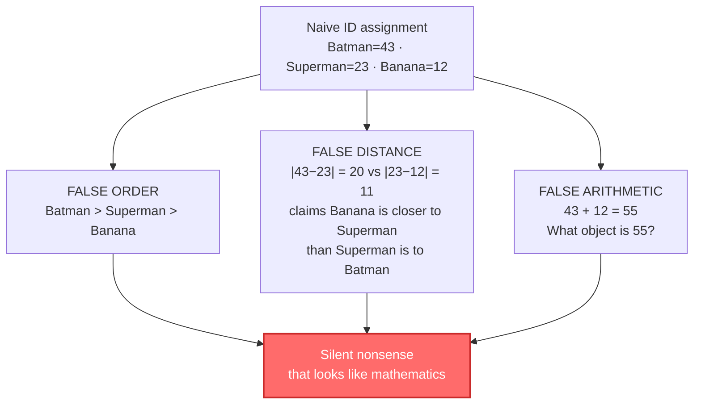

An ID is a **label**, not a **measurement**. Integer IDs (and token IDs inside an LLM vocabulary) carry no semantics: ID `1000` is not "twice as much" as ID `500`, and consecutive IDs are not conceptually adjacent.

**Two encodings that are legitimate — and their limits:**

| Encoding | Shape | What it preserves | What it breaks |
| :--- | :--- | :--- | :--- |
| **Ordinal** (`small=1, medium=2, large=3`) | 1 number | genuine order and rough spacing | only valid when the property truly is ordered |
| **One-hot** (`cat=[1,0,0]`, `dog=[0,1,0]`) | $V$ dimensions, one `1` | identity, zero false order | all items are equidistant; no notion of relatedness; enormous and sparse |

One-hot encoding is the honest version of an ID: it says "these are different categories" and nothing more. Because every pair has distance $\sqrt{2}$ and cosine $0$, one-hot vectors cannot express that `cat` is more similar to `dog` than to `database`.

> **The requirement is therefore not "any numbers" — it is numbers whose geometry encodes the relationships we care about.**

### 1.5 The Scope of the Problem

This is not a language problem. It is a *representation* problem, and it appears wherever software must reason about the real world:

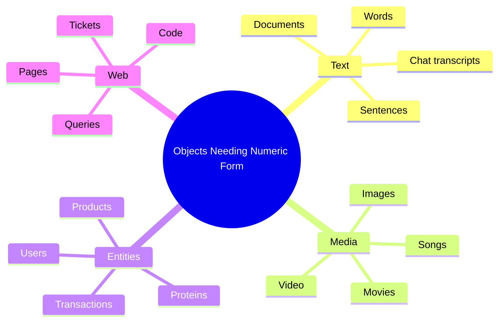

The problem predates LLMs by decades. Recommendation systems in the 2000s, search engines in the 2010s, and modern RAG pipelines in the 2020s are all variations of the same question: *what numbers should represent this thing?*

### 1.6 Chapter Summary and Key Takeaways

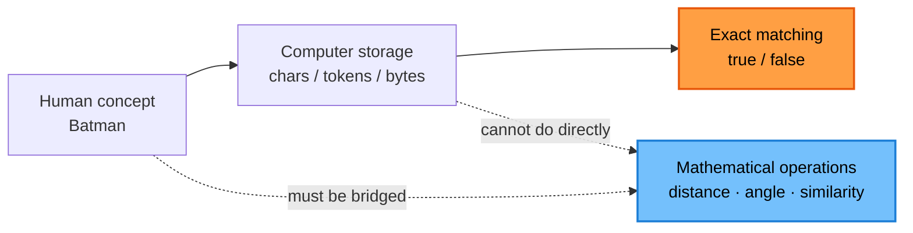

1. **Computers store symbols, not meanings** — perfect storage, zero understanding.
2. **String equality answers identity, not similarity** — the questions business actually asks are comparative.
3. **Mathematics is the only scalable reasoning substrate we have** — and it requires numbers.
4. **Random or sequential numbers fabricate structure** — order, distance, and arithmetic become meaningless.
5. **One-hot encoding is honest but flat** — it preserves identity while discarding all relatedness.
6. **The goal is a numeric representation whose geometry mirrors semantics** — that goal is the subject of Chapter 02.

---

## Chapter 02: From Numbers to Vectors

> **Chapter goal:** Build intuition for vectors as *lists of measurements*, show why a single number is never enough, explain what a dimension is, and establish the shift from boolean identity to continuous similarity.

### 2.1 First Attempt: One Number

Forget language. Imagine building a movie recommender and assigning every movie a single **action score** from 0 to 10:

| Movie | Action score |
| :--- | ---: |
| Avengers | 10 |
| Batman | 9 |
| Interstellar | 6 |
| Titanic | 2 |
| Hera Pheri | 1 |

Those names just became numbers:

```
Batman     → 9
Avengers   → 10
Titanic    → 2
```

For the first time, similarity is *measurable*:

```
|10 − 9| = 1   → Batman is close to Avengers
|9 − 2|  = 7   → Batman is far from Titanic
```

We have created a **one-dimensional space** — a number line — and every movie now has a position on it:

```
0----1----2----3----4----5----6----7----8----9----10
     |    |              |              |    |
  Hera  Titanic      Interstellar   Batman Avengers
  Pheri
```

### 2.2 The Limitation of a Single Dimension

Now look at two movies that landed on the same score:

```
Titanic     = 2
Hera Pheri  = 2
```

If action is the only axis, the system concludes these two films are **identical in every way that matters**. They are not:

| Movie | Genre reality | Tone | Language |
| :--- | :--- | :--- | :--- |
| Titanic | romantic drama / disaster | tragic, emotional | English |
| Hera Pheri | slapstick comedy | absurd, chaotic | Hindi |

> **One number can only measure one property. Real objects have many properties — and similarity depends on which properties you chose to measure.**

This is the first concrete failure of low-dimensional representation, and it is not a maths bug. The arithmetic is perfect; the *representation* is impoverished.

### 2.3 Adding a Second Dimension

Add **comedy** as a second measured characteristic:

| Movie | Action | Comedy |
| :--- | ---: | ---: |
| Batman | 9 | 1 |
| Avengers | 10 | 7 |
| Titanic | 2 | 1 |
| Hera Pheri | 2 | 10 |
| Interstellar | 6 | 1 |

Now `Batman` is no longer the scalar `9`. It becomes the ordered pair:

```
Batman = [9, 1]
```

Each movie is a **point** in a 2D plane:

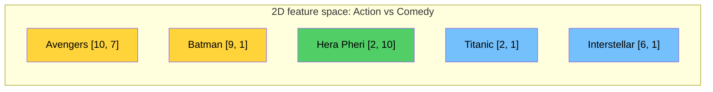

Plotted as coordinates:

```
Comedy
  10 |  ● Hera Pheri [2,10]
   9 |
   8 |
   7 |                    ● Avengers [10,7]
   6 |
   5 |
   4 |
   3 |
   2 |
   1 |  ● Titanic [2,1]  ● Interstellar [6,1]   ● Batman [9,1]
     +----+----+----+----+----+----+----+----+----+----+
     0    1    2    3    4    5    6    7    8    9   10   Action
```

Two immediate wins:

1. **Titanic and Hera Pheri separate** — same action, radically different comedy.
2. **Batman and Avengers cluster** — both high action, low-to-mid comedy.

The representation now carries enough information for the correct answer to be *derivable* rather than assumed.

### 2.4 Order Matters: Vectors Are Not Sets

These two vectors are different objects:

```
[9, 2]  ≠  [2, 9]
```

Because position carries meaning:

| Vector | Dimension 1 (Action) | Dimension 2 (Comedy) | Reads as |
| :--- | ---: | ---: | :--- |
| `[9, 2]` | 9 | 2 | very action-heavy, barely funny |
| `[2, 9]` | 2 | 9 | barely action, very funny |

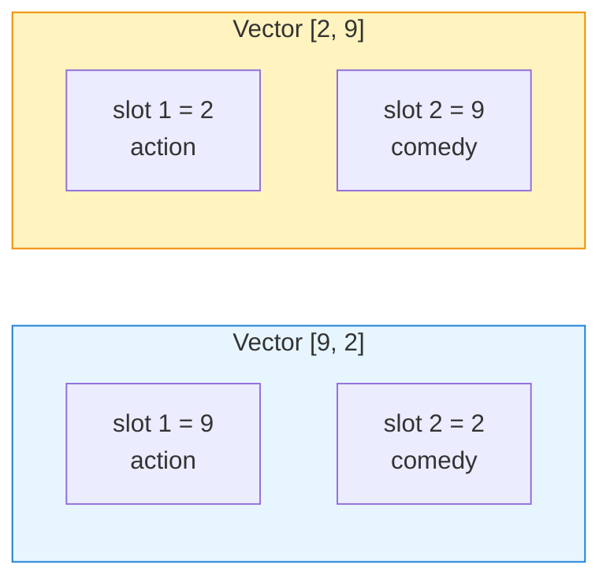

Formally, a vector is:

> **An ordered collection of numbers representing something.**

The word *ordered* is doing real work. A set $\{9,2\}$ has no slots; a vector has fixed, named positions. Every consumer of a vector — a distance function, a neural network, a database — relies on the contract that **slot $i$ always means the same thing** across every vector in the collection.

### 2.5 Adding More Dimensions

We can keep measuring:

```js
// Pseudocode: Batman as a 6-dimensional feature vector
const batman = [
  9,   // action
  1,   // comedy
  2,   // romance
  9,   // darkness
  8,   // violence
  7    // mystery
];
```

| Dimensionality | Expressive power | Example |
| :--- | :--- | :--- |
| 1D | one trait | action only |
| 2D | two traits, separates obvious collisions | action + comedy |
| 3D | a point in physical space, visualisable | + romance |
| 10D–100D | dozens of independent axes | hand-built product features |
| 768D | modern NLP embedding (BERT-base) | learned text representations |
| 1536D | `text-embedding-3-small` / `ada-002` | production semantic search |
| 3072D | `text-embedding-3-large` | higher-fidelity retrieval |

> **Humans cannot visualise 768 dimensions. Mathematics has no such limitation — and neither does the code we write.**

Two engineering consequences follow immediately:

1. **Storage is linear in $d$.** One 1536-dim `float32` vector is $1536 \times 4 = 6{,}144$ bytes ≈ 6 KB. A million of them ≈ 6 GB.
2. **Comparison cost is linear in $d$.** Comparing two vectors costs $d$ multiply-adds; scoring $N$ vectors costs $O(N \times d)$ per query. This is exactly the arithmetic wall analysed in Lecture 09.

### 2.6 What Is a Dimension

Each slot in the vector is one **dimension** — one independent axis of description:

```
[9]                      → 1 dimension
[9, 2]                   → 2 dimensions
[9, 2, 3]                → 3 dimensions
[0.12, −0.37, ..., 0.22] → d dimensions
```

In 2D you have X and Y. In 3D you have X, Y, Z. Beyond 3D, "dimension" stops being spatial and becomes *a measurable quality*: one axis per thing you decided (or trained) to measure.

### 2.7 Vector Space and Continuous Similarity

A **vector space** is the set of all vectors of a given dimension, plus the operations (add, scale, measure distance) defined on them.

```
Batman   = [9, 1]
Titanic  = [2, 1]
Avengers = [10, 7]
```

Once objects are *points*, two questions become answerable:

- Which objects are **close**? → likely similar
- Which are **far**? → likely different

This changes the *type* of answer the system can produce:

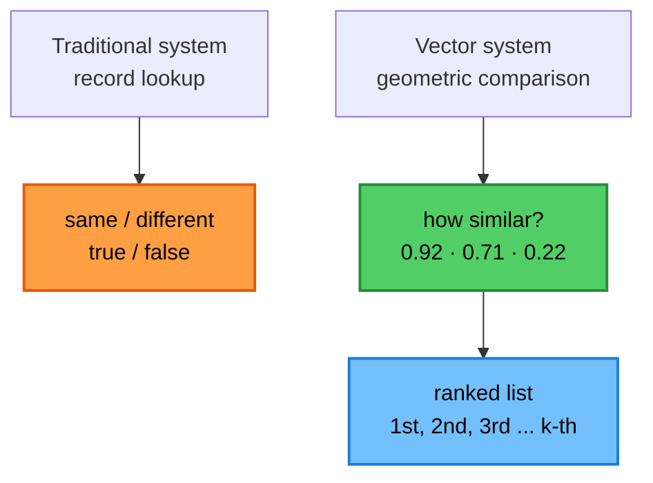

> **Binary membership becomes a continuous score; a continuous score becomes a ranking.** That progression — membership → similarity → ranking — is the mechanical heart of every search and recommendation product.

### 2.8 From One Vector to a Matrix

Production code never scores a single vector. It holds a **catalogue** and scores it in bulk. Stacking $N$ vectors of dimension $d$ produces a matrix:

$$
X \in \mathbb{R}^{N \times d}, \qquad X = \begin{bmatrix}
9 & 1 & 2 & 9 & 8 & 7\\
10 & 7 & 3 & 4 & 6 & 3\\
2 & 1 & 9 & 3 & 1 & 2
\end{bmatrix}
$$

Now "compare everything to a query" becomes a single algebraic operation — a matrix–vector product — which is why GPUs (and vector databases) are the right hardware for this problem:

$$
\text{score} = X\mathbf{q} \in \mathbb{R}^{N}
$$

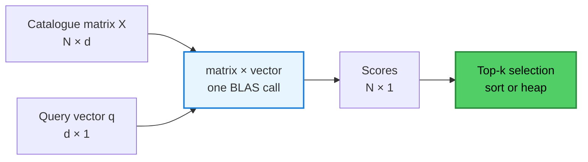

This is precisely the shape Lecture 08 builds by hand (a small in-memory matrix) and Lecture 09 replaces with an index at scale.

### 2.9 Chapter Summary and Key Takeaways

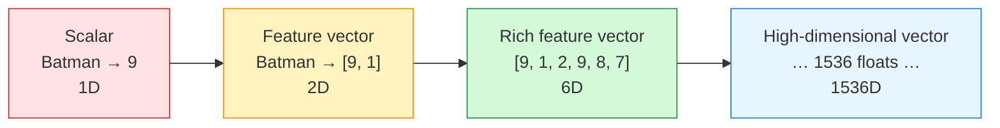

1. **A scalar captures one property** — useful, but almost always insufficient.
2. **A vector captures many properties simultaneously** — the minimum viable representation of a real object.
3. **Order is part of the meaning** — slot $i$ must mean the same thing in every vector.
4. **Vector spaces convert membership into distance, and distance into ranking.**
5. **Higher dimensionality increases expressiveness and cost together** — quality and $O(N \times d)$ move in the same direction.
6. **Bulk scoring is linear algebra** — which is why this idea scales to GPUs and vector databases.

The obvious question is now unavoidable: *how exactly do we measure "close"?* That is Chapter 03.

---

## Chapter 03: Measuring Similarity Between Vectors

> **Chapter goal:** Understand the three canonical similarity measures — Euclidean distance, dot product, and cosine similarity — including their geometry, their biases, and the conditions under which each is the correct engineering choice.

### 3.1 The Comparison Problem

Once objects are points, we need a *scoring function*:

$$
s(\mathbf{a}, \mathbf{b}) \rightarrow \mathbb{R}
$$

Canonical toy dataset used throughout this chapter:

| Movie | Vector | Meaning of slots |
| :--- | :--- | :--- |
| Batman | `[9, 1]` | high action, low comedy |
| Avengers | `[10, 7]` | high action, mid comedy |
| Hera Pheri | `[2, 10]` | low action, high comedy |

> **Note on source consistency:** the slide deck's 2D feature table lists `Titanic = [2, 1]`, but its similarity sections use the coordinates `[2, 10]` and label them "Titanic". `[2, 10]` is `Hera Pheri` in the canonical table. The arithmetic in the slides is unaffected; these notes use **Hera Pheri** so that one consistent dataset is used throughout. §3.2 shows what changes if you instead use `Titanic = [2, 1]` — and why that difference is itself a lesson.

Three families of measure exist:

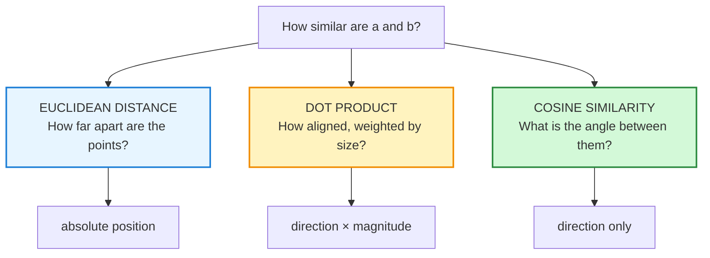

> **The intuition matters more than the formula.** Each metric answers a *different question*; picking the wrong one silently optimises for the wrong notion of similarity.

### 3.2 Euclidean Distance

Euclidean distance is ordinary straight-line distance — the length of the segment joining two points.

$$
d(\mathbf{a},\mathbf{b}) = \lVert\mathbf{a}-\mathbf{b}\rVert_2 = \sqrt{\sum_{i=1}^{d}(a_i-b_i)^2}
$$

**Worked example:**

```
Batman   = [9,  1]
Avengers = [10, 7]
Hera     = [2, 10]

d(Batman, Avengers) = √((10−9)² + (7−1)²)  = √(1 + 36)  = √37  ≈ 6.08
d(Batman, Hera)     = √((2−9)²  + (10−1)²) = √(49 + 81) = √130 ≈ 11.40
```

Interpretation:

```
smaller distance → closer → more similar
larger  distance → farther → less similar
```

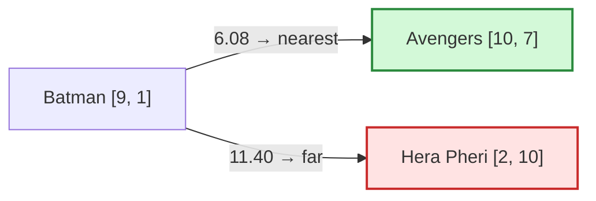

**Properties that matter in practice:**

| Property | Consequence |
| :--- | :--- |
| Translation-sensitive | adding a constant to every coordinate changes distances |
| Scale-sensitive | a feature measured in `0–10` is drowned out by one measured in `0–100000` |
| Requires comparable units | mixing rupees with ratings produces meaningless geometry |
| $O(d)$ per pair | cheap, and vectorisable into `L2` distance in any vector DB |

**The critical warning — bad representation, correct arithmetic:**

```js
// Pseudocode: a representation that destroys meaning
const batman  = [6, 7];   // [letters in title, release month]
const titanic = [7, 12];  // [letters in title, release month]
```

`Batman` and `Titanic` are now "close" because both titles are 6–7 characters long. The distance is computed perfectly; the answer is nonsense.

> **Similarity is only as meaningful as the representation it operates on.** No metric can rescue features that do not encode what you care about.

**A second, subtler warning — the metric can overrule your intent.** Recompute with the slide table's `Titanic = [2, 1]`:

```
d(Batman, Titanic) = √((2−9)² + (1−1)²) = √49 = 7.00
```

Titanic is now *closer* to Batman than Hera Pheri is — and under cosine it scores **0.938**, higher than Avengers' **0.877**, because both Batman and Titanic sit on the low-comedy axis. Nothing is broken mathematically; a 2-feature space simply cannot distinguish "dark action film" from "romantic tragedy". This is the cleanest possible demonstration of why **feature design, not metric choice, is the real bottleneck** — the subject of Chapter 04.

### 3.3 Why Direction Sometimes Matters More

Consider two users with `[action preference, romance preference]`:

```
User A = [9,  1]
User B = [90, 10]
```

Absolute values differ by a factor of ten, so:

$$
d(A,B)=\sqrt{(90-9)^2+(10-1)^2}=\sqrt{6561+81}=\sqrt{6642}\approx 81.5
$$

Euclidean distance calls them **extremely dissimilar**.

But the *ratio* is identical:

```
User A:  9 : 1  = 9× more action than romance
User B: 90 : 10 = 9× more action than romance
```

Geometrically, `B = 10 × A` — they are the **same ray** from the origin:

```
              ↗ User B [90, 10]
            /
          /
        ↗ User A [9, 1]
      /
    +────────────────────
```

| Question | Euclidean answer | What the business means |
| :--- | :--- | :--- |
| Same taste *pattern*? | "far apart" ❌ | yes — same 9:1 preference |
| Same *intensity*? | "very different" ✅ | maybe — one user is simply more engaged |

> **Euclidean distance conflates "how much" with "of what".** When the *shape* of a preference matters and the magnitude is an artefact (session length, click volume, document length), direction is the better signal.

### 3.4 Dot Product

The dot product multiplies corresponding components and sums:

$$
\mathbf{a}\cdot\mathbf{b}=\sum_{i=1}^{d}a_ib_i=\lVert\mathbf{a}\rVert\,\lVert\mathbf{b}\rVert\cos\theta
$$

**Worked example:**

```
A = [2, 3]
B = [4, 5]

A · B = (2 × 4) + (3 × 5) = 8 + 15 = 23
```

The dot product simultaneously encodes two things:

| Signal | How it enters |
| :--- | :--- |
| Direction | $90°$ apart → 0; opposite → negative; aligned → positive |
| Magnitude | doubling a vector doubles the score, even with identical direction |

```
A = [2, 3]      →  A · B = 23
A' = [20, 30]   →  A' · B = 230      same direction, 10× score
```

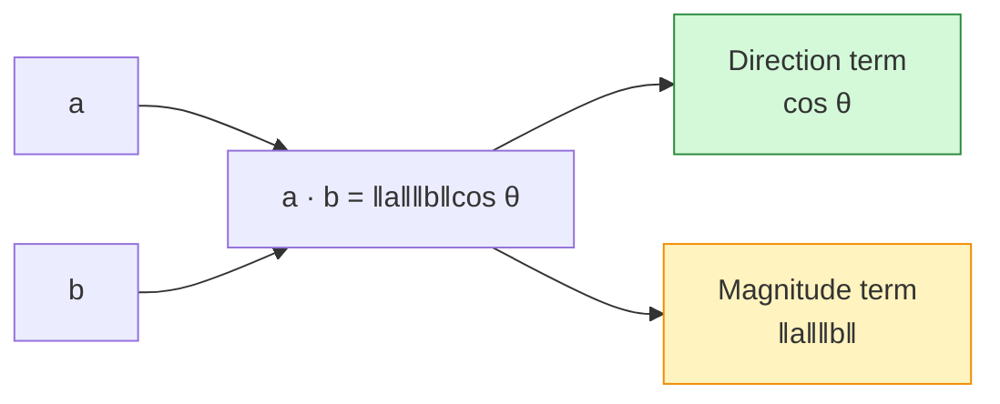

**Two identities worth memorising:**

1. **Squared distance via dot product** — the reason L2 and inner-product indexes are often interchangeable up to a constant:

$$
\lVert\mathbf{a}-\mathbf{b}\rVert^2=\lVert\mathbf{a}\rVert^2+\lVert\mathbf{b}\rVert^2-2\,\mathbf{a}\cdot\mathbf{b}
$$

2. **Unit vectors collapse the distinction** — if $\lVert\mathbf{a}\rVert=\lVert\mathbf{b}\rVert=1$:

$$
\mathbf{a}\cdot\mathbf{b}=\cos\theta \qquad\text{and}\qquad \lVert\mathbf{a}-\mathbf{b}\rVert^2 = 2-2\cos\theta
$$

So for **normalised** embeddings, ranking by dot product, by cosine, and by Euclidean distance produce the **same order**. This is why normalisation is a first-class operational concern (see §3.7).

> **Magnitude bias warning:** raw dot product favours long documents, active users, and high-norm vectors. Use it deliberately (when "more evidence" should score higher) — never accidentally.

### 3.5 Cosine Similarity

Cosine similarity normalises the dot product by both magnitudes, leaving only the angle:

$$
\cos\theta=\frac{\mathbf{a}\cdot\mathbf{b}}{\lVert\mathbf{a}\rVert\,\lVert\mathbf{b}\rVert}
=\frac{\sum_i a_ib_i}{\sqrt{\sum_i a_i^2}\;\sqrt{\sum_i b_i^2}}
$$

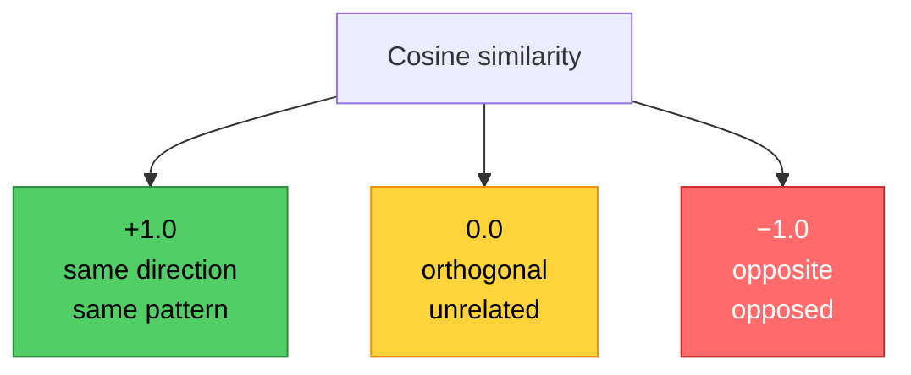

**Worked example — Batman vs the catalogue:**

```
Batman   = [9, 1]     ‖B‖ = √82  ≈ 9.055
Avengers = [10, 7]    ‖A‖ = √149 ≈ 12.207
Hera     = [2, 10]    ‖H‖ = √104 ≈ 10.198

cos(Batman, Avengers) = (9×10 + 1×7) / (9.055 × 12.207)
                      = 97 / 110.52
                      ≈ 0.878

cos(Batman, Hera)     = (9×2 + 1×10) / (9.055 × 10.198)
                      = 28 / 92.35
                      ≈ 0.303
```

Batman is directionally close to Avengers (0.88) and nearly orthogonal to Hera Pheri (0.30) — matching human judgement.

**Back to User A vs User B:**

```
A = [9, 1], B = [90, 10]

A · B = 810 + 10 = 820
‖A‖ = 9.055, ‖B‖ = 90.554

cos = 820 / (9.055 × 90.554) = 820 / 820 = 1.000
```

Exactly `1.0`, because `B = 10 × A` is a scalar multiple of `A`. The slide's `0.999` is a rounding artefact of two-decimal magnitudes.

> **Cosine is scale-invariant by construction** — which is why it dominates text retrieval, where document length is an artefact rather than a signal.

### 3.6 Choosing the Right Measure

| Measure | Question it answers | Sensitive to magnitude | Range | Typical use |
| :--- | :--- | :--- | :--- | :--- |
| **Euclidean ($L_2$)** | How far apart are these points? | ✅ Yes | $[0, \infty)$ | physically scaled features; image/pixel spaces; clustering with `k-means` |
| **Dot product (inner product)** | How aligned, weighted by strength? | ✅ Yes | $(-\infty, \infty)$ | recommendation with implicit feedback; maximum inner product search (MIPS) |
| **Cosine similarity** | What is the angle between them? | ❌ No | $[-1, 1]$ (often $[0,1]$ for text) | semantic search, document similarity, embedding retrieval |

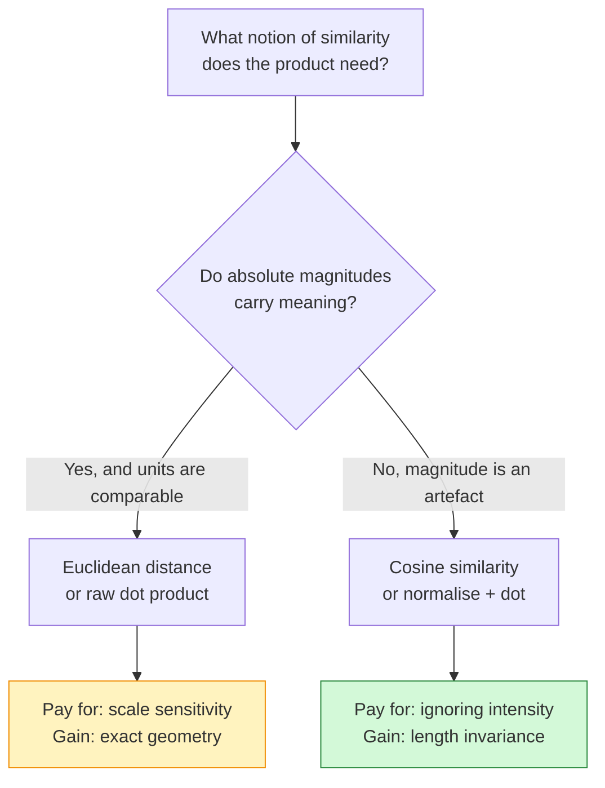

**Rule of thumb for AI systems:**

> If the vectors come from an **embedding model**, use **cosine** (or normalise then use dot product). If the vectors are **hand-built features with real units**, use **Euclidean** — and standardise your features first.

**Operational pairing — the metric must match the index:**

| Store / index setting | Score returned | What to do |
| :--- | :--- | :--- |
| `cosine` | cosine similarity (higher = closer) | use directly |
| `inner_product` / `dot` | raw dot product | normalise inputs, or verify model was trained for it |
| `l2` / `euclidean` | distance (lower = closer) | invert or negate before sorting descending |

Mixing a cosine query with an `l2` index produces plausible-looking but wrong rankings — one of the most common production bugs in retrieval systems.

### 3.7 Reference Pseudocode and Metric Pairing

```ts
// Pseudocode — illustrative, not production code

function dot(a: number[], b: number[]): number {
  let sum = 0;
  for (let i = 0; i < a.length; i++) sum += a[i] * b[i];
  return sum;
}

function norm(a: number[]): number {
  return Math.sqrt(dot(a, a));          // √(a · a)
}

function euclidean(a: number[], b: number[]): number {
  let sum = 0;
  for (let i = 0; i < a.length; i++) {
    const d = a[i] - b[i];
    sum += d * d;
  }
  return Math.sqrt(sum);                // lower = closer
}

function cosine(a: number[], b: number[]): number {
  const denom = norm(a) * norm(b);
  if (denom === 0) return 0;            // guard: zero vector has no direction
  return dot(a, b) / denom;             // higher = closer, range [-1, 1]
}

// Normalise ONCE at write time, then use plain dot product at query time.
function normalize(a: number[]): number[] {
  const n = norm(a);
  if (n === 0) return a.slice();        // never divide by zero
  return a.map((v) => v / n);
}

// Top-k over a small in-memory catalogue: O(N × d) + O(N log k)
function topK(
  query: number[],
  catalogue: { id: string; vector: number[] }[],
  k: number,
): { id: string; score: number }[] {
  const scored = catalogue.map((item) => ({
    id: item.id,
    score: cosine(query, item.vector),
  }));
  scored.sort((x, y) => y.score - x.score);
  return scored.slice(0, k);
}
```

**Usage:**

```ts
const batman   = [9, 1];
const avengers = [10, 7];
const hera     = [2, 10];

cosine(batman, avengers);    // ≈ 0.878 → similar direction
cosine(batman, hera);        // ≈ 0.303 → nearly orthogonal
euclidean(batman, avengers); // ≈ 6.08  → nearest neighbour
```

**Engineering notes that survive contact with production:**

1. **Guard zero vectors.** A zero vector has no direction; cosine is undefined (`0/0`). Return `0` explicitly instead of `NaN` — NaN silently poisons sorts and rankings.
2. **Store unit-normalised vectors** if you plan to use cosine at scale. Then cosine becomes a single dot product, saving two square roots per candidate — at 10M candidates that is 20M avoidable `sqrt` calls per query.
3. **Validate dimensionality** before scoring. Comparing a 1536-dim query to a 3072-dim index should throw, not silently compare the first 1536 slots.
4. **Score in one numeric precision.** Mixed `float32`/`float64` produces tiny score differences that break tie-breaking and cache-consistency tests.
5. **Never compare similarities across different models.** A `0.82` from model A and a `0.82` from model B are numbers from different universes.

### 3.8 Chapter Summary and Key Takeaways

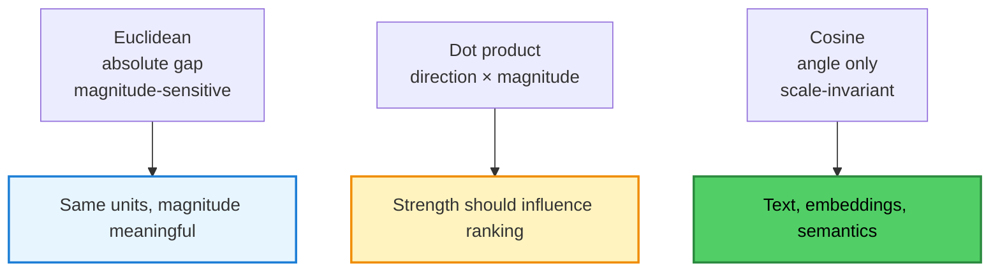

1. **All three metrics are valid; they answer different questions.** Choose the one matching the product's definition of "similar".
2. **Euclidean distance is magnitude-sensitive** — correct when units are real, misleading when scale is an artefact.
3. **Dot product fuses direction and magnitude** — powerful, but biased toward high-norm vectors.
4. **Cosine isolates direction** and is the default for embedding-based retrieval.
5. **For unit-normalised vectors all three rankings agree** ($\lVert a-b\rVert^2=2-2\cos\theta$).
6. **The metric cannot fix the representation.** A poor feature set yields confident nonsense under every formula.
7. **Metric choice is a system-wide contract** — the same metric must be used at index time, query time, and evaluation time.

Chapter 04 now attacks the assumption underneath all of this: that *we* get to choose the dimensions.

---

## Chapter 04: The Failure of Hand-Crafted Features

> **Chapter goal:** Show precisely why manually designed feature vectors cannot scale — not as an opinion, but as three structural problems (unbounded dimensionality, task dependence, linguistic ambiguity) plus a maintenance burden — and derive the question that replaces feature engineering.

### 4.1 We Are Still Choosing the Dimensions

Every vector so far was designed by a human:

```js
// Pseudocode: a fully hand-designed representation
const batman = [
  9,  // action     ← who decided this matters?
  2,  // romance    ← who decided this scale?
  3,  // comedy     ← why 3 and not 2.5?
  9,  // darkness   ← what counts as "dark"?
];
```

Four innocent-looking numbers hide four arbitrary decisions:

| Decision | Hidden assumption |
| :--- | :--- |
| Which dimensions exist | these four properties are the relevant ones |
| How many there are | nothing important is missing |
| How each is scored | `darkness = 9` means the same to every annotator |
| What the scale means | `9` is comparable across every movie ever made |

This practice — manually defining which characteristics to measure — is **feature engineering**.

> **Feature engineering is not wrong. It is bounded.** It works brilliantly inside a narrow, well-understood, slowly changing domain. It collapses outside one.

### 4.2 A Short History of Feature Engineering

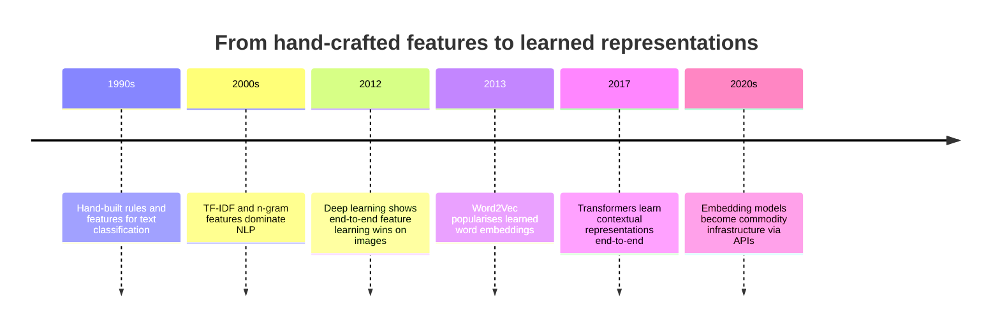

For decades, teams of domain experts spent months designing features for a single task: which n-grams, which lexicon, which hand-tuned weights. The ceiling was never the model — it was the feature list. Deep learning's real contribution was not "bigger models"; it was **moving feature discovery from humans into optimisation**.

### 4.3 Problem 1: How Many Dimensions Should We Create

Take one film — `Interstellar` — and ask what should represent it:

```
space · science · family · fatherhood · time travel · love
survival · philosophy · physics · sadness · adventure
visual spectacle · hope · sacrifice · isolation · duty
grief · curiosity · scale · mortality · ...
```

Every one of these is defensible. That is the problem.

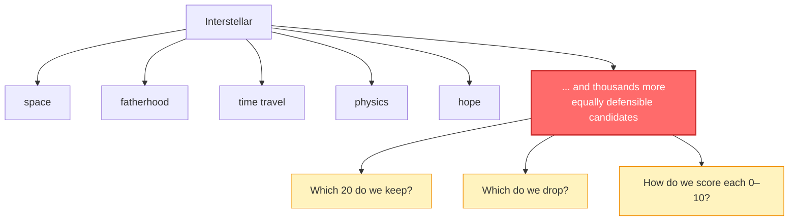

Three unresolvable sub-problems:

| Sub-problem | Why it is unresolvable |
| :--- | :--- |
| **No stopping rule** | there is no principled point at which a concept list is "complete" |
| **Subjective scoring** | two annotators disagree on whether Interstellar's "hope" is 7 or 9 |
| **Non-uniform density** | some films need 3 dimensions, others need 30; a fixed schema over-serves and under-serves simultaneously |

And every dimension added costs ongoing work: define it, scale it, document it, backfill it across the entire catalogue, and keep annotators consistent.

> **Dimensionality is not free, and there is no natural boundary.** This is the first structural failure.

### 4.4 Problem 2: Features Depend on the Task

The same object requires different dimensions depending on the question being asked:

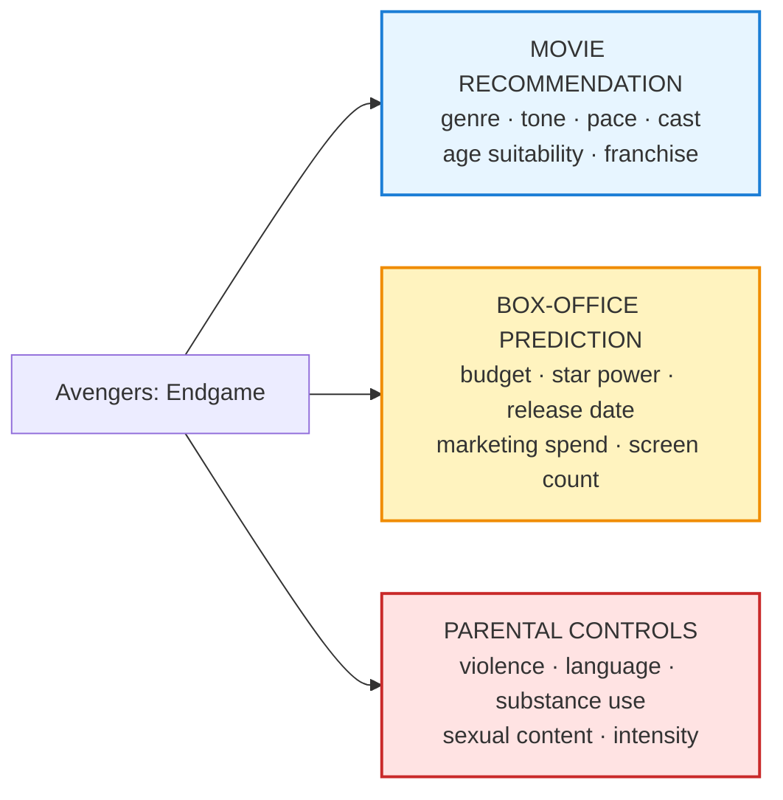

Same movie. Three incompatible schemas:

| Task | Useful dimensions | Useless dimensions |
| :--- | :--- | :--- |
| Recommendation | tone, pace, genre, franchise | budget, marketing spend |
| Box office | budget, cast, release window | tone, parental intensity |
| Parental controls | violence, language, intensity | budget, cast popularity |

There is **no universally correct feature list**. Every task forces a different schema, which means:

1. **N tasks → N representation pipelines**, each with its own annotations, backfills, and drift.
2. **Cross-task transfer is impossible** — a recommendation vector cannot answer a compliance question.
3. **A schema change is a migration** — a new dimension means re-annotating the entire corpus.

> **A representation valid for only one task is a representation you must rebuild for every task.** This is the second structural failure.

### 4.5 Problem 3: Language Makes Feature Design Impossible

Natural language breaks the design process in five distinct ways:

| Failure mode | Example | Why static features fail |
| :--- | :--- | :--- |
| **Polysemy** | `bank` (river / finance), `apple` (fruit / company), `java` (island / coffee / language) | one token would need multiple incompatible vectors |
| **Context dependence** | "The bank raised rates" vs "the bank was muddy" | meaning is a function of surrounding tokens |
| **Metaphor and idiom** | "time is money", "break a leg" | literal component words actively mislead |
| **Intent and pragmatics** | "Great, another outage." | sentiment is opposite to the word's polarity |
| **Entity relationships** | "the CEO fired the CTO" | roles and direction matter, not just word presence |

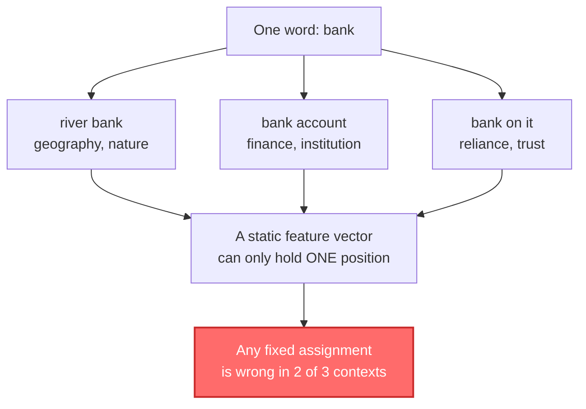

**The king / queen / apple thought experiment** makes the combinatorial problem concrete. To hand-encode just these three concepts you would need to decide, for each, values across royalty, gender, edibility, biology, authority, and thousands of unnamed interactions:

```
king   → royalty=high, gender=male,   edible=no,  alive=yes
queen  → royalty=high, gender=female, edible=no,  alive=yes
apple  → royalty=none, gender=none,   edible=yes, alive=no
```

Then someone asks about `crown` (royalty + object), `queen bee` (royalty + insect + female), or `Apple Inc.` (company, but written with an edible word). The schema never converges.

> **Language is not a fixed set of attributes; it is a system of relationships that shift with context.** This is the third structural failure.

### 4.6 The Scale and Maintenance Problem

Even granting perfect feature design for one domain, the scope is impossible:

```
Every word in every language
Every sentence ever written
Every movie ever made
Every song ever recorded
Every product ever sold
Every user profile ever created
Every image ever taken
Every protein structure ever studied
Every support ticket in the queue
```

| Dimension of scale | Consequence |
| :--- | :--- |
| **Breadth** | no single team can cover all domains |
| **Depth** | each domain has thousands of candidate properties |
| **Velocity** | language changes (new slang, products, memes) faster than schemas |
| **Consistency** | annotators drift; scores are not comparable across time |
| **Cost** | expert annotation is the most expensive part of the pipeline |

> **Feature engineering does not fail because experts are unskilled. It fails because it requires a finite, static, human-authored schema to describe an infinite, dynamic, context-sensitive world.**

### 4.7 Why Bigger Sparse Encodings Do Not Save Us

A natural objection: *"We already have automatic text features — one-hot, bag-of-words, TF-IDF. Why not just scale those?"*

Because they encode **lexical overlap**, not **meaning**:

| Query | Document | TF-IDF / BM25 | Embedding |
| :--- | :--- | :--- | :--- |
| "I forgot my password" | "How do I reset my login credentials?" | ~0 (no shared terms) | high similarity ✅ |
| "cheap flights to Delhi" | "low-cost airfare to Delhi" | partial (Delhi only) | high similarity ✅ |
| "dog" | "puppy" | 0 | high similarity ✅ |
| "bank account" | "river bank" | high (false positive) | low similarity ✅ |

| Approach | Dimensions | Density | Semantic relatedness | Cost profile |
| :--- | :--- | :--- | :--- | :--- |
| One-hot / bag-of-words | vocabulary size (10⁴–10⁶) | sparse (a few non-zeros) | ❌ none | large, low signal per dimension |
| TF-IDF | vocabulary size | sparse | ❌ lexical only | better weighting, same blind spot |
| Learned embedding | 384–3072 | **dense** (every slot carries signal) | ✅ yes | fixed size, compact, comparable |

This is the crucial quantitative insight:

> **Embeddings trade an unbounded sparse vocabulary axis for a fixed number of dense learned axes.** Dimensionality stops being "however many words exist" and becomes a design constant (e.g. 1536), while semantic capacity comes from training instead of enumeration.

### 4.8 The Question That Changes Everything

We want a space where:

```
Batman  ≈ Superman    (both superheroes)
dog     ≈ puppy       (same animal)
king    ≈ queen       (both royalty)

Batman  ≠ banana      (unrelated)
dog     ≠ database    (unrelated)
```

…without any human enumerating thousands of dimensions.

```mermaid
flowchart LR
    A["❌ OLD QUESTION<br/>'Which dimensions<br/>should we create?'"]
    B["✅ NEW QUESTION<br/>'What task should the<br/>system learn to solve?'"]

    A -. "replaced by" .-> B

    style A fill:#ffe3e3,stroke:#c92a2a,stroke-width:2px
    style B fill:#d3f9d8,stroke:#2b8a3e,stroke-width:2px
```

The reframing has three consequences:

1. **Truth moves from annotation to prediction.** We stop asking "what is true about this object?" and start asking "what must be true about it to predict well?"
2. **Dimensions become internal implementation details.** Their count and meaning are chosen by the optimiser, not the schema author.
3. **One representation serves many tasks.** A general objective (predict context, predict the paired caption, predict the next token) yields vectors that transfer.

> **Instead of asking "which dimensions should we create?", we ask "what task should the system learn to solve?" The representation emerges as a by-product of learning.**

### 4.9 Chapter Summary and Key Takeaways

```mermaid
mindmap
  root((Why Hand Crafted Features Fail))
    Unbounded dimensions
      Interstellar has thousands<br/>of defensible properties
      No stopping rule
      Subjective scoring
    Task dependence
      Recommendation schema
      Box-office schema
      Compliance schema
    Language ambiguity
      Polysemy
      Context shifts meaning
      Metaphor and intent
    Scale and maintenance
      Every domain at once
      Constant re-annotation
      Schema migrations
```

| Limitation | Impact if ignored |
| :--- | :--- |
| Unbounded dimensionality | incomplete representations, endless debate |
| Task specificity | one pipeline per task, no reuse |
| Ambiguity / context | statically wrong vectors for the same token |
| Subjectivity | inconsistent values, unreproducible results |
| Maintenance | permanent annotation and migration cost |

1. **Feature engineering is a design-time human activity** — and design does not scale to an open world.
2. **Three structural failures** — unbounded dimensions, task dependence, linguistic ambiguity — are not fixable with more effort.
3. **Sparse lexical encodings solve vocabulary, not semantics.**
4. **The replacement is not a better schema; it is a different question** — *what task should the model learn?*
5. **Chapter 05 answers that question** with training objectives, embedding tables, and gradient descent.

---

## Chapter 05: What Are Embeddings

> **Chapter goal:** Make the conceptual leap from *designed* vectors to *learned* vectors — how a training objective plus data plus gradient descent produces a space whose geometry encodes semantics, why context is the signal, what the embedding table really is, and why `king − man + woman ≈ queen` is not a trick.

### 5.1 The Key Insight: Let the Machine Learn

Instead of choosing dimensions, we choose a **task**:

```
OLD: "Which dimensions should we create?"      (design problem)
NEW: "What task should the model learn to solve?"  (optimisation problem)
```

The representation is then a **by-product** of getting good at that task.

```mermaid
flowchart LR
    T["Training task<br/>e.g. predict nearby words"] --> M["Model with<br/>trainable parameters"]
    D["Training data<br/>millions of sentences"] --> M
    M --> L["Loss<br/>how wrong was the prediction?"]
    L --> G["Gradient descent<br/>nudge parameters"]
    G --> M
    M --> R["Learned representations<br/>dense vectors"]
    R --> A["Downstream use<br/>search, recommendation, RAG"]

    style R fill:#51cf66,color:#000,stroke:#2b8a3e,stroke-width:2px
    style A fill:#74c0fc,color:#000,stroke:#1c7ed6,stroke-width:2px
```

> **Nobody tells the model what "king" means. The model is told what to predict; meaning is the compressed residue of solving that prediction problem at scale.**

### 5.2 The Formal Definition

An **embedding model** is a parameterised function:

$$
f_\theta : \mathcal{X} \rightarrow \mathbb{R}^{d}
$$

| Symbol | Meaning |
| :--- | :--- |
| $\mathcal{X}$ | input space — a word, sentence, document, image, user, product |
| $\mathbb{R}^{d}$ | a $d$-dimensional continuous vector space |
| $\theta$ | learned parameters (weights of a neural network or an embedding matrix) |
| $d$ | dimensionality — a **fixed design choice**, not learned |

Examples:

```
f("Batman is a dark superhero movie")
   → [0.12, −0.37, 0.91, 0.44, 0.02, …, 0.22]     ∈ ℝ⁷⁶⁸

f("I forgot my password")
   → [−0.08, 0.51, 0.13, …, 0.66]                  ∈ ℝ¹⁵³⁶
```

Properties that distinguish a learned embedding from a feature vector:

| Property | Learned embedding | Hand-built feature vector |
| :--- | :--- | :--- |
| Dimension semantics | unknown / distributed | human-labelled |
| Values | real numbers, roughly $[-1, 1]$ | task-defined units |
| Dimensionality | fixed by model (384–3072) | chosen per project |
| Transfer | reusable across tasks | usually task-specific |
| Cost to create | one API call or one training run | weeks of annotation |
| Cost to extend | re-embed (automatable) | re-annotate (human) |

### 5.3 Where Do Embedding Numbers Come From

Before training, the numbers are **random** — typically small values drawn from a normal distribution:

```js
// Pseudocode: initialisation, before any learning
king = [0.31, -0.84, 0.17, 0.66, ...];   // noise
queen = [-0.12, 0.45, 0.88, -0.03, ...]; // unrelated noise
```

They become meaningful through three ingredients:

| Ingredient | Role |
| :--- | :--- |
| **Training objective** | defines "good" — e.g. predict a neighbouring word |
| **Training data** | supplies the statistical regularities to be compressed |
| **Optimisation** | gradient descent adjusts parameters to reduce loss |

At no point does a human assign `dimension 7 = royalty`. The values are whatever minimises the loss.

> **The numbers are not authored; they are negotiated between the objective and the data.**

### 5.4 Meaning Through Context

Consider recurring patterns in a training corpus:

```
The king ruled the kingdom.
The queen ruled the kingdom.
The king lived in the palace.
The queen lived in the palace.
The king wore the crown.
The queen wore the crown.
```

And separately:

```
I ate a banana.
The banana is a fruit.
The apple is a fruit.
I ate an apple.
```

Two regularities emerge:

- `king` and `queen` share contexts (crown, palace, kingdom, ruled)
- `banana` and `apple` share contexts (ate, fruit)
- `king` and `banana` share almost nothing

This is the **distributional hypothesis**, stated by J.R. Firth (1957):

> **"You shall know a word by the company it keeps."**

```mermaid
flowchart LR
    subgraph Same["Similar contexts → similar vectors"]
        K["king"] -. "crown · palace · ruled" .-> Q["queen"]
        D["dog"] -. "barked · feed · walk" .-> P["puppy"]
    end

    subgraph Diff["Different contexts → distant vectors"]
        K2["king"] -. "no overlap" .-> B["banana"]
    end

    style Same fill:#d3f9d8,stroke:#2b8a3e
    style Diff fill:#ffe3e3,stroke:#c92a2a
```

This is the single most important idea in the chapter:

> **Meaning is not annotated; it is inferred from distributional behaviour.** Words that behave alike are treated alike, and that behavioural similarity becomes geometric proximity.

### 5.5 A Toy Training Objective

The classic toy objective is **predict the neighbours of a word** (the skip-gram formulation of Word2Vec):

```
Sentence:  The king wears a crown
Input:     king
Targets:   the · wears · a · crown
```

Now compare with:

```
Sentence:  The queen wears a crown
Input:     queen
Targets:   the · wears · a · crown
```

Both inputs must produce almost the **same predictions**. The cheapest way for a network to satisfy both examples is for the two inputs to have **similar internal representations**.

```mermaid
sequenceDiagram
    participant Data as Training data
    participant Model as Model
    participant Space as Embedding space

    Data->>Model: "The king wears a crown"
    Note over Model: input king → predict {the, wears, a, crown}
    Data->>Model: "The queen wears a crown"
    Note over Model: input queen → predict {the, wears, a, crown}
    Model->>Space: gradient pushes king and queen together
    Note over Space: before training: king ●        ● queen
    Note over Space: after training:  king ●● queen
```

Formally, with context word $c$, target word $o$, and vocabulary $V$:

$$
P(o \mid c)=\frac{\exp(\mathbf{u}_o^{\top}\mathbf{v}_c)}{\sum_{w \in V}\exp(\mathbf{u}_w^{\top}\mathbf{v}_c)}
\qquad
L=-\sum_{(c,o)\in\mathcal{D}}\log P(o\mid c)
$$

| Symbol | Role |
| :--- | :--- |
| $\mathbf{v}_c$ | vector of the centre word (input embedding) |
| $\mathbf{u}_o$ | vector of the context word (output embedding) |
| $\exp(\cdot)$ | turns similarity scores into positive weights |
| denominator | normaliser over the whole vocabulary — expensive, hence negative sampling in practice |

> **The objective never mentions similarity.** Similarity is the *strategy* the optimiser discovers, because similar inputs with different predictions are an expensive contradiction to maintain.

`banana` never appears near `crown`, `palace`, or `kingdom`, so nothing pulls it toward that region — its vector drifts elsewhere. No human ever typed `king is similar to queen`.

### 5.6 The Embedding Table

In a simple model, every vocabulary item owns one row of a learned matrix:

$$
E \in \mathbb{R}^{V \times d}, \qquad \mathbf{v}_t = E[t]
$$

| Word | $d_1$ | $d_2$ | $d_3$ | … | $d_{768}$ |
| :--- | ---: | ---: | ---: | :--- | ---: |
| king | 0.21 | −0.71 | 0.45 | … | 0.09 |
| queen | 0.19 | −0.68 | 0.49 | … | 0.11 |
| dog | −0.51 | 0.22 | 0.78 | … | −0.34 |
| cat | −0.48 | 0.19 | 0.73 | … | −0.31 |
| banana | 0.89 | 0.54 | −0.13 | … | 0.42 |
| apple | 0.84 | 0.57 | −0.09 | … | 0.39 |

Observations that fall directly out of the training dynamics:

- `king` ≈ `queen` — same contexts
- `dog` ≈ `cat` — same contexts
- `banana` ≈ `apple` — same contexts
- `king` ≉ `banana` — disjoint regions of the space

```mermaid
flowchart LR
    subgraph S["Learned region layout (schematic)"]
        direction LR
        K["king"] --- Q["queen"]
        Dg["dog"] --- Ct["cat"]
        Ba["banana"] --- Ap["apple"]
    end

    style K fill:#ffd43b,color:#000
    style Q fill:#ffd43b,color:#000
    style Dg fill:#e7f5ff,stroke:#1c7ed6
    style Ct fill:#e7f5ff,stroke:#1c7ed6
    style Ba fill:#d3f9d8,stroke:#2b8a3e
    style Ap fill:#d3f9d8,stroke:#2b8a3e
```

**Engineering arithmetic of the table** (worth doing once, because it governs cost):

| Quantity | Formula | Example ($V=50{,}000$, $d=768$) |
| :--- | :--- | :--- |
| Parameters | $V \times d$ | 38,400,000 |
| Memory (`float32`) | $V \times d \times 4$ bytes | 153,600,000 B ≈ 147 MiB |
| Lookup cost | $O(1)$ row read | effectively free |
| Update cost per step | only touched rows move | sparse updates |

Two practical notes:

1. **A lookup is a row read, not a computation.** For static embeddings, "embedding a word" is literally indexing a matrix — which is why the layer is called an *embedding table*.
2. **The table is the model's memory of vocabulary.** In an LLM, the input embedding matrix plus the output projection is often a large share of total parameters at small model sizes.

### 5.7 How Training Changes the Embeddings

```mermaid
flowchart TD
    S1["1 · Start with random vectors<br/>king = [0.31, −0.84, …]"] --> S2["2 · Make a prediction<br/>king → predict 'banana' (wrong)"]
    S2 --> S3["3 · Compare with the target<br/>expected: crown, palace, ruled"]
    S3 --> S4["4 · Compute loss<br/>loss = HIGH"]
    S4 --> S5["5 · Gradient descent<br/>θ ← θ − η∇L<br/>nudge king slightly toward crown"]
    S5 --> S6["6 · Repeat over millions of context pairs"]
    S6 --> S7["7 · Space self-organises<br/>king ●● queen, dog ●● cat, banana ●● apple"]

    style S4 fill:#ff6b6b,color:#fff,stroke:#c92a2a,stroke-width:2px
    style S7 fill:#51cf66,color:#000,stroke:#2b8a3e,stroke-width:2px
```

The update rule, in full:

$$
\theta_{t+1}=\theta_t-\eta\,\nabla_\theta L(\theta_t)
$$

| Symbol | Meaning | Practical effect |
| :--- | :--- | :--- |
| $\theta$ | all trainable parameters (the table, the projections) | what changes |
| $\eta$ | learning rate | too high → divergence, too low → never converges |
| $\nabla_\theta L$ | gradient of the loss | direction that most increases error; we move opposite |
| one step | one batch of context pairs | millions of steps required |

Before and after, in the same 2D projection:

```
BEFORE (random)                        AFTER (learned)
  king                banana             king  ●●  queen
            dog
  queen                       apple        dog  ●●  cat
                    cat
                                       banana  ●●  apple
```

> **Structure is not inserted; it is the fixed point of repeated correction.** Every gradient step moves each vector slightly toward whatever makes its predictions less wrong.

### 5.8 Vector Arithmetic and the Geometry of Meaning

One of the most celebrated consequences of a well-trained embedding space is that **relationships become directions**:

$$
\mathbf{v}_{\text{king}}-\mathbf{v}_{\text{man}}+\mathbf{v}_{\text{woman}}\approx\mathbf{v}_{\text{queen}}
$$

**Why it works.** If the space has factored the relevant attributes, then:

```
king  ≈ [royalty, male,   authority, ...]
queen ≈ [royalty, female, authority, ...]
man   ≈ [male,   human,   adult,     ...]
woman ≈ [female, human,   adult,     ...]
```

So the arithmetic performs attribute surgery:

```mermaid
flowchart LR
    K["king<br/>royalty + male + authority"] --> M["− man<br/>remove 'male'<br/>royalty + authority"]
    M --> W["+ woman<br/>add 'female'<br/>royalty + female + authority"]
    W --> Q["≈ queen<br/>nearest neighbour"]

    style K fill:#ffd43b,color:#000
    style Q fill:#51cf66,color:#000,stroke:#2b8a3e,stroke-width:2px
```

The operation is not symbolic substitution — it is **vector addition followed by nearest-neighbour search**:

```ts
// Pseudocode: analogy by arithmetic + search
function analogy(a: string, b: string, c: string): string {
  const target = add(sub(embed(a), embed(b)), embed(c));   // a − b + c
  return nearestNeighbour(target, vocabulary, { exclude: [a, b, c] });
}

analogy("king", "man", "woman");     // → queen
analogy("Paris", "France", "Germany");// → Berlin
analogy("walking", "walk", "swim");  // → swimming
```

**Other documented relationships:**

| Relationship | Example | Direction captured |
| :--- | :--- | :--- |
| Gender | king − man + woman ≈ queen | male ↔ female |
| Capital | Paris − France + Germany ≈ Berlin | country ↔ capital |
| Tense | walking − walk + swim ≈ swimming | present ↔ progressive |
| Comparative | big − bigger + small ≈ smaller | positive ↔ comparative |

> **The space encodes structure, not just proximity.** That is why a coordinate is more useful than a label — coordinates support arithmetic.

**Four caveats an engineer must keep in mind:**

1. **Analogies are approximate, not exact.** Results are top-1 nearest neighbours, not guarantees; accuracy on analogy benchmarks is typically well below 100%.
2. **The space inherits the corpus's biases.** `doctor − man + woman ≈ nurse` reflects historical text statistics, not truth. Embeddings can encode and amplify gender, racial, and occupational stereotypes — a real fairness and compliance concern.
3. **Static embeddings conflate senses.** One vector per word cannot represent `bank` (river) and `bank` (finance) separately.
4. **Arithmetic is model-specific.** It works within one model's space; it is meaningless across models or versions.

### 5.9 Does the Machine Discover Features

In one sense yes — but the naive interpretation is wrong.

| | Hand-built vector | Learned embedding |
| :--- | :--- | :--- |
| Coordinates | `[royalty, gender, authority]` | `[0.31, −0.84, 0.17, 0.66, …]` |
| Interpretability | each slot has a name | no slot has a reliable name |
| Location of meaning | one slot per concept | spread across many slots |

```
king  = [0.31, −0.84, 0.17, 0.66, 0.02, …, 0.19]
queen = [0.29, −0.78, 0.21, 0.61, 0.05, …, 0.22]
```

It would be wrong to conclude:

```
dimension 1  = royalty
dimension 2  = gender
dimension 3  = authority
```

Concept structure is **distributed**: a property like "royalty" is expressed through a pattern across dimensions 4, 18, 91, 207, …, and those same dimensions participate in many other concepts at once.

> **Meaning lives in the overall configuration of the vector, not in a single human-readable coordinate.** This is why "just look at which dimension is largest" almost never explains anything.

This is also why embeddings exhibit **superposition**: far more concepts can be represented than there are dimensions, because concepts share dimensions with near-orthogonal patterns.

**Static vs contextual embeddings — an important distinction the slides imply but do not name:**

| Type | Example | Vector for "bank" |
| :--- | :--- | :--- |
| **Static** | Word2Vec, GloVe | one fixed vector, all senses merged |
| **Contextual** | BERT, modern text-embedding models | a different vector per sentence; senses separated |

In production RAG and search, contextual sentence/document embeddings are the norm — which is why the same word can land in different places depending on the surrounding text.

### 5.10 Embeddings as Coordinates on a Map

A useful mental model: **coordinates on a geographic map**.

```
Delhi = [28.61, 77.20]     (latitude, longitude)
```

Neither number independently means "Delhi-ness":

- `77.20` does not mean "capital city"
- `28.61` does not mean "crowded"

But *together* they place Delhi at a meaningful location, and that location is only meaningful **relative to other locations**:

```
Delhi    [28.61, 77.20]
Jaipur   [26.91, 75.79]     ≈ 240 km away → nearby, similar region
Mumbai   [19.08, 72.88]     ≈ 1,150 km   → same country, different region
London   [51.51, −0.13]     ≈ 6,700 km   → far, different everything
```

```mermaid
flowchart TD
    A["Coordinate pair<br/>[lat, lon]"] --> B["No single number is meaningful alone"]
    B --> C["Position is meaningful<br/>relative to other positions"]
    C --> D["Distance encodes relatedness"]
    D --> E["Embeddings: same idea,<br/>768 or 1536 axes instead of 2"]

    style E fill:#51cf66,color:#000,stroke:#2b8a3e,stroke-width:2px
```

> **An embedding is a coordinate system for concepts.** Asking "what does dimension 412 mean?" is like asking "what does 77.20 mean?" — the question is malformed. Position, not axis, carries the meaning.

### 5.11 Why This Matters for a Neural Network

Suppose the network must complete:

```
The king lives in the ______     → palace · castle · kingdom
The queen lives in the ______    → palace · castle · kingdom
```

If `king` and `queen` had unrelated representations, the network would have to learn the same behaviour twice — duplicated parameters, duplicated data requirements, twice the risk of one path being under-trained.

If instead:

$$
\mathbf{v}_{\text{king}} \approx \mathbf{v}_{\text{queen}}
$$

then the **same downstream weights produce the same good predictions for both inputs**.

```mermaid
flowchart TD
    K["king vector"] --> W["Shared downstream weights"]
    Q["queen vector"] --> W
    W --> P["palace / castle / kingdom"]

    style W fill:#e7f5ff,stroke:#1c7ed6,stroke-width:2px
    style P fill:#d3f9d8,stroke:#2b8a3e,stroke-width:2px
```

> **Similar representations are useful because similar inputs often need to produce similar behaviour.** Semantic structure is not decoration — it is *parameter sharing*, and parameter sharing is generalisation.

This is the engineering justification for embeddings, stated plainly:

| Without shared structure | With shared structure |
| :--- | :--- |
| Learn "royal residence" separately per word | learn it once, reuse for all royalty terms |
| Data-hungry per concept | sample-efficient across concepts |
| No generalisation to unseen-but-related inputs | transfers to near neighbours in the space |
| Model treats synonyms as unrelated | synonyms inherit the same learned behaviour |

### 5.12 Latent Dimensions and Latent Space

The vocabulary word is **latent**:

| Term | Meaning |
| :--- | :--- |
| **Latent** | hidden; not directly observed; not manually specified |
| **Latent dimension** | a learned internal axis with no guaranteed human label |
| **Latent space** | the learned coordinate system spanned by those axes |
| **Latent representation** | the vector an object occupies in that space |
| **Latent factor** | the recommendation-systems term for the same idea (user/movie factors) |

```
Hand-designed:  [action, romance, comedy]      → explicit, named
Learned:        [0.21, −0.81, 0.44, …]         → implicit, unnamed, distributed
```

```mermaid
flowchart LR
    E["Explicit features<br/>named axes<br/>human scale"] --> L["Latent space<br/>learned axes<br/>hundreds to thousands"]
    L --> U["Use: compare, cluster,<br/>rank, retrieve"]

    style E fill:#fff3bf,stroke:#f08c00
    style L fill:#d3f9d8,stroke:#2b8a3e,stroke-width:2px
    style U fill:#e7f5ff,stroke:#1c7ed6
```

Two operational implications:

1. **You cannot hand-audit latent axes.** Interpretability requires post-hoc tools (probing, projection, nearest-neighbour inspection), not slot-by-slot reading.
2. **You can still trust distances.** Even when the axes are opaque, the *geometry* — proximity, direction, clusters — is measurable and testable. That is what retrieval systems rely on.

### 5.13 Chapter Summary and Key Takeaways

```mermaid
flowchart TD
    A["Real-world object<br/>e.g. Batman"] --> B["Need a numeric representation"]
    B --> C["Manual feature vector<br/>[action=9, romance=2, darkness=9]"]
    C --> D["Does not scale"]
    D --> E["Training objective<br/>+ training data<br/>+ gradient descent"]
    E --> F["Learned vector<br/>[0.23, −0.81, 0.47, …]"]
    F --> G["EMBEDDING"]

    style C fill:#ff9f43,color:#000,stroke:#e8590c,stroke-width:2px
    style D fill:#ffe3e3,stroke:#c92a2a,stroke-width:2px
    style G fill:#51cf66,color:#000,stroke:#2b8a3e,stroke-width:3px
```

| Concept | One-line definition |
| :--- | :--- |
| Embedding | a learned position in a continuous vector space |
| Embedding table | a $V \times d$ matrix of learned vectors, read by row index |
| Training objective | the prediction task whose solution forces useful representations |
| Distributional hypothesis | words in similar contexts tend to have related meaning |
| Latent feature | learned internal structure without a human-readable label |
| Vector arithmetic | semantic relationships captured as consistent directions |
| Gradient descent | the mechanism that turns random vectors into structured ones |

> **An embedding is not the meaning. It is a position inside a learned mathematical space where useful relationships in meaning or behaviour become relationships in geometry.**

Chapter 06 asks the practical question: *what can we build with these, and what exactly distinguishes an embedding from an ordinary vector?*

---

## Chapter 06: Vector vs Embedding and What They Unlock

> **Chapter goal:** Draw the distinction most engineers blur — vector vs feature vector vs embedding — then enumerate the application taxonomy those learned vectors make possible, with the operational rules that prevent the most common production failures.

### 6.1 The Critical Distinction

| Term | Definition | Example | Who chose the dimensions |
| :--- | :--- | :--- | :--- |
| **Vector** | any ordered list of numbers — the mathematical container | `[2.1, 4.7, 1.3]` | nobody / irrelevant |
| **Feature vector** | a vector whose slots are human-defined measurements | `[height=175, weight=70, age=28]` | a human designer |
| **Embedding** | a learned representation placing an object in a continuous space | `[0.21, −0.71, 0.45, …]` | a training objective |

```mermaid
flowchart TD
    V["VECTOR<br/>the container<br/>[2.1, 4.7, 1.3]"]
    FV["FEATURE VECTOR<br/>human-designed slots<br/>[175, 70, 28]"]
    E["EMBEDDING<br/>learned position<br/>[0.21, −0.71, 0.45, …]"]

    V --> FV
    V --> E

    FV -. "dimensions named by a person" .-> N1["interpretable<br/>task-specific<br/>does not scale"]
    E -. "dimensions discovered by training" .-> N2["opaque<br/>transferable<br/>scales"]

    style V fill:#e7f5ff,stroke:#1c7ed6,stroke-width:2px
    style FV fill:#ff9f43,color:#000,stroke:#e8590c,stroke-width:2px
    style E fill:#51cf66,color:#000,stroke:#2b8a3e,stroke-width:3px
```

**The rule:**

```
Every embedding IS a vector.
NOT every vector IS an embedding.
```

Two consequences that matter in code review:

1. **`number[]` is not a promise of semantics.** The TypeScript type tells you nothing about whether the values encode meaning. Track the *provenance* (model, version, metric) alongside the array.
2. **A feature vector cannot be used as an embedding.** Putting `[175, 70, 28]` into a cosine index produces mathematically valid, semantically meaningless neighbours — exactly the failure analysed in §3.2 and §4.1.

### 6.2 Almost Anything Can Be Embedded

The embedding function accepts any input a model can process:

```mermaid
flowchart LR
    EM["EMBEDDING MODEL<br/>f(input) → ℝᵈ"]

    W["Word"] --> EM
    S["Sentence"] --> EM
    D["Document"] --> EM
    M["Movie<br/>title + synopsis"] --> EM
    U["User<br/>purchase history"] --> EM
    SNG["Song<br/>audio or lyrics"] --> EM
    I["Image"] --> EM
    P["Product"] --> EM
    C["Code"] --> EM
    G["Graph node"] --> EM

    EM --> V1["vector"]
    EM --> V2["vector"]
    EM --> V3["vector"]

    style EM fill:#e7f5ff,stroke:#1c7ed6,stroke-width:2px
```

| Object | What is actually embedded | Typical use |
| :--- | :--- | :--- |
| Word | token id → learned row | classic NLP, similarity |
| Sentence | pooled token representations | semantic search, intent routing |
| Document | chunk text (see Lecture 09) | retrieval, RAG |
| Movie | title + synopsis + tags | recommendation (Lecture 08) |
| User | behaviour history, profile text | personalisation |
| Song | audio spectrogram or lyrics | music discovery |
| Image | pixels via CNN or ViT | visual search |
| Product | description + attributes | e-commerce search |
| Code | source tokens | code search, clone detection |
| Graph node | neighbourhood features | link prediction |

The single question to ask before building anything:

> **"Can we learn a useful space in which relationships between these objects become accessible through geometry?"**

If the answer is no — because the relationship you care about is not reflected in the data you can feed the model — no amount of vector-database sophistication will fix it.

### 6.3 The Embedding Model as a Function

$$
f : \mathcal{X} \rightarrow \mathbb{R}^{d}, \qquad d \text{ fixed at model level}
$$

```
Input:  "Batman is a dark superhero movie"
            ↓
     embedding model
            ↓
Output: [0.12, −0.37, 0.91, 0.44, 0.02, …, 0.22]     (d = 768)
```

Three properties that follow from the definition:

| Property | Meaning for engineers |
| :--- | :--- |
| **Fixed output length** | every document, however long, becomes one $d$-vector — storage is predictable |
| **Deterministic per model version** | same input + same model → same vector (modulo floating-point noise) |
| **Dimensionality is a design choice** | more dimensions capture more nuance, at linear storage and compute cost |

```ts
// Pseudocode: the contract
interface EmbeddingModel {
  readonly modelId: string;        // provenance: required for versioning
  readonly dimensions: number;     // 384 | 768 | 1536 | 3072
  embed(texts: string[]): Promise<number[][]>;
}
```

Note the `modelId`. Embeddings are only comparable **within** one model version; storing it next to the vectors is what makes re-embedding and mixed-index detection possible later (Lecture 09 covers the migration mechanics).

### 6.4 Shared Embedding Spaces and Multi-Modality

A powerful consequence: **two different input types can be embedded into the same space**.

```
Image of a cat
      ↓  CLIP image encoder
[0.55, −0.22, 0.18, …]  ─┐
                          ├─ same space → directly comparable
"a photo of a cat"        │
      ↓  CLIP text encoder│
[0.53, −0.19, 0.21, …]  ─┘
```

```mermaid
flowchart LR
    IMG["Image<br/>pixels"] --> IE["Image encoder"]
    TXT["Text<br/>'a photo of a cat'"] --> TE["Text encoder"]
    IE --> SP["SHARED LATENT SPACE<br/>one coordinate system"]
    TE --> SP
    SP --> Q["Cross-modal search:<br/>text query → images"]

    style SP fill:#51cf66,color:#000,stroke:#2b8a3e,stroke-width:3px
    style Q fill:#e7f5ff,stroke:#1c7ed6,stroke-width:2px
```

This is how text-to-image search, zero-shot image classification, and caption retrieval work: the model is trained **contrastively**, so a matching (image, caption) pair lands close together and mismatched pairs land far apart.

| Concept | Explanation |
| :--- | :--- |
| **Shared embedding space** | one coordinate system for multiple modalities |
| **Contrastive training** | pull matching pairs together, push mismatched pairs apart |
| **Zero-shot classification** | compare an image against text embeddings of class names — no classifier training |

> **Multi-modality is not a different idea — it is the same idea with more than one encoder.** The geometry does the work.

### 6.5 The Application Taxonomy

Once objects are vectors, one small set of primitives composes into every product feature:

```mermaid
mindmap
  root((Embeddings Enable))
    Similarity search
      Query to nearest neighbours
      Semantic search
      Duplicate detection
    Recommendation
      Content based
      Collaborative
      Similar items
    Clustering
      Topic discovery
      User segmentation
      Deduplication
    Classification
      Intent routing
      Sentiment
      Spam and abuse
    Ranking
      Re-rank candidates
      Feed ordering
    Retrieval
      RAG context
      Document QA
      Hybrid search
```

| Capability | What it does | Core operation |
| :--- | :--- | :--- |
| **Similarity search** | find items near a query | embed query → top-k by cosine |
| **Nearest-neighbour retrieval** | "more like this" | use an item's own vector as the query |
| **Clustering** | group without labels | k-means / HDBSCAN over embeddings |
| **Classification** | label an item | nearest class centroid, or a small head on top |
| **Ranking** | order candidates | similarity score as one feature in a ranker |
| **Recommendation** | personalise | user vector vs item vectors |
| **RAG** | ground an LLM answer | retrieve context, then generate |

#### 1 · Semantic search

```
Query: "I forgot my password"
   ↓ embed
   ↓ find nearest vectors
Results:
  "How do I recover my login credentials?"   0.94
  "Reset account access"                     0.87
  "Password recovery options"                0.85
```

A keyword index returns nothing for this query; an embedding index returns the three correct articles. That difference *is* the product.

#### 2 · Recommendation

```ts
// Pseudocode: content-based recommendation
function recommend(userId: string, items: Item[], k = 10) {
  const userVector = embed(getUserProfile(userId));
  return items
    .map((item) => ({ item, score: cosine(userVector, item.vector) }))
    .sort((a, b) => b.score - a.score)
    .slice(0, k);
}
```

Lecture 08 builds exactly this for movies — with the crucial refinement that **item vectors are precomputed offline**, so the online path only embeds the query.

#### 3 · Clustering

No labels, no schema: run k-means over the vectors and inspect the groups.

```
sports documents      → one cluster
finance documents     → another cluster
technology documents  → another cluster
```

Used for topic discovery, support-ticket triage, and dataset exploration before any labelling budget is spent.

#### 4 · Classification and intent routing

A very strong baseline: embed the input, compare against a handful of labelled examples per class, take the nearest.

| Advantage | Trade-off |
| :--- | :--- |
| works with ~3 examples per class | weaker than a fine-tuned model at high accuracy targets |
| add a class by adding examples | one embedding call per inference |
| no training pipeline, no GPU | class examples must be curated and versioned |

#### 5 · Ranking

Embeddings rarely produce the final order in mature systems. They produce a **candidate set** that a downstream ranker (business rules, recency, popularity, CTR model) re-orders. This is the "retrieve then rank" pattern formalised in Lecture 09.

#### 6 · Retrieval-Augmented Generation (RAG)

```mermaid
sequenceDiagram
    actor U as User
    participant E as Embedding model
    participant V as Vector index
    participant L as LLM

    U->>E: "What is our refund policy?"
    E->>V: query vector
    V->>V: top-k nearest chunks
    V-->>L: 3 relevant policy passages
    L-->>U: grounded answer with citation
```

> **RAG is the retrieval problem plus a generation step.** Everything that determines answer quality — chunking, embedding model, metric, index, filters — is decided *before* the LLM is called. Lecture 09 covers that storage and search half of the pipeline.

### 6.6 The Bridge Embeddings Create

```mermaid
flowchart TD
    HC["HUMAN CONCEPTS<br/>'Batman' · 'king' · 'I forgot my password'"]
    VR["VECTOR REPRESENTATION<br/>[0.12, −0.37, 0.91, …]"]
    MATH["MATHEMATICS<br/>distance · angle · dot product"]
    APPS["APPLICATIONS<br/>search · recommendation · classification · RAG"]

    HC --> VR --> MATH --> APPS

    style HC fill:#fff3bf,stroke:#f08c00,stroke-width:2px
    style VR fill:#e7f5ff,stroke:#1c7ed6,stroke-width:2px
    style MATH fill:#f3d9fa,stroke:#9c36b5,stroke-width:2px
    style APPS fill:#d3f9d8,stroke:#2b8a3e,stroke-width:3px
```

This four-stage chain is why embeddings are **infrastructure**, not a feature:

| Stage | Failure mode if broken |
| :--- | :--- |
| Human concept → text | bad input, missing context, wrong language |
| Text → vector | wrong model, wrong task adaptation, truncated input |
| Vector → score | wrong metric, unnormalised data, dimension mismatch |
| Score → application | no re-ranking, no filters, no thresholds |

### 6.7 Reference Table of Embedding Models

| Model | Dimensions | Provider | Modality | Notes |
| :--- | ---: | :--- | :--- | :--- |
| `text-embedding-ada-002` | 1536 | OpenAI | text | legacy default; unit-normalised |
| `text-embedding-3-small` | 1536 (shortenable) | OpenAI | text | cost-effective default |
| `text-embedding-3-large` | 3072 (shortenable) | OpenAI | text | higher retrieval quality |
| BERT base | 768 | Google | text | token-level; needs pooling for sentences |
| BERT large | 1024 | Google | text | same caveat, larger |
| all-MiniLM-L6-v2 | 384 | Sentence-Transformers | text | small, fast, runs locally |
| CLIP (ViT-B/32) | 512 | OpenAI | text + image | shared multi-modal space |
| Word2Vec | 100–300 | Google | word | static, historical importance |
| GloVe | 50–300 | Stanford | word | static, co-occurrence based |

```mermaid
flowchart LR
    subgraph Dim["Dimensionality trade-off"]
        S["384 dims<br/>fast · cheap<br/>lower ceiling"]
        M["768–1536 dims<br/>balanced"]
        L["3072 dims<br/>best quality<br/>3× storage & compute"]
    end

    S --> M --> L

    style S fill:#d3f9d8,stroke:#2b8a3e
    style M fill:#fff3bf,stroke:#f08c00
    style L fill:#ffe3e3,stroke:#c92a2a
```

**Choosing a model is a systems decision, not a leaderboard decision.** The relevant axes:

| Axis | Question to ask |
| :--- | :--- |
| Quality | does it rank *your* data correctly on *your* eval set? |
| Dimension | can you afford $N \times d \times 4$ bytes? |
| Latency | is it fast enough for the online path? |
| Cost | per-token price × expected token volume |
| Context limit | can it embed your chunk sizes without truncation? |
| Deployment | API, self-hosted, or on-premise (data residency)? |
| Stability | is the model version pinned and unlikely to change? |

> **A model that wins a public benchmark but requires migrating your index every quarter is a worse choice than a slightly weaker pinned model.** Version stability is a feature.

### 6.8 Reference Workflow in Pseudocode

```ts
// Pseudocode: the canonical three-step pipeline

interface Document {
  id: string;
  title: string;
  content: string;
}

// 1 · Embed (batched — never one call per document)
async function embedDocuments(texts: string[]): Promise<number[][]> {
  const BATCH = 256;                       // respect provider limits
  const vectors: number[][] = [];

  for (let i = 0; i < texts.length; i += BATCH) {
    const batch = texts.slice(i, i + BATCH);
    const response = await embeddingAPI.embed({
      model: "text-embedding-3-small",
      input: batch,
    });
    vectors.push(...response.embeddings);
  }
  return vectors;                          // number[][], each of length d
}

// 2 · Store (vector + payload + provenance)
async function indexDocuments(documents: Document[]): Promise<void> {
  const texts = documents.map((d) => `${d.title}\n\n${d.content}`);
  const vectors = await embedDocuments(texts);

  await vectorStore.upsert(
    documents.map((doc, i) => ({
      id: doc.id,
      vector: vectors[i],
      metadata: { title: doc.title, model: "text-embedding-3-small@1" },
    })),
  );
}

// 3 · Query
async function semanticSearch(query: string, topK = 5) {
  const [queryVector] = await embedDocuments([query]);

  const results = await vectorStore.query({
    vector: queryVector,
    topK,
    includeMetadata: true,
  });

  return results.map((r) => ({
    document: r.metadata,
    similarity: r.score,                   // confirm: cosine, not L2 distance
  }));
}
```

Four things this sketch gets right that naive implementations get wrong:

| Decision | Why it matters |
| :--- | :--- |
| **Batching** | 256-document batches turn 256 HTTP round-trips into 1 |
| **Concatenating title + body** | titles carry high-signal tokens that improve retrieval |
| **Storing `model` in metadata** | enables detecting stale vectors after a model upgrade |
| **Commenting the score semantics** | `score` is undefined without knowing the metric |

### 6.9 Operational Rules That Follow From This Chapter

| # | Rule | Failure it prevents |
| :--- | :--- | :--- |
| 1 | **One model, one index.** Never mix vectors from different models or versions. | incomparable coordinates, random results |
| 2 | **Normalise once, at write time.** | inconsistent cosine/dot results, wasted compute |
| 3 | **Store the model id with every vector.** | silent staleness after a model upgrade |
| 4 | **Pin the model version in config.** | uncontrolled drift when a provider updates |
| 5 | **Respect the context limit.** Truncated input silently loses the end of the document. | missing facts at retrieval time |
| 6 | **Batch embedding calls.** | 100× latency and rate-limit failures |
| 7 | **Embed the same text shape at query and index time.** If documents were embedded with titles, queries must be phrased accordingly. | query/document distribution mismatch |
| 8 | **Cache embeddings for identical inputs.** | duplicate spend on repeated queries |
| 9 | **Validate dimensionality at the boundary.** | silent truncation or shape errors |
| 10 | **Evaluate with retrieval metrics, not vibes.** | unmeasurable regressions (see Lecture 09) |

**Cost and storage arithmetic** (the numbers an FDE is always asked for):

| Quantity | Formula | Example |
| :--- | :--- | :--- |
| Storage per vector | $d \times 4$ bytes (`float32`) | 1536 × 4 = 6,144 B ≈ 6 KB |
| Storage for $N$ vectors | $N \times 6$ KB | 1M ≈ 6 GB |
| Embedding cost | tokens × price | 1M docs × 500 tokens = 500M tokens |
| Approx. spend (`3-small`) | $0.02 / 1M tokens | 500M tokens ≈ $10 |
| Query cost | 1 small embedding + ANN search | negligible vs generation |

> **Embedding is cheap; re-embedding is the expensive event.** One million documents cost roughly ten dollars to embed and hours to re-index — which is why model selection and versioning decisions deserve more deliberation than the embedding bill suggests.

### 6.10 Chapter Summary and Key Takeaways

```mermaid
flowchart LR
    V["Vector<br/>container"]
    FV["Feature vector<br/>human-designed"]
    E["Embedding<br/>learned position"]
    C["Capabilities"]
    V --> FV
    V --> E
    E --> C

    C --> S1["Semantic search"]
    C --> S2["Recommendation"]
    C --> S3["Clustering"]
    C --> S4["Classification"]
    C --> S5["Ranking"]
    C --> S6["RAG"]

    style E fill:#51cf66,color:#000,stroke:#2b8a3e,stroke-width:3px
    style C fill:#e7f5ff,stroke:#1c7ed6,stroke-width:2px
```

1. **Every embedding is a vector; not every vector is an embedding.** The difference is *provenance*: designed by a human vs learned by an objective.
2. **Almost anything can be embedded** — text, images, users, products, code — as long as relationships are learnable from available data.
3. **The embedding model is a function with fixed output dimensionality**; that fixity is what makes storage and comparison predictable.
4. **Shared spaces enable multi-modal retrieval** — one encoder per modality, one coordinate system.
5. **A small set of primitives** (similarity search, kNN, clustering, classification, ranking, recommendation, retrieval) composes into nearly every AI product surface.
6. **RAG is retrieval plus generation** — and retrieval quality is decided before the LLM sees anything.
7. **Most embedding failures are operational, not mathematical** — model mixing, unnormalised vectors, truncation, uncached calls.

Chapter 07 closes the loop: one continuous journey from `Batman` to a coordinate, and one definition that captures all of it.

---

## Chapter 07: The Complete Journey

> **Chapter goal:** Collapse the lecture into one continuous causal chain — from a word a computer cannot understand to a coordinate that supports search, recommendation, and retrieval — and state the definition that survives all the detail.

### 7.1 Where We Started

We began with one concrete, ordinary problem:

```
Batman
```

| Perspective | What exists |
| :--- | :--- |
| Human | superhero, Gotham, Bruce Wayne, dark, DC, vigilante |
| Computer | `B`, `a`, `t`, `m`, `a`, `n` — or token ids `[33, 64, 83, ...]` |
| Gap | perfect storage, zero comprehension |

The computer can compare the string to another string. It cannot tell you that `Batman` is closer to `Superman` than to `Titanic`, because "closer" is not defined for labels.

### 7.2 The First Attempt: Manual Vectors

Our first solution was to **measure** properties:

```js
// Pseudocode: hand-built representation
const batman = {
  action:   9,
  romance:  2,
  darkness: 9,
};
// as a vector: [9, 2, 9]
```

This genuinely worked, and it is worth being precise about *what* it bought us:

| Achievement | Why it mattered |
| :--- | :--- |
| Similarity became computable | $\lvert 9-10\rvert=1$ is a real answer |
| A vector space existed | every object got a position |
| Ranking became possible | sort by distance, take top-k |
| Mathematics became available | dot products, angles, clustering |

Then it hit four walls:

```
✗ Humans cannot enumerate every useful property of everything
✗ The right properties change with the task
✗ Language is ambiguous and context-dependent
✗ Millions of objects × thousands of properties is not annotatable
```

The approach was correct in principle and impossible in practice. That is the precise sense in which "feature engineering fails" — not that it produces bad vectors, but that it cannot produce enough of them.

### 7.3 The Insight That Changes Everything

```mermaid
flowchart TD
    Q1["❌ 'Which dimensions<br/>should we manually create?'"] --> W["No scalable answer"]
    Q2["✅ 'What task should the<br/>system learn to solve?'"] --> T["Train on data"]
    T --> R["Representations emerge<br/>as a by-product"]

    style Q1 fill:#ffe3e3,stroke:#c92a2a,stroke-width:2px
    style W fill:#ffe3e3,stroke:#c92a2a,stroke-width:2px
    style Q2 fill:#d3f9d8,stroke:#2b8a3e,stroke-width:2px
    style R fill:#51cf66,color:#000,stroke:#2b8a3e,stroke-width:3px
```

The reframing converts an **open-ended design problem** into a **well-posed optimisation problem**:

| | Design approach | Learning approach |
| :--- | :--- | :--- |
| Question | what are the right features? | what should the model predict? |
| Who decides dimensions | a human | the optimiser |
| When is it done | never provably | when validation loss stops improving |
| Scales with data | ❌ | ✅ |
| Transfers across tasks | ❌ | ✅ (usually) |

> **We stopped trying to describe meaning and started trying to predict behaviour. Meaning turned out to be a useful intermediate variable for prediction.**

### 7.4 The Complete Progression

```mermaid
flowchart TD
    A["REAL-WORLD OBJECT<br/>Batman (the film)"]
    B["NEED: numerical representation<br/>computers reason with numbers"]
    C["MANUAL VECTOR<br/>[action=9, romance=2, darkness=9]"]
    D["PROBLEM: does not scale<br/>unbounded, task-specific, ambiguous"]
    E["NEW APPROACH: let the model learn<br/>choose an objective, not a schema"]
    F["TRAINING PROCESS<br/>objective + data + gradient descent"]
    G["LEARNED VECTOR<br/>[0.23, −0.81, 0.47, 0.12, …]"]
    H["EMBEDDING<br/>a position in a learned space"]

    A --> B --> C --> D --> E --> F --> G --> H

    style C fill:#ff9f43,color:#000,stroke:#e8590c,stroke-width:2px
    style D fill:#ffe3e3,stroke:#c92a2a,stroke-width:2px
    style H fill:#51cf66,color:#000,stroke:#2b8a3e,stroke-width:3px
```

Read the chain as a set of *forced moves*:

1. Computers need numbers → something must be numeric.
2. Names are not numbers → represent objects numerically.
3. One number is insufficient → use vectors.
4. Vectors need comparison → define similarity.
5. Humans cannot choose dimensions at scale → learn them.
6. Learning needs a target → choose an objective.
7. The objective shapes the geometry → **the space reflects what you trained for**.

Step 7 is the one engineers most often forget: a model trained for symmetric semantic similarity produces a different space than one trained for next-token prediction. **The objective is the design decision.**

### 7.5 The Final Definition Unpacked

> **An embedding is not the meaning itself. It is a *position* inside a learned mathematical space where useful relationships in meaning or behaviour become relationships in geometry.**

| Phrase | What it rules out |
| :--- | :--- |
| "not the meaning itself" | the vector does not *contain* Batman; it locates it |
| "a position" | meaning is relational, not intrinsic |
| "inside a learned space" | the axes were discovered, not designed |
| "useful relationships in meaning or behaviour" | *useful* is load-bearing — the space reflects the objective, not objective truth |
| "become relationships in geometry" | proximity, direction, and clusters are the interface |

```mermaid
flowchart LR
    M1["'King' and 'Queen'<br/>related meaning"] -- "is represented as" --> G1["vectors close together"]
    M2["'King' and 'Banana'<br/>unrelated meaning"] -- "is represented as" --> G2["vectors far apart"]
    M3["male → female<br/>relationship"] -- "is represented as" --> G3["a consistent direction"]

    style G1 fill:#51cf66,color:#000,stroke:#2b8a3e
    style G2 fill:#ff6b6b,color:#fff,stroke:#c92a2a
    style G3 fill:#74c0fc,color:#000,stroke:#1c7ed6
```

One important nuance: **"useful" is task-relative.** Two models can both be "correct" and disagree about which items are similar, because they were trained on different objectives and corpora. There is no single true embedding space — only spaces that are useful for specific downstream behaviour.

### 7.6 End-to-End Worked Example: Support Ticket Routing

Now trace the entire lecture through one realistic system.

**Phase 1 — offline indexing**

```js
// Pseudocode: build a searchable knowledge base
const articles = [
  { id: 1, text: "How to reset your password" },
  { id: 2, text: "Changing your login credentials" },
  { id: 3, text: "Account recovery options" },
  { id: 4, text: "Adding items to your shopping cart" },
  { id: 5, text: "Checkout and payment methods" },
];

// embed once, at write time
const articleVectors = articles.map((article) => ({
  id: article.id,
  vector: embeddingModel.embed(article.text),   // ℝ¹⁵³⁶
}));

vectorDB.insert(articleVectors);
```

**Phase 2 — online query**

```js
// Pseudocode: the online path is one embed + one search
const query = "I forgot my password";
const queryVector = embeddingModel.embed(query);

const results = vectorDB.findNearest(queryVector, 3);   // cosine

// 1. "How to reset your password"       0.94  ✅
// 2. "Changing your login credentials"  0.89  ✅
// 3. "Account recovery options"         0.85  ✅
//    ("Adding items to your cart"       ~0.10) ❌ not returned
```

```mermaid
sequenceDiagram
    actor U as User
    participant App as Application
    participant E as Embedding model
    participant V as Vector DB

    U->>App: "I forgot my password"
    App->>E: embed(query)
    E-->>App: queryVector [0.45, −0.12, …]
    App->>V: findNearest(queryVector, k=3, metric=cosine)
    V->>V: score N stored article vectors
    V-->>App: [article1 0.94, article2 0.89, article3 0.85]
    App-->>U: top-3 help articles
```

**Why each chapter was necessary for this to work:**

| Chapter | Contribution to this flow |
| :--- | :--- |
| 01 | Recognising that `"forgot password"` and `"reset credentials"` are the same intent, not different strings |
| 02 | Representing each article as a fixed-length vector instead of a token bag |
| 03 | Scoring with cosine, so article length does not bias the ranking |
| 04 | Accepting that nobody can hand-author dimensions for "intent" |
| 05 | Obtaining the vectors from a model trained on language, not from a schema |
| 06 | Distinguishing "a vector" from "a learned embedding", and knowing that prose + title embeds better than a keyword list |
| 07 | Assembling all of it into an offline/online pipeline |

**The production refinements this example omits** (all covered later):

- **Chunking** long articles before embedding, so one vector does not average several topics.
- **Pre-filtering** by tenant, product, or language before nearest-neighbour search.
- **A similarity threshold**, so "no good match" is a valid answer instead of returning the least-bad article.
- **Hybrid search** (BM25 + embeddings) to catch exact identifiers such as error codes.
- **Re-ranking** the top 20 with a cross-encoder before showing the top 3.
- **An index** (HNSW/IVF) once $N$ stops being small — the subject of Lecture 09.

### 7.7 Feature Engineering vs Embeddings

```mermaid
flowchart LR
    subgraph Hand["Hand-crafted pipeline"]
        direction TB
        T1["Object: Batman"] --> T2["Human chooses dimensions"]
        T2 --> T3["Human assigns values"]
        T3 --> T4["Feature vector [9, 2, 3, 9]"]
    end

    subgraph Learned["Learned pipeline"]
        direction TB
        M1["Object: Batman text"] --> M2["Model trained on an objective"]
        M2 --> M3["Vectors emerge from optimisation"]
        M3 --> M4["Embedding [0.23, −0.81, 0.47, …]"]
    end

    style T4 fill:#ff9f43,color:#000,stroke:#e8590c,stroke-width:2px
    style M4 fill:#51cf66,color:#000,stroke:#2b8a3e,stroke-width:3px
```

| Aspect | Feature engineering | Learned embeddings |
| :--- | :--- | :--- |
| **Who decides dimensions** | human designer | training objective |
| **Number of dimensions** | tens (typically) | 384–3072 |
| **Interpretability** | high — each slot named | low — distributed, latent |
| **Scalability** | poor — manual per domain | excellent — one model, many objects |
| **Task specificity** | rebuild per task | often transferable |
| **Context sensitivity** | none (static) | high (contextual models) |
| **Time to first version** | weeks of schema + annotation | hours (API) or days (self-hosted) |
| **Marginal cost per new object** | annotation effort | one embedding call |
| **Quality driver** | domain expertise | training data + objective quality |
| **Failure mode** | incomplete / subjective schema | opaque errors, bias, domain mismatch |
| **Auditability** | inspect slot values | requires probes and eval sets |

**When hand-crafted features still win:**

| Situation | Why |
| :--- | :--- |
| Strong numeric signals (price, age, quantity) | embeddings add nothing to already-meaningful numbers |
| Regulatory explainability | "this score because rate > 8%" must be articulable |
| Tiny data, no pretrained model | no corpus to learn distributional structure from |
| Deterministic business rules | embeddings introduce probabilistic behaviour |

> **The mature answer is not "embeddings replace features" — it is "embeddings for semantics, engineered features for quantities".** Production rankers typically concatenate both.

### 7.8 The Seven Ideas in Seven Sentences

| # | Idea | One sentence |
| :--- | :--- | :--- |
| 1 | **Symbol vs meaning** | A computer stores the label, never the concept. |
| 2 | **Vectors** | Meaning must become numbers before mathematics can touch it, and one number is never enough. |
| 3 | **Similarity** | Distance, dot product, and cosine answer three different questions about closeness. |
| 4 | **The wall** | Hand-designed dimensions cannot cover an open, ambiguous, task-dependent world. |
| 5 | **Learning** | Predict something useful and the geometry organises itself. |
| 6 | **Provenance** | Every embedding is a vector, but only a learned one carries semantics. |
| 7 | **Application** | Once meaning is geometry, search, recommendation, clustering, and RAG are the same operation. |

```mermaid
flowchart LR
    C1["01<br/>symbols ≠ meaning"] --> C2["02<br/>vectors"] --> C3["03<br/>similarity"]
    C3 --> C4["04<br/>feature wall"] --> C5["05<br/>learned space"]
    C5 --> C6["06<br/>vector vs embedding"] --> C7["07<br/>applications"]

    style C7 fill:#51cf66,color:#000,stroke:#2b8a3e,stroke-width:3px
```

### 7.9 One Final Thought

We started with:

```
Batman
```

A word that means nothing to a machine.

We ended with:

```
Batman = [0.23, −0.81, 0.47, 0.12, −0.55, …, 0.19]     (768 numbers)
```

A point in a 768-dimensional space where:

- **Batman is close to Superman** — both dark superhero films
- **Batman is close to The Dark Knight** — same franchise
- **Batman is far from Titanic** — different genre
- **Batman is far from banana** — unrelated domain

And nobody told the model what "action" means, what "genre" means, or what a superhero is.

> **The geometry learned itself from the patterns in the data. That is the power of embeddings — and the reason the rest of this course is mostly about how to store, search, and serve that geometry at scale.**

### 7.10 Complete Lecture Summary Table

| Chapter | Core question | Answer | Engineering artefact |
| :--- | :--- | :--- | :--- |
| 01 | Why can't computers understand meaning? | they store symbols, not concepts | the motivation |
| 02 | How do we represent meaning numerically? | ordered lists of measurements in $d$ dimensions | feature vector |
| 03 | How do we compare vectors? | Euclidean, dot product, cosine | scoring function |
| 04 | Who designs the dimensions? | nobody can, at scale | the failure of schemas |
| 05 | How do machines learn the dimensions? | objective + data + gradient descent | embedding table |
| 06 | What can we build with embeddings? | search, recommendation, clustering, classification, ranking, RAG | retrieval pipeline |
| 07 | What is the unifying insight? | meaning becomes geometry | the definition |

---

## Appendix A: Formula Sheet

| Concept | Formula | Read it as |
| :--- | :--- | :--- |
| Vector | $\mathbf{a}=(a_1,a_2,\dots,a_d)\in\mathbb{R}^d$ | an ordered list of $d$ measurements |
| Euclidean distance | $d(\mathbf{a},\mathbf{b})=\sqrt{\sum_{i=1}^{d}(a_i-b_i)^2}$ | straight-line gap; lower is closer |
| Dot product | $\mathbf{a}\cdot\mathbf{b}=\sum_{i=1}^{d}a_ib_i$ | alignment weighted by size |
| Geometric identity | $\mathbf{a}\cdot\mathbf{b}=\lVert\mathbf{a}\rVert\lVert\mathbf{b}\rVert\cos\theta$ | why angle and dot product are linked |
| Cosine similarity | $\cos\theta=\dfrac{\mathbf{a}\cdot\mathbf{b}}{\lVert\mathbf{a}\rVert\lVert\mathbf{b}\rVert}$ | direction only; scale-free |
| Squared L2 via dot | $\lVert\mathbf{a}-\mathbf{b}\rVert^2=\lVert\mathbf{a}\rVert^2+\lVert\mathbf{b}\rVert^2-2\,\mathbf{a}\cdot\mathbf{b}$ | L2 ↔ inner product conversion |
| Unit-vector collapse | $\lVert\mathbf{a}\rVert=\lVert\mathbf{b}\rVert=1\Rightarrow \lVert\mathbf{a}-\mathbf{b}\rVert^2=2-2\cos\theta$ | normalised: all metrics agree |
| Embedding model | $f_\theta:\mathcal{X}\to\mathbb{R}^d$ | object → fixed-length vector |
| Embedding matrix | $E\in\mathbb{R}^{V\times d}$, $\mathbf{v}_t=E[t]$ | lookup = row read |
| Table parameters | $V\times d$ | model size contribution |
| Storage per vector | $d\times 4$ bytes (`float32`) | 1536 → 6,144 B |
| Softmax prediction | $P(o\mid c)=\dfrac{\exp(\mathbf{u}_o^\top\mathbf{v}_c)}{\sum_{w\in V}\exp(\mathbf{u}_w^\top\mathbf{v}_c)}$ | context prediction objective |
| Negative log-likelihood | $L=-\sum_{(c,o)}\log P(o\mid c)$ | training loss |
| Gradient step | $\theta_{t+1}=\theta_t-\eta\nabla_\theta L$ | how vectors learn |
| Analogy | $\mathbf{v}_{\text{king}}-\mathbf{v}_{\text{man}}+\mathbf{v}_{\text{woman}}\approx\mathbf{v}_{\text{queen}}$ | relationships as directions |
| Brute-force scoring | $O(N\times d)$ per query | the scaling wall (Lecture 09) |
| Top-k selection | $O(N\log k)$ or $O(N)$ with a heap | ranking step |

---

## Appendix B: Glossary

| Term | Definition |
| :--- | :--- |
| **Attention** | mechanism in transformers that weights tokens by relevance to each other (Lecture 02) |
| **Bi-encoder** | architecture that embeds query and document separately, enabling precomputation |
| **Cosine similarity** | cosine of the angle between two vectors; scale-invariant similarity |
| **Curse of dimensionality** | degradation of distance contrast and index pruning as dimensions grow |
| **Dense vector** | a vector where most components are non-zero |
| **Dimension** | one axis/slot in a vector; one measured or learned property |
| **Dot product** | sum of component-wise products; encodes direction and magnitude |
| **Embedding** | a learned position in a continuous vector space |
| **Embedding model** | function $f:\mathcal{X}\to\mathbb{R}^d$ mapping objects to vectors |
| **Embedding table** | $V\times d$ matrix of learned per-token vectors |
| **Euclidean distance** | straight-line (L2) distance between two points |
| **Feature engineering** | manual definition of which characteristics to measure |
| **Feature vector** | vector whose dimensions are human-designed measurements |
| **Gradient descent** | iterative parameter update along the negative gradient of a loss |
| **Hybrid search** | combination of lexical (BM25) and semantic (embedding) retrieval |
| **Latent space** | learned coordinate system whose axes are not human-labelled |
| **Loss** | scalar measure of prediction error that training minimises |
| **Normalisation** | scaling a vector to unit length so cosine equals dot product |
| **One-hot encoding** | sparse identity encoding with a single 1 per category |
| **Polysemy** | one word form carrying multiple meanings depending on context |
| **RAG** | retrieval-augmented generation: retrieve context, then generate |
| **Recall@K** | fraction of relevant items found within the top K results |
| **Skip-gram** | Word2Vec objective predicting context words from a centre word |
| **Sparse vector** | vector with mostly zero components (one-hot, TF-IDF) |
| **Static embedding** | one fixed vector per word regardless of context |
| **Contextual embedding** | vector that depends on the surrounding text |
| **Superposition** | representing more concepts than dimensions by sharing axes |
| **TF-IDF** | lexical weighting of terms by frequency and rarity |
| **Top-k** | the k highest-scoring results for a query |
| **Vector space** | mathematical space of all $d$-dimensional vectors and its operations |

---

## Appendix C: Common Misconceptions

| # | Misconception | Reality |
| :--- | :--- | :--- |
| 1 | "An embedding *is* the meaning." | It is a coordinate that encodes relationships; meaning is not stored inside the numbers. |
| 2 | "Any list of numbers is an embedding." | Only a *learned* representation is an embedding. A hand-built vector may be numerically valid and semantically empty. |
| 3 | "More dimensions always means better." | Quality is bounded by training data and objective; extra dimensions cost storage and can add noise. |
| 4 | "Cosine and Euclidean always differ." | For unit-normalised vectors their rankings are identical. |
| 5 | "Cosine similarity is a probability." | It is a bounded score in $[-1,1]$, not a calibrated probability. A `0.9` is not "90% likely relevant". |
| 6 | "Similarity scores are comparable across models." | Scores from different models (or versions) live in different geometries and are not comparable. |
| 7 | "Each embedding dimension has a human meaning." | Meaning is distributed across dimensions; individual axes rarely map to clean concepts. |
| 8 | "Embeddings understand negation and intent perfectly." | They capture distributional similarity; "not recommended" can land near "recommended". Hybrid and re-ranking fix this. |
| 9 | "A bigger model always retrieves better." | Retrieval quality depends on domain fit, chunking, and the query/document distribution, not only model size. |
| 10 | "Embeddings are unbiased because they are mathematical." | They inherit and can amplify biases present in the training corpus. |
| 11 | "Feature engineering is obsolete." | Numeric, regulated, and highly structured signals still need engineered features; embeddings handle semantics. |
| 12 | "Vector search returns the true nearest neighbours at scale." | Production indexes are usually *approximate* (ANN); recall must be measured (Lecture 09). |
| 13 | "One embedding per document is enough." | Long documents must be chunked; a single averaged vector blurs distinct topics. |
| 14 | "Vector databases are required from day one." | Brute force is correct and fast enough for small corpora; it is also the baseline every index must beat. |

---

## Appendix D: Self-Check Questions

1. **Why does `"Batman" === "Superman"` return `false` while a good embedding places them close together?**
   String equality tests identity of symbols; embeddings test similarity of learned positions encoding behaviour.

2. **Why is a single action score insufficient to distinguish Titanic from Hera Pheri?**
   One dimension can only express one property; both score low on action while differing completely on comedy/tone.

3. **What breaks if `[9, 2]` and `[2, 9]` are treated as the same set?**
   Slot semantics: `[9,2]` is high action / low comedy, `[2,9]` is the reverse. Order is part of the meaning.

4. **Compute $d(\text{Batman},\text{Avengers})$ for `[9,1]` and `[10,7]`.**
   $\sqrt{1^2+6^2}=\sqrt{37}\approx6.08$.

5. **Why does Euclidean distance call `[9,1]` and `[90,10]` far apart?**
   It measures absolute gap, which grows with magnitude; direction is identical (cosine = 1.0).

6. **When is dot product the right choice?**
   When magnitude carries information — e.g. implicit-feedback recommendation where more interactions should score higher.

7. **What is the relationship between cosine and dot product for unit vectors?**
   They are equal; Euclidean ranking is also monotone in the same score.

8. **Give the three structural reasons hand-crafted features fail.**
   Unbounded dimensionality, task dependence, and linguistic ambiguity/context — plus maintenance cost at scale.

9. **Why do TF-IDF and one-hot fail on `"I forgot my password"` vs `"How do I reset my login credentials?"`**
   They measure lexical overlap, which is near zero; semantics are not encoded.

10. **What does the training objective actually specify, and what does it not specify?**
    It specifies a prediction task; it does not specify dimension meanings. Geometry is a by-product.

11. **What does an embedding table look like, and how many parameters for $V=50{,}000$, $d=768$?**
    A $V\times d$ matrix; $50{,}000\times768=38.4$M parameters (~147 MiB in `float32`).

12. **Why does `king − man + woman ≈ queen` work, and when does it not?**
    Because a consistent gender direction exists; it fails for rare words, biased or small corpora, and across models.

13. **Why is `"number[]"` an insufficient type for an embedding in a shared codebase?**
    It carries no provenance — model, version, dimensionality, and metric must travel with the vector.

14. **What is the difference between a feature vector and an embedding in one sentence?**
    A feature vector is designed by a human; an embedding is learned by an optimisation objective.

15. **Why must a vector index and a similarity metric be configured consistently?**
    An L2 index returns distances, cosine returns similarity; mixing them inverts or distorts ranking.

16. **What is the cheapest correct retrieval architecture for 10,000 documents?**
    Brute-force cosine scoring in memory ($O(N\times d)$ ≈ 15M operations) — no index needed.

---

## Appendix E: Twenty Cardinal Takeaways

**Foundations**

1. **Symbols are not meaning.** Storing `Batman` perfectly tells you nothing about Batman.
2. **Mathematics is the only substrate that scales** for comparison, ranking, and learning.
3. **A scalar is a single property; a vector is a profile.** Real objects need profiles.
4. **Position is meaning.** In a vector space, where a thing is determines what it is similar to.

**Similarity**

5. **Every metric encodes a definition of "similar".** Choose the definition before choosing the metric.
6. **Euclidean measures gap, cosine measures direction, dot product measures both.**
7. **Normalise once and cosine becomes a dot product.** This is a real performance decision at scale.
8. **For unit vectors, all three metrics rank identically.** Normalisation is the great simplifier.

**The limits of design**

9. **Hand-crafted features fail through unbounded dimensionality, task dependence, and language ambiguity** — not through lack of effort.
10. **Sparse lexical encodings solve vocabulary, not semantics.** TF-IDF cannot bridge "password" and "credentials".
11. **Subjectivity is a correctness problem**, not a UX problem: two annotators produce two different spaces.

**Learning**

12. **We choose objectives, not dimensions.** The geometry is a by-product of prediction.
13. **Context is the supervision signal.** Distributional behaviour is where meaning is hidden.
14. **An embedding table is just a $V \times d$ matrix** — and "embedding a token" is a row read.
15. **Gradient descent is the only reason the numbers mean anything.** Random initialisation plus correction, at scale.

**Interpretation**

16. **Meaning is distributed, not slotted.** Do not read individual dimensions as concepts.
17. **Vector arithmetic works because relationships become directions** — and it inherits the corpus's biases.
18. **The map analogy is the right mental model**: coordinates matter relative to other coordinates.

**Engineering**

19. **Every embedding is a vector; not every vector is an embedding.** Track provenance: model, version, dimensions, metric.
20. **Embedding quality is measured by downstream retrieval metrics**, not by how plausible the numbers look.

---

## Appendix F: How Lecture 07 Connects to Lectures 08 and 09

Lecture 07 is the *theory*; the next two lectures are its *engineering consequences*.

```mermaid
flowchart LR
    L7["LECTURE 07<br/>what embeddings are<br/>and why geometry = meaning"]
    L8["LECTURE 08<br/>build a movie recommender<br/>REPRESENT → STORE → COMPARE → RANK"]
    L9["LECTURE 09<br/>vector storage and search at scale<br/>IVF · HNSW · quantization"]

    L7 --> L8 --> L9

    style L7 fill:#fff3bf,stroke:#f08c00,stroke-width:2px
    style L8 fill:#e7f5ff,stroke:#1c7ed6,stroke-width:2px
    style L9 fill:#d3f9d8,stroke:#2b8a3e,stroke-width:3px
```

| Lecture 07 concept | Where it reappears | What changes at scale |
| :--- | :--- | :--- |
| Vector + similarity (Ch 02–03) | Lecture 08 scoring function | same cosine, now over a catalogue |
| Embedding model as a function (Ch 06) | Lecture 08 `EmbeddingService` | batched, cached, with mock mode |
| Precomputation insight (Ch 06 §6.8) | Lecture 08 offline/online split | items embedded once, queries per request |
| $O(N \times d)$ scoring (Ch 03 §3.7) | Lecture 08 brute force | becomes the wall in Lecture 09 |
| Storage $d \times 4$ bytes (Ch 06 §6.9) | Lecture 09 capacity planning | 6 KB → 6 GB per million → 600 GB per 100M |
| Cosine/dot/L2 equivalence (Ch 03 §3.4) | Lecture 09 index metric choice | determines whether normalisation is free |
| ANN approximation | Lecture 09 IVF / HNSW / PQ | trades recall for latency and memory |

**What Lecture 08 adds that Lecture 07 does not cover:**

- The two-phase architecture (offline index build, online query).
- Why not to prompt an LLM with the whole catalogue.
- Deterministic mock embeddings for tests and offline development.
- Guardrails: zero-vector handling, dimension validation, `topK` bounds.

**What Lecture 09 adds:**

- Why a B-tree cannot index cosine similarity (Lecture 07 supplies the maths; 09 supplies the data-structure argument).
- ANN indexes, quantization, and recall/latency trade-offs.
- Production concerns: re-embedding migrations, sharding, multi-tenancy, ACL filtering, evaluation with recall@K / MRR / nDCG.

> **If you remember one sentence from Lecture 07, remember this: meaning becomes geometry.** Everything in Lectures 08 and 09 exists to serve that geometry efficiently.

---

## Appendix G: Reading Order and Revision Map

### Reading paths

| Goal | Path |
| :--- | :--- |
| **First pass (conceptual)** | §1 → §2 → §3 → §4 → §5 → §6 → §7 |
| **Interview prep (fast)** | §Executive Summary → §3.6 → §5.8 → §6.5 → §7.5 → Appendix A → Appendix E |
| **Implementing search today** | §2.8 → §3.4–§3.7 → §6.3 → §6.8 → §6.9 |
| **Debugging bad results** | §3.2 (representation) → §3.6 (metric/index) → §4.5 (ambiguity) → §6.9 (operations) |
| **Teaching someone else** | §1 → §2.1–§2.3 → §5.1–§5.7 → §7.4 |

### Revision checklist

- [ ] I can explain why `"Batman" == "Superman"` is the wrong question.
- [ ] I can write down Euclidean, dot product, and cosine from memory.
- [ ] I can explain when cosine and Euclidean differ, and when they agree.
- [ ] I can name three structural failures of hand-crafted features with examples.
- [ ] I can explain what a training objective has to do with geometry.
- [ ] I can describe an embedding table and its memory cost.
- [ ] I can explain `king − man + woman ≈ queen` without hand-waving.
- [ ] I can state the vector-vs-embedding distinction in one sentence.
- [ ] I can name seven applications built on the same primitive.
- [ ] I can list five operational rules for embedding pipelines.

### The whole lecture as one picture

```mermaid
mindmap
  root((Vector Embeddings))
    Problem
      Symbols carry no meaning
      String equality is not similarity
      Mathematics needs numbers
    Representation
      Scalar to vector
      Dimensions as axes
      Vector space and ranking
    Similarity
      Euclidean distance
      Dot product
      Cosine similarity
      Normalisation
    Limits of design
      Unbounded dimensions
      Task dependence
      Language ambiguity
    Learning
      Training objective
      Context and distribution
      Embedding table
      Gradient descent
      Vector arithmetic
    Meaning of embedding
      Vector versus embedding
      Latent space
      Shared multimodal space
    Applications
      Semantic search
      Recommendation
      Clustering
      Classification
      Ranking
      RAG
    Next lectures
      Lecture 08 recommender
      Lecture 09 vector search at scale
```

### Closing statement

> **Chapter 01 asked a question that sounds philosophical: how does a computer understand? The lecture's answer is engineering: it does not understand — it *locates*. Give it a coordinate system learned from behaviour, and every question about meaning becomes a question about distance. That is why embeddings, not ontologies or schemas, became the foundation of modern AI systems.**

---

*End of Lecture 07 — Complete Consolidated Notes.*
