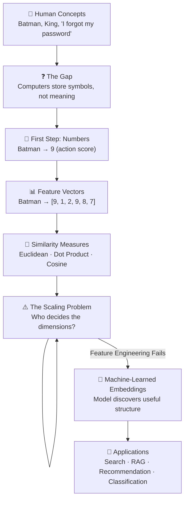

# Lecture 07 — Vector Embeddings: From First Principles

> **Lecture Summary:** This lecture builds the concept of vector embeddings from the ground up. Starting from why computers can't understand meaning, we progress through one-number representations, multi-dimensional feature vectors, similarity measures, the failure of manual feature engineering, and finally arrive at *learned embeddings* — the foundational technology behind modern semantic search, recommendation systems, and LLM-based applications.

---

## 📚 Table of Contents

| Chapter | Title | Core Concept |
|---|---|---|
| [01](./01_The_Problem_of_Meaning_in_Computers.md) | The Problem of Meaning in Computers | Symbols ≠ Meaning; why math requires numbers |
| [02](./02_From_Numbers_to_Vectors.md) | From Numbers to Vectors | Feature vectors, dimensions, vector spaces |
| [03](./03_Measuring_Similarity_Between_Vectors.md) | Measuring Similarity Between Vectors | Euclidean distance, Dot product, Cosine similarity |
| [04](./04_The_Failure_of_Hand_Crafted_Features.md) | The Failure of Hand-Crafted Features | Why feature engineering doesn't scale |
| [05](./05_What_Are_Embeddings_Learning_Representations.md) | What Are Embeddings? | Learned representations via training |
| [06](./06_Vector_vs_Embedding_And_Applications.md) | Vector vs Embedding & Applications | What embeddings unlock: Search, RAG, Recommendation |
| [07](./07_The_Complete_Journey_Synthesis.md) | The Complete Journey — Synthesis | The full picture + definitive definition |

---

## 🗺️ Conceptual Map

---

## 🔑 Key Definitions

| Term | Definition |
|---|---|
| **Vector** | An ordered list of numbers: `[2.1, 4.7, 1.3]` |
| **Feature Vector** | A vector where dimensions are manually chosen by humans |
| **Embedding** | A *learned* position in a continuous vector space |
| **Embedding Model** | A function `f(input) → ℝᵈ` that maps objects to vectors |
| **Latent Features** | Internal learned structure not directly human-readable |
| **Cosine Similarity** | Measures the angle between two vectors (direction only, scale-invariant) |
| **Euclidean Distance** | Straight-line distance between two points in vector space |
| **Dot Product** | Measures alignment in both direction and magnitude |
| **Vector Space** | The mathematical space in which all vectors (embeddings) live |
| **RAG** | Retrieval-Augmented Generation — using embeddings to find relevant context for LLMs |

---

## 💡 The Core Insight in One Sentence

> **An embedding is a position inside a learned mathematical space where useful relationships in meaning or behavior become relationships in geometry.**

---

## 📁 Source Materials

- [Notes.pdf](./Notes.pdf) — Original lecture PDF: "Vector Embeddings — From First Principles"
- [Excalidraw-Notes.svg](./Excalidraw-Notes.svg) — Hand-drawn visual notes from lecture

---

## 🔗 Real-World Embedding Models Reference

| Model | Dimensions | Provider |
|---|---|---|
| `text-embedding-ada-002` | 1536 | OpenAI |
| `text-embedding-3-small` | 1536 | OpenAI |
| `text-embedding-3-large` | 3072 | OpenAI |
| BERT base | 768 | Google |
| BERT large | 1024 | Google |
| CLIP | 512 | OpenAI |
| Word2Vec | 100–300 | Google |

---

## 🧭 Reading Order

**First time through** → Read chapters in order 01 → 07  
**Quick review** → Start with Chapter 07 (synthesis) and work backwards to any concept you need  
**Practical reference** → Chapter 03 (similarity measures) + Chapter 06 (applications)
