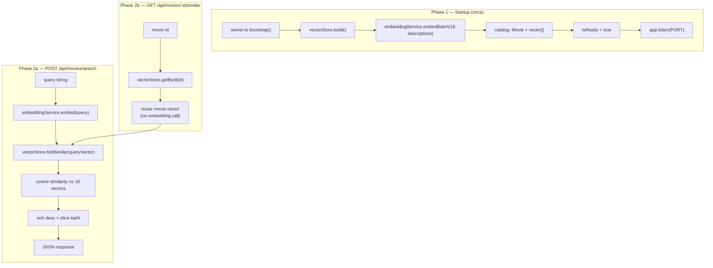
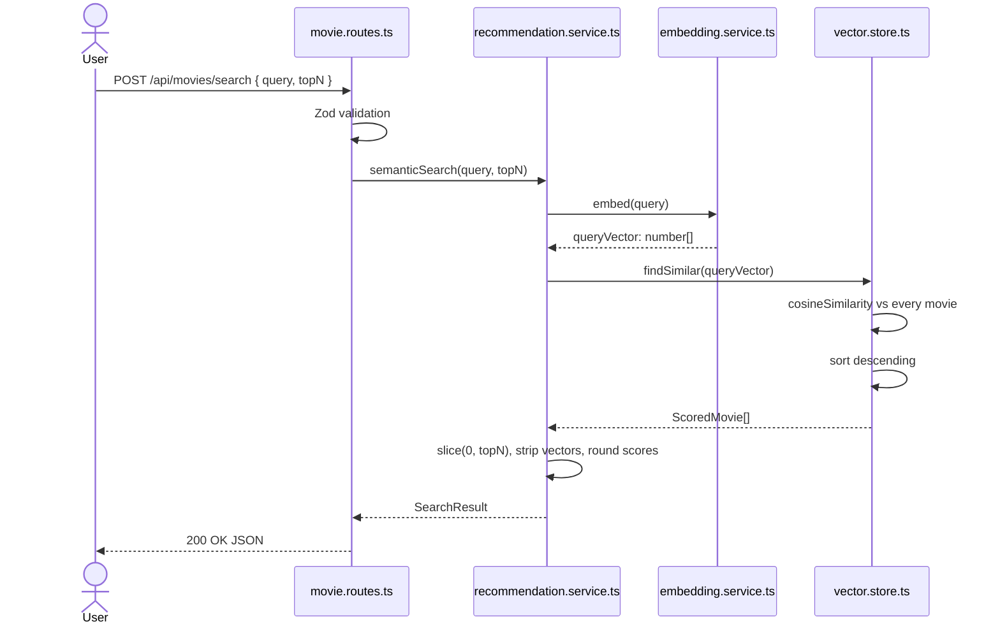
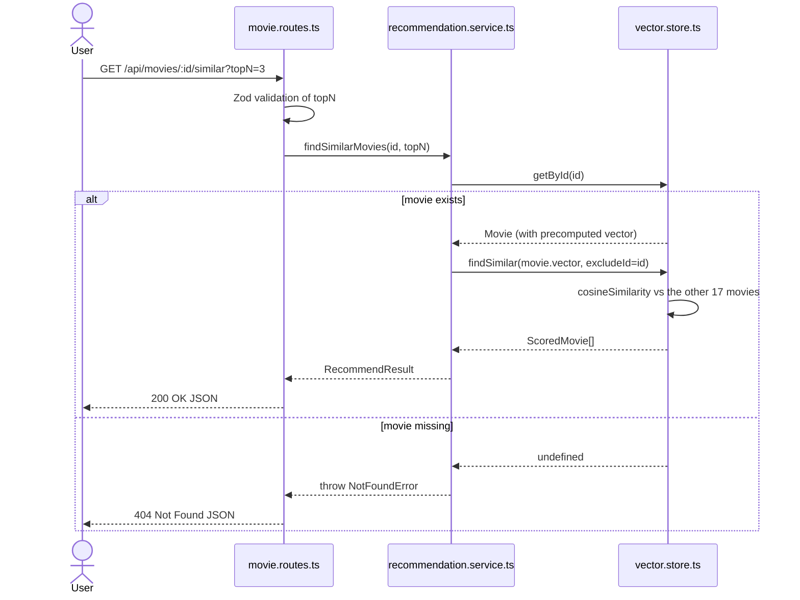

# Chapter 00: System Overview, Request Lifecycle & File Structure

> **Chapter Goal:** Build the mental model before reading any file. Understand what the service does, how a request travels through it, how the code is layered, where every file lives, and which commands run the system.

> **Prerequisites:** Node.js 18+ and npm. No API key is required for the pipeline to run.

---

## 0.1 What This Codebase Is

A small **movie recommendation engine** exposed as an Express HTTP API. It implements the lecture's central pipeline:

```text
REPRESENT → STORE → COMPARE → RANK
```

| Step | Meaning in this codebase | Implementation |
| :--- | :--- | :--- |
| **REPRESENT** | Convert text into a numeric vector | `embeddingService.embed()` / `embedBatch()` |
| **STORE** | Keep each movie's vector in memory | `vectorStore.build()` |
| **COMPARE** | Score every movie against a query vector | `vectorStore.findSimilar()` |
| **RANK** | Sort by score, keep the top N | `.sort((a, b) => b.score - a.score).slice(0, topN)` |

The service exposes two features from the notes:

1. **Semantic search** — the user describes a movie in natural language; the API embeds the query and returns the closest catalog entries.
2. **Similar-movie recommendation** — the user selects an existing movie; the API reuses that movie's *precomputed* vector and returns its nearest neighbours, excluding itself.

No generative LLM is used at request time. The recommendation decision is pure vector math.

---

## 0.2 Architectural Blueprint



### The two phases

| Phase | When | Work | Cost |
| :--- | :--- | :--- | :--- |
| **Build catalog** | Once at startup | Embed all 18 movie descriptions in one batch call | 1 embeddings API call |
| **Semantic search** | Per request | Embed the query, compare against 18 stored vectors | 1 embeddings API call + local math |
| **Similar movies** | Per request | Compare an existing vector against 17 others | 0 embeddings API calls + local math |

The asymmetry is the engineering point of Lecture 08: **stable data is precomputed; changing data is processed on demand.**

---

## 0.3 Request Lifecycle — Step by Step

### Semantic search



### Similar-movie recommendation



---

## 0.4 Layering Rules

| Layer | Files | Owns | Must not |
| :--- | :--- | :--- | :--- |
| HTTP / transport | `app.ts`, `routes/movie.routes.ts`, `server.ts` | Parsing, validation, status codes, startup order | Contain ranking logic |
| Orchestration | `services/recommendation.service.ts` | Combining embedding + store, shaping responses | Talk to Express `req`/`res` |
| Core operations | `services/embedding.service.ts`, `services/vector.store.ts` | REPRESENT, STORE, COMPARE, RANK | Know about HTTP |
| Contracts | `types/movie.types.ts` | Shared TypeScript shapes | Contain runtime logic |
| Data | `data/movies.ts` | The catalog source | Perform I/O |
| Configuration | `config/env.ts` | Validated environment settings | Read request data |

This separation is why both features can share `vectorStore.findSimilar()`: the only difference between them is **where the starting vector comes from**.

---

## 0.5 Complete File Structure

```text
Lecture 08/code/
├── package.json                     # Dependencies + dev/build/start scripts
├── package-lock.json                # Locked dependency tree
├── tsconfig.json                    # ES2022 + NodeNext + strict TypeScript
├── .env.example                     # Environment template (copy to .env)
├── .gitignore                       # node_modules/, dist/, .env
├── movies.json                      # Source catalog used by the legacy jsDemo/
├── README.md                        # High-level project documentation
├── test-requests.http               # REST Client / curl request suite
├── implementations guide/           # This guide (00 → 08)
│   ├── README.md
│   ├── 00_Overview_and_File_Structure.md
│   ├── 01_Project_Initialization_and_Tooling.md
│   ├── 02_Environment_Configuration_and_Validation.md
│   ├── 03_Domain_Types_and_Movie_Catalog.md
│   ├── 04_Embedding_Service_REPRESENT.md
│   ├── 05_Vector_Store_and_Cosine_Similarity.md
│   ├── 06_Recommendation_Service_Orchestration.md
│   ├── 07_HTTP_API_Routes_App_and_Server.md
│   └── 08_End_to_End_Verification.md
└── src/
    ├── config/
    │   └── env.ts                   # Zod-validated environment (Chapter 02)
    ├── data/
    │   └── movies.ts                # 18-movie catalog across 5 genres (Chapter 03)
    ├── types/
    │   └── movie.types.ts           # Domain + API contracts (Chapter 03)
    ├── services/
    │   ├── embedding.service.ts     # REPRESENT: text → vector (Chapter 04)
    │   ├── vector.store.ts          # STORE/COMPARE/RANK (Chapter 05)
    │   └── recommendation.service.ts# Orchestration (Chapter 06)
    ├── routes/
    │   └── movie.routes.ts          # HTTP endpoints + Zod request validation (Chapter 07)
    ├── app.ts                       # Express app factory + middleware (Chapter 07)
    └── server.ts                    # Bootstrap: build catalog, then listen (Chapter 07)
```

> `movies.json` is the 30-movie dataset used by the standalone `jsDemo/` at the repository root. The TypeScript service deliberately uses `src/data/movies.ts` so that the catalog is typed and self-contained.

---

## 0.6 Prerequisites & Commands

**Prerequisites:** Node.js ≥ 18 and npm ≥ 9.

```bash
# From Lecture 08/code
npm install                 # install dependencies

cp .env.example .env        # optional — server runs in MOCK MODE without it
# edit .env and add OPENAI_API_KEY for real embeddings

npm run dev                 # tsx watch src/server.ts  → http://localhost:3008
npm run build               # strict TypeScript compile → dist/
npm start                   # tsc && node dist/server.js
```

| Command | What it does |
| :--- | :--- |
| `npm run dev` | Starts with file watching via `tsx` — best for learning |
| `npm run build` | Runs `tsc`; fails on any type error |
| `npm start` | Compiles and runs the emitted JavaScript from `dist/` |

---

## 0.7 How to Read This Guide

| Chapter | Files | What you learn |
| :---: | :--- | :--- |
| 01 | `package.json`, `tsconfig.json`, `.env.example`, `.gitignore` | Why each dependency and compiler flag exists |
| 02 | `src/config/env.ts` | How invalid configuration fails at boot |
| 03 | `src/types/movie.types.ts`, `src/data/movies.ts` | The data model and catalog design |
| 04 | `src/services/embedding.service.ts` | REPRESENT, batch embedding, mock mode |
| 05 | `src/services/vector.store.ts` | STORE, COMPARE, cosine similarity, RANK |
| 06 | `src/services/recommendation.service.ts` | The two features and shared pipeline |
| 07 | `src/routes/movie.routes.ts`, `src/app.ts`, `src/server.ts` | HTTP surface and startup order |
| 08 | `test-requests.http` + curl | End-to-end proof and troubleshooting |

Every chapter ends with a **verification** section. Run the commands in order if you are building the project from scratch.

---

## 0.8 Completion Checklist

Before moving to Chapter 01, confirm you can answer these questions:

- [ ] What are the four operations of the mental model, and which file implements each?
- [ ] Why are movie descriptions embedded once, while user queries are embedded per request?
- [ ] Why does the similar-movie endpoint not need an embedding API call?
- [ ] Which two layers are allowed to know about HTTP?
- [ ] What does the service return when no API key is configured?

---

**Next:** [Chapter 01 — Project Initialization & Tooling](./01_Project_Initialization_and_Tooling.md)
