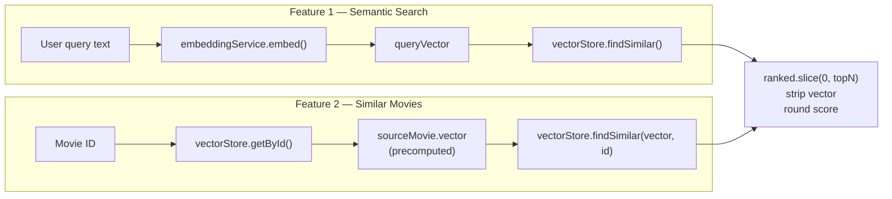

# Chapter 06: Recommendation Service — Orchestration

> **Chapter Goal:** Compose the REPRESENT and STORE/COMPARE/RANK layers into the two features from the lecture. Show that semantic search and similar-movie recommendation share one ranking engine and differ only in how the starting vector is obtained.

> **Lecture mapping:** Notes Chapters 04 (the two features), 06 (the mental model), and 07 (system design).

> **Files covered:**

| File | Lines | Purpose |
| :--- | :--- | :--- |
| `src/services/recommendation.service.ts` | 110 | `semanticSearch()`, `findSimilarMovies()`, response shaping, `NotFoundError` |

---

## 1. Complete Source Code

### 📄 `src/services/recommendation.service.ts` (110 lines)

```typescript
import type { Movie, MovieResponse, SearchResult, RecommendResult } from '../types/movie.types.js';
import { embeddingService } from './embedding.service.js';
import { vectorStore } from './vector.store.js';
import { env } from '../config/env.js';

/**
 * RecommendationService — orchestrates the full REPRESENT → STORE → COMPARE → RANK pipeline.
 *
 * This service exposes the two features described in the lecture:
 *   Feature 1: semanticSearch()       — user describes what they want
 *   Feature 2: findSimilarMovies()    — user is watching a movie, find similar ones
 *
 * Notice that both features share the same `vectorStore.findSimilar()` call.
 * The only difference is where the starting vector comes from.
 */
export class RecommendationService {

  /**
   * FEATURE 1: Semantic Movie Search
   *
   * Pipeline:
   *   Query Text → Embed (REPRESENT) → Compare (COMPARE) → Sort (RANK)
   *
   * The user doesn't need to know the exact movie title — they describe the kind
   * of movie they want and we find the closest matches semantically.
   */
  async semanticSearch(query: string, topN = env.DEFAULT_TOP_N): Promise<SearchResult> {
    console.log(`[Search] Query: "${query}" (topN=${topN})`);

    // REPRESENT: Convert the user's natural language query to a vector
    const queryVector = await embeddingService.embed(query);

    // COMPARE + RANK: Find and sort movies by cosine similarity
    const ranked = vectorStore.findSimilar(queryVector);

    return {
      query,
      results: ranked.slice(0, topN).map(({ movie, score }) => ({
        movie: toMovieResponse(movie),
        score: roundScore(score),
      })),
      totalSearched: ranked.length,
    };
  }

  /**
   * FEATURE 2: Similar Movie Recommendation
   *
   * Pipeline:
   *   Movie ID → Get Precomputed Vector (no new API call) → Compare → Sort
   *
   * Because the movie was embedded during Phase 1, we skip the embedding step.
   * We already have the vector — just compare it against all others.
   */
  findSimilarMovies(movieId: string, topN = env.DEFAULT_TOP_N): RecommendResult {
    console.log(`[Recommend] Movie ID: ${movieId} (topN=${topN})`);

    const sourceMovie = vectorStore.getById(movieId);
    if (!sourceMovie) {
      throw new NotFoundError(`Movie with id "${movieId}" not found in catalog.`);
    }

    if (!sourceMovie.vector) {
      throw new Error(`Movie "${sourceMovie.title}" has not been embedded yet.`);
    }

    // COMPARE + RANK: Use the precomputed vector directly — no API call needed
    const ranked = vectorStore.findSimilar(sourceMovie.vector, movieId);

    return {
      sourceMovie: toMovieResponse(sourceMovie),
      results: ranked.slice(0, topN).map(({ movie, score }) => ({
        movie: toMovieResponse(movie),
        score: roundScore(score),
      })),
      totalSearched: ranked.length,
    };
  }

  /**
   * Return all movies in the catalog (for browsing / display).
   */
  getAllMovies(): MovieResponse[] {
    return vectorStore.getAllMovies().map(toMovieResponse);
  }
}

// ─── Helpers ─────────────────────────────────────────────────────────────────

/** Strip the internal `vector` field before sending movies to clients. */
function toMovieResponse(movie: Movie): MovieResponse {
  const { vector: _omit, ...safe } = movie;
  return safe;
}

/** Round similarity scores to 4 decimal places for clean API output. */
function roundScore(score: number): number {
  return Math.round(score * 10000) / 10000;
}

/** Domain error for missing resources — handled by the route layer. */
export class NotFoundError extends Error {
  constructor(message: string) {
    super(message);
    this.name = 'NotFoundError';
  }
}

// Singleton
export const recommendationService = new RecommendationService();
```

---

## 2. Block-by-Block Explanation

### Block 1: Dependencies

```typescript
import type { Movie, MovieResponse, SearchResult, RecommendResult } from '../types/movie.types.js';
import { embeddingService } from './embedding.service.js';
import { vectorStore } from './vector.store.js';
import { env } from '../config/env.js';
```

This file is the **only** place where the embedding layer and the vector store meet. That is deliberate:

- `embeddingService` knows how to turn text into vectors.
- `vectorStore` knows how to store and compare vectors.
- Neither knows about the other's internals.
- The service composes them and shapes the response.

`env.DEFAULT_TOP_N` is imported so the default limit is configurable in one place.

### Block 2: `semanticSearch()` — feature 1

```typescript
async semanticSearch(query: string, topN = env.DEFAULT_TOP_N): Promise<SearchResult> {
  console.log(`[Search] Query: "${query}" (topN=${topN})`);

  const queryVector = await embeddingService.embed(query);

  const ranked = vectorStore.findSimilar(queryVector);

  return {
    query,
    results: ranked.slice(0, topN).map(({ movie, score }) => ({
      movie: toMovieResponse(movie),
      score: roundScore(score),
    })),
    totalSearched: ranked.length,
  };
}
```

Line by line:

1. **Default parameter** — `topN = env.DEFAULT_TOP_N` applies only when the caller passes `undefined`. The route always passes a number (either the validated request value or the same default).
2. **REPRESENT** — `await` is essential. The embedding call is the only asynchronous part of the request; everything after it is synchronous CPU work.
3. **COMPARE + RANK** — `findSimilar()` returns every movie with a score, sorted descending.
4. **`.slice(0, topN)`** — the store ranks everything; the service decides how many results the client sees. `slice` is safe when `topN` exceeds the candidate count (it simply returns the whole array).
5. **`.map(({ movie, score }) => ...)`** — destructures each `ScoredMovie` and projects it into the API shape.
6. **`toMovieResponse(movie)`** — removes the internal vector at runtime.
7. **`roundScore(score)`** — keeps JSON output readable (`0.8123` rather than `0.812345678901234`).
8. **`totalSearched: ranked.length`** — reports how many candidates were scored (`18`), not how many were returned (`topN`).

The method is `async` because of the embedding call. If it were mock-only, it could be synchronous, but the signature must support live mode.

### Block 3: `findSimilarMovies()` — feature 2

```typescript
findSimilarMovies(movieId: string, topN = env.DEFAULT_TOP_N): RecommendResult {
  console.log(`[Recommend] Movie ID: ${movieId} (topN=${topN})`);

  const sourceMovie = vectorStore.getById(movieId);
  if (!sourceMovie) {
    throw new NotFoundError(`Movie with id "${movieId}" not found in catalog.`);
  }

  if (!sourceMovie.vector) {
    throw new Error(`Movie "${sourceMovie.title}" has not been embedded yet.`);
  }

  const ranked = vectorStore.findSimilar(sourceMovie.vector, movieId);

  return {
    sourceMovie: toMovieResponse(sourceMovie),
    results: ranked.slice(0, topN).map(({ movie, score }) => ({
      movie: toMovieResponse(movie),
      score: roundScore(score),
    })),
    totalSearched: ranked.length,
  };
}
```

This method is **synchronous**, and that is the whole point. Once the catalog is built:

- No network call is needed to obtain the source vector.
- The only work is local scoring and sorting.
- The method can return a plain object rather than a `Promise`.

The two guards are different:

| Guard | Condition | Error | HTTP result |
| :--- | :--- | :--- | :--- |
| Missing movie | `getById()` returns `undefined` | `NotFoundError` | `404` |
| Missing vector | Movie exists but has no vector | generic `Error` | `500` |

The second case should be impossible after a successful `build()`. It is defence in depth: if someone queries during startup or after a partial build, the failure is explicit rather than a `NaN` score.

**`findSimilar(sourceMovie.vector, movieId)`** passes the source ID as `excludeId`, so the movie is not recommended to itself. `totalSearched` is therefore `17`, one less than a search over the full catalog.

### Block 4: `getAllMovies()`

```typescript
getAllMovies(): MovieResponse[] {
  return vectorStore.getAllMovies().map(toMovieResponse);
}
```

Maps every catalog entry through the same projection helper. This guarantees that `GET /api/movies` can never leak vectors, even if a future change adds a new field to `Movie`.

---

### Block 5: Response helpers

```typescript
function toMovieResponse(movie: Movie): MovieResponse {
  const { vector: _omit, ...safe } = movie;
  return safe;
}

function roundScore(score: number): number {
  return Math.round(score * 10000) / 10000;
}
```

**`toMovieResponse()`** is where the type-level promise from Chapter 03 becomes a runtime guarantee. Destructuring with a rest element copies every property *except* `vector` into `safe`. The underscore prefix on `_omit` signals that the variable is intentionally unused.

**`roundScore()`** multiplies by 10,000, rounds, and divides back. This keeps four decimal places:

```text
0.8123456789 → 8123.456789 → 8123 → 0.8123
```

The rounding is presentation-only. Ranking already happened on the full-precision score, so rounding cannot reorder results.

### Block 6: Domain error

```typescript
export class NotFoundError extends Error {
  constructor(message: string) {
    super(message);
    this.name = 'NotFoundError';
  }
}
```

A dedicated error class lets the route distinguish “the client asked for a movie that does not exist” (`404`) from “the server broke” (`500`) using `instanceof`, without string matching.

The `this.name` assignment is necessary because extending built-in `Error` in TypeScript/JavaScript does not automatically set the subclass name in all runtimes; it also makes logs clearer.

### Block 7: Singleton

```typescript
export const recommendationService = new RecommendationService();
```

The routes import this single instance. It holds no request-specific state, so sharing it is safe. All mutable state lives in the vector store (the catalog) and is read-only after `build()`.

---

## 3. Search vs. Recommendation — Side by Side



| Aspect | `semanticSearch()` | `findSimilarMovies()` |
| :--- | :--- | :--- |
| Starting vector | Embed the query | Reuse `sourceMovie.vector` |
| Embedding API calls | 1 (live mode) | 0 |
| Async? | Yes | No |
| Excludes a movie? | No | Yes — the source |
| Candidates scored | 18 | 17 |
| Failure modes | Embedding API error | Movie not found / not embedded |
| Output shape | `SearchResult` | `RecommendResult` |

The shared code path — `findSimilar()` plus projection — is the lecture's main architectural claim: **search and recommendation are the same operation with different inputs.**

---

## 4. Verification

### Build

```bash
npm run build
```

### Semantic search

```bash
npm run dev
curl -X POST http://localhost:3008/api/movies/search \
  -H "Content-Type: application/json" \
  -d '{"query":"astronaut stranded in space","topN":3}'
```

Expected shape:

```json
{
  "query": "astronaut stranded in space",
  "results": [
    { "movie": { "id": "...", "title": "...", "genre": "..." }, "score": 0.1234 }
  ],
  "totalSearched": 18
}
```

Check:

- `results.length === 3`
- no `movie.vector` field appears
- `totalSearched === 18`
- scores are descending

### Similar movies

```bash
curl "http://localhost:3008/api/movies/1/similar?topN=3"
```

Check:

- `sourceMovie.id === "1"`
- no result has `id === "1"` (self excluded)
- `totalSearched === 17`
- `results.length === 3`

### Missing movie

```bash
curl -i http://localhost:3008/api/movies/999/similar
```

Expected:

```text
HTTP/1.1 404 Not Found
{"error":"NotFound","message":"Movie with id \"999\" not found in catalog."}
```

> **Mock-mode reminder:** scores are deterministic but not semantic. To verify ranking quality, set a real `OPENAI_API_KEY` and repeat the search/test cases in Chapter 08.

---

**Next:** [Chapter 07 — HTTP API: Routes, App & Server](./07_HTTP_API_Routes_App_and_Server.md)
