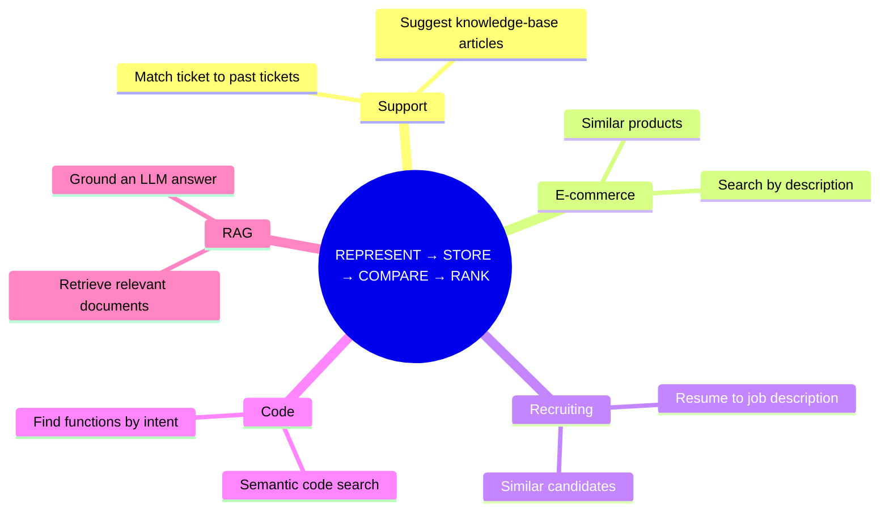

# Chapter 08: End-to-End Verification & Production Notes

> **Chapter Goal:** Prove the whole pipeline works from the outside. Exercise every endpoint, check the invariants that matter (18 movies, vectors hidden, self excluded, correct status codes), and connect the demo to the production concerns the lecture raises.

> **Files covered:**

| File | Lines | Purpose |
| :--- | :--- | :--- |
| `test-requests.http` | 136 | Ready-to-run REST Client / curl suite covering every endpoint |

---

## 1. Complete Source Code

### 📄 `test-requests.http` (136 lines)

```http
### Lecture 08 — Movie Recommendation Engine
### Test all endpoints with VS Code REST Client or curl

@baseUrl = http://localhost:3008

# ─── Health Check ─────────────────────────────────────────────────────────────

GET {{baseUrl}}/health

###

# ─── Catalog Status ───────────────────────────────────────────────────────────
# Check how many movies are embedded and ready

GET {{baseUrl}}/api/movies/status

###

# ─── List All Movies ──────────────────────────────────────────────────────────
# Browse the full catalog

GET {{baseUrl}}/api/movies

###

# ─── FEATURE 1: Semantic Movie Search ─────────────────────────────────────────
# User describes a movie in natural language — different words, same meaning

### Test 1: Space survival (should surface The Martian, Gravity, Interstellar)
POST {{baseUrl}}/api/movies/search
Content-Type: application/json

{
  "query": "astronaut stranded alone trying to survive on another planet"
}

###

### Test 2: Same idea, completely different words (tests semantic understanding)
POST {{baseUrl}}/api/movies/search
Content-Type: application/json

{
  "query": "person stuck far from earth trying to stay alive"
}

###

### Test 3: Alien contact / linguistics
POST {{baseUrl}}/api/movies/search
Content-Type: application/json

{
  "query": "humans trying to communicate with extraterrestrial beings"
}

###

### Test 4: Heist or dream manipulation
POST {{baseUrl}}/api/movies/search
Content-Type: application/json

{
  "query": "stealing secrets inside someone's mind and consciousness"
}

###

### Test 5: Love story and tragedy
POST {{baseUrl}}/api/movies/search
Content-Type: application/json

{
  "query": "tragic love story between two people from different worlds"
}

###

### Test 6: Superhero saving the world
POST {{baseUrl}}/api/movies/search
Content-Type: application/json

{
  "query": "heroes fight to save humanity from a powerful villain"
}

###

### Test 7: Custom topN
POST {{baseUrl}}/api/movies/search
Content-Type: application/json

{
  "query": "dark city with a caped vigilante fighting crime",
  "topN": 3
}

###

# ─── FEATURE 2: Similar Movie Recommendation ──────────────────────────────────
# User is watching a movie and clicks "Show Similar" — no text input needed

### Similar to Interstellar (id: 1)
GET {{baseUrl}}/api/movies/1/similar

###

### Similar to The Martian (id: 2)
GET {{baseUrl}}/api/movies/2/similar

###

### Similar to The Dark Knight (id: 7)
GET {{baseUrl}}/api/movies/7/similar

###

### Similar to Titanic (id: 10)
GET {{baseUrl}}/api/movies/10/similar

###

### Similar to Inception (id: 13)
GET {{baseUrl}}/api/movies/13/similar

###

### Similar to Interstellar — top 3 only
GET {{baseUrl}}/api/movies/1/similar?topN=3

###

### 404 — movie ID that doesn't exist
GET {{baseUrl}}/api/movies/999/similar

###
```

---

## 2. Block-by-Block Explanation

### Block 1: Variables and separators

```http
@baseUrl = http://localhost:3008

GET {{baseUrl}}/health

###
```

- `@baseUrl` is a REST Client variable, so the host/port is changed in one place.
- `###` separates requests. VS Code REST Client (or JetBrains HTTP Client) shows a “Send Request” action above each block.
- The same file is valid documentation: each request states the feature it exercises.

### Block 2: Read-only checks

```http
GET {{baseUrl}}/health
GET {{baseUrl}}/api/movies/status
GET {{baseUrl}}/api/movies
```

Run these first. They prove the server booted, the catalog is embedded, and the response projection hides vectors. If `/status` reports `isReady: false`, the catalog build has not finished or has failed.

### Block 3: Search scenarios

The seven search cases are designed to test **semantic** behaviour, not keyword matching:

| # | Query | Expected cluster (live mode) |
| :---: | :--- | :--- |
| 1 | astronaut stranded alone trying to survive on another planet | The Martian, Gravity, Interstellar |
| 2 | person stuck far from earth trying to stay alive | same cluster, different wording |
| 3 | humans trying to communicate with extraterrestrial beings | Arrival, Life, Ad Astra |
| 4 | stealing secrets inside someone's mind and consciousness | Inception, Shutter Island |
| 5 | tragic love story between two people from different worlds | Titanic, La La Land, The Notebook |
| 6 | heroes fight to save humanity from a powerful villain | Avengers, The Dark Knight, Spider-Man |
| 7 | dark city with a caped vigilante fighting crime (`topN: 3`) | The Dark Knight, then action neighbours |

Tests 1 and 2 are the key pair: they describe the same idea with almost no shared keywords. A keyword search would fail; an embedding search should return a similar cluster. Test 7 verifies that `topN` is honoured.

> In mock mode, ordering is random. The suite still validates **shape**, **status codes**, and **counts**; only the semantic quality requires a real key.

### Block 4: Similar-movie scenarios

```http
GET {{baseUrl}}/api/movies/1/similar
GET {{baseUrl}}/api/movies/2/similar
GET {{baseUrl}}/api/movies/7/similar
GET {{baseUrl}}/api/movies/10/similar
GET {{baseUrl}}/api/movies/13/similar
GET {{baseUrl}}/api/movies/1/similar?topN=3
GET {{baseUrl}}/api/movies/999/similar
```

These cover:

- Different clusters (space, action, romance, thriller).
- The default `topN` (5).
- An explicit `topN` (3).
- The `404` path for an unknown ID.

Every successful response must satisfy: `sourceMovie.id` is present, no result repeats it, and `totalSearched === 17`.

---

## 3. Runbook — From Zero to Verified

### Step 1: Install and build

```bash
cd "Lecture 08/code"
npm install
npm run build
```

Expected: no TypeScript errors.

### Step 2: Start the server

```bash
npm run dev
```

Expected:

```text
[VectorStore] Building catalog: 18 movies...
[EmbeddingService] MOCK MODE — returning stub vectors for batch
[VectorStore] ✅ Catalog ready — 18 movies embedded.
```

### Step 3: Verify readiness

```bash
curl -s http://localhost:3008/api/movies/status
```

Expected:

```json
{"totalMovies":18,"embeddedMovies":18,"isReady":true}
```

### Step 4: Verify search

```bash
curl -s -X POST http://localhost:3008/api/movies/search \
  -H "Content-Type: application/json" \
  -d '{"query":"astronaut stranded in space","topN":3}'
```

Expected shape (values vary by mode):

```json
{
  "query": "astronaut stranded in space",
  "results": [
    { "movie": { "id": "2", "title": "The Martian", "genre": "Sci-Fi", "year": 2015 }, "score": 0.9123 },
    { "movie": { "id": "3", "title": "Gravity", "genre": "Sci-Fi", "year": 2013 }, "score": 0.8891 },
    { "movie": { "id": "1", "title": "Interstellar", "genre": "Sci-Fi", "year": 2014 }, "score": 0.8754 }
  ],
  "totalSearched": 18
}
```

### Step 5: Verify similar movies

```bash
curl -s "http://localhost:3008/api/movies/1/similar?topN=3"
```

Expected: `sourceMovie` is Interstellar, the results do not include ID `1`, and `totalSearched` is `17`.

### Step 6: Verify failure paths

```bash
curl -i http://localhost:3008/api/movies/999/similar
curl -i -X POST http://localhost:3008/api/movies/search \
  -H "Content-Type: application/json" -d '{"query":"ab"}'
curl -i "http://localhost:3008/api/movies/1/similar?topN=0"
curl -i http://localhost:3008/api/nope
```

Expected status codes: `404`, `400`, `400`, `404`.

### Step 7: Switch to live embeddings (optional)

```bash
cp .env.example .env
# edit .env and set OPENAI_API_KEY=sk-...
npm run dev
```

Expected banner: `🔑 OpenAI Live: ENABLED ✅`. Re-run Step 4 and confirm the space cluster ranks at the top.

---

## 4. Acceptance Checklist

A run is complete when all of these are true:

| # | Check | Expected |
| :---: | :--- | :--- |
| 1 | `npm run build` | exit code `0`, no diagnostics |
| 2 | Startup log | `Catalog ready — 18 movies embedded` |
| 3 | `GET /health` | `200`, `status: "healthy"` |
| 4 | `GET /api/movies/status` | `totalMovies: 18`, `embeddedMovies: 18`, `isReady: true` |
| 5 | `GET /api/movies` | `count: 18`; no `vector` field anywhere in the JSON |
| 6 | `POST /search` with `topN: 3` | `results.length === 3`, `totalSearched === 18` |
| 7 | Search scores | strictly non-increasing |
| 8 | `GET /:id/similar` | source movie excluded; `totalSearched === 17` |
| 9 | `GET /999/similar` | `404` with `error: "NotFound"` |
| 10 | Search query shorter than 3 chars | `400` with `details.query` |
| 11 | `topN` outside 1–20 | `400` with `details.topN` |
| 12 | Unknown route | `404` with method and URL |
| 13 | Live mode (optional) | space query ranks space movies first |

---

## 5. Troubleshooting Matrix

| Symptom | Likely cause | Fix |
| :--- | :--- | :--- |
| `EADDRINUSE` on startup | Port `3008` already in use | Stop the other process or set `PORT` in `.env` |
| `VectorStore is not ready` | `build()` never completed | Check startup logs; ensure `await vectorStore.build()` runs before `listen` |
| Every search returns `500` | Invalid/expired `OPENAI_API_KEY` | Fix the key or remove it to use mock mode |
| `Vector dimension mismatch` | Mixed mock (128) and live (1536) vectors | Restart the process after changing the key; never mix models |
| `results` empty | `topN` validated to 1–20 but catalog empty | Confirm `/status` shows 18 embedded movies |
| Similar results include the source | `excludeId` not passed | Verify `findSimilar(sourceMovie.vector, movieId)` |
| Scores all near `0` | Mock mode | Expected; set a real key |
| `req.body` is `undefined` | Missing `Content-Type: application/json` | Add the header |
| `400` on a valid-looking query | Query shorter than 3 or longer than 500 characters | Adjust the query |
| `Cannot find module .../env.js` | Running source with plain `node` | Use `tsx` (`npm run dev`) or `npm run build` first |

---

## 6. What This Demo Does and Does Not Do

### Implemented

- Batch precomputation of the catalog at startup.
- Semantic search over natural-language descriptions.
- Content-based similar-movie recommendation.
- Cosine similarity implemented from first principles.
- Mock mode for zero-cost development.
- Input validation, status codes, and a health endpoint.

### Deliberately omitted

| Omitted | Why | Production replacement |
| :--- | :--- | :--- |
| Persistent vector storage | Keeps the demo in-memory and readable | Postgres + `pgvector`, Pinecone, Qdrant, Weaviate |
| Approximate nearest-neighbour index | 18 movies do not need one | HNSW, IVF, ScaNN, LSH |
| Collaborative filtering | Requires user interaction history | Matrix factorisation, two-tower models |
| LLM-generated explanations | The lecture separates search from generation | RAG: retrieve with embeddings, then prompt an LLM with the top results |
| Authentication / rate limiting | Out of scope for the lecture | API gateway, per-key quotas |
| Retries / timeouts on embeddings | Small batch, demo scope | SDK retries, circuit breaker, request timeout |
| Hybrid search | Keyword + vector fusion is a later topic | BM25 + cosine, reciprocal rank fusion |

---

## 7. Where the Pattern Applies Next

The same four operations power far more than movies:



The API shape barely changes. Only the data source, the embedding model, and the store implementation change.

---

## 8. Final Mental Model

```text
Do not ask: "Which movie should I recommend?"
Ask:        "Which vectors point in the same direction?"

REPRESENT  text → number[]
STORE      keep the numbers
COMPARE    cos(θ) = (A · B) / (‖A‖ × ‖B‖)
RANK       sort descending, take the top N
```

Once the catalog is embedded, every request is arithmetic. That is the entire lesson of Lecture 08.

---

**Back to:** [Implementation Guide Index](./README.md) · [Codebase README](../README.md) · [Lecture Notes](../../notes/README.md)
