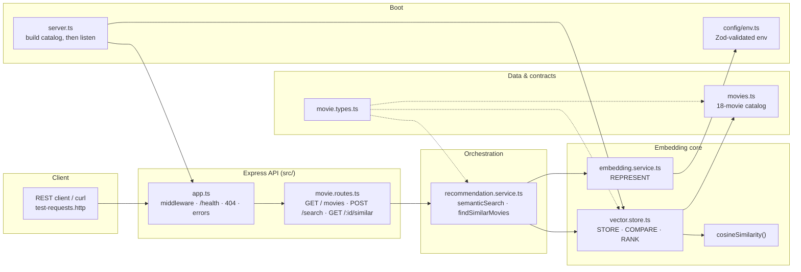

# Implementation Guide — Lecture 08: Movie Recommendation Engine

Welcome to the chapter-by-chapter **Implementation Guide** for the **Lecture 08 codebase**: a movie recommendation engine built with vector embeddings and cosine similarity.

This guide follows the same format as the guides for Lectures 03–06. Every chapter contains:

1. **Files covered** — what the chapter creates and why.
2. **Complete source code** — the full contents of every file discussed.
3. **Block-by-block explanation** — what each block does, how it works, and why it is written that way.
4. **Verification** — the exact command(s) that prove the chapter works.

> **Scope discipline:** this guide documents the code that exists. It does not introduce extra endpoints, databases, or LLM-generation features. The optional LLM extension (RAG) is described conceptually in Chapter 08 only.

---

## 🧭 System Topology



---

## 📚 Chapter Navigation Index

| Chapter | Title | Files Covered | Lecture Notes |
| :---: | :--- | :--- | :--- |
| **[00](./00_Overview_and_File_Structure.md)** | **System Overview & File Structure** | Architecture, request lifecycle, full file tree, commands, reading order. | All chapters |
| **[01](./01_Project_Initialization_and_Tooling.md)** | **Project Initialization & Tooling** | `package.json`, `tsconfig.json`, `.env.example`, `.gitignore` — every dependency justified. | — |
| **[02](./02_Environment_Configuration_and_Validation.md)** | **Environment Configuration & Boot-Time Validation** | `src/config/env.ts` — fail-fast Zod validation and mock-mode detection. | — |
| **[03](./03_Domain_Types_and_Movie_Catalog.md)** | **Domain Types & Movie Catalog** | `src/types/movie.types.ts`, `src/data/movies.ts` — contracts and the 18-movie dataset. | 07.2 |
| **[04](./04_Embedding_Service_REPRESENT.md)** | **Embedding Service — REPRESENT** | `src/services/embedding.service.ts` — OpenAI wrapper, batch embedding, deterministic mock. | 01, 02, 03 |
| **[05](./05_Vector_Store_and_Cosine_Similarity.md)** | **Vector Store & Cosine Similarity — STORE / COMPARE / RANK** | `src/services/vector.store.ts` — precomputed catalog, scoring, sorting, the cosine formula. | 03, 05, 06 |
| **[06](./06_Recommendation_Service_Orchestration.md)** | **Recommendation Service — Orchestration** | `src/services/recommendation.service.ts` — semantic search and similar-movie flows. | 04, 06, 07 |
| **[07](./07_HTTP_API_Routes_App_and_Server.md)** | **HTTP API — Routes, App & Server** | `src/routes/movie.routes.ts`, `src/app.ts`, `src/server.ts` — validation, status codes, startup. | 04, 07 |
| **[08](./08_End_to_End_Verification.md)** | **End-to-End Verification & Production Notes** | `test-requests.http`, curl suite, expected outputs, troubleshooting, next steps. | 07 |

---

## 🚦 Suggested Reading Paths

| If you want to… | Read |
| :--- | :--- |
| Understand the whole design first | **00 → 04 → 05 → 06 → 07** |
| Focus on the REPRESENT step | **02 → 03 → 04** |
| Focus on the STORE / COMPARE / RANK math | **03 → 05** |
| Focus on the API surface | **06 → 07 → 08** |
| Prove the system works | run the commands in **08** |
| Connect code back to the theory | read the matching chapters in [`../../notes/README.md`](../../notes/README.md) |

---

## 🧠 The Four Operations This Code Implements

```text
REPRESENT ── text  → number[]          embedding.service.ts
STORE     ── number[] kept with movie  vector.store.ts  (build)
COMPARE   ── cosineSimilarity(a, b)    vector.store.ts  (findSimilar)
RANK      ── sort by score descending  vector.store.ts  (findSimilar)
```

Every file in the codebase exists to make one of these four operations correct:

| Operation | File | Key method |
| :--- | :--- | :--- |
| REPRESENT | `src/services/embedding.service.ts` | `embed()`, `embedBatch()` |
| STORE | `src/services/vector.store.ts` | `build()` |
| COMPARE | `src/services/vector.store.ts` | `findSimilar()`, `cosineSimilarity()` |
| RANK | `src/services/vector.store.ts` | `.sort((a, b) => b.score - a.score)` |

---

## ✅ Verification Status

The code in this guide was verified against the repository:

```bash
npm run build                 # TypeScript strict build — zero errors
npm run dev                   # starts in MOCK MODE when no API key is set

curl http://localhost:3008/health
# {"status":"healthy","service":"Lecture 08 — Movie Recommendation Engine", ...}

curl http://localhost:3008/api/movies/status
# {"totalMovies":18,"embeddedMovies":18,"isReady":true}

curl -X POST http://localhost:3008/api/movies/search \
  -H "Content-Type: application/json" \
  -d '{"query":"astronaut stranded in space","topN":3}'
# 200 OK — ranked results with cosine scores

curl http://localhost:3008/api/movies/1/similar?topN=3
# 200 OK — source movie + ranked similar movies (self excluded)

curl http://localhost:3008/api/movies/999/similar
# 404 {"error":"NotFound", ...}
```

> **Mock-mode caveat:** without an `OPENAI_API_KEY`, the embedding service returns deterministic pseudo-random vectors. The pipeline is fully exercised, but the *ordering* of results is not semantically meaningful. Set a real key to see meaningful recommendations.

---

**Start here:** [Chapter 00 — System Overview & File Structure](./00_Overview_and_File_Structure.md)
